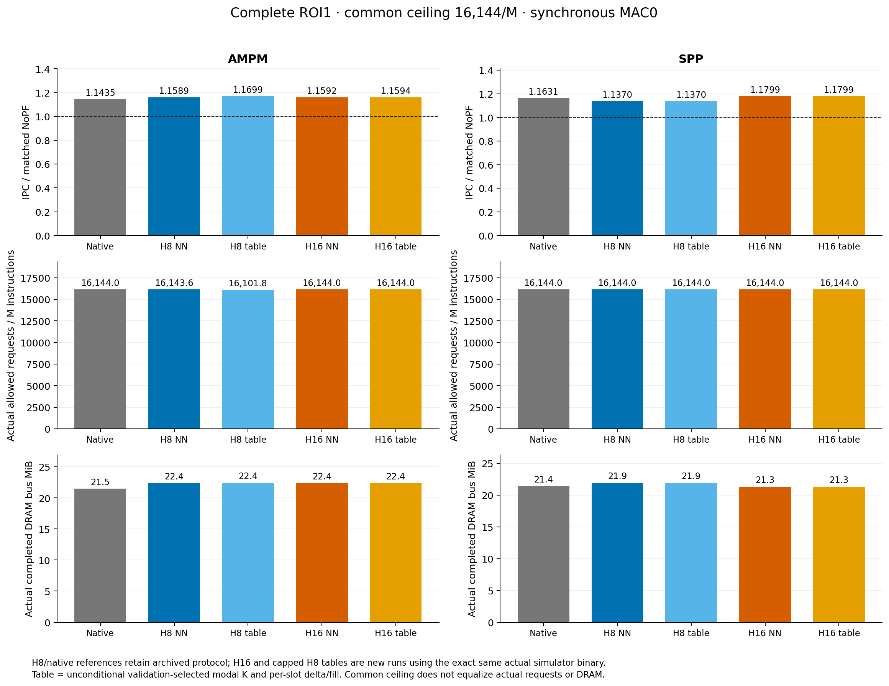

# CacheArch results

- **Question:** Do small teacher-trained recurrent prefetchers retain useful gains under a request ceiling and finite compute? Weights stay frozen; recurrent state updates during independent online inference.

## Results at a glance

- **H16 improves IPC in the measured MAC0 matrix.** In the latest seed7/two-ROI live study, H16 wins **8/8** comparisons against native teachers and **8/8** against H8 NN. IPC gains over native: **AMPM 0.53%–2.21%; SPP 1.41%–4.15%**. [Exact pairs](formal_study/results/602_width_templates/summary.csv).
- **Simple templates reproduce nearly all measured IPC gain.** SPP H16’s frozen template matches IPC, requests and DRAM in all four cases; AMPM NN’s uncapped edge is at most **0.125%**, and its capped template is slightly better. H8 capped templates nearly match Streamer/SPP and outperform AMPM NN. [Paired results](formal_study/results/602_width_templates/paired_comparisons.csv).
- **Finite-resource benefit is still unproven.** The earlier filtered Stride-trained NN (seed7, capped, MAC4) is near NoPF: **+0.045% / −0.080%** across the two ROIs. Latest H8/H16 global-model IPC is **MAC0 only**. [Finite-engine evidence](docs/602_gate_mechanism/FINITE_CURRENTLINE.md).

- These results support a reproducible mechanism study. They do **not** establish that learned payload or recurrent state is necessary, or that the models win across seeds, workloads and hardware budgets.

## Scope before interpreting the numbers

- **Latest protocol:** frozen original seed7 weights; validation 20–25M; ROI0 25–50M and ROI1 75–100M; 5M cache/state warmup each. Own-validation H16 templates and already-frozen H8 templates; no test fitting. ROI0 was previously inspected. [Full contract](formal_NN_training/experiments/602_four_prefetcher_formal/width_templates/README.md).
- **Budget is an upper limit:** uncapped or 16,144 requests/M does not mean equal actual requests or DRAM. DRAM uses real controller counters, never requests × 64. Quality uses completely tracked L2/LLC intent cohorts; unused is not pollution. [Metric definitions](formal_study/results/602_width_templates/metric_definitions.json).
- **Limits and negative results:** H8 beats native in only 9/16 four-route comparisons; capped AMPM H16 loses to its template. Model training budgets and native/student SPP fill inputs differ. Finite global-model IPC, more training seeds/workloads and complete deployment cost remain open. [H8 findings](formal_NN_training/experiments/602_four_prefetcher_formal/results/formal_20261017/FINDINGS.md) · [method limits](formal_NN_training/experiments/602_four_prefetcher_formal/report/METHOD_LIMITATIONS.md) · [cost assumptions](formal_study/results/602_width_templates/storage_cost.csv).

## Completed studies — separate protocols

- “New” means new in that study; reused rows are not extra replications. IPC is not pooled across stages.

| Study | Completed runs / reuse | Model, baselines and cost |
| --- | --- | --- |
| [Original offline / keyed replay](formal_NN_training/experiments/602_four_prefetcher_formal/width_templates/EVIDENCE_ALIGNMENT.md) | Historical slide/model evidence; excluded from live totals | Original seed7 models; own replayed teacher; different warmup/state contract |
| [First Stride formal](formal_NN_training/experiments/602_lstm_stride_dynamic_inference/results/formal_20261016_v2/README.md) | 101 runs = 89 test + 12 validation; 14 h/c runs separate | 602 seeds 7/17/27; NoPF, Stride variants, SPP; MAC0/MAC4. Historical 605/623 transfer: seed7 only |
| [Current-line / gate / payload](docs/602_gate_mechanism/REPORT.md) | 64 new + 7 references | Two 602 ROIs, seeds 7/17/27; cap 2,363/M; NN/+2/PC-gate/Stride/SPP. MAC4 subset: seed7 only |
| [Four-route H8 live v2](formal_NN_training/experiments/602_four_prefetcher_formal/results/formal_20261017/README.md) | 64 new = 56 test + 8 validation | Seed7; NoPF/native/student plus mechanism controls; MAC0; cap 16,144/M |
| [Latest H16 + capped H8 templates](formal_study/results/602_width_templates/README.md) | **24 new = 2 validation + 22 test; 64 references reused** | AMPM/SPP H16; Streamer/AMPM/SPP capped H8 templates; native/H8/NoPF controls; seed7, MAC0 |

- Earlier Stride work found that filtering current-line requests partially restores capped MAC0 benefit; fixed +2 nearly reproduces learned payload. It does not fix the serial-engine bottleneck. [Mechanism pairs](docs/602_gate_mechanism/results/paired_ranges.csv).

## Evidence and files

- **Current results folder:** [summary](formal_study/results/602_width_templates/summary.csv) · [24 new rows](formal_study/results/602_width_templates/per_run_new.csv) · [all 88 labeled rows](formal_study/results/602_width_templates/per_run.csv) · [9,748-check audit](formal_study/results/602_width_templates/audit.json) · [all figures](formal_study/results/602_width_templates/FINDINGS.md).
- **Details:** [method diagram](formal_study/results/602_width_templates/method.svg) · [full-ROI actions](formal_study/results/602_width_templates/action_histograms_full_roi.csv) · [stage curves](formal_study/results/602_width_templates/phase_progress.csv) · [retained paper story](formal_study/results/602_width_templates/PAPER_STORY.md).
- **Old slides:** [historical PDF](docs/602_deck_v7_15.pdf) · [concise evidence alignment](formal_NN_training/experiments/602_four_prefetcher_formal/width_templates/EVIDENCE_ALIGNMENT.md) · [denominator/traffic/coverage corrections](docs/602_width_templates/SLIDE_ERRATA.md). Old replay IPC is separate from live IPC.
- **Raw data, local/Sacramento only:** `/Users/angelawoo/Documents/CMU/ece/cache/formal_study/runs/602_width_templates_20261017/` and `/home/qianruw/cache/formal_study/runs/602_width_templates_20261017/`. Includes logs, callbacks, snapshots, models and cost probes; large files are absent from GitHub.
- **Preserved history:** `formal_study/archive/20261016/` and `archive/20261017/`; original offline `formal_NN_training/experiments/*/runs/` stay in place. The local recovery donor remains required. [Exact paths and recovery](docs/602_width_templates/LAYOUT_AND_RECOVERY.md).
- **Copies and branches:** `main` is the identical GitHub/local/Sacramento reading branch. `archive/summer-2026-offline` and all three experiment branches are preserved. [Integration checks](formal_study/INTEGRATION.md) · [website](docs/index.html).
