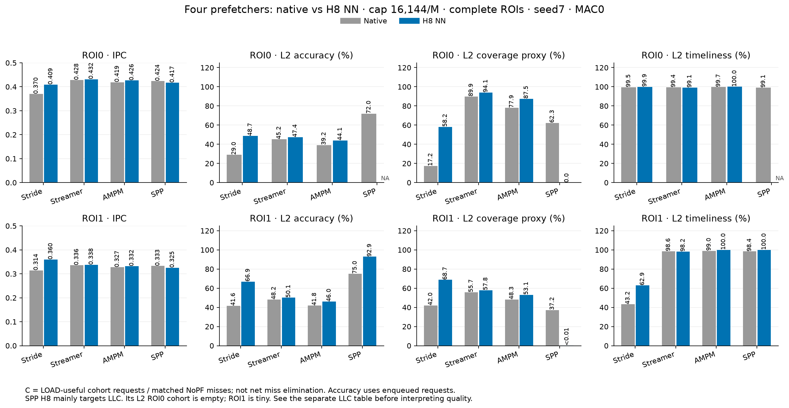
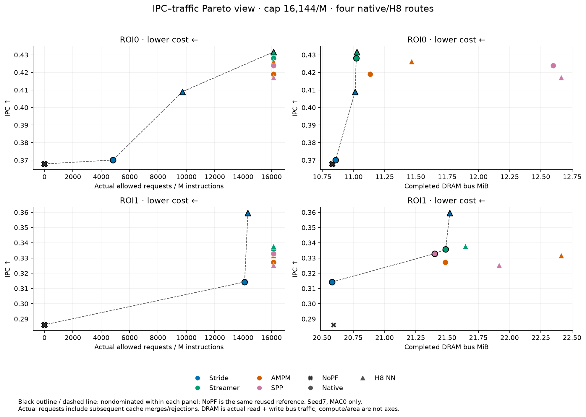

# 602 prefetcher results

- **Question:** How do Stride, Streamer, AMPM and SPP compare with their own frozen NN students on IPC, accuracy, coverage, timeliness and traffic?
- **Read the main comparison below.** H8 is the four-route comparison; AMPM/SPP H16 and simple-template controls are separate supplements. All results here are complete-ROI live inference, seed7 and **zero inference cost (MAC0)**.
- **Result:** H8 NN improves IPC in **6/8 capped pairs**, but uses more DRAM in **all eight**. Across capped and uncapped cases it wins **9/16**. A universal NN advantage is not supported. [Exact paired evidence](formal_study/results/602_width_templates/reader_pairs.csv).

## Four native prefetchers versus H8 NN

- Common ceiling: **16,144 allowed requests/M instructions**. Each cell is **native → NN**; IPC change is relative to the matching native. Quality values are percentages.
- **C = coverage proxy:** LOAD-useful requests ÷ matched NoPF LOAD misses. It is not the fraction of misses eliminated. Accuracy uses the enqueued cohort; timeliness uses timely ÷ all useful LOAD requests.

| Prefetcher | ROI | NN IPC change | L2 accuracy | L2 C | L2 timeliness |
| --- | --- | --- | --- | --- | --- |
| Stride | 0 | +10.51% | 29.0 → 48.7 | 17.2 → 58.2 | 99.5 → 99.9 |
| Stride | 1 | +14.44% | 41.6 → 66.9 | 42.0 → 68.7 | 43.2 → 62.9 |
| Streamer | 0 | +0.81% | 45.2 → 47.4 | 89.9 → 94.1 | 99.4 → 99.1 |
| Streamer | 1 | +0.56% | 48.2 → 50.1 | 55.7 → 57.8 | 98.6 → 98.2 |
| AMPM | 0 | +1.75% | 39.2 → 44.1 | 77.9 → 87.5 | 99.7 → 100.0 |
| AMPM | 1 | +1.34% | 41.8 → 46.0 | 48.3 → 53.1 | 99.0 → 100.0 |
| SPP | 0 | −1.59% | 72.0 → NA | 62.3 → 0.0 | 99.1 → NA |
| SPP | 1 | −2.24% | 75.0 → 92.9* | 37.2 → 0.004* | 98.4 → 100.0* |

- **SPP needs the LLC view:** its H8 NN mainly targets LLC. ROI0 has no L2 enqueues; ROI1 has only **14** (13 useful), so starred values are a tiny cohort. Capped LLC accuracy rises **26.1% → 47.1% / 28.6% → 49.0%**, yet IPC falls in both ROIs. Better request quality alone does not establish a performance gain. [LLC counts and definitions](formal_study/results/602_width_templates/README.md#spp-llc-intent-quality).
- **Uncapped:** H8 NN wins only **3/8** pairs. Both budgets, absolute IPC, enqueued/useful counts and net miss reduction are in the [full comparison](formal_study/results/602_width_templates/README.md) and [run-level metric CSV](formal_study/results/602_width_templates/reader_metrics.csv). Rounded 100.0% is not always exactly 100%.

## Pareto: what does the IPC gain cost?

- **Axes:** maximize IPC; minimize actual allowed requests/M or actual completed DRAM bytes. Compare the four native/H8 pairs and NoPF separately for each ROI and budget. Compute, area and energy are not measured axes.
- **Capped result:** Stride, Streamer and AMPM exchange higher IPC for more DRAM; native SPP beats its H8 NN on both. **No capped H8 NN improves both IPC and DRAM over its own native.** [Pair classifications](formal_study/results/602_width_templates/reader_pairs.csv).
- A shared request ceiling does not equalize actual requests or DRAM. Capped ROI0 Stride NN makes about twice as many allowed requests as native Stride. DRAM comes from controller counters, never requests × 64. [Traffic table and exact Pareto membership](formal_study/results/602_width_templates/README.md#ipc-versus-actual-requests-and-dram).

## Supported, limited and still open

- **Supported in these runs:** route-dependent H8 IPC gains; improved quality can coexist with lower IPC; request caps can change the outcome. These statements cover this seed, workload and protocol.
- **H16 supplement:** AMPM/SPP NN beats its native in 8/8 measured pairs, but simple templates reproduce nearly all IPC gain. Only capped ROI1 SPP H16 improves both IPC and DRAM versus native. [H16 results](formal_study/results/602_width_templates/README.md#h16-width-supplement) · [template evidence](formal_study/results/602_width_templates/paired_comparisons.csv).
- **Not established:** learned payload or recurrent state is necessary; gains persist across seeds/workloads; the students improve finite-resource performance or hardware Pareto efficiency. Prior Stride MAC4 evidence is mixed and uses a different protocol. [Finite-engine results](docs/602_gate_mechanism/FINITE_CURRENTLINE.md).
- **Method limits:** different route training budgets/state organization; native/student SPP fill feedback differs; ROI0 was previously inspected. [Metric contract](formal_study/results/602_width_templates/metric_definitions.json) · [method limits](formal_NN_training/experiments/602_four_prefetcher_formal/report/METHOD_LIMITATIONS.md) · [storage/cost assumptions](formal_study/results/602_width_templates/storage_cost.csv).

## Scope and further reading

- **Protocol:** validation 20–25M; ROI0 25–50M; ROI1 75–100M; 5M cache/state warmup for each test. Frozen original weights; runtime h/c updates. Both uncapped and cap 16,144/M results are retained; no results are averaged across ROIs or protocols.
- **Runs:** four-route H8/native study = 64 completed rows (56 test + 8 validation). Later H16/capped-template supplement = 24 rows (22 test + 2 validation), reusing those 64 references. This reader view selects 42 test rows; it adds no simulations or training. [Labeled source rows](formal_study/results/602_width_templates/per_run.csv).
- **Secondary evidence:** [H16/template mechanisms](formal_study/results/602_width_templates/FINDINGS.md) · [actions and stages](formal_study/results/602_width_templates/action_histograms_full_roi.csv) · [phase curves](formal_study/results/602_width_templates/phase_progress.csv) · [paper story](formal_study/results/602_width_templates/PAPER_STORY.md).
- **Separate history:** [offline/replay versus live](formal_NN_training/experiments/602_four_prefetcher_formal/width_templates/EVIDENCE_ALIGNMENT.md) · [first Stride formal](formal_NN_training/experiments/602_lstm_stride_dynamic_inference/results/formal_20261016_v2/README.md) · [current-line/gate/payload study](docs/602_gate_mechanism/REPORT.md). Their IPC is not pooled with the current four-route comparison.
- **Historical slides:** [old PDF](docs/602_deck_v7_15.pdf) · [corrections](docs/602_width_templates/SLIDE_ERRATA.md). Replay and live results have different state/warmup and measurement contracts.

## Where the evidence lives

- **Shared figures and CSVs:** [`formal_study/results/602_width_templates/`](formal_study/results/602_width_templates/README.md). The same relative links work on GitHub and in local Markdown preview.
- **Local full raw:** `/Users/angelawoo/Documents/CMU/ece/cache/formal_study/runs/602_width_templates_20261017/`; H8/native originals: `/Users/angelawoo/Documents/CMU/ece/cache/formal_study/archive/20261017/raw_v2/`.
- **Sacramento full raw:** `/home/qianruw/cache/formal_study/runs/602_width_templates_20261017/`; H8/native originals: `/home/qianruw/cache/formal_study/archive/20261017/raw_v2/`. Large logs, traces and builds stay off GitHub.
- **Navigation:** `main` is the shared reading branch. All experiment branches and `archive/summer-2026-offline` remain preserved. [Layout/recovery](docs/602_width_templates/LAYOUT_AND_RECOVERY.md) · [integration](formal_study/INTEGRATION.md) · [website](docs/index.html).
