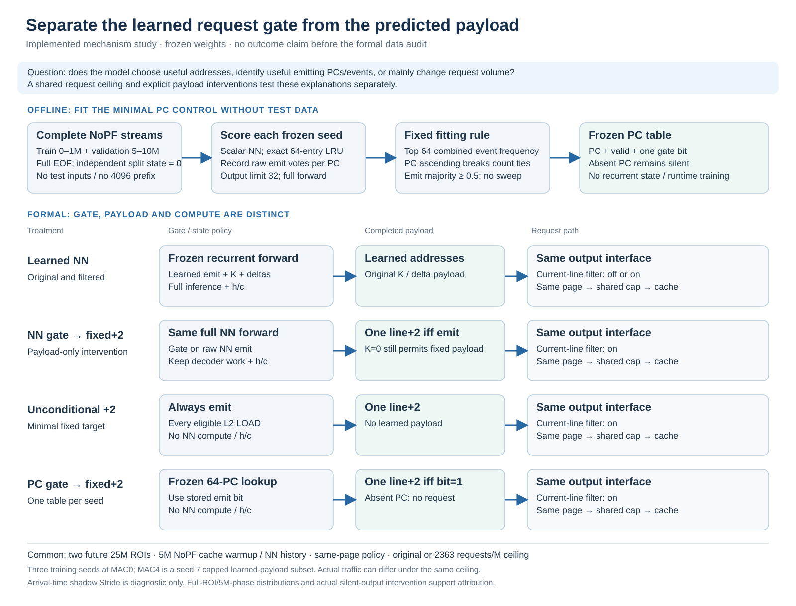

# What does the recurrent student actually contribute?

**Status: complete and audited — 71/71 logical rows: 64 fresh full formal runs + 7 compatible references; zero analysis failures.**
This follow-up separates a learned request gate from a learned address payload.
It does not train new NN weights or assume that recurrence, address prediction,
or teacher imitation is responsible for an IPC gain.

The model remains the three independently trained, frozen balanced-emit models
from the main-v2 study. A PC/address event changes that PC's h/c through the
original forward computation. In the NN-gate control, the full original forward,
decoder work, admission, completion and h/c policy remain; only the completed
payload becomes one fixed line+2 request when **raw NN emit is true**. Learned
K=0 or an empty decoded list does not force this replacement payload to be
silent. Cache feedback may subsequently change events and state trajectories;
the intervention preserves the policy, not a counterfactually identical future.

| Control | Gate | Actual payload | NN compute / h/c |
|---|---|---|---|
| Learned NN, original and current-line-filtered | Raw learned emit | Learned K and deltas | Full original forward |
| NN gate → fixed+2, current-line-filtered | Raw learned emit | One line+2 request | Full original forward |
| Unconditional fixed+2 | Every eligible L2 LOAD | One line+2 request | None |
| Frozen PC gate → fixed+2 | At most 64 frozen PC bits; absent PC silent | One line+2 request | None |

The current-line filter removes requests equal to the triggering aligned line
before request-budget credit. It is distinct from adding lookahead. The fixed+2
controls keep the same filter enabled as the filtered learned-payload arm, even
though a normal line+2 target is already forward. Page filtering, the common
cumulative request ceiling and the cache request path remain explicit.

## What the small PC control is allowed to know

Each seed's full scalar model scores the complete saved NoPF training stream
(0–1M) and validation stream (5–10M). Every split starts with zero h/c and uses
the same exact-PC 64-entry LRU state semantics and output limit 32. Validation
scoring deliberately has no 4M NN-state warmup; this is an offline fitting
contract, distinct from the performance runs. Neither test ROI is scored or
used to select the table, capacity or threshold.

Combine train/validation event counts and positive **raw emit** votes. Select
the 64 most frequent PCs, breaking equal counts by ascending unsigned PC, and
set each bit with `2 × positive votes >= event count`. The threshold 0.5,
capacity 64 and silence for absent PCs are fixed. The table stores no h/c and
does not learn online. The raw count/positive fields in the file allow loader
verification; deployed lookup needs PC, validity and one gate bit.

Full input row counts, per-PC votes and train/validation/combined agreement are
saved. A PC absent from the deployed top-64 table can have appeared in fitting;
table misses must not automatically be described as never-observed PCs. The
4096-event diagnostic log is not used for fitting or full-ROI distributions.

**Offline fitting audit: 数据支持.** The complete inputs contain 16,172 training
and 80,206 validation events, totaling 96,378. Their union has 55 PCs, so each
capacity-64 table contains 55 entries. Independent scalar recomputation matches
all six split outputs exactly; original model weights differ across seeds.
The real C++ constructor also passes all table-PC/unknown-PC decisions without
changing the files. These fitting agreements are not test accuracy or IPC results.

| Training seed | Train agreement | Validation agreement | Combined agreement | Gate-positive PCs |
|---|---:|---:|---:|---:|
| 7 | 99.418748% | 99.467621% | 99.459420% | 24 / 55 |
| 17 | 99.690824% | 99.503778% | 99.535164% | 29 / 55 |
| 27 | 99.251793% | 99.819216% | 99.724003% | 20 / 55 |

All three tables cover every PC in these fitting splits. Full audit evidence:
[independent fit verification](pc_gate_fit/independent_verification.json),
[split agreement/count table](pc_gate_fit/agreement_summary.tsv), and
[actual C++ table-loader roundtrip](pc_gate_fit/engine_loader_verification.json).
Future ROI table misses and IPC are recorded in the completed [per-seed results](results/metrics_per_seed.csv).

## Formal comparisons and evidence status

All rows use 602, identical cache warmup and page policy, two future 25M ROIs
(25–50M and 75–100M), 5M NoPF cache warmup and 5M NN-state history. The main
mechanism comparisons use MAC0, seeds 7/17/27 and original/capped policies.
MAC4 covers seed7 capped learned-payload original/filtered arms on both ROIs.
The common ceiling is the existing validation-selected 2363 requests/M, not
exact realized traffic equality. The fixed-bit and unconditional controls have
unmodeled lookup service, as do the existing conventional baselines.

The matrix is 64 fresh full formal runs plus 7 explicitly preserved compatible
forward-Stride references. Fresh NoPF rows establish compatibility; native SPP
is rerun with the repaired cohort boundary. Reused references retain their
original build/spec and require the fresh-NoPF equality audit.

### Completed IPC comparisons

All values below are relative IPC changes versus the matched NoPF. NoPF IPC is 0.367861290 on ROI0 and 0.286147323 on ROI1. Ranges retain seeds 7/17/27; deterministic controls have one value. Exact raw IPC, cycles, requests, DRAM bytes and cohort outcomes remain in the [result table](results/metrics_per_seed.csv).

| Treatment | ROI0 original | ROI1 original | ROI0 cap2363 | ROI1 cap2363 |
|---|---:|---:|---:|---:|
| NN learned, unfiltered | +10.6248% to +10.8733% | +25.1606% to +27.5323% | +0.0029% to +0.0104% | +0.0136% to +0.0671% |
| NN learned, current-line-filtered | +10.6249% to +10.8736% | +25.2320% to +27.6131% | +3.1968% to +3.2204% | +2.7656% to +2.8172% |
| Full NN gate → fixed+2 | +10.6246% to +10.8735% | +25.2388% to +27.6153% | +3.1958% to +3.2183% | +2.7629% to +2.8149% |
| Frozen PC gate → fixed+2 | +10.5899% to +10.9516% | +25.9041% to +26.1662% | +3.1863% to +3.2196% | +2.7642% to +2.7761% |
| Unconditional fixed+2 | +17.5904% | +35.0638% | +3.1305% | +2.7013% |
| Native SPP | +16.4968% | +36.1786% | +1.6854% | +2.2492% |
| Forward Stride degree1 | +0.6101% | +11.5694% | +0.6006% | +0.9904% |
| Forward Stride degree2 | +1.0402% | +17.2890% | +0.6159% | +0.8579% |

These MAC0 NN/fixed-target capped controls actually submit 2,362.96 requests/M; the common ceiling does not equate cache acceptance, request timing or DRAM traffic. Some conventional controls realize slightly fewer submissions, as retained in the CSV. Uncapped unconditional+2 submits 15,671.84/M and 20,631.32/M on ROI0/1, versus filtered NN 9,299–9,477/M and 13,873–14,692/M. Its larger uncapped IPC therefore remains confounded by request quantity. Native SPP remains the strongest uncapped reference on ROI1 (+36.1786%, versus unconditional+2 +35.0638%).

### Claims supported or limited by the controls

| Proposed contribution / status | Completed evidence and boundary |
|---|---|
| 数据支持 · current-line credit matters | Raw current-line addresses are 50.0003–50.0245% across the six full original NN controls. Filtering raises capped IPC by 3.1860–3.2130% on ROI0 and 2.7216–2.7570% on ROI1 relative to unfiltered NN. The previous weak capped unfiltered result cannot alone establish an absence of useful prediction. |
| 未支持 · learned addresses are necessary for the headline benefit | Every decoded first slot is delta0; 99.9256–99.9980% of second slots are delta+2. Keeping the full NN and replacing its payload changes IPC by at most 0.00990% in magnitude across paired seed/ROI/cap comparisons, with both signs. This limits the learned-address story for these runs; it is not a general equivalence theorem. |
| 未支持 · a recurrent gate consistently beats the bounded PC gate | PC-gate versus filtered learned NN changes capped IPC by −0.0515 to +0.0089% across seed/ROI pairs; uncapped differences range −1.1339 to +0.5964%. The sign varies. The static gate numerically recovers most of the headline benefit here, without proving recurrence universally unnecessary. |
| 未支持 · practical finite-cost advantage | The seed7 MAC4 filtered rows change IPC by +0.0450% on ROI0 and −0.0798% on ROI1 versus NoPF, below the retained conventional controls. Their actual submission rates are 1,769.56/M and 2,267.04/M, so both caps are nonbinding; do not group these with equal-realized-submission MAC0 controls. |
| 数据支持 · actual zero-cost silent-output intervention | The added original, unfiltered MAC0 seed7 ROI1 silent-output suppression lowers IPC by 9.4094% relative to its unsuppressed control. This estimates that whole simulation intervention; request-category labels alone do not identify individual causal IPC contributions. |
| 待验证 · universal hardware, minimum-history or transfer claims | This follow-up covers two future ROIs of 602, with three existing training seeds and one finite-cost seed. It does not establish silicon PPA, a universal minimum observation count, or generalization to new workloads. |

Evidence: [71-row audit](results/audit.json), [paired interventions](results/paired_comparisons.csv), [full distributions](results/full_roi_distributions.csv), [5M-phase distributions](results/phase_distributions.csv), and the [independent full-profile/identity certificate](full_profile_verification.json). All 64 fresh row identities are checked; the available NN/fixed-payload histogram checks include all six original seed/ROI controls and all 28 fixed-payload controls. Fixed payloads have only K0/1 and exact delta+2; no diagnostic prefix substitutes for full-ROI data.

Teacher snapshots remain observation-only, captured when every eligible LOAD
arrives, including NN-dropped inputs. The additional zero-cost ROI1 seed7
teacher-silent-output suppression fills the missing actual intervention.
Overlap labels and useful/unused classifications describe requests; they do
not establish per-request causal IPC contributions or measured pollution.

## Concise paper-story outline

1. **Question.** A teacher-action-trained recurrent student can improve zero-cost IPC, but the aggregate gain does not identify the value of its address model, emit gate or recurrent state. Keep the earlier main-v2 protocol separate from this follow-up.
2. **Method.** Freeze the original model, isolate current-line credit and completed payload, and compare the full NN gate with a capacity64 static PC gate and unconditional fixed+2. Match cache warmup, future ROI, page policy and the validation-selected request ceiling; save full distributions and request outcomes.
3. **Result — 数据支持.** The learned list is almost entirely current-line plus fixed+2. Current-line filtering materially changes the capped comparison. The full NN with fixed payload and a small PC gate retain similar zero-cost IPC to learned payloads; unconditional fixed+2 wins uncapped against the NN while making more requests. SPP still leads uncapped ROI1.
4. **Limit — 未支持.** These data do not establish a material learned-address contribution, a consistent recurrent-gate advantage, or a finite-cost practical win. Keep the small seed/ROI reversals and the lower request rate of finite runs visible. Three seeds do not justify population or significance claims.
5. **Boundary — 待验证.** Physical hardware benefit, generalization and universal minimum-history claims remain unestablished. MAC0 is a functional comparator, not a mathematical IPC upper bound; a startup-curve crossing is not a minimum-history threshold. Unused requests are not measured pollution. Native-SPP L2-target cohort metrics describe only that tracked subset; whole-SPP accuracy/timeliness remains unavailable for LLC-only requests.

Read the [full report](REPORT.md), [one-page paper story](PAPER_STORY.md), [per-seed result table](results/metrics_per_seed.csv), and [paired comparisons](results/paired_comparisons.csv). Configuration and launch contract: [run guide](../../formal_NN_training/experiments/602_gate_mechanism/RUN_GUIDE.md). All original build/spec provenance and compatibility checks are preserved; no missing formal outcome is represented by a placeholder.
