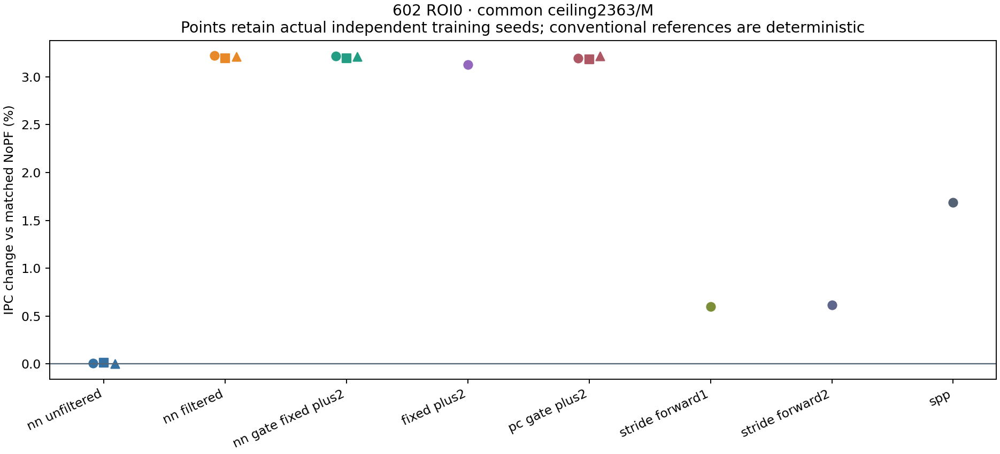
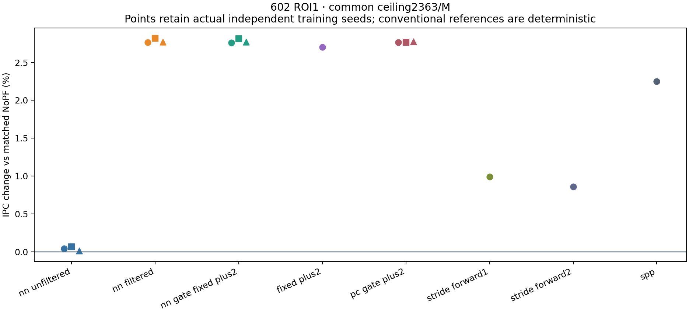

# 602：current-line、gate 与 payload 的正式机制结果

**64/64 新完整实验完成，0 运行中、0 失败；7 个兼容参考，71/71 审计 PASS。**
运行、独立验证和提交状态分开记录于[完成证书](completion_certificate.json)、
[审计](results/audit.json)和本分支 Git 历史。保留全部负面结果。

① **MAC0 下，去掉 triggering current-line 后，cap 收益部分恢复；没有恢复到 uncapped 水平。**
既定 2363 requests/M ceiling 下，NN 相对 NoPF 从 ROI0 的 **+0.003%–+0.010%**
恢复到 **+3.197%–+3.220%**，ROI1 从 **+0.014%–+0.067%** 恢复到
**+2.766%–+2.817%**。这不是增加 lookahead：完整 forward、h/c、原始地址列表及顺序
均保留，只在共同 credit gate 前拒绝 current-line；同列表重复地址仅计数。
原始 capped NN 的 **98.167%–99.924%** credit 被 current-line 消耗；过滤后为 0，
六个 MAC0 配对两边都实际提交 59,074 请求。[配对数据](results/paired_comparisons.csv)、
[逐 slot/current 类别](results/classified_whole_roi.csv)、[credit](results/current_line_credits.csv)。

② **这些模型的主要收益不需要 learned address payload；简单 +2 控制已能复现或超过它。**
保留 NN gate、完整原始 forward/decoder 和 h/c，只把完成后的 payload 改为一个 line+2，
相对过滤后 learned NN 的 IPC 差为 **−0.00418% 至 +0.00990%**；这支持“主要收益无需
learned payload”，没有进行统计等效性检验。冻结 PC-gate/+2 在 cap 下相对 learned NN
仅差 **−0.05151% 至 +0.00893%**，uncapped 差 **−1.13388% 至 +0.59644%**，
不能把它写成逐 seed 完全追平。Unconditional +2 在两个 uncapped ROI 均超过 NN，
但发出更多请求；相同 cap 下，NN-gate/+2 相对 unconditional +2 的 IPC 优势仅
**+0.060%–+0.111%**。[完整配对范围](results/paired_ranges.csv)。

下面是相对同 ROI NoPF 的 IPC 变化百分比。NN-derived 数字保留 seeds 7/17/27 的范围，
不是置信区间；确定性 baseline 各运行一次。NoPF IPC：ROI0 **0.367861290**，
ROI1 **0.286147323**。

| 方法（MAC0） | ROI0 uncapped | ROI0 cap | ROI1 uncapped | ROI1 cap |
|---|---:|---:|---:|---:|
| 原始 NN | 10.625–10.873 | 0.003–0.010 | 25.161–27.532 | 0.014–0.067 |
| 过滤 current-line 的 NN | 10.625–10.874 | 3.197–3.220 | 25.232–27.613 | 2.766–2.817 |
| NN gate → 固定 +2 | 10.625–10.874 | 3.196–3.218 | 25.239–27.615 | 2.763–2.815 |
| 冻结 PC gate → 固定 +2 | 10.590–10.952 | 3.186–3.220 | 25.904–26.166 | 2.764–2.776 |
| Unconditional +2 | 17.590 | 3.131 | 35.064 | 2.701 |
| forward1 Stride | 0.610 | 0.601 | 11.569 | 0.990 |
| forward2 Stride | 1.040 | 0.616 | 17.289 | 0.858 |
| 原生 SPP | 16.497 | 1.685 | 36.179 | 2.249 |

[完整简表](results/RESULT_TABLE.md)逐项给出绝对 IPC、实际 requests/M 与实际 DRAM MiB；
[质量表](results/QUALITY_TABLE.md)给出 coverage、accuracy、timeliness；
[逐 seed CSV](results/metrics_per_seed.csv)和[完整原字段](results/raw_per_seed.csv)保留 cycles、
MPKI、timely/late、接受/合并/拒绝、重复、evicted-unused、末端未决、队列和状态统计。

圆、方、三角分别对应 seed 7、17、27；常规 baseline 的单个圆点不是重复训练。
Uncapped 图和两个 ROI 的 cumulative/相邻 snapshot interval 启动曲线位于 results/。
启动前缀不代替全 ROI 分布，也不据首次超过 baseline 定义最少观察量。

## 完整 ROI 的机制与实际干预

六项原始 uncapped NN 共覆盖两个完整 25M ROI、三个 seeds：所有 emit 的第一个 slot
均为 delta 0；K=2 占 emit 的 **99.902%–99.999%**，第二个 slot 为 +2 的比例
**99.926%–99.998%**，同列表重复地址均为 0。各 5M phase 的精确分布单独保留，
没有用 4096 条 example log 外推。[全 ROI](results/learned_payload_full_roi.csv)、
[全部 phase](results/phase_distributions.csv)。过滤几乎减半 uncapped API 提交，而两个 ROI
六个配对的实际 DRAM bytes 均不变；API 请求不是 DRAM transaction。

补齐的 **ROI1、seed7、MAC0、原始未过滤、uncapped** teacher-silent 输出抑制：
IPC **0.358144 → 0.324445（−9.409%）**，相对 NoPF 仍有 +13.384%，
实际 requests/M **28,221.96 → 14,092.60**。这说明该事件集合的输出在这个整段干预中
有净 IPC 价值；不能按请求标签分摊因果 IPC，也不能由此推出 learned payload 或 recurrent
state 必不可少。Teacher 在每个 eligible LOAD 到达时推进并随事件保存标签，包括 NN
丢弃输入；主 NN 决策不读取 shadow teacher。

## 有限成本没有稳健恢复

以下仅为 **seed7、既定 cap、MAC4** 的成本参考，不能推广到三 seed：

| ROI | 原始 IPC | 过滤后 IPC | 过滤后相对 NoPF | 实际 requests/M 原始→过滤 |
|---|---:|---:|---:|---:|
| 0 | 0.367910 | 0.368027 | +0.04502% | 2362.92 → 1769.56 |
| 1 | 0.286146 | 0.285919 | −0.07983% | 2362.96 → 2267.04 |

过滤后的 cap 均不再绑定，但输入丢弃仍约 **79.5%–80.6%**，平均到达至完成约
**13.8k–14.2k cycles**。过滤相对原始成本行在 ROI0 改善 +0.03174%，ROI1 恶化
−0.07950%；它没有解决串行计算/排队瓶颈。[完整成本分布与状态](FINITE_CURRENTLINE.md)。

成本模型保持 serial **II = service time**，4 MAC/cycle、16 B/cycle、单个 4-cycle
非线性单元、input FIFO16、output FIFO32、decode32、64 个 PC state。只有完成时发布
h/c 与输出，无新 callback 时仍逐 cycle 服务。Dense MAC 与 dense-weight read 取较慢者
重叠，再串行加入 nonlinear/control/scratch；bias read 未另收费。权重常驻，模型化 NN
权重 DRAM 为 0；`MAC×4` 是分析性的 dense operand bytes，另列且不是实测 SRAM/DRAM。
传统 Stride、SPP、PC gate 和固定 +2 没有新有限服务模型。[成本不变量](cost_invariants.json)。

## 协议、统计与恢复边界

冻结 balanced H8 checkpoints，未重训：train 0–1M、validation 5–10M；test ROI0
25–50M、ROI1 75–100M，各 5M NoPF cache warmup、5M NN h/c 可见历史，清除 warmup
未完成工作。地址为 64B cache line，+2 = 128B，same-page 4KiB。机器、依赖与完成结果
的实际代码一致；新构建 `build_20261016_213702`。实际 retirement overshoot 和分母保留。
Cap 沿用 validation 选出的 2363/M，没有 threshold sweep 或 test 参数选择。

PC table 容量 64、实际 55 条；每 seed 用完整 16,172 train + 80,206 validation 事件的
NN raw emit 投票，频率 top64、固定 majority ≥0.5，未列 PC silent。分 split 从零 h/c
评分，不给 validation 额外历史；test 不参与拟合。每 seed 55 条均来自完整 fitting 数据。
测试 table-miss 事件约 ROI0 0.299%、ROI1 7.268%。这些对照没有单独隔离 line features
与 h/c，PC 表的差距不能被称为 stateful 创新。[拟合契约与独立重算](pc_gate_fit/)。

实际 C++ 55-entry map header+node allocation requests 为 **2688B**（不含其余引擎/
allocator 元数据）；528B 仅是假设的 64-slot packed table payload。显式控制与候选
源字段预留后，PC gate **560B / capped 576B**，unconditional +2 **32B / 48B**；
完整 NN source-field reservation **16920B / 16936B**，NN-gate fixed payload 并未节省
NN forward/storage。它们与 C++ 对象、RSS、综合面积不同。[逐字段存储](STORAGE.md)。

Accuracy = observed timely+late **LOAD** uses / 实际插入的、完整追踪的 L2-target PQ cohort；
timeliness = timely_LOAD/(timely_LOAD+late_LOAD)；timely coverage = timely_LOAD/同 ROI
NoPF L2 LOAD misses。RFO 单列，pending/resident-unused 右删失。`uses/submission` 单列
为提交收益率。SPP 保留原生 L2/LLC fill policy，只对 L2-target 子 cohort 报这些指标；
LLC-only accuracy/timeliness 为 NA，整体 IPC、MPKI 和 DRAM 仍保留。修复可能同时改变
旧跨 scope usefulness 信用，不能只说分母改变。[SPP 4/4 独立核对](cohort_verification.json)。
Unused 不是 pollution；DRAM 来自实际 controller bus completion，含初末队列/在途信息，
没有用 issued×64 代替。

两个新 NoPF 各 210 个共同字段、11 个有旧对照的原始 NN 各 14 字段、4 个原生 SPP
各 54 个功能/DRAM 字段全部 exact（共 790）；旧 ROI1 三 seed 的 MAC0 capped NN
原本不存在，已本轮新执行。7 个 Stride 引用保留原 protocol/build/spec。完整运行状态、
源码与 binary/table/model 字节兼容检查见[证书](completion_certificate.json)。

完整原始数据：服务器 `/home/qianruw/cache_gate_mechanism_20261016_runs`；本地
`/Users/angelawoo/.codex/.chatgpt-projects/g-p-69fa00bd18d88191bc3efcbb94ae6240/gate_output/raw`。
原 checkpoints/reference raw：`/home/qianruw/cache_formal_20261016_runs_v2`，本地
`/Users/angelawoo/.codex/.chatgpt-projects/g-p-69fa00bd18d88191bc3efcbb94ae6240/research_output/raw_v2`。
旧目录、旧结果与损坏 Git 均保留。健康 checkout、模型路径与恢复步骤见
[RECOVERY](RECOVERY.md)和[运行指南](../../formal_NN_training/experiments/602_gate_mechanism/RUN_GUIDE.md)。

[Gate/payload idea diagram](diagram.svg) · [机制说明](MECHANISM.md) · [一页 paper story](PAPER_STORY.md)
