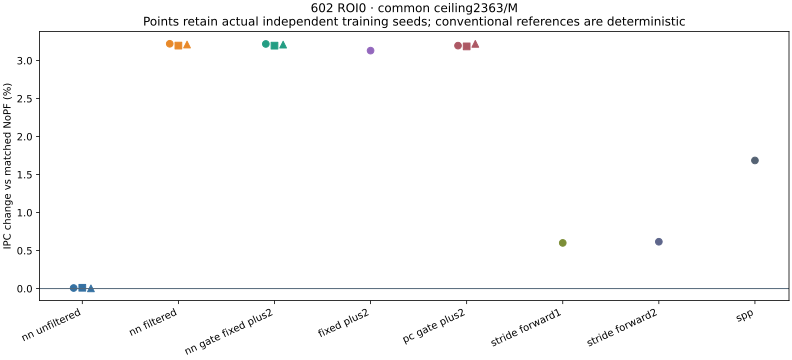
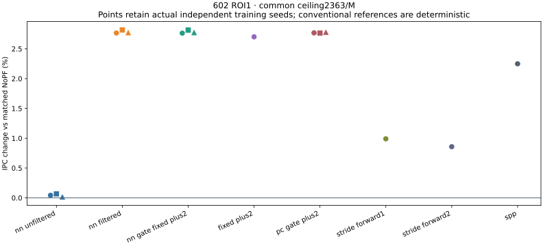

# Current-line, gate and payload: 602 mechanism study

- **Stage entry:** this report summarizes the completed `gate_mechanism_20261016_v1` study. For the later H8/H16 work and shared conclusions, start with the [project overview](../../RESULTS_INDEX.md).
- **Complete:** 64 new full formal runs, no running/failed rows, and 7 compatible references; 71/71 audited rows pass. Execution, validation and Git submission are separate states: [completion certificate](completion_certificate.json), [audit](results/audit.json).
- **Main finding:** current-line requests consume the capped NN's credits; filtering helps MAC0. Fixed +2 controls closely reproduce its learned payload. The seed 7 MAC4 subset remains near NoPF, with opposite signs across ROIs.

## MAC0 results

- The fixed ceiling is **2,363 requests per million retired instructions**, inherited from validation. It is an upper limit, not equal cache acceptance, timing or DRAM traffic.
- Original capped NN spends **98.167%–99.924%** of credits on the triggering current line. Filtering reduces this to zero; all six MAC0 pairs submit **59,074** requests on each side. [Credits](results/current_line_credits.csv), [slot/current classes](results/classified_whole_roi.csv).
- Filtering preserves full forward/decoder work, h/c policy and raw list order; it rejects current-line outputs before credit. It does not add lookahead or deduplicate lists.
- NoPF IPC is **0.367861290** on ROI0 and **0.286147323** on ROI1. Table values are IPC changes versus the matched NoPF, in percent. NN ranges are seeds 7/17/27, **not confidence intervals**; deterministic baselines run once.

| MAC0 treatment | ROI0 uncapped | ROI0 capped | ROI1 uncapped | ROI1 capped |
| --- | ---: | ---: | ---: | ---: |
| Original NN | 10.625–10.873 | 0.003–0.010 | 25.161–27.532 | 0.014–0.067 |
| Current-line-filtered NN | 10.625–10.874 | 3.197–3.220 | 25.232–27.613 | 2.766–2.817 |
| Full NN gate → fixed +2 | 10.625–10.874 | 3.196–3.218 | 25.239–27.615 | 2.763–2.815 |
| Frozen PC gate → fixed +2 | 10.590–10.952 | 3.186–3.220 | 25.904–26.166 | 2.764–2.776 |
| Unconditional +2 | 17.590 | 3.131 | 35.064 | 2.701 |
| Forward Stride degree 1 | 0.610 | 0.601 | 11.569 | 0.990 |
| Forward Stride degree 2 | 1.040 | 0.616 | 17.289 | 0.858 |
| Native SPP | 16.497 | 1.685 | 36.179 | 2.249 |

- **Payload control:** keeping the full NN gate/forward/h/c but replacing its completed payload with one +2 request changes IPC by **−0.00418% to +0.00990%** versus filtered learned payload. This is numerical proximity in these runs, not a statistical equivalence test.
- **PC-gate control:** differences versus filtered learned NN are **−0.05151% to +0.00893%** capped and **−1.13388% to +0.59644%** uncapped. It does not match every seed exactly or isolate line features from recurrent state.
- **Unconditional +2:** beats NN on both uncapped ROIs while submitting more requests. At the common cap, NN-gate/+2 leads it by only **0.060%–0.111%**. Native SPP remains the strongest uncapped ROI1 reference.
- Exact IPC/cycles, requests/M and actual DRAM: [result table](results/RESULT_TABLE.md), [per-seed CSV](results/metrics_per_seed.csv), [paired comparisons](results/paired_comparisons.csv), [pair ranges](results/paired_ranges.csv).
- Full quality/counter evidence: [quality table](results/QUALITY_TABLE.md), [raw fields](results/raw_per_seed.csv). The raw fields retain MPKI, timely/late uses, accepted/merged/rejected requests, duplicates, evicted-unused, pending work, queues and state.

- Circle/square/triangle denote seeds 7/17/27. A single conventional-baseline point is not a training replication.
- Uncapped and startup plots remain in [results](results/). Snapshot prefixes do not replace full-ROI distributions; first crossing of a baseline is not a minimum-history estimate.

## What the interventions show

- Across the six original uncapped NN runs, every emitted first slot has delta 0; **99.902%–99.999%** of emit events have K=2, and **99.926%–99.998%** of second slots are +2. Same-list duplicates are zero. [Full-ROI payload](results/learned_payload_full_roi.csv), [all distributions](results/full_roi_distributions.csv), [five 5M phases](results/phase_distributions.csv).
- Filtering nearly halves uncapped API submissions; actual DRAM bytes are unchanged in all six pairs. API requests are not DRAM transactions. The bounded 4,096-event example log is not used for these distributions.
- The **ROI1, seed 7, MAC0, original/unfiltered/uncapped** teacher-silent-output intervention changes IPC **0.358144 → 0.324445 (−9.409%)**, still **+13.384%** versus NoPF; requests/M fall **28,221.96 → 14,092.60**. [Intervention pairs](results/paired_comparisons.csv).
- That whole-run intervention supports net value for that event set in this case. Request labels do not assign individual causal IPC contributions or prove learned payload/recurrent state necessary.
- Shadow Stride advances on **every eligible LOAD arrival**, including NN-dropped inputs; labels travel with the event. NN decisions do not read the observer, except the explicitly requested output-suppression intervention.

## Finite-cost result: no consistent recovery

- This subset is **seed 7 only**, capped MAC4, learned payload, original versus current-line-filtered, on both full ROIs. It is not a three-seed finite-cost result.

| ROI | Original IPC | Filtered IPC | Filtered versus NoPF | Requests/M: original → filtered |
| --- | ---: | ---: | ---: | ---: |
| 0 | 0.367910 | 0.368027 | +0.04502% | 2362.92 → 1769.56 |
| 1 | 0.286146 | 0.285919 | −0.07983% | 2362.96 → 2267.04 |

- Filtered IPC changes versus original are **+0.03174% / −0.07950%**. Both filtered runs use fewer credits than the cap permits, yet **79.5%–80.6%** of inputs are dropped and mean completion age is **13.8k–14.2k cycles**. Filtering does not remove the serial service/queue bottleneck. [All four rows and timing distributions](FINITE_CURRENTLINE.md).
- Serial **II = service time**: 4 MAC/cycle, 16 B/cycle, one 4-cycle nonlinear unit, FIFO input 16/output 32, decode 32 and 64 PC states. h/c and outputs publish only on completion; service advances without new callbacks.
- Dense MAC and dense-weight-read costs overlap at their maximum; nonlinear/control/scratch costs follow serially. Bias reads are not separately charged. Resident NN weights have zero modeled DRAM traffic; `MAC × 4` is an analytical dense-operand byte count, not measured SRAM/DRAM traffic. [Cost invariants](cost_invariants.json).
- Conventional Stride, SPP, PC gate and unconditional +2 have no newly modeled finite compute/lookup service. No physical area, energy or PPA claim follows.

## Protocol and metric limits

- Frozen balanced H8 weights; **no retraining**. Train 0–1M, validation 5–10M; test ROI0 25–50M and ROI1 75–100M. Each run has 5M NoPF cache warmup and 5M NN-state history; unfinished warmup work is cleared.
- 64 B lines; +2 means 128 B; same-page policy uses 4 KiB pages. Actual retirement overshoot and denominators are retained. Build `build_20261016_213702` uses ChampSim base `838be17e`. No test-based threshold/cap selection.
- PC-gate capacity 64, actual 55 entries per seed: full **16,172 train + 80,206 validation = 96,378 events**, top-frequency PCs, fixed majority ≥0.5, absent PC silent. Each split starts with zero h/c; test is excluded. Test table misses are about **0.299% / 7.268%** on ROI0/1. A table miss is not necessarily a never-observed PC. [Mechanism and fit audit](MECHANISM.md), [fit evidence](pc_gate_fit/).
- Source-field reservations are **16,920 B / 16,936 B capped** for full NN, **560 B / 576 B** for PC gate and **32 B / 48 B** for unconditional +2. The actual 55-entry C++ map header plus requested nodes is **2,688 B**, excluding other engine/allocator memory. These are different storage boundaries; fixed payload does not remove NN computation/storage. [Storage](STORAGE.md).
- Accuracy is observed timely+late **LOAD** uses divided by tracked **L2-target PQ insertions**; timeliness is timely_LOAD/(timely_LOAD+late_LOAD); timely coverage is timely_LOAD/matched NoPF L2 LOAD misses. RFO is separate; pending/resident-unused are right-censored. Uses/submission is a separate yield.
- Native SPP keeps its L2/LLC fill policy. This stage reports lifecycle quality only for its tracked L2-target subset; LLC-only accuracy/timeliness are NA. Whole-policy IPC, MPKI and DRAM remain available. The repair can change usefulness attribution as well as the denominator. [SPP 4/4 audit](cohort_verification.json).
- Unused is not measured pollution. DRAM comes from controller bus completions, with initial/final queued and in-flight work recorded; never issued × 64.
- Compatibility checks match **790 fields**: 2 NoPF × 210, 11 original NN × 14 and 4 native SPP × 54. The three previously missing ROI1 capped MAC0 NN rows were newly run; seven Stride references retain their original protocol/build/spec. [Completion and compatibility](completion_certificate.json).

## Evidence and recovery

- [Mechanism contracts](MECHANISM.md) · [finite subset](FINITE_CURRENTLINE.md) · [storage](STORAGE.md) · [gate/payload diagram](diagram.svg).
- [Canonical archive paths and recovery](RECOVERY.md) · [retained runner guide](../../formal_NN_training/experiments/602_gate_mechanism/RUN_GUIDE.md).
- This is one workload, two ROIs and three existing training seeds; no significance/equivalence test, online weight training, cross-workload retraining, silicon synthesis or proof of stateful novelty.
