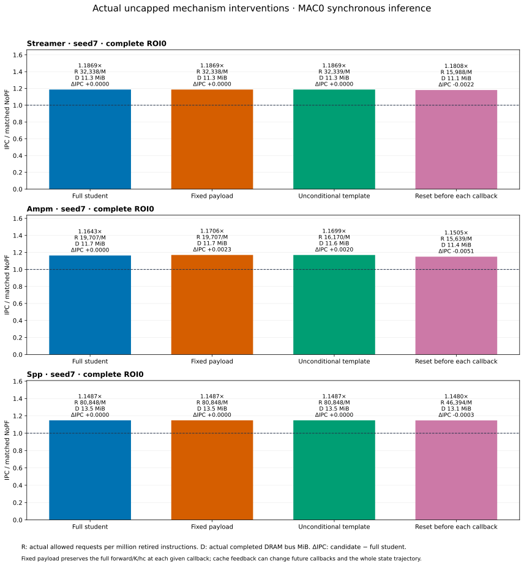
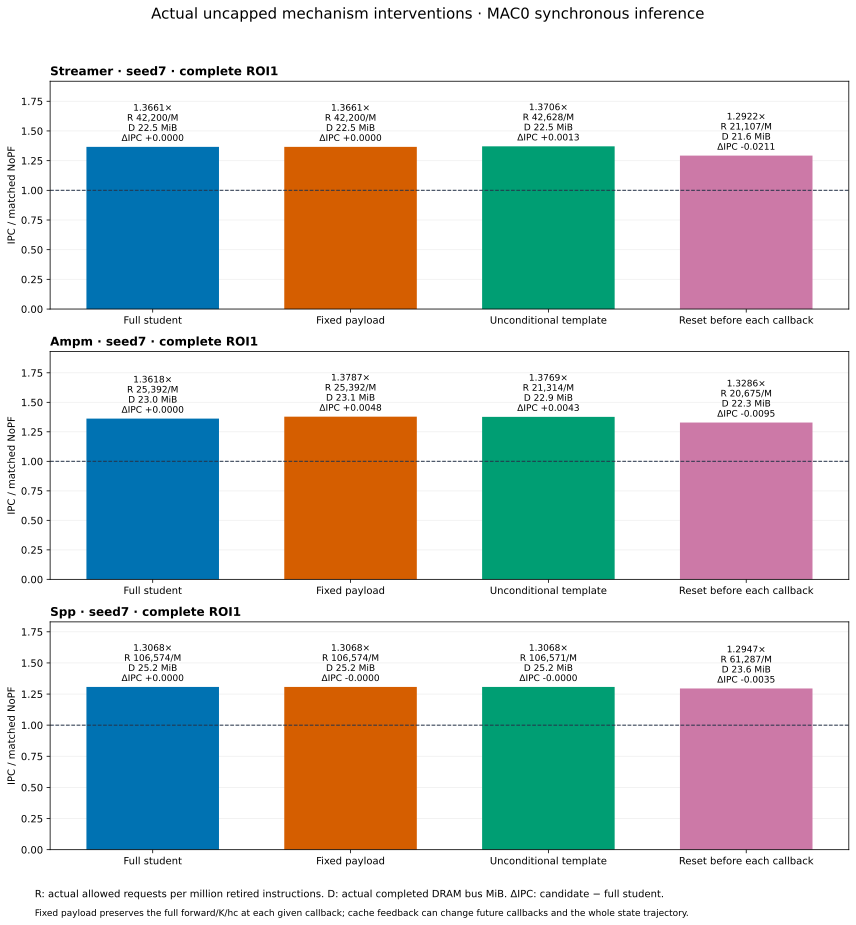
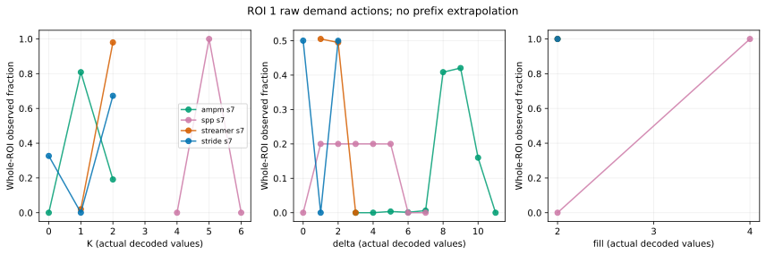
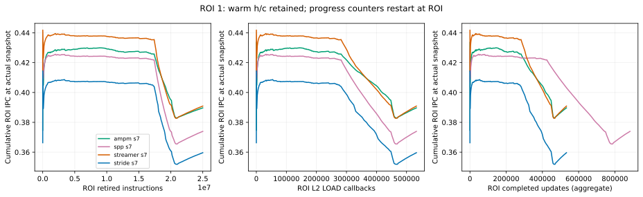
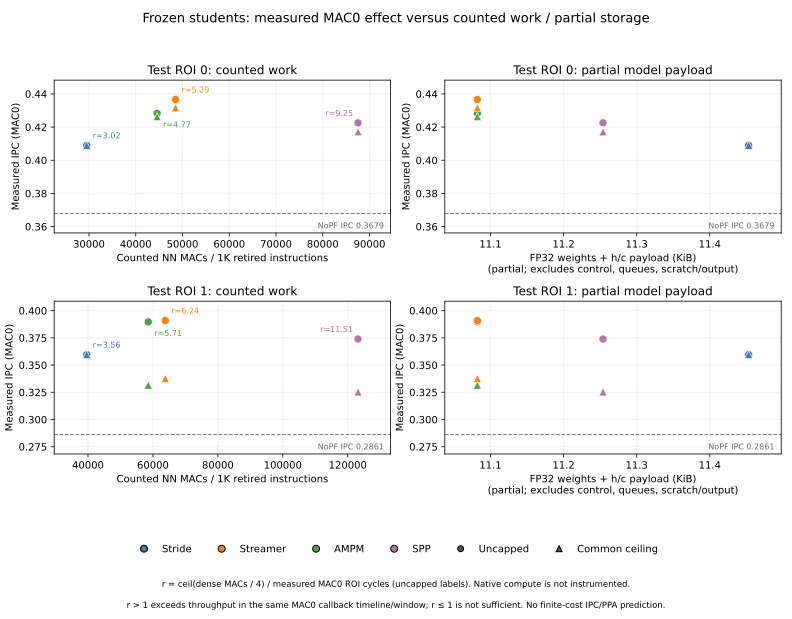
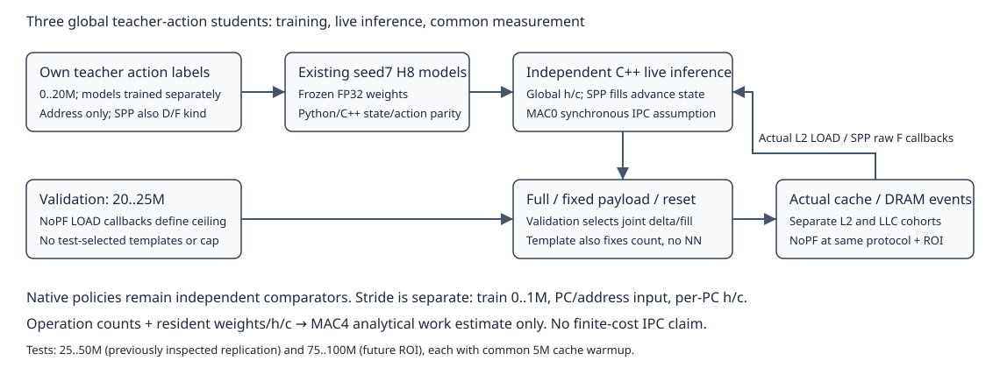

# Four-route H8 live results: retained v2 study

- **Scope:** `four602_frozen_live_20261017_v2`; 64/64 complete runs, 8 validation + 56 test. This is an English reader view; original reports remain with the raw evidence. [Current overview](../../../../../RESULTS_INDEX.md).
- **Measured outcome:** students beat their native teacher in 9/16 pairs and lose in 7/16. Every main NN comparison improves over NoPF, which does not establish a win over native teachers.
- **Limits:** existing seed7 only, frozen weights, synchronous MAC0. Stride trained on 0–1M for 12 epochs; the other models on 0–20M for 8 epochs. This is not a matched-training-budget ranking or finite-cost result.
- **Protocol:** validation 20–25M; ROI0 25–50M was previously inspected; ROI1 75–100M is distinct. Each run uses 5M cache/state warmup. The external page gate is cross-page; native internal page rules remain. The common 16,144 requests/M ceiling is an upper limit, not equal realized traffic.

## IPC, actual requests and actual DRAM

- Zero ceiling means uncapped. Requests/M counts credit-allowed cache calls per million retired instructions; PQ acceptance/merges/rejections are separate. DRAM uses actual completed controller bus transfers, not requests × 64.

| Policy | ROI | Ceiling | Native IPC | NN IPC (/NoPF) | NN/native | Requests/M: native → NN | DRAM MiB: native → NN |
|---|---:|---:|---:|---:|---:|---:|---:|
| stride | 0 | 0 | 0.370105 | 0.409015 (1.1119×) | +10.513% | 4833.4 → 9717.2 | 10.857 → 11.014 |
| stride | 0 | 16144 | 0.370105 | 0.409015 (1.1119×) | +10.513% | 4833.4 → 9717.2 | 10.857 → 11.014 |
| streamer | 0 | 0 | 0.431071 | 0.436622 (1.1869×) | +1.288% | 72357.0 → 32338.3 | 11.324 → 11.307 |
| streamer | 0 | 16144 | 0.428172 | 0.431659 (1.1734×) | +0.814% | 16144.0 → 16144.0 | 11.023 → 11.028 |
| ampm | 0 | 0 | 0.430021 | 0.428318 (1.1643×) | -0.396% | 56938.4 → 19707.4 | 11.211 → 11.680 |
| ampm | 0 | 16144 | 0.418974 | 0.426299 (1.1589×) | +1.748% | 16144.0 → 16144.0 | 11.134 → 11.466 |
| spp | 0 | 0 | 0.427730 | 0.422557 (1.1487×) | -1.209% | 90352.5 → 80847.6 | 12.924 → 13.533 |
| spp | 0 | 16144 | 0.423904 | 0.417164 (1.1340×) | -1.590% | 16144.0 → 16144.0 | 12.598 → 12.661 |
| stride | 1 | 0 | 0.318998 | 0.359643 (1.2568×) | +12.742% | 15473.8 → 14337.3 | 20.583 → 21.522 |
| stride | 1 | 16144 | 0.314254 | 0.359643 (1.2568×) | +14.443% | 14105.3 → 14337.3 | 20.580 → 21.522 |
| streamer | 1 | 0 | 0.397788 | 0.390892 (1.3661×) | -1.734% | 93024.0 → 42200.2 | 22.387 → 22.470 |
| streamer | 1 | 16144 | 0.335728 | 0.337604 (1.1798×) | +0.559% | 16144.0 → 16144.0 | 21.489 → 21.646 |
| ampm | 1 | 0 | 0.392795 | 0.389686 (1.3618×) | -0.792% | 71340.6 → 25392.2 | 21.809 → 23.048 |
| ampm | 1 | 16144 | 0.327222 | 0.331607 (1.1589×) | +1.340% | 16144.0 → 16143.6 | 21.485 → 22.412 |
| spp | 1 | 0 | 0.387512 | 0.373941 (1.3068×) | -3.502% | 116475.4 → 106574.2 | 22.638 → 25.223 |
| spp | 1 | 16144 | 0.332809 | 0.325346 (1.1370×) | -2.242% | 16144.0 → 16144.0 | 21.400 → 21.916 |

- Uncapped pairs: 3 wins / 5 losses; capped pairs: 6 wins / 2 losses. In ROI1, all three global students lose to their native teacher when uncapped. [All paired data](paired_comparisons.csv).

## Mechanism controls: complete uncapped ROIs

- **Full:** original student. **Fixed:** complete forward/K/h/c, then replace payload. **Template:** validation modal K and joint per-slot delta/fill, no NN or PC. **Reset:** clear h/c before each demand/fill callback, then run the full forward.

| Policy | ROI | Full IPC | Fixed IPC | Template IPC (vs full) | Reset IPC | Template requests/M | Template DRAM MiB |
|---|---:|---:|---:|---:|---:|---:|---:|
| streamer | 0 | 0.436622 | 0.436622 | 0.436622 (+0.000%) | 0.434389 | 32339.0 | 11.307 |
| ampm | 0 | 0.428318 | 0.430609 | 0.430351 (+0.475%) | 0.423210 | 16169.5 | 11.603 |
| spp | 0 | 0.422557 | 0.422557 | 0.422557 (+0.000%) | 0.422286 | 80847.6 | 13.533 |
| streamer | 1 | 0.390892 | 0.390894 | 0.392200 (+0.335%) | 0.369753 | 42628.3 | 22.483 |
| ampm | 1 | 0.389686 | 0.394499 | 0.393989 (+1.104%) | 0.380172 | 21314.3 | 22.935 |
| spp | 1 | 0.373941 | 0.373933 | 0.373933 (-0.002%) | 0.370471 | 106571.2 | 25.223 |

- Streamer's +1/+2 template is equal or better; AMPM's +8 template is better; SPP's +1…+5/LLC template is within 0.003% of full NN. These cases do not establish a need for complex learned payload.
- Reset reduces the current NN's IPC, but templates still reproduce most benefit. This does not establish an irreplaceable state advantage. Changed requests can change future cache callbacks, so fixed payload does not guarantee identical whole-run h/c trajectories.
- Capped versions of these controls were not measured in this v2 study; the later supplement is a separate protocol.

## Complete-ROI actions and cohort scope

| Student | ROI | Demand / fill callbacks | Full K distribution: K:events | L2 / LLC actions | Current-line / same-list duplicates |
|---|---:|---:|---|---:|---:|
| streamer | 0 | 404238 / 0 | 1:19; 2:404219 | 808457 / 0 | 0 / 0 |
| ampm | 0 | 404238 / 0 | 1:315792; 2:88446 | 492684 / 0 | 0 / 0 |
| spp | 0 | 404238 / 203176 | 5:404238 | 0 / 2021190 | 0 / 0 |
| streamer | 1 | 532854 / 0 | 1:10702; 2:522152 | 1055006 / 0 | 0 / 0 |
| ampm | 1 | 532858 / 0 | 0:7; 1:430896; 2:101955 | 634806 / 0 | 0 / 0 |
| spp | 1 | 532856 / 350748 | 4:3; 5:532775; 6:78 | 66 / 2664289 | 17 / 27 |

- ROI1 SPP produces 66 L2 and 2,664,289 LLC actions. Rare K=4/6, current-line and duplicate events remain; the output is not mathematically constant. [Whole-ROI distributions](action_histograms_full_roi.csv), [phase distributions](action_histograms.csv), [classified outcomes](classified_requests.csv).
- SPP fill callbacks update h/c but are outside the demand-action denominator. Native K counts raw source calls; teacher labels merge duplicate targets with L2 priority.
- Accuracy = observed LOAD-useful / first-source-enqueue cohort; timeliness = timely / (timely + late); coverage = target LOAD-useful / matching NoPF LOAD misses. L2/LLC intention cohorts stay separate; later merges may upgrade fill destinations. Incomplete scope is NA; pending/resident-unused is censored; unused is not pollution. [Definitions](metric_definitions.json).
- Native SPP FILTER sees prefetch fills; its student sees all raw L2 fills. Native thresholds remain 90/40 and internal same-page rules remain. Earlier default-25 SPP IPC is not pooled here.
- [Progress snapshots](progress_snapshots.csv) and [phase curves](phase_progress.csv) separate retired instructions, callbacks and completed updates. They are not training size, per-PC history or a minimum-observation estimate.

## Storage, inference cost and recovery

- Streamer/AMPM/SPP FP32 weights are 11,284 / 11,284 / 11,460 B; each global h/c is 64 B. Host object + persistent requested heap is 13,204 / 13,204 / 13,616 B, already including weights/state. Fixture-observed scratch peaks do not bound worst-case decoder storage. [Cost fields](cost_fields.json), [limits](../../report/COST.md).
- MAC0 imposes no inference service, queue, bandwidth or nonlinear throughput cost. Global students have no imposed decoder32/PC-table limit. Weights are assumed resident; no extra NN-weight DRAM was simulated.
- At four MAC/cycle, counted dense work divided by the measured MAC0 cycle window is 4.77–11.51×. This is a throughput condition, not finite IPC. Native compute/PPA was not measured.
- Actual-checkpoint Python/C++ h/c, K, address and fill fixtures passed. [Correctness](metadata/correctness_gate.json), [actual build](metadata/build.json), [frozen selection](metadata/selection.json), [64-run audit](audit.json), [callback checks](callback_verification.json).
- V1's callback tail-flush defect and complete runs remain separate. V2 reran the 64-row matrix; 24 comparable v1/v2 records matched IPC, requests, DRAM and phase distributions. The original 101-row Stride archive is a different protocol.
- Full raw is local/Sacramento only: `/Users/angelawoo/Documents/CMU/ece/cache/formal_study/archive/20261017/raw_v2/` and `/home/qianruw/cache/formal_study/archive/20261017/raw_v2/`. Code, binaries, models, logs and callback/snapshot streams are retained there.
- [Run/recovery guide](../../README.md), [method limits](../../report/METHOD_LIMITATIONS.md), [per-run data](per_run.csv), [route status](route_status.csv), [English-reader note](../../../../../docs/602_width_templates/LAYOUT_AND_RECOVERY.md#reader-documentation).

## Interpretation

- **Supported for this H8 protocol:** independent frozen live inference passes actual-checkpoint Python/C++ state/action checks; students improve over NoPF but beat their own native teacher in only 9/16 measured pairs.
- **Learned payload necessity is not supported:** validation-frozen unconditional templates explain most gain without PC/test fitting. SPP template IPC is within 0.003% of full NN; Streamer and AMPM templates are equal or better in the measured uncapped ROIs.
- **Recurrent-state necessity remains open:** reset reduces current NN IPC but also changes K, requests and future callbacks. It does not isolate an irreplaceable state contribution or establish a minimum observation history.
- **Finite cost and generality remain open:** counted four-MAC throughput is not finite-cost IPC; native hardware/PPA is unmeasured. One seed, workload and differing route training budgets do not establish learning-algorithm superiority or stateful novelty.
- Later H16/template runs keep their separate protocol: [current combined results](../../../../../formal_study/results/602_width_templates/README.md) and [canonical story](../../../../../formal_study/results/602_width_templates/PAPER_STORY.md).
