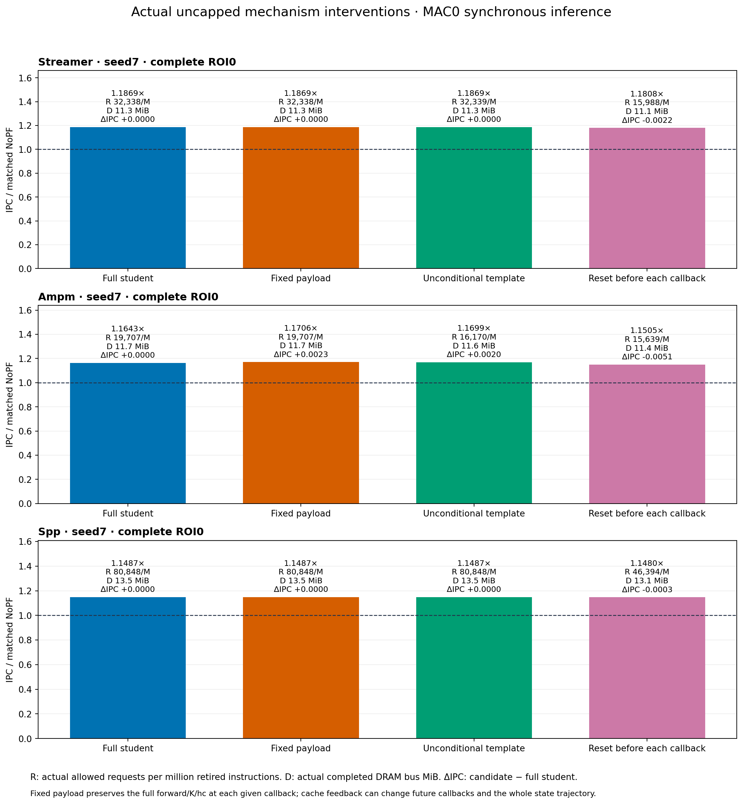
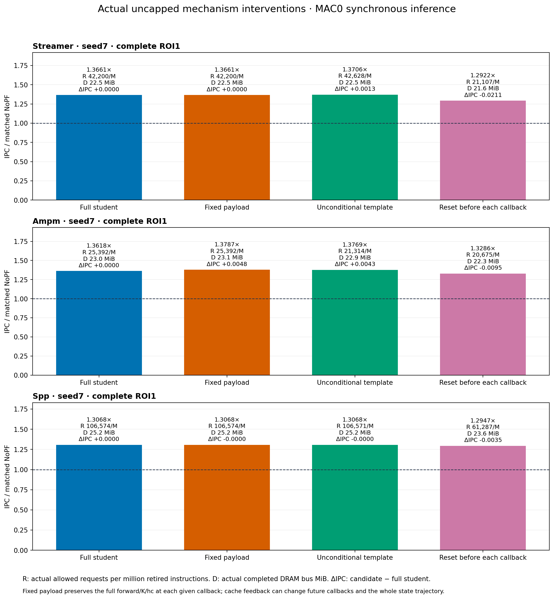
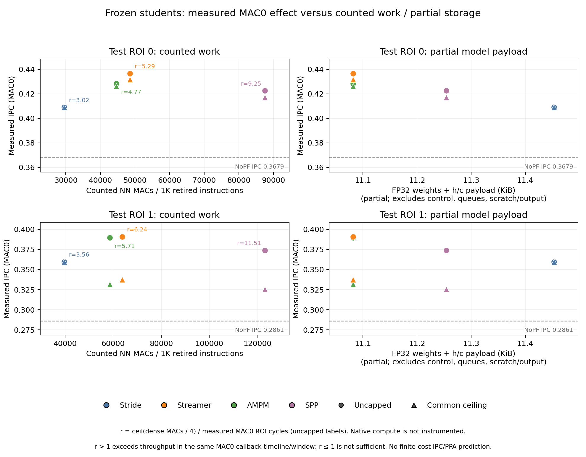

# 602 四路线：完整 live formal 结果与机制结论

**64/64 完整运行与严格数据核对通过，0 失败。** 8 validation +56 test；旧 offline/live/第一轮 formal、gate study 和日志有缺陷的 v1 分别保留。本表只使用 `four602_frozen_live_20261017_v2`。605暂缓。

真实 seed7 checkpoint、冻结权重；MAC0 完整 C++ forward。三个新 student 各自使用原模型，全局 h/c；SPP 实际 demand/raw-fill 回调、预测 L2/LLC 目标均接入。Stride 保留原 per-PC64/decoder32 部署及 current-line filter。三条新模型训练0–20M/8 epochs，Stride0–1M/12 epochs；不能作等训练预算的四算法排名。

ROI0=25–50M（原先已观察的复现），ROI1=75–100M（未来区间）；各有5M NoPF 缓存 warmup，模型保留相应 warmup 状态。validation=20–25M，独立冻结 ceiling=16,144 requests/M 和无PC模板。共同外部 page gate 为 cross_page，native内部 page规则仍保留。

## IPC、实际请求与实际 DRAM

DRAM为实际完成的 controller bus transfers，非 issued×64；R/M为输出门实际允许请求数/百万退休指令，接受/合并/拒绝和实际PQ插入另列在完整CSV。

| 路线 | ROI | ceiling | Native IPC | NN IPC（/NoPF） | NN/native | R/M：Native → NN | DRAM MiB：Native → NN |
|---|---:|---:|---:|---:|---:|---:|---:|
| stride | 0 | 0 | 0.370105 | 0.409015 (1.1119×) | +10.513% | 4833.4 → 9717.2 | 10.857 → 11.014 |
| stride | 0 | 16144 | 0.370105 | 0.409015 (1.1119×) | +10.513% | 4833.4 → 9717.2 | 10.857 → 11.014 |
| streamer | 0 | 0 | 0.431071 | 0.436622 (1.1869×) | +1.288% | 72357.0 → 32338.3 | 11.324 → 11.307 |
| streamer | 0 | 16144 | 0.428172 | 0.431659 (1.1734×) | +0.814% | 16144.0 → 16144.0 | 11.023 → 11.028 |
| ampm | 0 | 0 | 0.430021 | 0.428318 (1.1643×) | -0.396% | 56938.4 → 19707.4 | 11.211 → 11.680 |
| ampm | 0 | 16144 | 0.418974 | 0.426299 (1.1589×) | +1.748% | 16144.0 → 16144.0 | 11.134 → 11.466 |
| spp | 0 | 0 | 0.427730 | 0.422557 (1.1487×) | -1.209% | 90352.5 → 80847.6 | 12.924 → 13.533 |
| spp | 0 | 16144 | 0.423904 | 0.417164 (1.1340×) | -1.590% | 16144.0 → 16144.0 | 12.598 → 12.661 |
| stride | 1 | 0 | 0.318998 | 0.359643 (1.2568×) | +12.742% | 15473.8 → 14337.3 | 20.583 → 21.522 |
| stride | 1 | 16144 | 0.314254 | 0.359643 (1.2568×) | +14.443% | 14105.3 → 14337.3 | 20.580 → 21.522 |
| streamer | 1 | 0 | 0.397788 | 0.390892 (1.3661×) | -1.734% | 93024.0 → 42200.2 | 22.387 → 22.470 |
| streamer | 1 | 16144 | 0.335728 | 0.337604 (1.1798×) | +0.559% | 16144.0 → 16144.0 | 21.489 → 21.646 |
| ampm | 1 | 0 | 0.392795 | 0.389686 (1.3618×) | -0.792% | 71340.6 → 25392.2 | 21.809 → 23.048 |
| ampm | 1 | 16144 | 0.327222 | 0.331607 (1.1589×) | +1.340% | 16144.0 → 16143.6 | 21.485 → 22.412 |
| spp | 1 | 0 | 0.387512 | 0.373941 (1.3068×) | -3.502% | 116475.4 → 106574.2 | 22.638 → 25.223 |
| spp | 1 | 16144 | 0.332809 | 0.325346 (1.1370×) | -2.242% | 16144.0 → 16144.0 | 21.400 → 21.916 |

0表示 uncapped。16组配对9胜7负；无cap为3胜5负，有cap为6胜2负。未来ROI的三个新student无cap均输给各自teacher。所有NN主比较相对NoPF仍有收益；不能把“优于NoPF”写成“优于teacher”。cap是共同上限，不是同实际请求或DRAM流量，尤其Stride的实现、输出和流量与其他路线不同。

## 完整 ROI 的实际机制干预

Full=原student；Fixed=完整forward/K/hc后只替换payload；Template=validation modal K与joint slot delta/fill，无NN、无PC；Reset=每次D/F前清空h/c仍执行完整forward。以下均uncapped，未运行的capped机制结果不作推断。

| 路线 | ROI | Full IPC | Fixed IPC | Template IPC（vs Full） | Reset IPC | Template R/M | Template DRAM MiB |
|---|---:|---:|---:|---:|---:|---:|---:|
| streamer | 0 | 0.436622 | 0.436622 | 0.436622 (+0.000%) | 0.434389 | 32339.0 | 11.307 |
| ampm | 0 | 0.428318 | 0.430609 | 0.430351 (+0.475%) | 0.423210 | 16169.5 | 11.603 |
| spp | 0 | 0.422557 | 0.422557 | 0.422557 (+0.000%) | 0.422286 | 80847.6 | 13.533 |
| streamer | 1 | 0.390892 | 0.390894 | 0.392200 (+0.335%) | 0.369753 | 42628.3 | 22.483 |
| ampm | 1 | 0.389686 | 0.394499 | 0.393989 (+1.104%) | 0.380172 | 21314.3 | 22.935 |
| spp | 1 | 0.373941 | 0.373933 | 0.373933 (-0.002%) | 0.370471 | 106571.2 | 25.223 |

Streamer 的无条件 +1/+2 模板相同或更好；AMPM 的 +8（Fixed罕见第二槽+10）更好；SPP 的 +1…+5/LLC 模板与 full 差不超过0.003%。这些数据不支持复杂 learned payload 是本轮收益必要条件。Reset降低当前NN的IPC，但模板仍能复现主要收益，因此不能据reset损失宣称跨回调状态具有不可替代的优势。不同请求会改变后续cache回调，Fixed只保证给定当前输入/状态时完整forward在替换前执行，不保证整场h/c轨迹相同。

## 动作分布、cohort 与观察量

| Student | ROI | demand / fill callbacks | 全部K分布：K:事件数 | L2 / LLC action数 | current-line / 同列表重复数 |
|---|---:|---:|---|---:|---:|
| streamer | 0 | 404238 / 0 | 1:19; 2:404219 | 808457 / 0 | 0 / 0 |
| ampm | 0 | 404238 / 0 | 1:315792; 2:88446 | 492684 / 0 | 0 / 0 |
| spp | 0 | 404238 / 203176 | 5:404238 | 0 / 2021190 | 0 / 0 |
| streamer | 1 | 532854 / 0 | 1:10702; 2:522152 | 1055006 / 0 | 0 / 0 |
| ampm | 1 | 532858 / 0 | 0:7; 1:430896; 2:101955 | 634806 / 0 | 0 / 0 |
| spp | 1 | 532856 / 350748 | 4:3; 5:532775; 6:78 | 66 / 2664289 | 17 / 27 |

SPP未来ROI实际执行了66个L2目标动作，其他2,664,289个为LLC目标；其K并非数学常数，稀有K4/K6、current-line和duplicates均保留。前三者均不能由一个训练/运行前缀代替全ROI分布。完整原始分类保留每个slot、阶段和目标的allowed、冗余与有用结果。

[全ROI分布](action_histograms_full_roi.csv)、[各阶段分布](action_histograms.csv)、[slot/current-line/duplicate分类与usefulness](classified_requests.csv)保留全部事件，不用前缀外推。SPP fill回调更新h/c但不进入demand动作分母；native SPP K是raw sourcecalls，训练标签按target合并、L2优先，二者不是相同动作列表口径。

L2/LLC派生accuracy分别为ROI结束已观察LOAD useful / 按首次source L2 PQ enqueue意图目标分组的enqueued；timeliness为timely/(timely+late)，coverage为该目标LOAD useful/对应NoPF LOAD misses。后续merge可升级filllevel，最初分组不等于最终filllevel，也不统计request的全层总usefulness。availability不完整则NA，不能混合L2和LLC；pending/resident-unused右删失，unused不称pollution。对应原始分母、miss reduction、接受/合并/拒绝、evicted-unused与未决在[完整指标](per_run.csv)和[字段定义](metric_definitions.json)。

SPP student保留训练时的全部raw L2-fill输入，而native FILTER仅接prefetch fills；native内部same-page规则也未移除。native阈值90/40匹配teacher标签配置；旧第一轮default25的SPP IPC不混入本表。不同有效输入和page规则限制了“只由teacher学习产生差异”的解释。

[累计坐标](progress_snapshots.csv)与[阶段曲线](phase_progress.csv)区分ROI退休指令、L2 LOAD回调与aggregate完成推理数；warmup更新另列。它们不是训练样本数、每PC可见history，也不提供累计曲线首次超过baseline的“最少观察量”。

## 实际字段存储与成本边界

三个新模型FP32权重分别11,284 /11,284 /11,460 B，全局h/c各64 B；主机runtime对象+持久requested heap分别13,204 /13,204 /13,616 B，已含权重和h/c，不能重复相加。观察临时堆峰值仅对应4096真实回调fixture，不是decoder的最坏情况上界。原生字段、排除项、实际v2源码探针见[cost fields](cost_fields.json)与[完整成本说明](../../report/COST.md)。

MAC0没有推理服务延迟、队列、带宽或非线性吞吐约束；三个global模型无强加decoder32或PC表。权重假设常驻，未模拟额外NN权重DRAM读取，不能把MAC×4当权重流量。

假设每CPU cycle4 MAC，三条新student完整MAC工作量/实测MAC0窗口为 **4.77–11.51倍**（dense计数，忽略其他代价）。这说明4 MAC不能在同一MAC0 callback timeline/window内完整服务这些工作量；它不是finite IPC预测。finite执行会改变时间、到达率和可能的admission。原生计算量未测，不作硬件PPA排名。

## 状态、复现与证据

四路线offline/live/旧formal/本轮formal状态见[状态表](route_status.csv)。三个真实checkpoint各4096连续真实callback及边界fixture的Python/C++全部h/c、K、地址/fill动作通过；认证绑定实际构建源码和模型，模型全程冻结。[正式认证](metadata/correctness_gate.json)、[actual build](metadata/build.json)、[冻结selection](metadata/selection.json)、[64行严格审计](audit.json)、[9份完整callback日志核对](callback_verification.json)均保留。

v1缺陷只涉及callback流尾部落盘；旧v1完整运行单独保留，最终主表全部重跑v2。24个可配对v1/v2完成记录的IPC、请求、DRAM及阶段分布精确相同；证据在完整study的reproduction/。旧第一轮formal的101行轻量材料另在Stride dynamic sibling的formal_20261016_v2归档。

[简洁paper story](../../report/PAPER_STORY.md)、[方法边界](../../report/METHOD_LIMITATIONS.md)、[运行与恢复指南](../../README.md)、[原始逐run字段](raw_flat.csv)、[配对干预](paired_comparisons.csv)。完整原始数据本地 `/Users/angelawoo/Documents/CMU/ece/cache/formal_study_20261017/raw_v2/`；服务器 `/home/qianruw/cache/formal_study_20261017/raw_v2/`。大日志、实际源/二进制、模型和callback/snapshot流保留在cache，不进入Git。

