# Four-prefetcher frozen live study

- Status: **PASS**; 64 complete selected runs; 0 checks failed.

- All measured IPC here assumes synchronous zero-cost inference (MAC0).
- Existing true seed7 checkpoints are used; this study does not establish three-seed training robustness or finite-cost IPC gains.
- Streamer/AMPM/SPP training0..20M (8 epochs) and Stride training0..1M (12 epochs balanced) have different budgets; compare each native/student route, not a matched learning-algorithm ranking.
- Training coordinates are separate from online recurrent state history.
- SPP model labels canonicalize duplicate targets with L2 priority, while native generated K counts raw source calls.
- A fixed-payload intervention preserves each given callback's complete forward/K/hc update, but changed cache feedback can change future callbacks and the full state trajectory.
- Tests25..50M were already inspected in prior work;75..100M is a distinct future interval.
- Native SPP preserves prefetch-fill FILTER callbacks; its student's training interface observes every raw L2-fill callback, so equal effective input is not claimed.

| Policy | ROI | Seed | Method | Ceiling | IPC / NoPF | Allowed / M instructions | L2 LOAD accuracy | LLC LOAD accuracy |
|---|---:|---:|---|---:|---:|---:|---:|---:|
| ampm | 0 | 7 | student | 0 | 1.16435 | 19707.35764 | 0.36865 | NA |
| ampm | 0 | 7 | student | 16144 | 1.15886 | 16143.95806 | 0.44062 | NA |
| spp | 0 | 7 | student | 0 | 1.14869 | 80847.59030 | NA | 0.09851 |
| spp | 0 | 7 | student | 16144 | 1.13402 | 16143.95806 | NA | 0.47105 |
| streamer | 0 | 7 | student | 0 | 1.18692 | 32338.27612 | 0.24566 | NA |
| streamer | 0 | 7 | student | 16144 | 1.17343 | 16143.95806 | 0.47354 | NA |
| stride | 0 | 7 | stride_student | 0 | 1.11187 | 9717.23883 | 0.48677 | NA |
| stride | 0 | 7 | stride_student | 16144 | 1.11187 | 9717.15883 | 0.48678 | NA |
| ampm | 1 | 7 | student | 0 | 1.36184 | 25392.23797 | 0.46553 | NA |
| ampm | 1 | 7 | student | 16144 | 1.15887 | 16143.63871 | 0.45971 | NA |
| spp | 1 | 7 | student | 0 | 1.30681 | 106574.19147 | 0.98485 | 0.12437 |
| spp | 1 | 7 | student | 16144 | 1.13699 | 16143.95871 | 0.92857 | 0.48961 |
| streamer | 1 | 7 | student | 0 | 1.36605 | 42200.23662 | 0.31603 | NA |
| streamer | 1 | 7 | student | 16144 | 1.17983 | 16143.95871 | 0.50074 | NA |
| stride | 1 | 7 | stride_student | 0 | 1.25685 | 14337.31885 | 0.66913 | NA |
| stride | 1 | 7 | stride_student | 16144 | 1.25685 | 14337.27885 | 0.66914 | NA |

| Claim | Evidence status | Scope |
|---|---|---|
| Existing teacher-action students execute independently online | Supported within the stated scope | Exact exported weights and separate parity evidence required; new formal complete rows in per_run.csv |
| Students uniformly outperform native teachers | Not supported | 9 positive / 7 negative of 16 actual paired comparisons; every ROI/cap retained in paired_comparisons.csv |
| Learned gate, payload and state explain performance | Unverified | Read actual fixed_payload/template/reset_state interventions individually; labels alone are not causal evidence |
| Benefits survive finite inference resources | Unverified | MAC4 outputs are analytical work estimates only; no finite-cost IPC simulation in this protocol |
| Independent training seed robustness | Unverified | Existing seed7 only; no size sweep mislabeled as seeds |

- L2 and LLC target accuracy/timeliness use separate LOAD-only cohorts. L2 usefulness coverage is a target-subset opportunity ratio when LLC requests exist; it is not total SPP coverage. LLC availability false produces NA. Actual completed DRAM bytes, bus starts, queue arrivals and pending boundary work are separately retained. Unused requests are not called pollution.

- Raw inputs are read-only. The full raw snapshot JSON is retained in raw_snapshots.json. No replay/live or old/new protocol IPC is cross-compared.

## Route evidence

| Policy | Route | Status | Evidence |
|---|---|---|---|
| stride | offline | previously_completed | ../602_offline_lstm_stride/README.md |
| stride | live | previously_completed_and_regenerated | ../602_lstm_stride_dynamic_inference/runtime/FORWARD_REPRODUCTION.md |
| stride | old_formal | previously_completed_archived | ../602_lstm_stride_dynamic_inference/results/formal_20261016_v2/README.md |
| stride | new_formal | completed_4_formal_runs | results/formal_20261017/per_run.csv |
| streamer | offline | previously_completed | ../602_offline_lstm_streamer/README.md |
| streamer | live | newly_implemented_and_parity_verified | ../602_lstm_streamer_live_inference/README.md |
| streamer | old_formal | not_previously_run | Not supplied |
| streamer | new_formal | completed_4_formal_runs | results/formal_20261017/per_run.csv |
| ampm | offline | previously_completed | ../602_offline_lstm_ampm/README.md |
| ampm | live | newly_implemented_and_parity_verified | ../602_lstm_ampm_live_inference/README.md |
| ampm | old_formal | not_previously_run | Not supplied |
| ampm | new_formal | completed_4_formal_runs | results/formal_20261017/per_run.csv |
| spp | offline | previously_completed | ../602_offline_lstm_spp/README.md |
| spp | live | newly_implemented_and_parity_verified | ../602_lstm_spp_live_inference/README.md |
| spp | old_formal | native_reference_only | ../602_lstm_stride_dynamic_inference/results/formal_20261016_v2/README.md |
| spp | new_formal | completed_4_formal_runs | results/formal_20261017/per_run.csv |

- Plot status: generated. Callback logs checked: True. Incomplete callback logs are not reconstructed or extrapolated.

## Outputs

- [Per-run complete metrics](per_run.csv), [all raw fields](raw_flat.csv), [paired contrasts](paired_comparisons.csv), [audit](audit.json), [definitions](metric_definitions.json), [route evidence](route_status.csv), [selection verification](selection_verification.json).

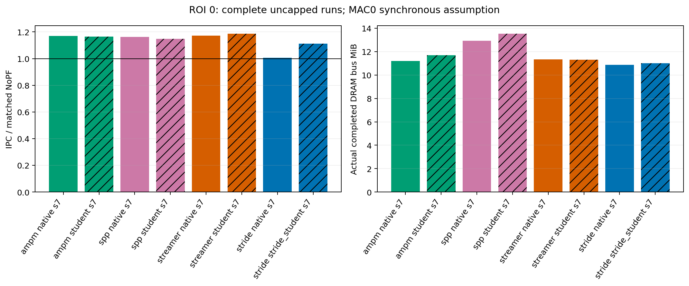
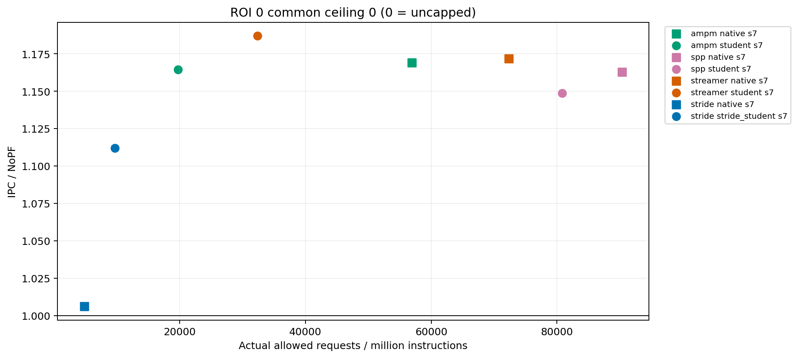
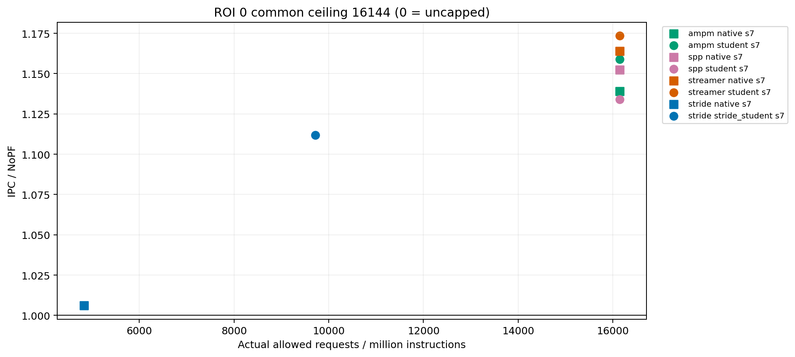
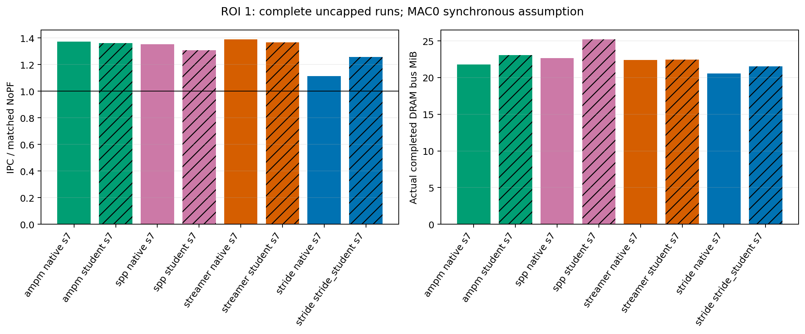
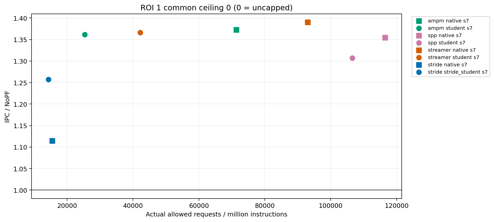
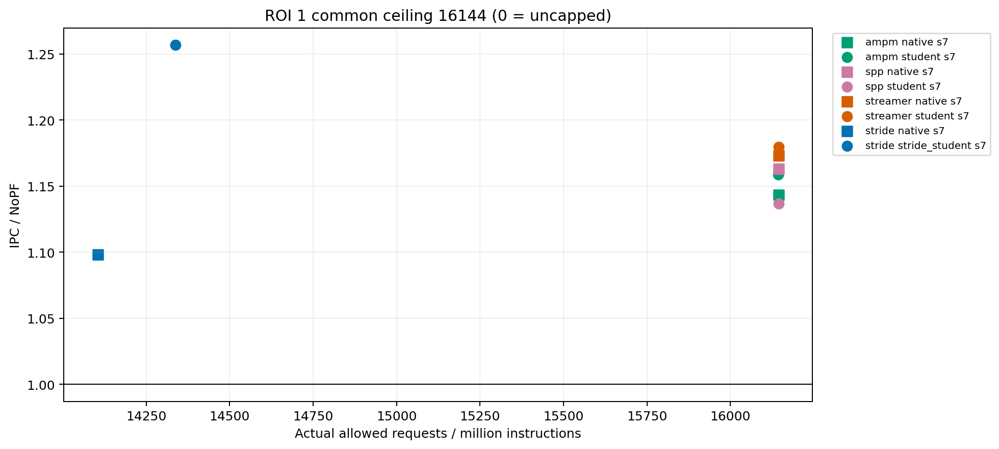
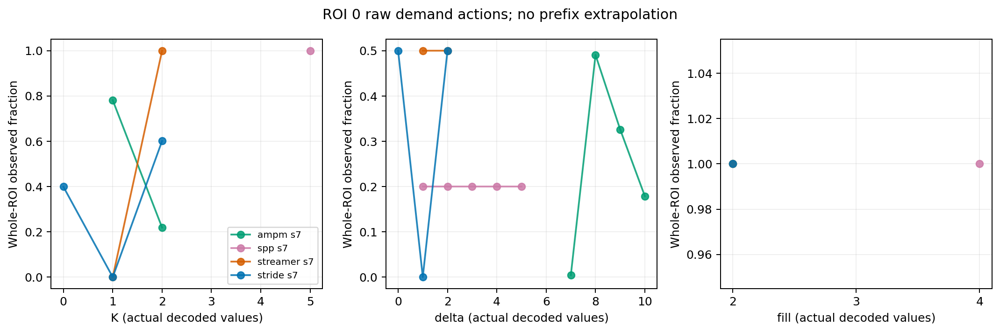
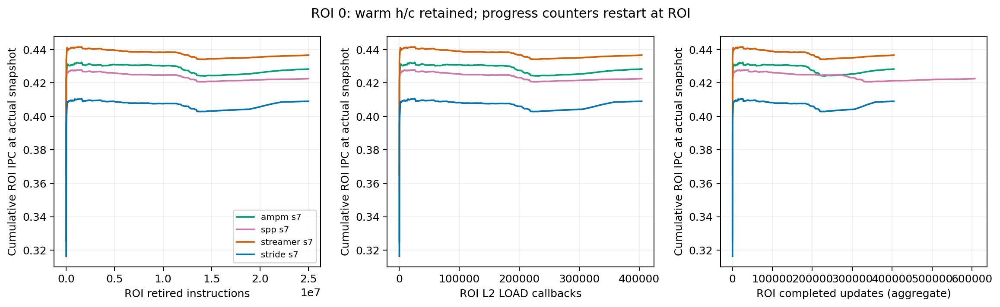
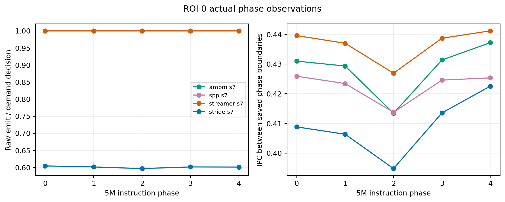
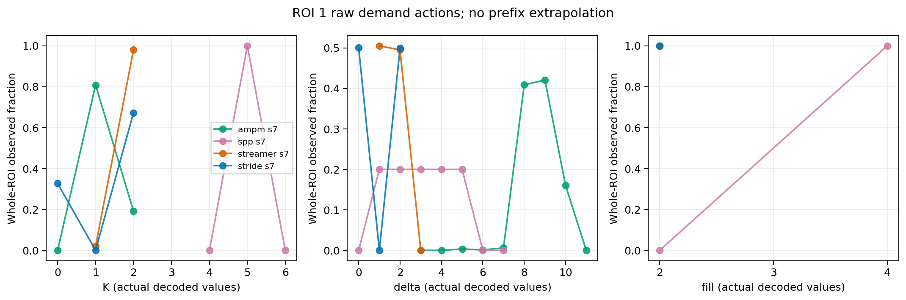
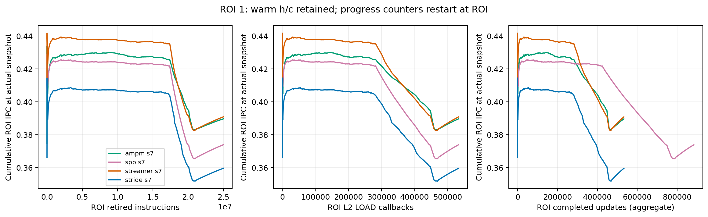
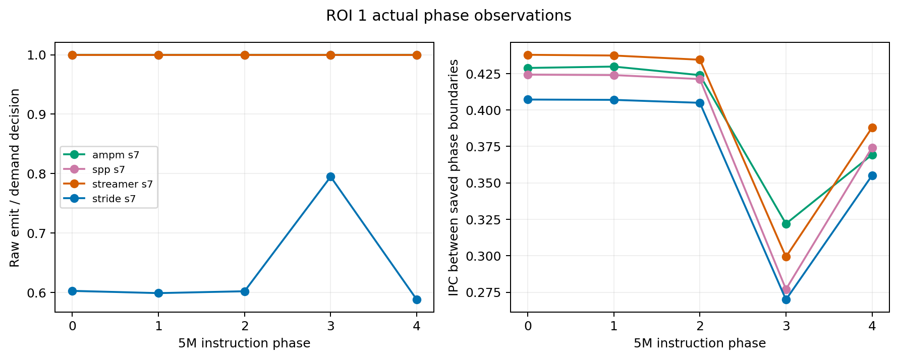

