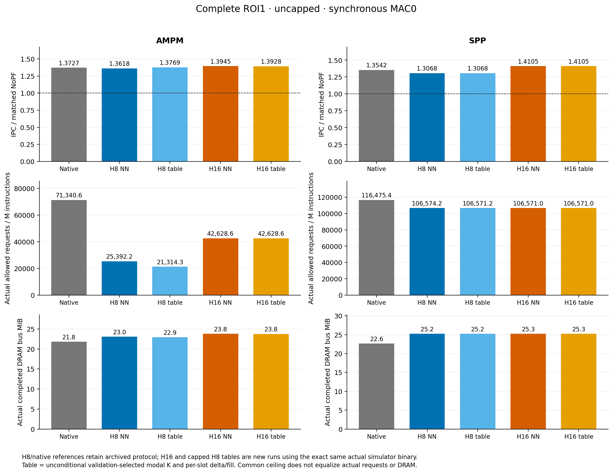
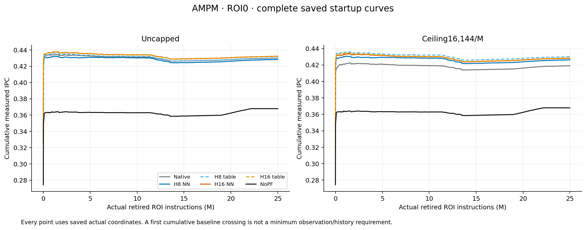
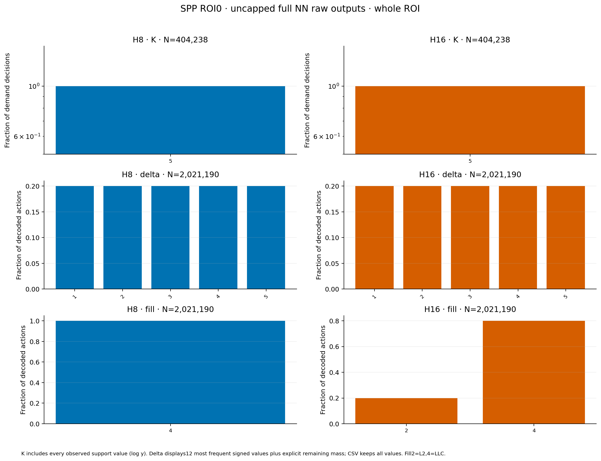
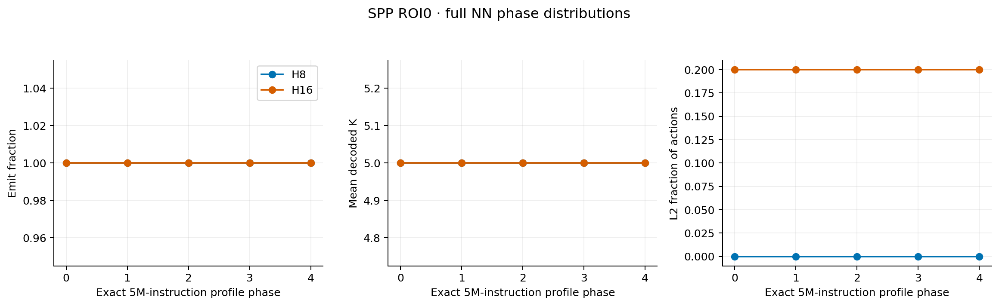
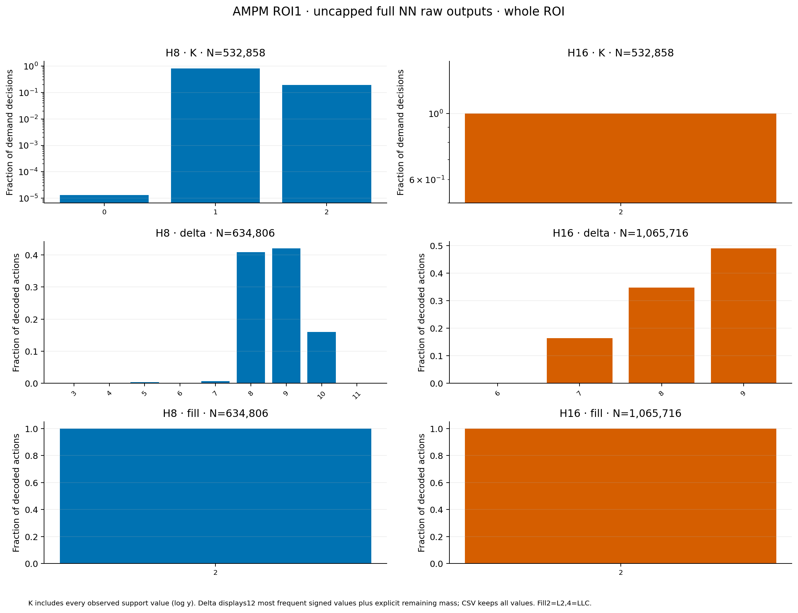
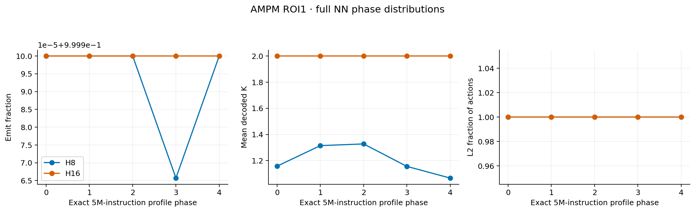
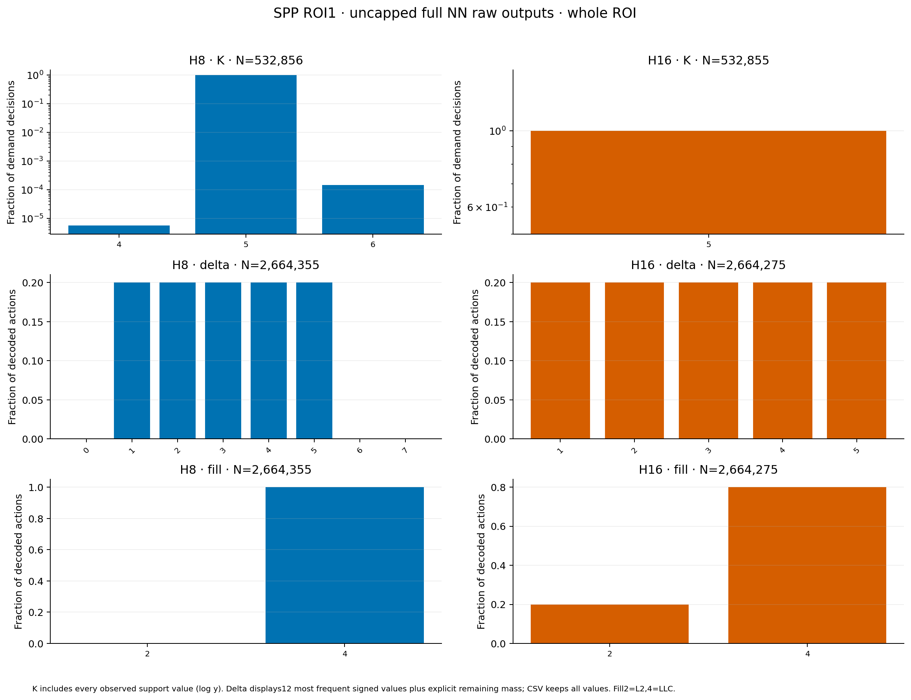

# Width and unconditional-template supplemental study

Status: **PASS**. New complete runs: 24/24 (22 test + 2 validation required). Archived 64-row dataset is retained separately with its original protocol.

All measured IPC uses synchronous MAC0 inference. H16 uses retained real seed7 checkpoints, not retraining or extra seeds. H16 templates use only their own full20–25M validation outputs. H8 capped templates reuse the original validation-selected H8 tables. Cap16144 is inherited unchanged; it does not equalize realized traffic.

| Policy | Width | ROI | Arm | Cap | IPC / NoPF | Actual requests/M | DRAM MiB | L2 LOAD accuracy | LLC LOAD accuracy |
|---|---:|---:|---|---:|---:|---:|---:|---:|---:|
| ampm | 8 | 0 | template | 16144 | 1.16922 | 16130.24 | 11.570 | 0.46886 | NA |
| ampm | 16 | 0 | student | 0 | 1.17520 | 32339.04 | 11.845 | 0.23546 | NA |
| ampm | 16 | 0 | student | 16144 | 1.16407 | 16143.96 | 11.474 | 0.45238 | NA |
| ampm | 16 | 0 | template | 0 | 1.17478 | 32339.04 | 11.834 | 0.23502 | NA |
| ampm | 16 | 0 | template | 16144 | 1.16506 | 16143.96 | 11.476 | 0.45512 | NA |
| ampm | 8 | 1 | template | 16144 | 1.16993 | 16101.84 | 22.447 | 0.48880 | NA |
| ampm | 16 | 1 | student | 0 | 1.39453 | 42628.64 | 23.806 | 0.29296 | NA |
| ampm | 16 | 1 | student | 16144 | 1.15921 | 16143.96 | 22.427 | 0.46744 | NA |
| ampm | 16 | 1 | template | 0 | 1.39279 | 42628.64 | 23.764 | 0.29224 | NA |
| ampm | 16 | 1 | template | 16144 | 1.15939 | 16143.96 | 22.423 | 0.46880 | NA |
| spp | 8 | 0 | template | 16144 | 1.13402 | 16143.96 | 12.661 | NA | 0.47105 |
| spp | 16 | 0 | student | 0 | 1.18674 | 80847.59 | 13.537 | 0.48974 | 0.00061 |
| spp | 16 | 0 | student | 16144 | 1.16865 | 16143.96 | 12.663 | 0.66784 | 0.03355 |
| spp | 16 | 0 | template | 0 | 1.18674 | 80847.59 | 13.537 | 0.48974 | 0.00061 |
| spp | 16 | 0 | template | 16144 | 1.16865 | 16143.96 | 12.663 | 0.66784 | 0.03355 |
| spp | 8 | 1 | template | 16144 | 1.13698 | 16143.96 | 21.915 | NA | 0.48964 |
| spp | 16 | 1 | student | 0 | 1.41046 | 106570.99 | 25.258 | 0.61871 | 0.00240 |
| spp | 16 | 1 | student | 16144 | 1.17995 | 16143.96 | 21.326 | 0.68496 | 0.08438 |
| spp | 16 | 1 | template | 0 | 1.41046 | 106570.99 | 25.258 | 0.61871 | 0.00240 |
| spp | 16 | 1 | template | 16144 | 1.17995 | 16143.96 | 21.326 | 0.68496 | 0.08438 |
| streamer | 8 | 0 | template | 16144 | 1.17343 | 16143.96 | 11.028 | 0.47355 | NA |
| streamer | 8 | 1 | template | 16144 | 1.17977 | 16143.96 | 21.649 | 0.50071 | NA |

| Actual NN | FP32 weights B | h/c B | Object + persistent requested heap B | Observed extra Infer heap peak B |
|---|---:|---:|---:|---:|
| ampm H8 | 11284 | 64 | 13204 | 628 |
| ampm H16 | 26612 | 128 | 28596 | 884 |
| spp H8 | 11460 | 64 | 13616 | 924 |
| spp H16 | 26436 | 128 | 28656 | 1148 |
| streamer H8 | 11284 | 64 | 13204 | 628 |

Host persistent measurement already includes weights and h/c; do not add them again. H8 heap peaks cover its recorded4096 real callbacks; H16 covers4096 real callbacks plus8/16 documented boundaries. Neither is an all-degree worst-case bound. Outer Four602/controller/observer, stack, allocator metadata, RSS and hardware PPA are excluded.

| Frozen table | Retained slots | Essential prediction fields B | Actual Action scalar fields + modalK B | Padded logical Action array + modalK B |
|---|---:|---:|---:|---:|
| ampm H8 | 2 | 32 | 64 | 72 |
| ampm H16 | 2 | 32 | 64 | 72 |
| spp H8 | 5 | 68 | 148 | 168 |
| spp H16 | 5 | 68 | 148 | 168 |
| streamer H8 | 2 | 32 | 64 | 72 |

The essential payload is a semantic lower-level field inventory, not the current host allocation. Actual Action has address/delta/fill/fill_index/coordinate fields and32B ABI size. Vector descriptor/capacity/slack and outer control are unmeasured; no complete hardware table size is claimed.

| Claim | Evidence status | Evidence and limit |
|---|---|---|
| H16 uniformly improves over H8 | 数据支持（仅本矩阵） | 8 positive, 0 negative, 0 tied; all paired ROI/cap cases retained. Width comparisons use the same existing seed, not independent seed robustness. |
| Learned payload/state is necessary for the observed benefit | 未支持 | Unconditional template vs full NN: 8 positive, 5 negative, 7 tied. A template near/better than NN is a negative result for necessity; failure to match does not itself establish stateful novelty. |
| Gains survive finite compute | 待验证 | MAC0 IPC only. MAC4 aggregate dense work/window is a necessary throughput estimate, without queue, latency, nonlinear throughput or finite IPC simulation. |
| Three independently trained seeds generalize | 待验证 | Existing seed7 only, one workload, two distinct complete25M ROIs. |

L2/LLC target cohorts remain separate. Accuracy is target LOAD-useful/enqueued; timeliness is timely LOAD-useful/all LOAD-useful. Useful/NoPF-misses is an opportunity ratio, not causal total coverage. LLC metrics become NA when tracking is incomplete. Pending/resident-unused and evicted-unused remain distinct; unused is not pollution. DRAM is actual completed controller bus bytes, never requests×64.

Native SPP FILTER retains prefetch-fill-only feedback; student SPP consumes all raw L2 fill callbacks. Same effective input is not claimed. Full ROI25–50M was already inspected before this supplement;75–100M remains a distinct interval but the supplement is post-inspection analysis. No prefix stands for a whole ROI. The startup plots do not identify a minimum history by first baseline crossing.

[New runs](per_run_new.csv), [all explicitly labeled rows](per_run.csv), [unaltered original64 CSV](reference_per_run_original.csv), [paired contrasts](paired_comparisons.csv), [audit](audit.json), [template selection checks](selection_verification.json), [callback checks](callback_verification.json), [storage/cost](storage_cost.csv).

[One-page paper story](PAPER_STORY.md)

