# Supplementary evidence: Width and unconditional-template supplemental study

- **Read first:** [project overview](../../../RESULTS_INDEX.md) · [four-route native-versus-own-NN results](README.md), including IPC, accuracy, coverage, timeliness and Pareto comparisons.
- **This page:** Secondary width/template findings, detailed numerical tables and the original figure gallery; these do not replace the four-route comparison.

- Status: **PASS**. New complete runs: 24/24 (22 test + 2 validation required). Archived 64-row dataset is retained separately with its original protocol.

- All measured IPC uses synchronous MAC0 inference. H16 uses retained real seed7 checkpoints, not retraining or extra seeds. H16 templates use only their own full20–25M validation outputs. H8 capped templates reuse the original validation-selected H8 tables. Cap16144 is inherited unchanged; it does not equalize realized traffic.

| Policy | Width | ROI | Arm | Cap | IPC / NoPF | Actual requests/M | DRAM MiB | L2 LOAD accuracy | LLC LOAD accuracy |
|---|---:|---:|---|---:|---:|---:|---:|---:|---:|
| ampm | 8 | 0 | template | 16144 | 1.16922 | 16130.24 | 11.570 | 0.46886 | NA |
| ampm | 16 | 0 | student | 0 | 1.17520 | 32339.04 | 11.845 | 0.23546 | NA |
| ampm | 16 | 0 | student | 16144 | 1.16407 | 16143.96 | 11.474 | 0.45238 | NA |
| ampm | 16 | 0 | template | 0 | 1.17478 | 32339.04 | 11.834 | 0.23502 | NA |
| ampm | 16 | 0 | template | 16144 | 1.16506 | 16143.96 | 11.476 | 0.45512 | NA |
| ampm | 8 | 1 | template | 16144 | 1.16993 | 16101.84 | 22.447 | 0.48880 | NA |
| ampm | 16 | 1 | student | 0 | 1.39453 | 42628.64 | 23.806 | 0.29296 | NA |
| ampm | 16 | 1 | student | 16144 | 1.15921 | 16143.96 | 22.427 | 0.46744 | NA |
| ampm | 16 | 1 | template | 0 | 1.39279 | 42628.64 | 23.764 | 0.29224 | NA |
| ampm | 16 | 1 | template | 16144 | 1.15939 | 16143.96 | 22.423 | 0.46880 | NA |
| spp | 8 | 0 | template | 16144 | 1.13402 | 16143.96 | 12.661 | NA | 0.47105 |
| spp | 16 | 0 | student | 0 | 1.18674 | 80847.59 | 13.537 | 0.48974 | 0.00061 |
| spp | 16 | 0 | student | 16144 | 1.16865 | 16143.96 | 12.663 | 0.66784 | 0.03355 |
| spp | 16 | 0 | template | 0 | 1.18674 | 80847.59 | 13.537 | 0.48974 | 0.00061 |
| spp | 16 | 0 | template | 16144 | 1.16865 | 16143.96 | 12.663 | 0.66784 | 0.03355 |
| spp | 8 | 1 | template | 16144 | 1.13698 | 16143.96 | 21.915 | NA | 0.48964 |
| spp | 16 | 1 | student | 0 | 1.41046 | 106570.99 | 25.258 | 0.61871 | 0.00240 |
| spp | 16 | 1 | student | 16144 | 1.17995 | 16143.96 | 21.326 | 0.68496 | 0.08438 |
| spp | 16 | 1 | template | 0 | 1.41046 | 106570.99 | 25.258 | 0.61871 | 0.00240 |
| spp | 16 | 1 | template | 16144 | 1.17995 | 16143.96 | 21.326 | 0.68496 | 0.08438 |
| streamer | 8 | 0 | template | 16144 | 1.17343 | 16143.96 | 11.028 | 0.47355 | NA |
| streamer | 8 | 1 | template | 16144 | 1.17977 | 16143.96 | 21.649 | 0.50071 | NA |

| Actual NN | FP32 weights B | h/c B | Object + persistent requested heap B | Observed extra Infer heap peak B |
|---|---:|---:|---:|---:|
| ampm H8 | 11284 | 64 | 13204 | 628 |
| ampm H16 | 26612 | 128 | 28596 | 884 |
| spp H8 | 11460 | 64 | 13616 | 924 |
| spp H16 | 26436 | 128 | 28656 | 1148 |
| streamer H8 | 11284 | 64 | 13204 | 628 |

- Host persistent measurement already includes weights and h/c; do not add them again. H8 heap peaks cover its recorded4096 real callbacks; H16 covers4096 real callbacks plus8/16 documented boundaries. Neither is an all-degree worst-case bound. Outer Four602/controller/observer, stack, allocator metadata, RSS and hardware PPA are excluded.

| Frozen table | Retained slots | Essential prediction fields B | Actual Action scalar fields + modalK B | Padded logical Action array + modalK B |
|---|---:|---:|---:|---:|
| ampm H8 | 2 | 32 | 64 | 72 |
| ampm H16 | 2 | 32 | 64 | 72 |
| spp H8 | 5 | 68 | 148 | 168 |
| spp H16 | 5 | 68 | 148 | 168 |
| streamer H8 | 2 | 32 | 64 | 72 |

- The essential payload is a semantic lower-level field inventory, not the current host allocation. Actual Action has address/delta/fill/fill_index/coordinate fields and32B ABI size. Vector descriptor/capacity/slack and outer control are unmeasured; no complete hardware table size is claimed.

| Claim | Evidence status | Evidence and limit |
|---|---|---|
| H16 improves over H8 in the measured pairs | Supported in this matrix | 8 positive, 0 negative, 0 tied; all paired ROI/cap cases retained. Width comparisons use the same existing seed, not independent seed robustness. |
| Learned payload/state is necessary for the observed benefit | Not supported | Unconditional template vs full NN: 8 positive, 5 negative, 7 tied. A template near/better than NN is a negative result for necessity; failure to match does not itself establish stateful novelty. |
| Gains survive finite compute | Unverified | MAC0 IPC only. ceil(counted dense MACs / 4) / measured MAC0 ROI cycles is a necessary throughput estimate, without queue, latency, nonlinear throughput or finite IPC simulation. |
| Three independently trained seeds generalize | Unverified | Existing seed7 only, one workload, two distinct complete25M ROIs. |

- L2/LLC target cohorts remain separate. Accuracy is target LOAD-useful/enqueued; timeliness is timely LOAD-useful/all LOAD-useful. Useful/NoPF-misses is an opportunity ratio, not causal total coverage. LLC metrics become NA when tracking is incomplete. Pending/resident-unused and evicted-unused remain distinct; unused is not pollution. DRAM is actual completed controller bus bytes, never requests×64.

- Native SPP FILTER retains prefetch-fill-only feedback; student SPP consumes all raw L2 fill callbacks. Same effective input is not claimed. Full ROI25–50M was already inspected before this supplement;75–100M remains a distinct interval but the supplement is post-inspection analysis. No prefix stands for a whole ROI. The startup plots do not identify a minimum history by first baseline crossing.

- [New runs](per_run_new.csv), [all explicitly labeled rows](per_run.csv), [unaltered original64 CSV](reference_per_run_original.csv), [paired contrasts](paired_comparisons.csv), [audit](audit.json), [template selection checks](selection_verification.json), [callback checks](callback_verification.json), [storage/cost](storage_cost.csv).

- [One-page paper story](PAPER_STORY.md)

## Detailed H16 and capped-template comparisons

- Supplemental status: **24/24 full runs verified; 9,748 checks, zero failures** (2 validation, 16 H16 test and 6 capped H8-template test runs). The 64 reused references retain their original protocol identities.
- These retained supplemental tables support the [four-route reader report](README.md); they do not replace its H8 native-versus-own-NN comparison. Models, protocols and negative outcomes retain their original scopes.

### H16 versus native and H8

- H16 wins **8/8 against native and 8/8 against its H8 NN**, within this MAC0/602/seed7 matrix. Native-relative IPC gains are AMPM **0.5320%–2.2054%** and SPP **1.4146%–4.1512%**.
- These are paired live results. Old replay IPC is not substituted into the comparison.

| Model | ROI | Cap | Native IPC | H16 NN IPC | Own template IPC | NN/native | NN/template |
|---|---:|---:|---:|---:|---:|---:|---:|
| AMPM | 0 | 0 | 0.430021 | 0.432309 | 0.432157 | +0.5320% | +0.0351% |
| AMPM | 0 | 16144 | 0.418974 | 0.428215 | 0.428582 | +2.2054% | -0.0857% |
| AMPM | 1 | 0 | 0.392795 | 0.399042 | 0.398544 | +1.5903% | +0.1248% |
| AMPM | 1 | 16144 | 0.327222 | 0.331705 | 0.331756 | +1.3698% | -0.0154% |
| SPP | 0 | 0 | 0.427730 | 0.436556 | 0.436556 | +2.0634% | +0.0000% |
| SPP | 0 | 16144 | 0.423904 | 0.429901 | 0.429901 | +1.4146% | +0.0000% |
| SPP | 1 | 0 | 0.387512 | 0.403598 | 0.403598 | +4.1512% | +0.0000% |
| SPP | 1 | 16144 | 0.332809 | 0.337639 | 0.337639 | +1.4515% | +0.0000% |

- SPP's template matches all four measured performance/traffic cases. AMPM NN is only **0.0351% / 0.1248%** better uncapped and **0.0857% / 0.0154%** worse capped. Those residuals do not isolate a recurrent-state contribution.
- The capped AMPM H8 template also beats the H16 template; larger width is not uniformly better for every deployment.

### Capped H8 template interventions

- Tables contain address-relative K/delta/fill, without PC or NN state. All three H8 tables reuse the original frozen validation selection byte for byte.
- Each row covers a full 25M ROI. Positive template/NN values favor the template.

| Model | ROI | NN IPC | Template IPC | Template/NN | Actual requests/M: NN / template | DRAM MiB: NN / template |
|---|---:|---:|---:|---:|---:|---:|
| STREAMER | 0 | 0.431659 | 0.431661 | +0.0004% | 16143.96 /16143.96 | 11.028 /11.028 |
| STREAMER | 1 | 0.337604 | 0.337587 | -0.0051% | 16143.96 /16143.96 | 21.646 /21.649 |
| AMPM | 0 | 0.426299 | 0.430109 | +0.8939% | 16143.96 /16130.24 | 11.466 /11.570 |
| AMPM | 1 | 0.331607 | 0.334771 | +0.9542% | 16143.64 /16101.84 | 22.412 /22.447 |
| SPP | 0 | 0.417164 | 0.417164 | +0.0000% | 16143.96 /16143.96 | 12.661 /12.661 |
| SPP | 1 | 0.325346 | 0.325345 | -0.0006% | 16143.96 /16143.96 | 21.916 /21.915 |

- Streamer differs by at most **0.0052%** and SPP by **0.0006%**. AMPM templates improve IPC by **0.8939% / 0.9542%**, with fewer requests.
- This is an actual no-NN intervention. Failure of a PC table or template to match every case would not establish stateful novelty. The H8 losses against native remain in the evidence.

### Traffic penalties and exact payload observations

- The common cap is an upper limit, not equal actual submissions, acceptance or DRAM. H8 AMPM tables do not always exhaust it; equal request counts can still produce different DRAM.
- Uncapped SPP H16 submits fewer requests than native SPP but increases DRAM by **4.74% / 11.57%** in ROI0/ROI1.
- Capping lowers H16's absolute future-ROI IPC by **16.87% for AMPM** and **16.34% for SPP**. These negative results are retained.
- Full-validation H16 selections are AMPM **K2: (+9,L2), (+8,L2)** and SPP **K5: (+1,L2), (+2..+5,LLC)**.
- Across all **404,238 ROI0** and **532,855 ROI1** uncapped SPP H16 demand events, emit/K and each slot's delta/fill equal that template. This is an empirical fact for the complete ROIs, not a guarantee for all inputs.
- CSVs retain complete and phase-level K support, rare delta/fill, current-line/duplicate/slot classes, and allowed/redundant/useful counts.

- Full-ROI **ceil(counted MACs/4) / measured MAC0 cycles** is **12.95 / 15.75 for AMPM** and **23.95 / 31.15 for SPP**. Four MACs/cycle cannot serve all counted work within those same MAC0 windows, even before other costs; this necessary throughput condition does not predict finite-resource IPC.

### Retained width/template mechanism claims

| Statement | Evidence status | Measured support / limit |
| --- | --- | --- |
| H16 improves over H8 in the measured pairs | Supported in this matrix | 8 positive / 0 negative / 0 tied; IPC change +0.0295% to +7.9310%. Same seed/data/training budget within policy; no independent-seed claim. |
| Learned payload/state is universally necessary for the full-NN benefit | Not supported | H16 unconditional table vs NN: 2 positive / 2 negative / 4 tied; IPC change -0.1247% to +0.0858%. Failure of one table to match is not proof of stateful novelty. |

- These are retained independently trained widths, not a newly paired retraining or independent-seed experiment. Small residuals do not isolate a recurrent-state contribution.

### Supplemental runs and inventory

| Route | New completed runs | Preserved history |
|---|---|---|
| Stride | 0; original per-PC frozen reference retained | Offline/live/formal/gate; 13 reference rows |
| Streamer H8 | 2 capped-template tests | H8 model, NoPF/native/live/template |
| AMPM H8/H16 | 11 full runs | Original v7 H8/H16 checkpoints and replay |
| SPP H8/H16 | 11 full runs | Empirical-prior H8/H16, fill-aware replay, v1/v2 |

- The recorded raw sync checked **345 server files / 176,314,065 bytes**, with all paths/sizes equal. Later local analysis, figures and arithmetic checks are separate from that inventory. Builds, traces and large logs stay local/server; no hash ledger is introduced.

- Old replay initialization, generation/loading/matching/emission chains, source identities and corrected denominators remain in the [historical alignment](../../../formal_NN_training/experiments/602_four_prefetcher_formal/width_templates/EVIDENCE_ALIGNMENT.md) and its [detailed evidence appendix](../../../formal_NN_training/experiments/602_four_prefetcher_formal/width_templates/EVIDENCE_ALIGNMENT_APPENDIX.md). Old replay IPC is not a live comparator.

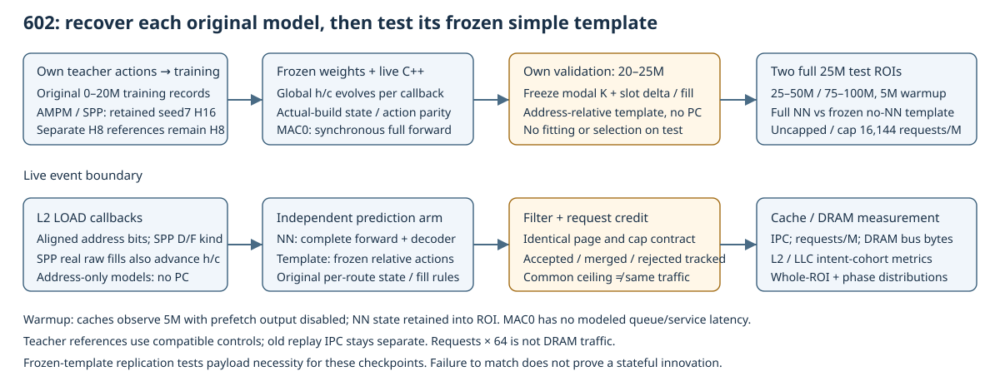

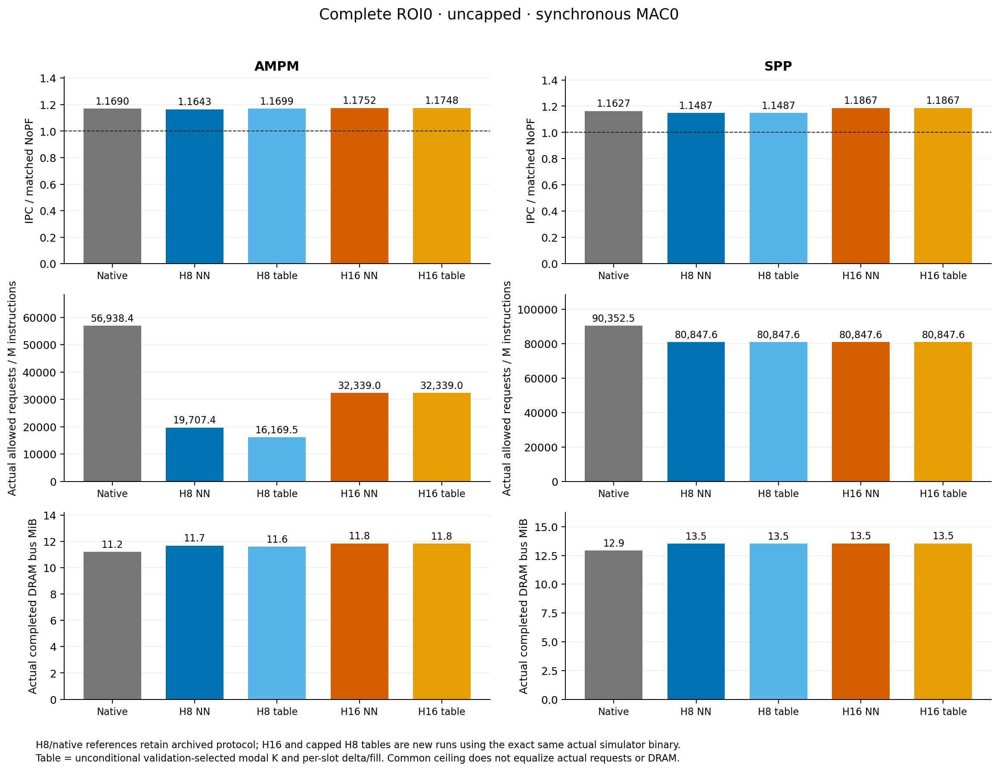
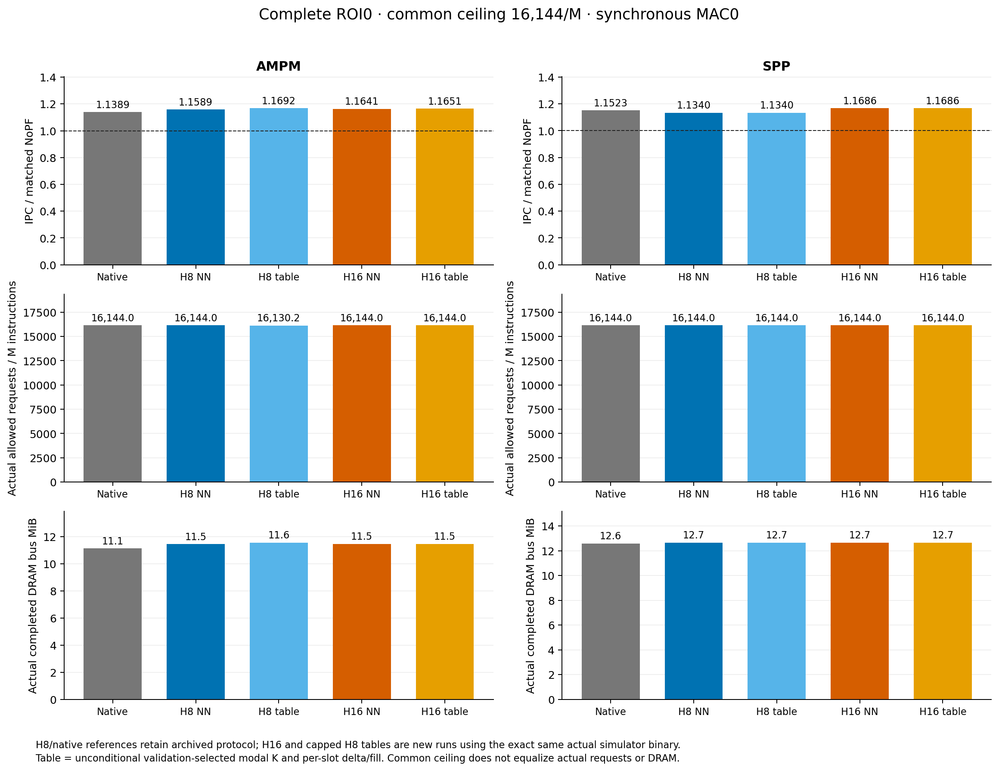

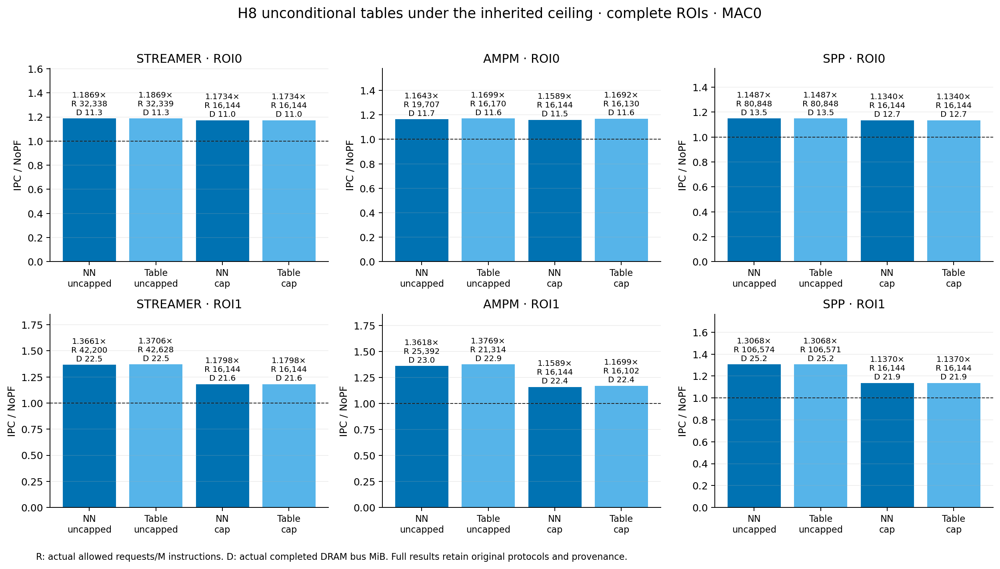
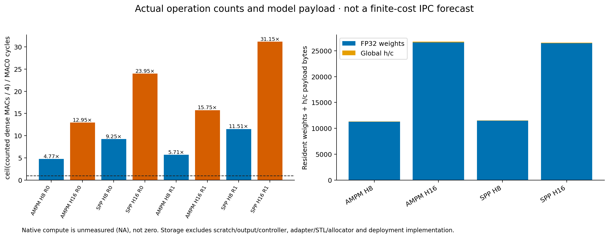

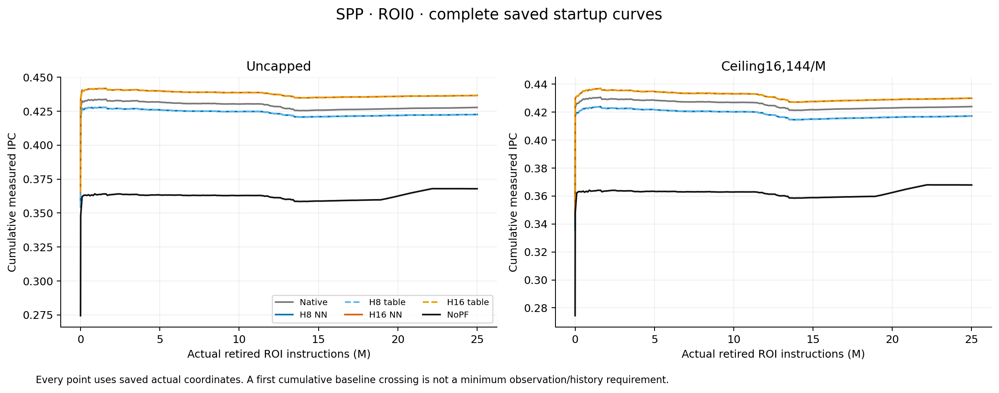
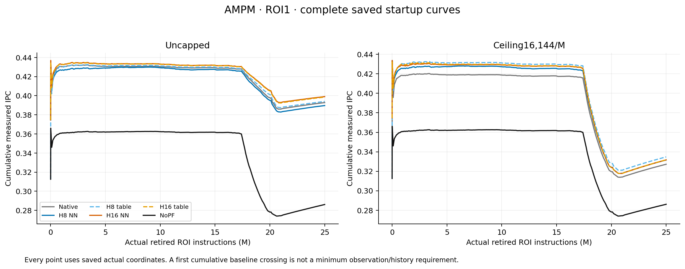
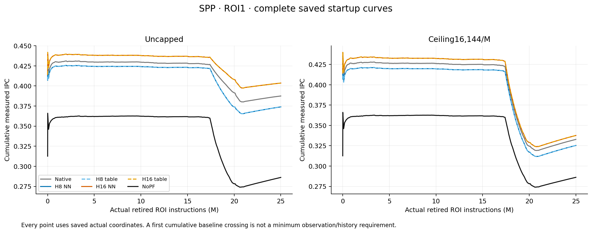
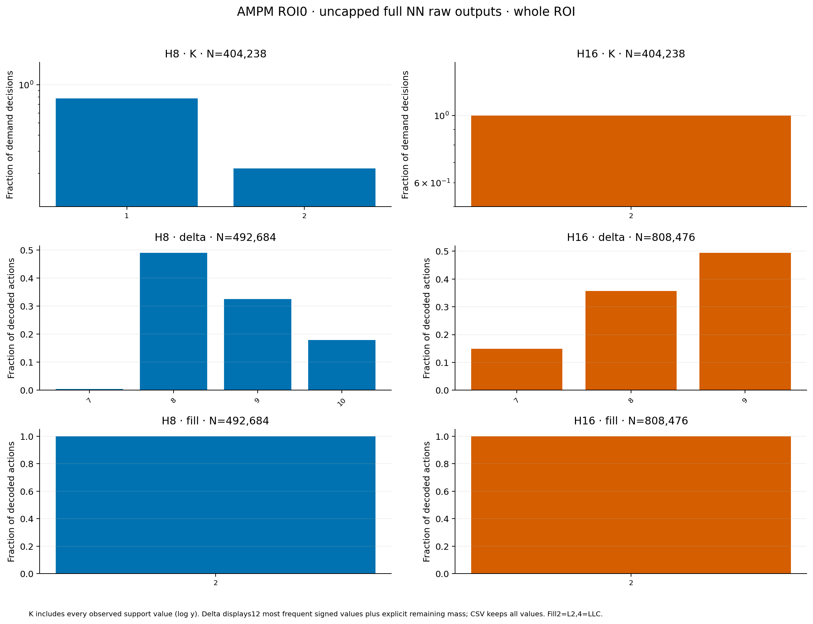
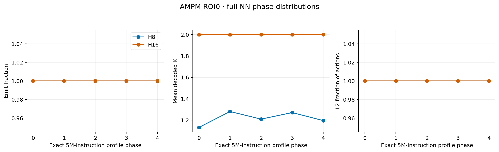

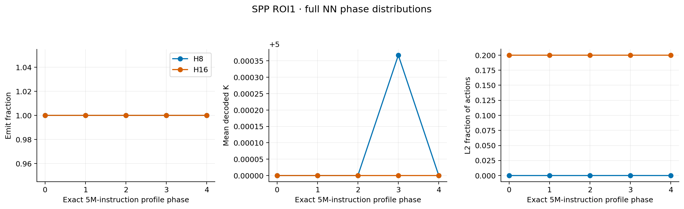
