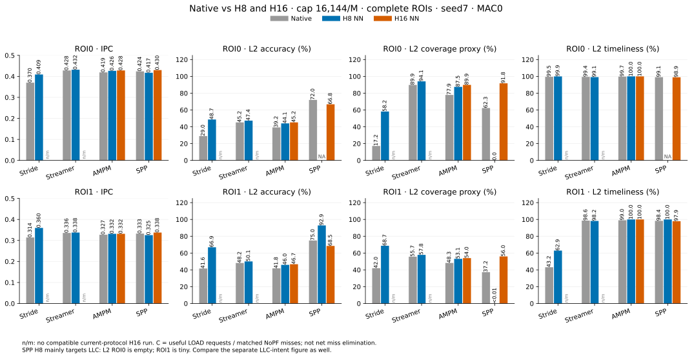
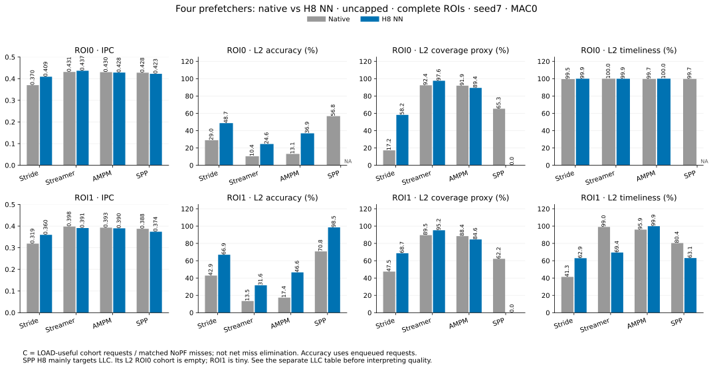
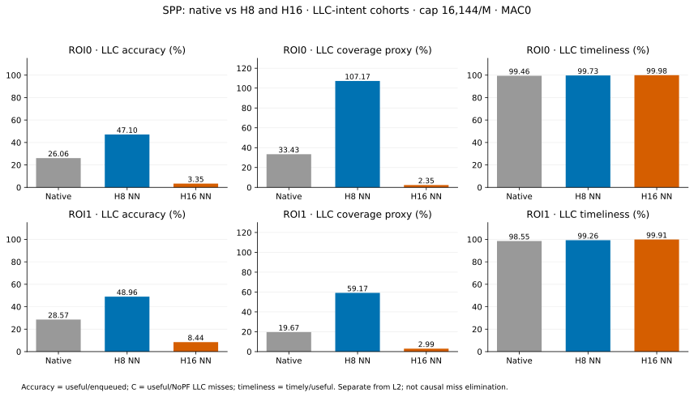
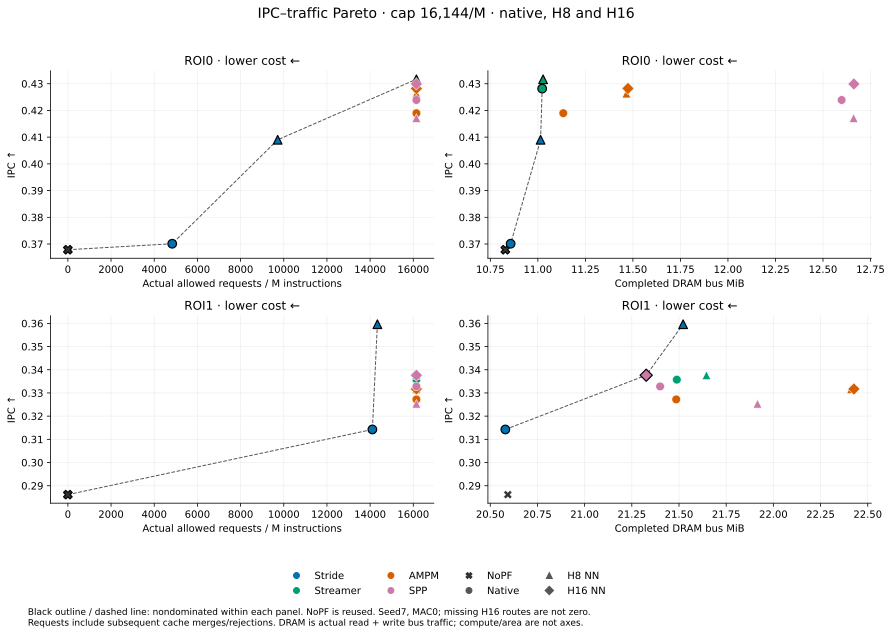
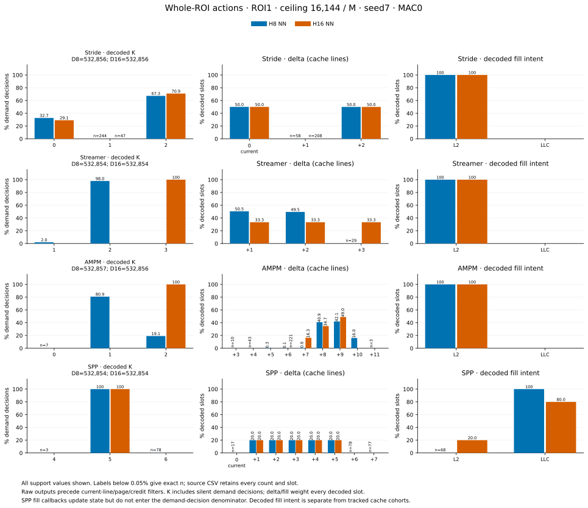
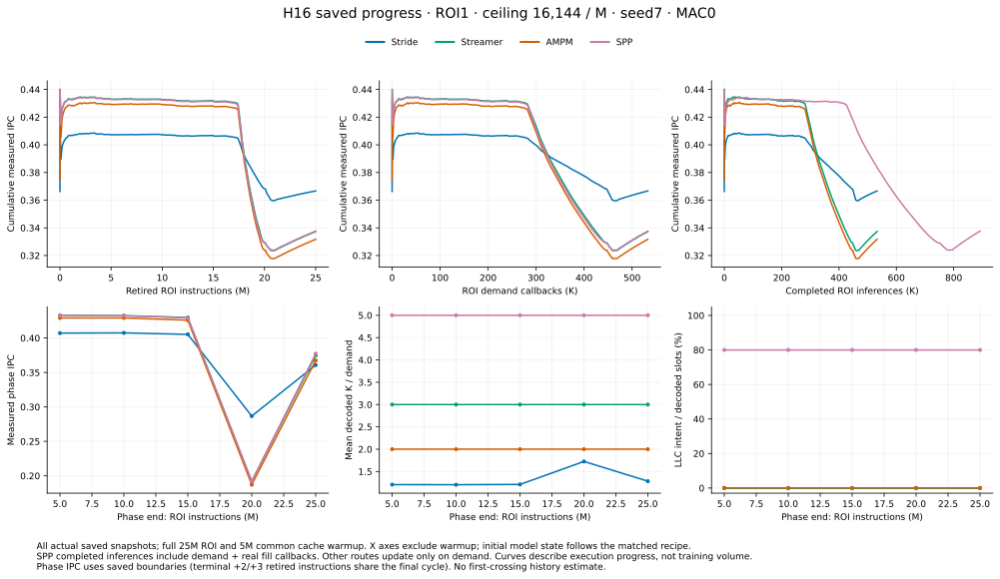
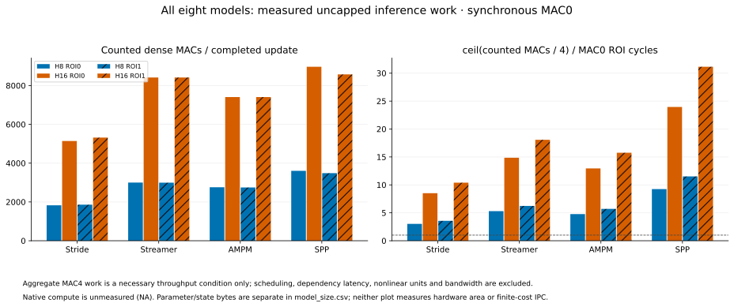
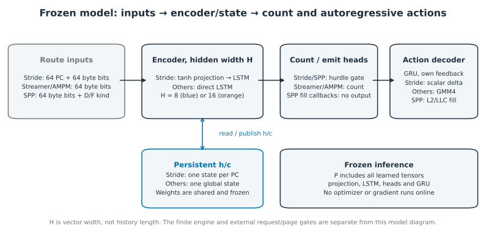
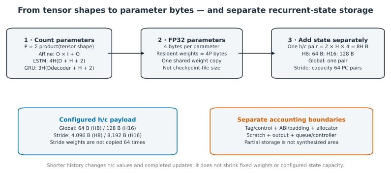

# 602: H8 and H16 versus native prefetchers

- **Read:** [project overview](../../../RESULTS_INDEX.md) · [run metrics](reader_metrics.csv) · [native/NN pairs](reader_pairs.csv) · [Pareto flags](reader_pareto.csv) · [reader audit](reader_audit.json).
- **Completed widths:** H8 and H16 for Stride, Streamer, AMPM and SPP. All are frozen during inference. The same cache/ROI/page protocol and actual binary are used; each checkpoint retains its own training provenance.
- **Scope:** original seed7 weights; complete two-ROI live inference; frozen weights, updating state; MAC0. Quality cells are **native → NN (%)**; C is the useful/NoPF-miss proxy.

## Capped results

- **Budget:** cap 16,144/M. H8 IPC wins 6/8; H16 wins 8/8. Each NN is paired with its own native.

### H8

| ROI | Policy | IPC native → NN | NN IPC gain | L2 accuracy | L2 C | L2 timeliness |
| --- | --- | --- | --- | --- | --- | --- |
| 0 | Stride | 0.3701 → 0.4090 | +10.51% | 29.0 → 48.7 | 17.2 → 58.2 | 99.5 → 99.9 |
| 1 | Stride | 0.3143 → 0.3596 | +14.44% | 41.6 → 66.9 | 42.0 → 68.7 | 43.2 → 62.9 |
| 0 | Streamer | 0.4282 → 0.4317 | +0.81% | 45.2 → 47.4 | 89.9 → 94.1 | 99.4 → 99.1 |
| 1 | Streamer | 0.3357 → 0.3376 | +0.56% | 48.2 → 50.1 | 55.7 → 57.8 | 98.6 → 98.2 |
| 0 | AMPM | 0.4190 → 0.4263 | +1.75% | 39.2 → 44.1 | 77.9 → 87.5 | 99.7 → 100.0 |
| 1 | AMPM | 0.3272 → 0.3316 | +1.34% | 41.8 → 46.0 | 48.3 → 53.1 | 99.0 → 100.0 |
| 0 | SPP | 0.4239 → 0.4172 | -1.59% | 72.0 → NA | 62.3 → 0.0 | 99.1 → NA |
| 1 | SPP | 0.3328 → 0.3253 | -2.24% | 75.0 → 92.9 | 37.2 → <0.01 | 98.4 → 100.0 |

### H16

| ROI | Policy | IPC native → NN | NN IPC gain | L2 accuracy | L2 C | L2 timeliness |
| --- | --- | --- | --- | --- | --- | --- |
| 0 | Stride | 0.3701 → 0.4094 | +10.62% | 29.0 → 48.6 | 17.2 → 58.4 | 99.5 → 99.9 |
| 1 | Stride | 0.3143 → 0.3667 | +16.68% | 41.6 → 67.5 | 42.0 → 73.1 | 43.2 → 61.6 |
| 0 | Streamer | 0.4282 → 0.4316 | +0.80% | 45.2 → 47.2 | 89.9 → 93.9 | 99.4 → 99.2 |
| 1 | Streamer | 0.3357 → 0.3374 | +0.48% | 48.2 → 49.8 | 55.7 → 57.6 | 98.6 → 98.5 |
| 0 | AMPM | 0.4190 → 0.4282 | +2.21% | 39.2 → 45.2 | 77.9 → 89.9 | 99.7 → 100.0 |
| 1 | AMPM | 0.3272 → 0.3317 | +1.37% | 41.8 → 46.7 | 48.3 → 54.0 | 99.0 → 100.0 |
| 0 | SPP | 0.4239 → 0.4299 | +1.41% | 72.0 → 66.8 | 62.3 → 91.8 | 99.1 → 98.9 |
| 1 | SPP | 0.3328 → 0.3376 | +1.45% | 75.0 → 68.5 | 37.2 → 56.0 | 98.4 → 97.9 |

- SPP H8 L2 enqueues: **0 / 14** (ROI0 / ROI1). ROI1 useful: 13. Its L2-only quality cannot describe its predominantly LLC-targeted policy.
- H16 SPP has lower L2 accuracy but higher IPC than native in both ROIs; a metric gain/loss is not a performance mechanism by itself.

| Model | ROI | Actual requests/M native → NN | DRAM MiB native → NN | DRAM change | Net L2 miss reduction % native → NN |
| --- | --- | --- | --- | --- | --- |
| Stride H8 | 0 | 4,833.44 → 9,717.16 | 10.857 → 11.014 | +1.45% | 17.1 → 58.1 |
| Stride H8 | 1 | 14,105.32 → 14,337.28 | 20.580 → 21.522 | +4.58% | 18.1 → 43.1 |
| Streamer H8 | 0 | 16,143.96 → 16,143.96 | 11.023 → 11.028 | +0.04% | 89.3 → 93.2 |
| Streamer H8 | 1 | 16,143.96 → 16,143.96 | 21.489 → 21.646 | +0.73% | 54.8 → 56.7 |
| AMPM H8 | 0 | 16,143.96 → 16,143.96 | 11.134 → 11.466 | +2.98% | 77.7 → 87.5 |
| AMPM H8 | 1 | 16,143.96 → 16,143.64 | 21.485 → 22.412 | +4.31% | 47.7 → 52.9 |
| SPP H8 | 0 | 16,143.96 → 16,143.96 | 12.598 → 12.661 | +0.50% | 61.8 → <0.01 |
| SPP H8 | 1 | 16,143.96 → 16,143.96 | 21.400 → 21.916 | +2.41% | 36.6 → 0.0 |
| Stride H16 | 0 | 4,833.44 → 9,766.64 | 10.857 → 11.038 | +1.67% | 17.1 → 58.4 |
| Stride H16 | 1 | 14,105.32 → 15,111.24 | 20.580 → 21.659 | +5.25% | 18.1 → 44.9 |
| Streamer H16 | 0 | 16,143.96 → 16,143.96 | 11.023 → 11.040 | +0.16% | 89.3 → 93.1 |
| Streamer H16 | 1 | 16,143.96 → 16,143.96 | 21.489 → 21.662 | +0.81% | 54.8 → 56.6 |
| AMPM H16 | 0 | 16,143.96 → 16,143.96 | 11.134 → 11.474 | +3.06% | 77.7 → 89.8 |
| AMPM H16 | 1 | 16,143.96 → 16,143.96 | 21.485 → 22.427 | +4.38% | 47.7 → 53.8 |
| SPP H16 | 0 | 16,143.96 → 16,143.96 | 12.598 → 12.663 | +0.51% | 61.8 → 90.7 |
| SPP H16 | 1 | 16,143.96 → 16,143.96 | 21.400 → 21.326 | -0.34% | 36.6 → 54.7 |

## Uncapped results

- **Budget:** uncapped. H8 IPC wins 3/8; H16 wins 8/8. Each NN is paired with its own native.

### H8

| ROI | Policy | IPC native → NN | NN IPC gain | L2 accuracy | L2 C | L2 timeliness |
| --- | --- | --- | --- | --- | --- | --- |
| 0 | Stride | 0.3701 → 0.4090 | +10.51% | 29.0 → 48.7 | 17.2 → 58.2 | 99.5 → 99.9 |
| 1 | Stride | 0.3190 → 0.3596 | +12.74% | 42.9 → 66.9 | 47.5 → 68.7 | 41.3 → 62.9 |
| 0 | Streamer | 0.4311 → 0.4366 | +1.29% | 10.4 → 24.6 | 92.4 → 97.6 | 100.0 → 99.9 |
| 1 | Streamer | 0.3978 → 0.3909 | -1.73% | 13.5 → 31.6 | 89.5 → 95.2 | 99.0 → 69.4 |
| 0 | AMPM | 0.4300 → 0.4283 | -0.40% | 13.1 → 36.9 | 91.9 → 89.4 | 99.7 → 100.0 |
| 1 | AMPM | 0.3928 → 0.3897 | -0.79% | 17.4 → 46.6 | 88.4 → 84.6 | 95.9 → 99.9 |
| 0 | SPP | 0.4277 → 0.4226 | -1.21% | 56.8 → NA | 65.3 → 0.0 | 99.7 → NA |
| 1 | SPP | 0.3875 → 0.3739 | -3.50% | 70.8 → 98.5 | 62.2 → 0.0 | 80.4 → 63.1 |

### H16

| ROI | Policy | IPC native → NN | NN IPC gain | L2 accuracy | L2 C | L2 timeliness |
| --- | --- | --- | --- | --- | --- | --- |
| 0 | Stride | 0.3701 → 0.4094 | +10.62% | 29.0 → 48.6 | 17.2 → 58.4 | 99.5 → 99.9 |
| 1 | Stride | 0.3190 → 0.3667 | +14.95% | 42.9 → 67.5 | 47.5 → 73.1 | 41.3 → 61.6 |
| 0 | Streamer | 0.4311 → 0.4369 | +1.35% | 10.4 → 16.4 | 92.4 → 97.7 | 100.0 → 99.9 |
| 1 | Streamer | 0.3978 → 0.4029 | +1.29% | 13.5 → 21.0 | 89.5 → 95.5 | 99.0 → 81.9 |
| 0 | AMPM | 0.4300 → 0.4323 | +0.53% | 13.1 → 23.5 | 91.9 → 93.6 | 99.7 → 100.0 |
| 1 | AMPM | 0.3928 → 0.3990 | +1.59% | 17.4 → 29.3 | 88.4 → 89.1 | 95.9 → 99.9 |
| 0 | SPP | 0.4277 → 0.4366 | +2.06% | 56.8 → 49.0 | 65.3 → 97.2 | 99.7 → 99.6 |
| 1 | SPP | 0.3875 → 0.4036 | +4.15% | 70.8 → 61.9 | 62.2 → 94.0 | 80.4 → 78.6 |

- SPP H8 L2 enqueues: **0 / 66** (ROI0 / ROI1). ROI1 useful: 65. Its L2-only quality cannot describe its predominantly LLC-targeted policy.
- H16 SPP has lower L2 accuracy but higher IPC than native in both ROIs; a metric gain/loss is not a performance mechanism by itself.

| Model | ROI | Actual requests/M native → NN | DRAM MiB native → NN | DRAM change | Net L2 miss reduction % native → NN |
| --- | --- | --- | --- | --- | --- |
| Stride H8 | 0 | 4,833.44 → 9,717.24 | 10.857 → 11.014 | +1.45% | 17.1 → 58.1 |
| Stride H8 | 1 | 15,473.84 → 14,337.32 | 20.583 → 21.522 | +4.56% | 19.6 → 43.1 |
| Streamer H8 | 0 | 72,356.95 → 32,338.28 | 11.324 → 11.307 | -0.16% | 92.4 → 97.5 |
| Streamer H8 | 1 | 93,024.03 → 42,200.24 | 22.387 → 22.470 | +0.37% | 88.4 → 65.9 |
| AMPM H8 | 0 | 56,938.39 → 19,707.36 | 11.211 → 11.680 | +4.19% | 91.6 → 89.3 |
| AMPM H8 | 1 | 71,340.59 → 25,392.24 | 21.809 → 23.048 | +5.68% | 84.7 → 84.2 |
| SPP H8 | 0 | 90,352.51 → 80,847.59 | 12.924 → 13.533 | +4.71% | 65.1 → <0.01 |
| SPP H8 | 1 | 116,475.39 → 106,574.19 | 22.638 → 25.223 | +11.42% | 50.1 → 0.1 |
| Stride H16 | 0 | 4,833.44 → 9,766.72 | 10.857 → 11.038 | +1.67% | 17.1 → 58.4 |
| Stride H16 | 1 | 15,473.84 → 15,111.28 | 20.583 → 21.659 | +5.23% | 19.6 → 44.9 |
| Streamer H16 | 0 | 72,356.95 → 48,508.55 | 11.324 → 11.529 | +1.81% | 92.4 → 97.6 |
| Streamer H16 | 1 | 93,024.03 → 63,942.23 | 22.387 → 23.274 | +3.96% | 88.4 → 78.0 |
| AMPM H16 | 0 | 56,938.39 → 32,339.04 | 11.211 → 11.845 | +5.65% | 91.6 → 93.5 |
| AMPM H16 | 1 | 71,340.59 → 42,628.64 | 21.809 → 23.806 | +9.15% | 84.7 → 88.7 |
| SPP H16 | 0 | 90,352.51 → 80,847.59 | 12.924 → 13.537 | +4.74% | 65.1 → 97.0 |
| SPP H16 | 1 | 116,475.39 → 106,570.99 | 22.638 → 25.258 | +11.57% | 50.1 → 74.0 |

## SPP LLC quality

- Keep LLC and L2 first-enqueue intent separate. They are not final fill destinations; do not add their ratios.
- Empty useful/enqueued denominators give NA. Useful/NoPF-miss ratios can exceed 100%; they are not unique baseline misses eliminated.

| Budget | ROI | Arm | LLC enqueued | Accuracy % | C % | Timeliness % |
| --- | --- | --- | --- | --- | --- | --- |
| cap 16,144/M | 0 | Native | 227,567 | 26.1 | 33.4 | 99.5 |
| cap 16,144/M | 0 | H8 NN | 403,599 | 47.1 | 107.2 | 99.7 |
| cap 16,144/M | 0 | H16 NN | 124,458 | 3.4 | 2.4 | 100.0 |
| cap 16,144/M | 1 | Native | 229,888 | 28.6 | 19.7 | 98.5 |
| cap 16,144/M | 1 | H8 NN | 403,501 | 49.0 | 59.2 | 99.3 |
| cap 16,144/M | 1 | H16 NN | 118,113 | 8.4 | 3.0 | 99.9 |
| uncapped | 0 | Native | 2,023,000 | 2.9 | 33.4 | 99.9 |
| uncapped | 0 | H8 NN | 2,017,198 | 9.9 | 112.0 | 100.0 |
| uncapped | 0 | H16 NN | 1,613,016 | 0.1 | 0.6 | 99.7 |
| uncapped | 1 | Native | 2,597,738 | 3.8 | 29.8 | 98.9 |
| uncapped | 1 | H8 NN | 2,650,096 | 12.4 | 98.7 | 99.9 |
| uncapped | 1 | H16 NN | 2,118,303 | 0.2 | 1.5 | 97.0 |

- [Uncapped LLC quality figure](reader_spp_llc_cap0.svg). AMPM has no LLC-intent enqueues: accuracy/timeliness are NA and the coverage proxy is 0.

## Pareto frontiers

- **Axes:** maximize IPC; minimize actual requests/M or completed DRAM bytes. Strict nondominance uses unrounded values. Ties remain tied; no significance or global-optimum claim is made.
- **Combined candidate set:** four natives + four H8 NNs + four H16 NNs + NoPF, separately per ROI and budget. H8-only membership is also retained in `reader_pareto.csv`.
- **H8 capped:** all eight NN cases increase DRAM. Native SPP dominates H8 NN on IPC/DRAM; Stride/Streamer/AMPM trade higher IPC for more DRAM.
- **H16:** H16 dominates its own native in 13/16 IPC/request pairs and 1/16 IPC/DRAM pairs. Native compute/area and finite NN service costs are outside these plots.
- NoPF is the same reused reference in both budget panels, not a new capped run. Requests below the final ceiling do not prove that cumulative credit never limited earlier output.

- [Uncapped H8/H16 Pareto](reader_pareto_h16_cap0.svg) · [H8-only capped](reader_pareto_cap16144.svg) · [H8-only uncapped](reader_pareto_cap0.svg).

## Actions and live progress

- **Full-ROI actions:** all 32 H8/H16 NN tests. K includes silent demand decisions; delta/fill count decoded slots before current-line/page/credit gates. Rare support is retained, not rounded away. [Exact action counts](action_plot_data_h16_completion.csv) · [per-slot support](slot_support_h16_completion.csv).

- **Other conditions:** [ROI0 capped](actions_all_widths_roi0_cap16144.svg) · [ROI0 uncapped](actions_all_widths_roi0_cap0.svg) · [ROI1 uncapped](actions_all_widths_roi1_cap0.svg) · [slot/delta/fill, capped ROI1](slots_all_widths_roi1_cap16144.svg).
- **Stages:** each phase is 5M measured instructions. [Capped ROI1 phase emit/K/fill](phase_actions_all_widths_roi1_cap16144.svg) · [all phase values](phase_plot_data_h16_completion.csv). SPP fill callbacks advance state but are excluded from demand-action denominators.

- **History axes differ:** measured instructions, demand callbacks and completed inference are runtime progress, not training data or minimum history. SPP completions include demand and fill callbacks. Curves do not identify a minimum observation count by first baseline crossing.
- **Other histories:** [ROI0 capped](history_all_h16_roi0_cap16144.svg) · [ROI0 uncapped](history_all_h16_roi0_cap0.svg) · [ROI1 uncapped](history_all_h16_roi1_cap0.svg). [Saved snapshots](startup_plot_data_h16_completion.csv) · [all figure/source links](plot_manifest_h16_completion.json).

## Inference work and width

- Measured MAC/nonlinear counts come from full completed ROIs. `ceil(MACs/4) / MAC0 cycles` is an aggregate necessary throughput condition, not simulated finite-cost IPC. Native compute is unmeasured, not zero.

- [Width, IPC and actual traffic figures](reader_widths_roi1_cap16144.svg) · [complete cost points](reader_cost.csv).

## Model size and inference state

- **Hidden width H:** the number of elements in each hidden/cell vector, not the number of PCs or observations.
- **Parameters → bytes:** sum every tensor’s element count to obtain **P**; FP32 parameter payload is **4P bytes**. One h/c pair stores **2 × H × 4 = 8H bytes**. [Tensor-by-tensor verification](model_size_tensors.csv) · [checkpoint/export audit](model_size_audit.json).

| Model | Parameters P | FP32 parameter bytes | h/c per state (B) | Configured states | Configured h/c bytes |
| --- | --- | --- | --- | --- | --- |
| Stride H8 | 1,908 | 7,632 | 64 | 64 | 4,096 |
| Stride H16 | 5,220 | 20,880 | 128 | 64 | 8,192 |
| Streamer H8 | 2,821 | 11,284 | 64 | 1 | 64 |
| Streamer H16 | 6,653 | 26,612 | 128 | 1 | 128 |
| AMPM H8 | 2,821 | 11,284 | 64 | 1 | 64 |
| AMPM H16 | 6,653 | 26,612 | 128 | 1 | 128 |
| SPP H8 | 2,865 | 11,460 | 64 | 1 | 64 |
| SPP H16 | 6,609 | 26,436 | 128 | 1 | 128 |

- **Layer calculation:** affine = O×I + O; LSTM = 4H(D+H+2); GRU = 3H(Ddecoder+H+2). Both cells include two bias vectors. Encoder D = H for projected Stride, 64 for Streamer/AMPM and 65 for SPP; decoder input = 1 except SPP’s 3. Counts below come from actual checkpoint/export tensors; 0 means that learned layer is absent. [Per-layer CSV](model_size_layers.csv).

| Layer parameters | Stride H8 | Stride H16 | Streamer H8 | Streamer H16 | AMPM H8 | AMPM H16 | SPP H8 | SPP H16 |
| --- | --- | --- | --- | --- | --- | --- | --- | --- |
| Input projection | 1,032 | 2,064 | 0 | 0 | 0 | 0 | 0 | 0 |
| Encoder LSTM | 576 | 2,176 | 2,368 | 5,248 | 2,368 | 5,248 | 2,400 | 5,312 |
| Emit gate | 18 | 34 | 0 | 0 | 0 | 0 | 18 | 34 |
| Count head | 9 | 17 | 9 | 17 | 9 | 17 | 9 | 17 |
| Decoder initialization | 0 | 0 | 72 | 272 | 72 | 272 | 0 | 0 |
| Decoder GRU | 264 | 912 | 264 | 912 | 264 | 912 | 312 | 1,008 |
| Delta head | 9 | 17 | 108 | 204 | 108 | 204 | 108 | 204 |
| Fill head | 0 | 0 | 0 | 0 | 0 | 0 | 18 | 34 |
| **Total P** | **1,908** | **5,220** | **2,821** | **6,653** | **2,821** | **6,653** | **2,865** | **6,609** |

- **Why SPP H16 is smaller:** it omits the 272-parameter learned decoder initialization; extra input, gate, fill and GRU parameters add 228, leaving **44 fewer parameters** than Streamer/AMPM H16.
- **State organization:** Stride shares one weight copy across its 64-PC capacity; only h/c and metadata scale with PC entries. Streamer/AMPM/SPP each keep one chronological global h/c pair. Stride’s source-field tag/control reservation adds 32 B/entry (2,048 B at capacity); actual ABI/padding/map allocation is separate.
- **Measured host example:** Streamer H16 object + persistent requested heap is **28,596 B**, already including its 26,612 B weights and 128 B h/c. Extra inference heap peak is **948 B** on the passed 8,236-callback fixture; this is not a worst-case bound. [Actual host fields and source/fixture bindings](model_size_host_streamer_h16.json).
- **Observation history:** shorter history changes h/c values and update counts, not fixed P, H or configured capacity. Fewer active PCs may reduce occupied states, not reserved capacity. Action-dependent scratch/output is separate.
- **Accounting boundary:** weights + h/c is partial storage. Checkpoint/container file lengths include serialization and headers. Scratch, outputs, queues, control, allocator overhead and synthesized hardware area require separate accounting. [Full model-size CSV](model_size.csv) · [global runtime cost details](../../../formal_NN_training/experiments/602_four_prefetcher_formal/report/COST.md) · [Stride field/ABI boundaries](../../../docs/602_gate_mechanism/STORAGE.md).

- [H8/H16 parameter and state storage plot](model_size_storage.svg) · [PNG architecture](model_size_architecture.png) · [PNG accounting](model_size_accounting.png).

## Definitions and scope

- **IPC:** actual retired instructions ÷ cycles. **Net miss reduction:** (NoPF LOAD misses − candidate misses) ÷ NoPF misses; distinct from C.
- **Accuracy:** LOAD-useful ÷ enqueued requests in a fully tracked intent cohort, including ROI-end pending/resident-unused. Cache merges are not new enqueues.
- **Coverage proxy (C):** LOAD-useful cohort requests ÷ same-ROI NoPF LOAD misses at that level. It is not causal miss elimination.
- **Timeliness:** timely LOAD-useful ÷ (timely + late LOAD-useful). Zero denominator gives NA. RFO usefulness is excluded.
- **Requests/M:** credit-allowed cache calls ÷ actual retired instructions × 1M, including later cache merges/rejections. **DRAM:** actual completed read + write controller bus bytes; MiB = bytes ÷ 2²⁰. Requests × 64 is never used.
- **NoPF:** prefetch quality is not applicable; reader availability is false and ratios are NA, independently of source empty-cohort tracking flags.
- **Protocol:** validation 20–25M; ROI0 25–50M and ROI1 75–100M; 5M cache/state warmup each. ROI0 was previously inspected. Different route training/state budgets and native/student SPP fill inputs limit claims.
- **Cost:** synchronous MAC0 IPC; resident NN weights with no modeled weight DRAM fetches. No hardware compute/area/energy Pareto is established. [Storage fields](storage_cost.csv) · [full contract](metric_definitions.json) · [method limits](../../../formal_NN_training/experiments/602_four_prefetcher_formal/report/METHOD_LIMITATIONS.md).

## Evidence and recovery

- **50 selected test rows:** 16 native + 16 H8 + 16 H16 + 2 NoPF. Original 88 labeled rows remain unchanged; [30 H16-completion rows](per_run_h16_completion.csv) retain their new protocol. No references are relabeled as new runs. [Earlier source](per_run.csv).
- **New complete raw:** `formal_study/runs/602_width_templates_20261017/stride_streamer_h16/` under both cache roots, including checkpoints/bindings, correctness, runs, validation selections and analysis.
- **Mechanisms/history:** [template findings](FINDINGS.md) · [paper story](PAPER_STORY.md) · [replay alignment](../../../formal_NN_training/experiments/602_four_prefetcher_formal/width_templates/EVIDENCE_ALIGNMENT.md) · [full-ROI actions](action_histograms_full_roi.csv) · [stages](phase_progress.csv) · [new completion stages](phase_progress_h16_completion.csv).
- **Local raw:** `/Users/angelawoo/Documents/CMU/ece/cache/formal_study/runs/602_width_templates_20261017/`; `/Users/angelawoo/Documents/CMU/ece/cache/formal_study/archive/20261017/raw_v2/`.
- **Sacramento raw:** `/home/qianruw/cache/formal_study/runs/602_width_templates_20261017/`; `/home/qianruw/cache/formal_study/archive/20261017/raw_v2/`. [Layout and preservation](../../../docs/602_width_templates/LAYOUT_AND_RECOVERY.md).
- **Rebuild figures/tables only:** `python3 formal_NN_training/experiments/602_four_prefetcher_formal/width_templates/build_reader_results.py` with matplotlib. [Independent checker](../../../formal_NN_training/experiments/602_four_prefetcher_formal/width_templates/verify_reader_results.py). [Action/history plot source](../../../formal_NN_training/experiments/602_four_prefetcher_formal/width_templates/plot_h16_completion.py) rebuilds those figures from retained CSVs only. All runtime files stay inside cache.
