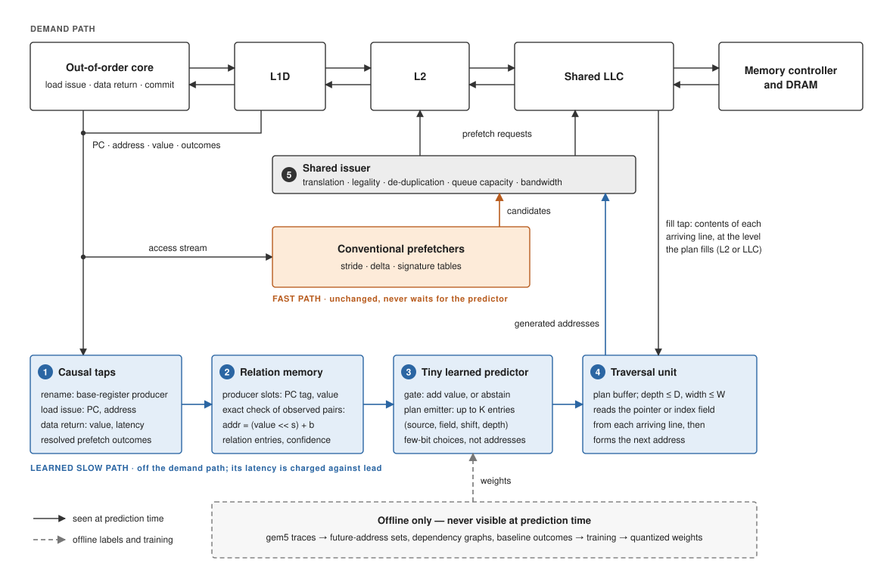

# Can a tiny learned predictor plan the dependent accesses that conventional prefetchers miss?

**Research design memo, 22 November 2026.** It reviews what the ChampSim studies measured, proposes the gem5 study that follows, and fixes what has to be measured before a model is chosen. No source code was changed and no simulation was run to write it. It claims neither novelty nor speedup.

[Exact data-collection specification](DATA_COLLECTION.md) · [Prompt for the next step](NEXT_STEP_PROMPT.md) · [Earlier shared-LLC study](../llc_hybrid_prefetch/README.md) · [LLC LSTM study](https://github.com/Angelawoo572/cache_arch/blob/cb69439/llc_lstm_research/README.md)

## Short answers

- **Run the learned unit in parallel with the conventional prefetchers.** Neither waits for the other or reads the other's candidates. They meet at one shared issuer.
- **Gate on predicted value, not on a pattern name.** The unit does not need to recognise "this is a stride". It estimates whether one more request would turn a miss that the fast path leaves into a timely hit, using outcomes that have already resolved. Which future loads the fast path will cover is a training label and never an input.
- **Copy address bits instead of predicting them.** A pointer target is unknown until the line holding the pointer arrives. The unit emits a short plan: which arriving field to read, how to shift it, which base to add, how deep and how wide to go. A bounded traversal unit executes it. Each learned choice is a few bits.
- **Feed it one trigger and a small relation memory, not a long history.** The output is always a set of addresses: the lines the plan requests when it runs. How many slots and how much history it needs are measured in section 5, not assumed.
- **Use gem5 for this question.** The ChampSim traces carry no load values, so the earlier studies could not observe pointer, index or tree relationships. gem5 executes the program and exposes values, register dataflow and ready times. Programs have to be built and run, and the configuration has to be written, so the plan starts with bring-up and sampled windows.
- **Expect strong non-learned competition.** Hardware that follows index and pointer relations without software already exists at about 1 KB (IMP, the Differential-Matching Prefetcher), and pointer-following prefetchers ship in processors. A learned unit has to earn its place in what they leave open: which fields to follow, how deep and wide, and when to stay silent.
- **Do not choose the network yet.** Our LSTM runs did not establish a benefit from recurrent state. Section 5 lists nine measurements that size the inputs, outputs, tables and latency budget. Section 6 says which mechanism each result would select.
- **Start with a measurement study.** It needs no neural network. It decides whether the dependent-access opportunity is large enough, early enough and regular enough to pursue.

## 1. What the measurements so far support

Every row is a measured ChampSim result from this repository. The LLC LSTM files live on `experiment/llc-lstm-research` and are linked at commit `cb69439`.

| Measured result | Consequence for this design |
|---|---|
| **Correct requests often arrive late.** Under SPP in the first MCF-472B window, 1,448,604 original misses merged into a pending prefetch. Median trigger-to-demand lead was 1,328 cycles for timely uses and 58 for late ones. Dispatch-to-fill took a median 190 cycles for both. [Full-workload findings](../llc_hybrid_prefetch/full_workload/FINDINGS.md) | Lead is the scarce resource. Inference latency and every traversal hop are charged against it. |
| **On PageRank every conventional prefetcher lengthened the run.** Over 450M instructions Stride took 1.03% more time than NoPF, Multi-delta 0.96% and SPP 1.30%. Of 12,291 sampled targets that all three left missed or late, 1,055 lay on a page seen in the last 64 LLC arrivals with at least 130 cycles of lead. [Full-workload findings](../llc_hybrid_prefetch/full_workload/FINDINGS.md) · [Learning findings](../llc_hybrid_prefetch/learning_opportunity/FINDINGS.md) | In a graph workload the missing piece is the target page. Recent address history does not contain it. It has to come from data. |
| **On MCF most underserved targets are new lines on pages already seen.** 8,789 of 8,921 eligible pairs in MCF-1644B and 3,152 of 3,384 in MCF-472B. [Reach and lead](../llc_hybrid_prefetch/learning_opportunity/labels/RESULTS.md) | A page directory with a chosen offset reaches these. It stays as the representation for targets that depend on no loaded value. |
| **More history improved probability, not complementary coverage.** Adding 32 ordered global arrivals lowered held-out log loss on 11 of 11 recordings. At one proposal per cue the net change in qualified addresses was −80 over 66,147 cues: −15 on 2,104 SPP-late misses and 0 on 12,195 persistent SPP misses. Pooled training added 2,548 on targets SPP already served on time. [Learning findings](../llc_hybrid_prefetch/learning_opportunity/FINDINGS.md) | A longer LLC history is not the lever. Train and score on what the fast path leaves. Report gains and losses separately. |
| **A learned displacement vocabulary did not transfer across graph inputs.** 145 of 7,079 Stanford-to-Google BFS targets were expressible, and both abstaining probes recovered none. [Probe findings](../llc_hybrid_prefetch/learning_opportunity/probes/FINDINGS.md) | Addresses must be built from operands of the running program, not from a trained vocabulary. |
| **An exact, timely address is not a speedup.** A prospective BFS forecast was exact, 26,157 cycles early and consumed on time, and the 200M-instruction run finished 784 cycles later. Moving 18 known targets earlier saved 148,219 cycles on MCF and 106,164 on BFS and cost 392,638 on Soplex. [Learning findings](../llc_hybrid_prefetch/learning_opportunity/FINDINGS.md) | Only closed-loop replay under contention measures performance. Success is defined on fixed-work time with gains and losses, not on address accuracy. |
| **A small LLC LSTM paid for itself on one program.** On three fresh 605.mcf regions it finished 2.88% sooner than the fastest conventional policy per region, with 3.15% more DRAM bytes. Each region is 2M instructions per core, with private-cache prefetchers off. [V5 results](https://github.com/Angelawoo572/cache_arch/blob/cb69439/llc_lstm_research/lstm/V5_RESULTS.md) | A learned address head can beat table prefetchers in a narrow setting. One program is not a general result. |
| **Recurrent state did not earn its cost.** With weights fixed, zeroing the recurrent input finished 0.06% faster than the full LSTM over five regions. In the first study the event-only scorer beat the LSTM on both held-out regions. That model's label and 16-candidate directory could reach 5.32% and 5.74% of baseline misses even with perfect scoring. [V5 results](https://github.com/Angelawoo572/cache_arch/blob/cb69439/llc_lstm_research/lstm/V5_RESULTS.md) · [First LSTM results](https://github.com/Angelawoo572/cache_arch/blob/cb69439/llc_lstm_research/lstm/RESULTS.md) | Do not start from a recurrent model. The reach of the output representation bounds everything else, so measure it first. |
| **The LLC sees a thin slice of the program, and no values.** 83,456,728 of 548,807,320 load operands reached LLC ingress across nine NoPF windows, from 7.2% in BFS-14 to 43.7% in PageRank-3. The capture has no memory values. [Figures](../llc_hybrid_prefetch/learning_opportunity/figures/README.md) · [Capture schema](../llc_hybrid_prefetch/learning_opportunity/capture/README.md) | Observe at the core, where PC, dataflow and values exist. This is the reason to move to gem5. |
| **Decisions arrive in bursts.** LLC arrival rates ran from 2.98 to 22.50 per thousand cycles across eleven recordings. 45.28% of adjacent arrivals in BC-3 were under four cycles apart, against 0.46% in GCC-734B. [Decision bandwidth](../llc_hybrid_prefetch/learning_opportunity/resources/README.md) | Size the initiation interval and input buffer from measured bursts, per tap level. |
| **NN students of conventional prefetchers won with inference assumed free.** H16 students won 8 of 8 capped IPC pairs at zero inference cost. The study did not establish a universal NN advantage or a necessary learned state, and finite-cost deployment stayed open. [602 results](../RESULTS_INDEX.md) | That design imitated conventional behaviour. This one takes no conventional candidate as input and charges its latency. |

Not yet measured anywhere in the repository: neural circuit area, energy, initiation interval, any dependent-access relationship, and any end-to-end hybrid speedup across programs.

## 2. What prior designs already do

Sizes, latencies and results are as each paper states them. Where a paper was not read directly the row says so.

### Learned predictors

| Design | What it does | Published size and latency | What it means here |
|---|---|---|---|
| [Peled et al., ISCA 2015](https://yoav.net.technion.ac.il/files/2016/05/Context-ISCA2015.pdf) and [TACO 2019](https://yoav.net.technion.ac.il/files/2019/10/a37-peled.pdf) | Learn online from machine context: PC, access deltas, branch history, register values. Output address deltas. Evaluated in gem5 | 2015: about 31 kB of tables. 2019: a 128-32-32 network with 8-bit weights, about 15 kB, with an 8-cycle inference run asynchronously | The closest small core-side learner. It predicts the address bits themselves, and covers linked structures as recorded recurrences |
| [Hashemi et al., ICML 2018](https://proceedings.mlr.press/v80/hashemi18a.html) | Two-layer LSTM over PC and miss delta. Prefetches the top 10 of a 50,000-delta vocabulary. Trace-only precision and recall | No hardware design. The authors leave open whether such models can meet hardware latency | Shows where parameters go when a model must name the address: the output vocabulary |
| [Voyager, ASPLOS 2021](https://par.nsf.gov/servlets/purl/10334423) | LSTMs over 16 LLC accesses. Softmax over pages and 64 offsets | 18,000 ns per prediction by its own account. Its IPC numbers exclude latency and storage | High accuracy with cost set aside. It cannot name an address absent from its training data |
| [TransFetch, CF 2022](https://arxiv.org/abs/2205.02269) and [DART, IPDPS 2024](https://arxiv.org/abs/2401.06362) | Attention over nine LLC addresses. The output is a 256-bit delta bitmap, so the degree varies. DART distils the model into tables | DART-S: 29.9 KB and 57 cycles. DART: 864 KB and 97 cycles | Multi-address output exists for spatial deltas. Nothing data dependent |
| [Twilight and T-LITE, ISCA 2024](https://www.cs.utexas.edu/~lin/papers/isca24.pdf) | Pick the i-th most frequent recorded successor page, or no prefetch, plus an offset | T-LITE: 0.8 MB of 8-bit weights and 64 KB of successor metadata, about 29 cycles | A selection-style output: the model chooses among stored candidates. It cannot emit a successor it has not recorded |
| [Pythia, MICRO 2021](https://arxiv.org/abs/2109.12021) | Tabular reinforcement learning chooses one in-page offset, or none, per demand | 25.5 KB with a five-stage lookup | An abstain action learned online. Offsets stay inside a page |
| [PPF, ISCA 2019](https://par.nsf.gov/servlets/purl/10121116), [TLP, HPCA 2024](https://arxiv.org/abs/2403.15181) and [ReSemble, SC 2022](https://par.nsf.gov//servlets/purl/10390280) | Perceptrons filter another prefetcher's candidates. ReSemble's network chooses which of four prefetchers' suggestions to issue, or none | SPP with PPF: 39.34 KB. TLP: 7 KB. ReSemble: 4.2 KB on chip, 34.8 KB of replay memory off chip, about 22 cycles | Filters and selectors over conventional candidates. The constraints here exclude that role |
| [Alecto, HPCA 2025](https://arxiv.org/abs/2503.19390) and [Micro-Armed Bandit, MICRO 2023](https://jnamaral.github.io/CDOL/papers/GerogiannisMICRO23.pdf) | Route each PC's requests to, or set the degree of, existing prefetchers from their past accuracy | Under 1 KB. About 100 bytes | "Who should handle this PC" can be decided from resolved outcomes with very little state. Neither is neural |
| [Ayers et al., ASPLOS 2020](https://par.nsf.gov/servlets/purl/10187648) (Google) | Offline backward dataflow slices over instruction traces yield prefetch kernels of offsets and indirections, injected as software prefetches | Software, plus one proposed instruction | Our label extractor is this analysis, used to supervise hardware instead of rewriting code. The paper also notes that a pointer-chase load must resolve before the next address can be formed |
| [MPGraph, SC 2023](https://arxiv.org/abs/2212.05250) | Per-phase attention models for graph frameworks, with chained prefetching from a predicted page | Compressed: 7.5 KB plus 1.9 KB per phase, 79 to 123 cycles | The smallest neural address generator found. Trained offline per framework |
| Moirai | Listed in this repository's [paper index](https://github.com/Angelawoo572/cache_arch/blob/cb69439/llc_lstm_research/PAPERS.md) as a compact binarized network for L1D ([IEEE Xplore 11617757](https://ieeexplore.ieee.org/document/11617757/)) | Not read | The record could not be opened for this memo and no search found the paper elsewhere. Nothing here relies on it |

### Hardware for dependent accesses

| Design | Where the traversal knowledge comes from | How it resolves the dependence | Published cost and evaluation | What it means here |
|---|---|---|---|---|
| [Dependence-based prefetching, ASPLOS 1998](https://www.eecg.utoronto.ca/~moshovos/research/dep-pref.pdf) | Learned at run time: a loaded value later used as a base address forms a producer-consumer pair | Waits for the producer's value, then requests value plus offset, one instance ahead | 128-entry producer window and 256-entry correlation table. SimpleScalar on Olden: 10% on average | Our relation memory is this idea. It overlaps only the work inside one iteration |
| [Content-directed prefetching, ASPLOS 2002](https://doi.org/10.1145/605397.605427) (not read directly) | None. A word in an arriving line whose upper bits match the line's own address is treated as a pointer | Scans every arriving line and recurses to a depth limit | No added state. A later study measured a 14% slowdown and 83.3% more bus traffic when it joined a stream prefetcher | Following every pointer is the failure mode. Which fields to follow is the decision a learned selector would make |
| [Ebrahimi et al., HPCA 2009](https://utw10235.utweb.utexas.edu/pub/ebrahimi_hpca09.pdf) | A compiler pass tells the hardware which pointers are worth following | Content-directed traversal, with feedback throttling between it and the stream prefetcher | 22.5% faster with 25% less memory bandwidth than a stream-prefetcher baseline | The closest hybrid: a conventional prefetcher, a pointer follower, a filter and coordination. Its filter comes from the compiler |
| [IMP, MICRO 2015](https://people.csail.mit.edu/devadas/pubs/imp.pdf) and the [Differential-Matching Prefetcher, HPCA 2024](https://doi.org/10.1109/HPCA57654.2024.00040) (abstract only) | Learned at run time by matching index values against later miss addresses for a few shifts | Fetch the index ahead, read it, then form base plus shifted index | About 0.7 KB and 0.9 KB. IMP ships in mainline gem5 | The exact-relation baseline for index arrays is already under 1 KB. A learned unit must beat it at equal budget |
| Ainsworth and Jones, [ICS 2016](https://www.cl.cam.ac.uk/~tmj32/papers/docs/ainsworth16-ics.pdf) and [ASPLOS 2018](https://www.cl.cam.ac.uk/~sa614/papers/programmableprefetcher.pdf) | Address bounds set by the program (2016). Prefetch kernels written by hand or by a compiler pass (2018) | Events on loads and on arriving prefetches trigger the next hop | About 1.6 KB (2016). Twelve small programmable units, about 3% of a Cortex-A57 (2018). gem5, 3.0× on average | The traversal-unit template, with software supplying what we want learned. BFS over linked lists gained only 1.7×, because the serial walk keeps pace with the program |
| [Prodigy, HPCA 2021](https://tnm.engin.umich.edu/wp-content/uploads/sites/353/2021/01/2021.02.Prodigy_HPCA2021_Camera_Ready.pdf) | A data-indirection graph from a compiler pass: arrays, single-valued and ranged edges, a trigger | On every prefetch fill it reads the data and issues the next edge | 0.8 KB. Sniper, 2.6× over no prefetching | Its graph is the nearest thing to our plan grammar. A compiler writes it |
| [Pickle, arXiv 2511.19973](https://arxiv.org/abs/2511.19973) | Programmer-written kernels and hints | An LLC-side engine with its own MMU walks each chain level by level | Second version: an estimated 0.52 mm² and 483.8 mW. gem5 full system, 1.49× on GAP with 2% more DRAM traffic | An LLC placement needs its own translation. Precise traversal keeps traffic low |
| [Vector Runahead, ISCA 2021](https://homepages.inf.ed.ac.uk/sainswo2/papers/isca2021.pdf) and [Decoupled Vector Runahead, MICRO 2023](https://www.cl.cam.ac.uk/~tmj32/papers/docs/naithani23-micro.pdf) | Learned in the core: a striding load and taint tracking of its dependents | Re-executes the dependent chain for many future iterations at once | 1.31 KB and 1,139 bytes. Sniper, 1.79× and 2.4× | Covers address arithmetic that is not affine, which the plan grammar cannot. Needs a striding anchor |
| [Triangel, ISCA 2024](https://arxiv.org/abs/2406.10627) | Learned address pairs. It never reads data | Chains table lookups | 17.6 KiB plus an L3 partition. gem5, public code | The temporal alternative. Its paper notes that a linked list gives a look-ahead-1 prefetcher no more parallelism than the program has |
| [Loop-Decoupled Prefetcher, MICRO 2026](https://github.com/xjtuiair-cag/LDP-gem5) (artifact only, paper not read) | Not verified | Targets linked-structure traversals interleaved with an outer loop | gem5 on AArch64 in syscall emulation, public code. The artifact reports a geometric mean of 2.2× to 2.6× over no prefetching on its subset | A current hardware-only competitor for linked structures. Read the paper before Stage 2 |
| Shipping data memory-dependent prefetchers | Not public | Dereference pointer-like values in fetched data | Reverse-engineered on Apple cores: [Augury, IEEE S&P 2022](https://ieeexplore.ieee.org/document/9833570) | Following loaded pointers already ships. A traversal unit alone is not new |

**What the search did not find.** In the sources read for this memo there is no design in which a learned model emits a bounded traversal descriptor for a small hardware walker. Descriptors come from a compiler or a programmer (Prodigy, Pickle, Ainsworth and Jones), and run-time discovery is exact matching (IMP, Differential-Matching, dependence-based). Learned predictors output deltas, bitmaps or recorded successors. No neural address generator of a few KB with its latency simulated on pointer-heavy programs turned up. Neither did a learned abstain decision that defers to conventional prefetchers from prediction-time inputs alone: the nearest are no-prefetch classes (Pythia, T-LITE), candidate filters and Alecto's accuracy table. These are statements about one search. They are not novelty claims.

**Where that leaves a learned unit.** The exact designs already sit near 1 KB and cover index arrays. A learned component has to earn its place in what they leave open: choosing which pointer fields to follow without a compiler, bounding depth and width to the lead that exists, cutting the traffic that indiscriminate traversal adds, and staying silent where conventional prefetchers already work. As one data point on traffic, Pickle's evaluation measured 43% more DRAM traffic for the Differential-Matching Prefetcher on GAP.

## 3. Proposed architecture



*Figure 1. Solid arrows carry signals that exist at prediction time. The dashed box exists only offline. Numbers match the list below.*

1. **Causal taps.** At rename, a tag records which earlier load produced the base or index register of each new load. At issue the tap reports PC and address. At data return it reports the loaded value and how long the load took. Later, resolved outcomes of earlier prefetches arrive: used in time, used late, unused, and which path requested them. Every record carries the time it became visible.
2. **Relation memory.** A few slots hold recent producer loads and their values. When a consumer's address is known, exact logic checks it against the tagged producer's value: `address = (value << s) + b` for a small set of shifts. Confirmed relations are stored with a confidence count. This part is arithmetic and uses no learned weights.
3. **Tiny learned predictor.** A gate decides whether to act or abstain. A plan emitter then writes up to K entries. Each entry names a source operand, a field, a shift, and a depth or width bound. The outputs are selections among operands the hardware already holds.
4. **Traversal unit.** It holds live plans. For each entry it waits until the parent line arrives at the fill level, reads the named field from the line, forms the next address, and hands it to the issuer. Depth, width and lifetime are bounded. It never uses a value before that value exists in the cache.
5. **Shared issuer.** It translates virtual addresses, drops illegal and duplicate requests, and enforces queue capacity and bandwidth for both paths. It is the only place the two paths interact.

**Why parallel works.** The fast path keeps its own tables, triggers and timing. The slow path takes tens of cycles and sits off the demand path. A request both paths make is issued once. The fast path loses nothing when the slow path is silent, slow or wrong, apart from shared queue and memory bandwidth, which the issuer meters and section 8 measures.

**Why a value gate and not a pattern classifier.** Three reasons. First, "conventional prefetchers handle this" is observable after the fact and cheaply: per load PC, count how often a demand hit a line the fast path brought in time, merged with a late one, or missed with none. Alecto and Micro-Armed Bandit make comparable decisions from past accuracy in under 1 KB. Second, the quantity that matters is marginal timely coverage, which a pattern name does not give. Third, a classifier over pattern names needs hand labels, and the constraint is to avoid them. The gate's inputs are those resolved counters, relation confidence, the parent's latency and issuer pressure. Its offline label is whether the best bounded plan from this trigger covers at least one residual target in time (section 4). A fourth counter records demands served by the slow path itself. Without it the gate would switch itself off as soon as it succeeds.

**Why copy and not predict.** A model that outputs addresses must choose among a very large number of classes, which is where earlier neural prefetchers spend their parameters. For a dependent access the address bits already sit in memory. Once the parent line arrives, the remaining uncertainty is which field to follow and whether to follow it. Whether that uncertainty really is a few bits is measurement M4 in section 5. If it is, the learned part can be tiny. If it is not, this design loses its main argument.

**What is exact and what is learned.** The relation between a producer's value and a consumer's address is arithmetic, so it is detected exactly. Learning is reserved for decisions under uncertainty: whether to act, which fields of an arriving line to follow, how deep and wide to go within the lead budget, and whether a relation seen at one PC applies at a PC not seen before. If the measurements show those decisions are nearly deterministic given the relation memory, the right design has almost no learned part. That would be a result, not a failure.

**Where it sits.** The default is the core side: taps at rename, issue and data return, requests filling L2, and the fill tap at L2. Pointers are virtual addresses and need the data TLB. PC, dataflow and values originate at the core. The LLC saw 7% to 44% of loads in our windows. An LLC-side unit with a transported PC and a translation path stays measurable, because the capture records what both placements would see.

## 4. Prediction task and labels

### Task

Order all tap records by the time they become visible. A **trigger** is a load record at the tap. The default trigger is a load that missed L1D, taken at data return. M6 measures the alternatives. At trigger *t*, the **context** is every tap record visible by then, after each tap's transport delay. The unit either abstains or emits a plan of at most K entries:

```text
plan   := entry{1..K}
entry  := DIRECT(base, delta)
        | DEREF(parent, field, width, shift, base)
        | RANGE(parent, first, count, step, shift, base)
        | REPEAT(entry, depth)
base   := 0 | trigger address | trigger value | slot j
parent := trigger line | result of an earlier entry
```

| Entry | Executes as | Typical use |
|---|---|---|
| `DIRECT` | Request the line of `base + delta` now. | A delta the fast path left late. A new line on a known page. The index array ahead of the current position. |
| `DEREF` | When the parent line is present, read `width` bytes at byte offset `field`, call it *v*, and request `(v << shift) + base`. | A pointer hop. An index into another array. |
| `RANGE` | Apply a `DEREF` to `count` consecutive fields, `step` bytes apart. | An array of pointers. A CSR neighbour list. The children of a node. |
| `REPEAT` | Use an entry's result as its own parent, up to `depth` times. | A chain. A tree descent. |

A linked list is `DEREF` plus `REPEAT`. A tree is two `DEREF`s plus `REPEAT`. A CSR graph expansion is a `DIRECT` on the index array followed by a `RANGE` with a shift and an array base. Structure names are read off the shape of the plan. They are not classes the model is asked to output. The grammar is a hypothesis class, not a pattern table: M2 reports how much residual weight it can express, and whatever falls outside it is counted.

Executing a plan against memory yields a set of requested lines with request times. A dynamic load is **covered in time** if its line is in that set and the fill completes before the load's demand lookup at the fill level. The objective is the stall-weighted number of residual targets covered in time, per issued request, within the issuer's budget.

### Labels

Every label is a deterministic function of the captured traces. Nobody assigns a pattern class.

| Label | Definition |
|---|---|
| L0 Join key | The ordinal of each committed load within the measured region. A deterministic single-threaded run commits the same loads in the same order in every arm, so every outcome joins on this key. |
| L1 Future footprint | For trigger *t* and a lead window, the distinct lines first demanded in that window, each with its demand time, its outcome in the NoPF arm, its outcome in the fast-path-only arm and its stall weight. An **original miss** misses in the NoPF arm. A **residual target** is an original miss that is late or missed in the fast-path-only arm. **Stall weight** is the cycles the load spent blocking the reorder-buffer head. |
| L2 Dependence edges | For each consumer load, a backward slice through register dataflow, and through store-to-load pairs, to its nearest producer loads within a bounded window. If the consumer's address is affine in one producer value, record shift and base. Otherwise mark the edge non-affine. |
| L3 Edge timing | When the producer's value returned, when the consumer issued, when the consumer's data returned, and when the producer's line was first present at the fill level. |
| L4 Plan label | The plan, within the grammar and bounds, whose execution covers the most residual stall weight in time from trigger *t*. A fixed extraction procedure over the dependence edges produces it. |
| L5 Gate label | 1 if the L4 plan covers at least one residual target in time, else 0. |

Timeliness in L4 and L5 is an open-loop estimate from the reference arm's latencies. Stage 2 replaces it with closed-loop measurement.

Training is supervised. The loss is per plan field, weighted by covered stall weight. A predicted plan is scored by executing it against the held-out trace, because two different plans can cover the same loads. Splits are by program, by input and by phase, never by random event. When the unit later runs in the loop, traces are captured again with it active, relabelled and used for retraining. That replaces reinforcement learning at this stage.

### Output and label representations

| Representation | Names a target by | Reaches | Misses | Cost |
|---|---|---|---|---|
| A. Delta bitmap | A bit per line offset near the trigger | Dense local patterns | Other pages. Anything data dependent | Small. Overlaps the fast path most |
| B. Page slot and offset | A recently seen page plus one of 64 offsets | New lines on known pages (MCF) | Pages not recently seen (PageRank) | A page directory. 64 scores per slot |
| C. Operand-copy plan | The grammar above | Pointer, index, range and chain targets | Addresses that are not affine in a loaded value, such as hashes | Relation memory, traversal unit, fill tap, translation |
| D. Temporal successor | A pointer into a recorded miss sequence | Irregular sequences that repeat | First traversals | Large metadata. Outside a tiny budget unless M2 shows the need |
| E. Mixed plan | `DIRECT` entries in form A or B plus C entries | The union of A, B and C | As C | As C |

E is the working choice. M2 decides how much of A and B it needs.

## 5. Measure before choosing a model

Each measurement comes from the capture in the [data-collection specification](DATA_COLLECTION.md), without any neural network. Entropies are held-out log losses of count-based and tree estimators over nested contexts. They measure usable information for those estimators, not mutual information.

| | Measurement | Definition | What it decides |
|---|---|---|---|
| M1 | Residual opportunity | Original misses split by fast-path outcome and weighted by stall, per workload and cache level | Whether there is a prize. The denominator for everything else |
| M2 | Mechanism census | For each residual target, the cheapest causal construction that names its line: same-PC delta, offset on a known page, affine in a loaded value at dependence depth 1, 2 or more, consecutive fields, repeat of an earlier sequence, or none | Which plan entries and fallbacks are needed. How much the grammar covers |
| M3 | Lead budget | Demand time minus earliest causal availability for each construction, against measured fill latency. Per-hop slack on chains. Overlap available on fan-outs. An oracle-walker bound with real latencies | Tolerable inference latency. Whether traversal can win on serial chains. D and W |
| M4 | Decision entropy | Held-out bits per decision for the gate and for each plan field, under nested contexts: PC alone, plus relation hits, plus k earlier producers, plus resolved outcomes, each with and without the arriving line | The input set and history depth. Whether a learned selector beats a table |
| M5 | Relation reuse | Distinct producer-consumer relations needed to cover 50%, 90% and 99% of value-derived residual weight, and how long each stays valid | Relation-memory entries and tag bits |
| M6 | Trigger rate and bursts | Triggers and inspected fills per thousand cycles, inter-arrival distribution, plans alive at once | Initiation interval, buffer depths, traversal slots |
| M7 | Operand age | Events and cycles from a producer's data return to its consumer's issue | Slot count and value bits to retain |
| M8 | Translation and legality | Share of generated addresses that cross a page, miss the data TLB or are unmapped | Placement of the traversal unit. Issuer rules. Cost of a TLB port |
| M9 | Budget sensitivity | Residual coverage and wasted requests as the issue budget varies | Bandwidth setting. Pollution exposure |

**Stop rules.** If M1 puts residual stall weight inside run-to-run variation on the chosen workloads, stop. If M2 and M3 show that value-derived targets with positive oracle lead are a small share of residual weight, drop the traversal unit and return to representations A and B. If M4 shows the gate and field choices are nearly deterministic given the relation memory, build the table-only design and report that no learned selector is warranted.

### Hardware budget sheet

Each line is filled from a measurement. The reference column holds what this repository has measured, or what a paper in section 2 states.

| Line | Sized by | Reference point |
|---|---|---|
| Weights: count × bits | M4 | LLC LSTM: 2,183 FP32 coefficients, 8,732 B |
| Predictor state per core | M4 | LLC LSTM: 64 B |
| Relation memory: entries × bits | M5 | IMP: 16-entry prefetch table and 4-entry detector, about 0.7 KB in all. Dependence-based prefetching: 256-entry correlation table |
| Operand slots: count × value bits | M7 | Dependence-based prefetching: 128-entry producer window. LLC LSTM line directory: 512 B per core |
| Plan buffer and traversal registers | M3, M6 | Prodigy: 16 status registers, 0.26 KB |
| Rename dependence tags | Architectural registers × tag bits | Not measured |
| Datapath: comparators, shifters, adders, multiply-accumulates per decision | M4, M6 | LLC LSTM: up to 1,816 multiply-accumulates per trigger |
| Interfaces: tap widths, fill-tap bits, TLB port | M7, M8 | Not measured |
| Inference latency and initiation interval | M3, M6 | LLC LSTM: 32 modeled cycles. NoPF demand service on 605.mcf: median 210, p90 263, p95 340 cycles |

Published totals, as each paper states them: Micro-Armed Bandit about 100 bytes, IMP about 0.7 KB, Prodigy 0.8 KB, Differential-Matching 0.9 KB, Alecto under 1 KB, Decoupled Vector Runahead 1,139 bytes, ReSemble 4.2 KB on chip, TLP 7 KB, Peled et al. 2019 about 15 kB with an 8-cycle inference, Triangel 17.6 KiB plus an L3 partition, Pythia 25.5 KB, DART-S 29.9 KB at 57 cycles, T-LITE 0.8 MB at about 29 cycles. The dependent-access designs cluster near 1 KB. That is the scale "tiny" has to mean here, with latency charged.

## 6. Candidate mechanisms

| Mechanism | What it computes | Cost shape | Fits | Does not fit | Chosen if |
|---|---|---|---|---|---|
| Incremental temporal state | A running summary updated at every event | Weights grow with H × (H + inputs). State grows with H per stream. One serial update per event, so update latency bounds the trigger rate | Phase and progress tracking. Depth and distance control | Finding which earlier value produced this address. Bursty triggers | M4 shows order-dependent information that slots and counters miss. Our LSTM runs did not show it |
| Quantized TCN | A fixed causal window through shared low-precision filters | Weights grow with layers × kernel × channels² at 1 to 2 bits. Needs an event buffer. No cross-event state, so it pipelines | Local delta motifs at fixed latency | Relations outside the window. Dependent addresses | M2 finds large delta or offset classes the fast path leaves, inside a short window |
| Sparse relational attention | A hard top-k match of the current event against stored slots | One comparison per slot, in parallel. Small key projections. State is slots × (key + payload) | "Which earlier load relates to this one". Copy outputs | Testing arithmetic equality between a value and an address, which a dot product cannot do | M4 shows the right operand is ambiguous from PC alone and resolvable from slot contents |
| Shared conditional generator | One small network reused for every plan entry, conditioned on context and entry index | Weights shared across K entries. K serial passes or K parallel copies | Several output entries at little weight cost | Entries that depend on each other, unless run serially | M2 shows plans need more than one learned entry |
| Exact relation table with a learned gate | Detects relations exactly. Learns only act or abstain, depth and width | Table bits from M5. A perceptron-sized scorer | Pointer and index cases when M4 entropy is low | Applying a relation at a PC never seen | The starting point. Every richer mechanism must beat it at equal budget |

**Recommendation.** Start from the last row. If M4 shows a gap, add hard slot selection, which is attention reduced to an associative lookup, and feed it the exact relation bits as inputs. Reuse one generator across plan entries. Add temporal state only if M4 shows information in event order. Use low-precision weights throughout and take every size from section 5. Standard recurrent or Transformer models over long address histories are not the starting point: the output here is a selection among a few operands, and our own data did not reward recurrence.

**Shape of the first learned unit.** Its inputs are structural, so that it can apply at a PC it has not seen: the consumer's addressing fields, relation confidence, the producer's latency class, whether a value's upper bits match a recent address, chain depth and fan-out so far, the resolved-outcome counters and issuer pressure. Its outputs are act or abstain, and for each entry a source slot, a field position within the line, a shift, and depth and width bounds. PC identity enters only as a tag that indexes relation memory. Widths, counts and precision are left open until section 5 is measured.

## 7. gem5 instrumentation and staged implementation

**Why gem5.** Four things this study needs are missing from a ChampSim trace and present in an execution-driven simulator: the value each load returns, register dataflow from a producer load to a consumer's address, the times at which operands and data become ready in an out-of-order core, and real line contents at fill, so that a traversal unit reads a pointer instead of being handed it. gem5 also carries the nearest baselines: an indirect-memory prefetcher in mainline, and public forks with [Triangel](https://github.com/SamAinsworth/gem5-triangel) and with [Pickle and a Differential-Matching Prefetcher](https://github.com/pickle-device/gem5_pickle).

**What it costs.** gem5 workshop material reports about 140 thousand instructions per second for the out-of-order model, so a 50M-instruction window takes about six minutes before capture overhead. [ISCA 2025 workshop slides](https://www.gem5.org/_pages/static/events/isca_2025/01-pincpu-gem5-2025-06-21-export.pdf) No side-by-side speed comparison with ChampSim was found. Programs have to be built and run instead of downloaded as traces. The cache probes this plan relies on exist only in gem5's classic cache model in timing mode, and the stock GAPBS, NPB and SPEC scripts use Ruby caches with a simpler CPU, so the configuration has to be written. The public forks sit on gem5 23.0 and 24.1 while stable is 26.0, and the prefetcher interface changed after 23.0. The 840M-arrival ChampSim corpus does not carry over. Its discipline does: the dynamic-load join, the original-miss denominator, and gains and losses reported separately.

The capture has ten streams. Fields, units, gem5 hooks and validation checks are in the [data-collection specification](DATA_COLLECTION.md).

- **Architectural streams, recorded once per window.** Committed micro-ops with register sources and destinations and integer results. Committed loads and stores with address and value.
- **Timing streams, recorded per arm.** Per-load pipeline times and hit level. Wrong-path loads. Cache lookups, fills and evictions per level. Prefetch lifecycle per prefetcher. Line contents at fill. Data-TLB misses. Queue pressure.
- **Arms.** NoPF and fast-path-only first. Oracle-walker and learned arms later. All arms restore the same checkpoint and commit the same instructions.

| Stage | Build | Question | Exit test |
|---|---|---|---|
| 0 Bring-up | gem5 O3 core, baseline prefetchers, checkpoints, validation microbenchmarks | Are runs deterministic and joinable? | Checks V1 and V2 pass. Baseline table reproduced twice |
| 1 Measure | Capture streams, label extractors, M1 to M9 | Is the dependent opportunity large, early and regular enough? | Stop rules. Budget sheet filled |
| 2 Offline-trained, replayed | Train offline on captured causal inputs. Inject plans in gem5 keyed by correct-path load ordinal, after a modeled latency. The traversal unit executes them against real fills | Do causal plans become timely first uses under contention? | Net timely coverage and fixed-work time against the fast path at equal budget, on held-out windows |
| 3 Online inference | Fixed-point predictor inside gem5 with latency, initiation interval and bounded buffers. Capture with the unit active, relabel, retrain | Does it survive its own latency and its own feedback? | Bit-exact agreement with the offline model. Results hold with latency charged |
| 4 Bounded traversal hardware | Traversal unit with depth, width and lifetime bounds, translation, fill tap and issuer arbitration | What do the limits cost? | Sensitivity to D, W, TLB policy and bandwidth |
| 5 Robustness and cost | Held-out programs and inputs, multiple cores, area, energy and timing estimates | Does it generalise, and is it small? | Section 8 |

Stage 2 is exact for one class of inputs. In a deterministic single-threaded run, prefetching changes timing but not the committed sequence of load PCs, addresses and values. Predictions computed offline from those architectural inputs equal what an online predictor would compute from the same inputs. Inputs that depend on timing or cache outcomes, including the gate's outcome counters, break this property and are first evaluated properly in Stage 3.

## 8. What counts as success

| Measure | Definition | Reported as |
|---|---|---|
| Marginal timely coverage | Original misses that are timely first uses with the hybrid and not with the fast path alone, over all original misses, joined by dynamic load | Gained, lost and net, per workload |
| Prediction lead | Request-to-demand and fill-to-demand time for each issued request | Distributions, late share, by plan depth |
| Execution time and IPC | Cycles for fixed committed work, against the best fast-path-only configuration | Per workload, at equal issue budget and at equal DRAM traffic |
| Memory traffic | DRAM bytes, requests issued, used and unused, evictions of lines used later | Ratios to fast-path-only |
| Hardware cost | The budget sheet in section 5 | Weights, state, buffers, datapath and latency as separate lines |

A speedup claim needs Stage 3 or later with inference latency charged, at least one held-out program and one held-out input, losses reported next to gains, an equal-budget comparison, and variation across windows. A novelty claim needs a comparison with the closest designs in section 2 under the same simulator and budget. Neither exists today.

## 9. Key technical risks

| Risk | Early signal | Response |
|---|---|---|
| Serial chains leave no lead. A traversal unit cannot outrun a tight pointer chain, because each hop waits for the same fill the core waits for | M3 per-hop slack near zero. Oracle-walker bound close to baseline | Aim at fan-out, index arrays and roots known early. Report the bound |
| Exact hardware already captures the opportunity | M4 entropy near zero. Table-only design matches the learned one | Report the comparison. Keep no learned selector |
| The residual is small once the fast path is strong | M1 | Choose workloads by measurement and report all of them |
| Translation and safety. Pointers are virtual. Following data values creates a data-dependent side channel, as shown on shipping data memory-dependent prefetchers | M8. [Augury, IEEE S&P 2022](https://ieeexplore.ieee.org/document/9833570) · [GoFetch, USENIX Security 2024](https://www.usenix.org/conference/usenixsecurity24/presentation/chen-boru) | Suppress faults. Bound traversal. Provide a disable control. State the exposure |
| Labels miss dependences that pass through memory or through non-affine arithmetic | Large "none" class in M2. Extractor errors on microbenchmarks | Slice through store-to-load pairs. Report grammar coverage |
| Relations keyed by PC do not transfer across binaries | Held-out program and input results | Make learned inputs structural. Learn relations online |
| The gate removes its own evidence | Coverage that oscillates | Origin tags on prefetched lines. The slow-path counter |
| gem5 cost and fidelity: a configuration written from scratch, out-of-order model accuracy, page placement in syscall emulation, SPEC licensing, baselines that live on older gem5 releases | Stage 0 | Sampled windows. Open workloads first. Sensitivity runs. Port a baseline only when a comparison needs it |
| Bandwidth and pollution on graph frontiers | M9. The PageRank result above | Issuer budget. Gate trained on residual value |
| Budget creep. Traversal unit, TLB port, fill tap and rename tags are not free | Budget sheet | Account each line. Compare with published budgets |

## 10. Priorities and open decisions

1. Settle the five decisions below.
2. Stage 0: bring-up, checkpoints, determinism.
3. Capture and validation on microbenchmarks with known structure.
4. M1, M2 and M3 on two or three workloads. This is the first go or no-go.
5. M4 to M9 and the budget sheet.
6. Label extractor, the table-with-gate baseline and Stage 2 replay.
7. A learned selector only where M4 shows a gap. Then Stages 3 to 5.

| Open decision | Proposed default | Why it matters |
|---|---|---|
| Instruction set and mode | x86-64, syscall emulation, one thread, gem5 26.0 with classic caches. AArch64 if x86 dataflow extraction or model fidelity proves troublesome in Stage 0 | The earlier traces were x86 and no cross-compiler is needed. The public Triangel and Pickle forks run AArch64, so comparing against them later may need it |
| Workloads | GAP BFS, PageRank, CC, BC and SSSP built from source on at least two graph inputs each. Open pointer-linked programs such as the Olden suite and a hash join. SPEC mcf, omnetpp and xalancbmk only if a licensed copy with inputs is available | SPEC sources are licensed, and the earlier studies used public traces, not binaries |
| Fast path to complement | L1D stride plus one L2 prefetcher from gem5's built-ins (signature path, best offset or access map). The built-in indirect-memory prefetcher as a separate arm, after its implementation is checked | The residual is defined against this configuration |
| Tap and fill level | Core-side taps. Requests fill L2 | Translation, PC and values live at the core. The LLC placement stays a measured alternative |
| Compute and storage | Build gem5 and run captures on Sacramento, which had 48 cores, 92 GiB of memory and 4.3 TB free on 22 November 2026. The Mac had about 82 GiB free | S1 alone is 2 GB per 50M micro-ops before compression. Sacramento had gcc 8.5.0, system Python 3.6.8, no SCons and no gem5 tree, so the build toolchain has to be set up inside the cache root first |
