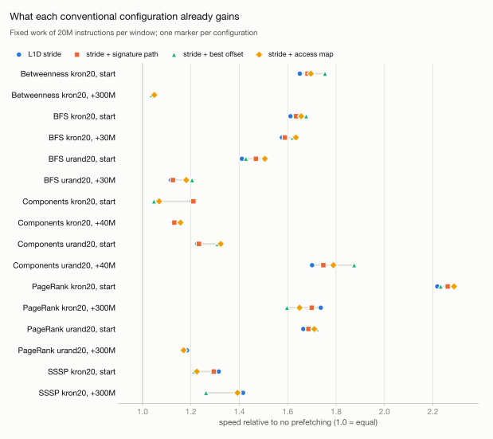
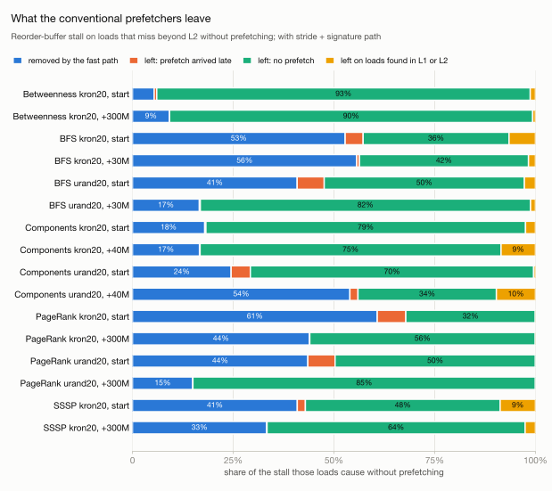
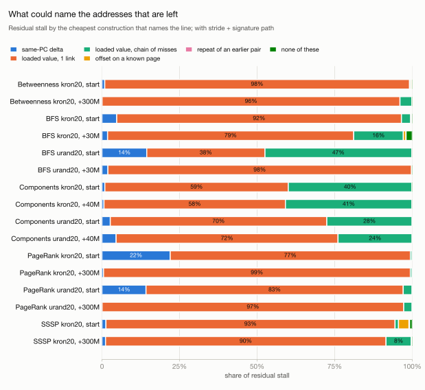
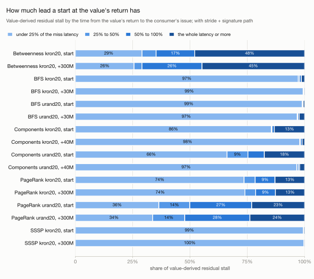
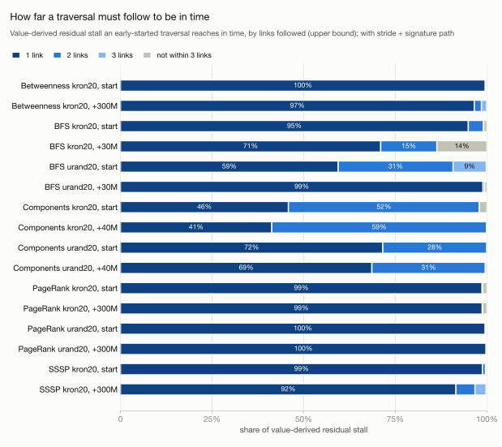

# On GAP, loaded values name what stride and signature-path prefetching leave, and only an early start reaches most of it

**Measurement study, 23 November 2026.** Stage 0 and Stage 1 of the [design memo](../README.md), run in gem5 26.0.0.0 on Sacramento. It contains no neural network and no new prefetcher. It claims neither speedup nor novelty. Every table below is generated from [`tables/`](tables/) by [`analysis/np_markdown.py`](../analysis/np_markdown.py).

[Design memo](../README.md) · [Data-collection specification](../DATA_COLLECTION.md) · [How to run it](../sim/README.md) · [Prompt for the next step](../NEXT_STEP_PROMPT.md)

## Short answers

- **There is a prize.** With an L1D stride prefetcher and an L2 signature-path prefetcher running, loads that missed beyond L2 without prefetching and are still late or missed hold the reorder-buffer head for 18% to 92% of run time across 16 windows (median 65%). Best offset or access map in place of signature path leave about the same: at most 7 points apart in a window.
- **A loaded value names almost all of it.** 78% to 100% of that stall (median 98%) falls on addresses built exactly from a value an earlier load read: an array element, `(value << shift) + base`, or the word of a bit vector that holds bit `value`. One to 6 static relations cover 99% of it in each window, at most 3 of them at one starting PC.
- **Which relation to follow is not a learning problem here.** Given the PC of the load a traversal would start at, a count table that learns as it goes needs 0.00 to 0.98 bits to say which relation names a target (median 0.03). Where that is not near zero, one start feeds two or three relations at once and the plan follows all of them.
- **Whether one instance will miss is not predictable from the contexts tested.** Relation, the producer's cache level and the last two outcomes leave 0.12 to 0.77 bits of a 0.20 to 1.00-bit question. The unit holds the target address before it issues, so it can probe the cache instead of predicting.
- **Reacting when the value returns is too late in 12 of 16 windows.** There the consumer issues a median 1 to 9 cycles after its producer's value returns, its own miss then takes a median 42 to 318 cycles, and 0.2% to 25% of the stall has slack of at least half the miss latency. A unit that starts when the value returns is level with the core. The other four windows, betweenness and PageRank on the uniform graph, have 50% to 71%, because a late branch or full L1D miss registers hold the core up.
- **An early start reaches almost all of it.** Stepping a root whose address continues a delta, reading the other fields of a line a load has opened, or starting from a line that arrives in L2 reaches 41% to 100% of the value-derived residual stall with one link and 86% to 100% within three. This is an open-loop upper bound.
- **The memo's default trigger sees little.** Loads that miss L1D start 0% to 64% of the value-derived residual stall (median 5%). The producers are mostly L1D hits on arrays read in order.
- **Decision.** Build the exact relation table with early starts first, in the loop. These data give no reason to add a learned selector for the relation. What stays open for learning is traversal control and the part no exact relation reaches.
- **Two gem5 baselines are defective in 26.0.** The signature-path prefetcher can walk without end, and the indirect-memory prefetcher stops the simulator. The first is bounded here. The second could not be run, so there is no indirect-memory arm.

## 1. What was run

| | |
|---|---|
| Simulator | gem5 26.0.0.0, out-of-order x86-64 core, syscall emulation, classic caches, one thread |
| Core | 4 GHz, 256-entry reorder buffer, 96 load and 64 store queue entries |
| Caches | L1D 48 KiB 12-way, 4 cycles. L2 512 KiB 8-way, 10 cycles. L3 2 MiB 16-way, 20 cycles. One DDR4-2400 channel |
| Programs | GAP breadth-first search, PageRank, connected components, betweenness centrality and single-source shortest paths, built from source at commit `941462c` |
| Inputs | A Kronecker graph (`kron20`) and a uniform random graph (`urand20`), each with 2^20 vertices and average degree 16, generated by GAP's converter. Breadth-first search, PageRank and components run on both. Betweenness and shortest paths run on the Kronecker graph only. Eight program and input pairs |
| Windows | Two per pair: one at the marker where the kernel starts, one 30M, 40M or 300M instructions later. The offsets were fixed when the workloads were registered, before any capture was measured. Each window is 5M instructions of warm-up, then 20M measured |
| Arms | No prefetching. L1D stride. Stride plus L2 signature path ("fast path"). Stride plus best offset. Stride plus access map |
| Capture | Every committed micro-op, load and store with values, per-load pipeline times, every cache event at three levels, and the contents of lines filled into L2 |

The caches are small on purpose: a 2 MiB last level against graphs of 2^20 vertices keeps the working set outside the cache, as the full-size inputs do on a real last level. Absolute miss rates do not transfer to a larger machine.

**Residual target.** A load that missed beyond L2 without prefetching and, with the fast path, either merged into a prefetch still in flight (late) or missed again. **Stall** is the time a load spent at the reorder-buffer head waiting for its data, in cycles. Only one micro-op is at the head at a time, so stall adds up without double counting.

## 2. The capture can be trusted

Five small programs with a known structure were captured first.

<!-- table:validation_programs -->
| Program | Committed loads | V1 same loads in 3 arms | V2 capture changes nothing | V3 known relations found (shift, base) | V4 counts match gem5 (worst difference) | V5 storage |
|---|---:|---:|---:|---:|---:|---:|
| stride | 500,000 | pass | pass (0 of 1,589 differ) | pass: [] | pass (0.100%) | pass |
| list | 1,000,000 | pass | pass (0 of 1,598 differ) | pass: [(0, 0), (0, 16)] | pass (0.100%) | pass |
| tree | 559,152 | pass | pass (0 of 1,650 differ) | pass: [(0, 0), (0, 16), (0, 8)] | pass (0.124%) | pass |
| csr | 568,056 | pass | pass (0 of 1,662 differ) | pass: [(2, 'array'), (3, 'array')] | pass (0.105%) | pass |
| hash | 235,256 | pass | pass (0 of 1,673 differ) | pass: [(0, 0), (0, 16), (0, 8)] | pass (0.107%) | pass |
<!-- /table:validation_programs -->

V1: every arm commits the same loads at the same addresses. V2: with the capture off and on, every gem5 statistic is equal. V3: the relations extracted from the capture are the ones built into the program. V4: event counts equal gem5's own counters. V5: every stored block reads back. The hash bucket in `hash` is not affine in any loaded value, and the extractor reports it as unexplained, which is correct. V6, the causal-prefix test of the specification, applies to predictor inputs and has nothing to test yet.

The same checks on the GAP windows:

<!-- table:validation_windows -->
| Window | Arms | Committed loads | V1 same loads in every arm | Load values equal in every arm | V4 counts match gem5 (worst difference) | V5 storage |
|---|---:|---:|---:|---:|---:|---:|
| Betweenness kron20, start | 5 | 3,181,596 | pass | yes | pass (0.024%) | pass |
| Betweenness kron20, +300M | 5 | 4,940,253 | pass | yes | pass (0.011%) | pass |
| BFS kron20, start | 5 | 5,048,275 | pass | no | pass (0.014%) | pass |
| BFS kron20, +30M | 5 | 5,863,143 | pass | no | pass (0.010%) | pass |
| BFS urand20, start | 5 | 3,458,375 | pass | no | pass (0.021%) | pass |
| BFS urand20, +30M | 5 | 5,744,524 | pass | no | pass (0.028%) | pass |
| Components kron20, start | 5 | 4,918,221 | pass | yes | pass (0.014%) | pass |
| Components kron20, +40M | 5 | 4,859,413 | pass | yes | pass (0.011%) | pass |
| Components urand20, start | 5 | 5,154,253 | pass | yes | pass (0.012%) | pass |
| Components urand20, +40M | 5 | 4,646,978 | pass | yes | pass (0.014%) | pass |
| PageRank kron20, start | 5 | 6,409,160 | pass | yes | pass (0.026%) | pass |
| PageRank kron20, +300M | 5 | 7,829,002 | pass | yes | pass (0.012%) | pass |
| PageRank urand20, start | 5 | 6,404,044 | pass | yes | pass (0.023%) | pass |
| PageRank urand20, +300M | 5 | 7,807,285 | pass | yes | pass (0.016%) | pass |
| SSSP kron20, start | 5 | 8,231,354 | pass | no | pass (0.016%) | pass |
| SSSP kron20, +300M | 5 | 8,300,523 | pass | yes | pass (0.011%) | pass |
<!-- /table:validation_windows -->

Load values are equal in every arm except where the program reads a clock. GAP times the phases of a kernel. In five windows, the four of breadth-first search and the first of shortest paths, the arms read different values, with the same loads at the same addresses. In breadth-first search on urand20 at the start, 21 of 3,458,375 loads read a different value under stride prefetching than without: 18 at three PCs in the C library and 3 at one PC that restores a register from the stack.

**The signature-path prefetcher had to be bounded.** In gem5 26.0 its lookahead walk continues while a confidence stays above a threshold, and each step multiplies the confidence by the prefetcher's accuracy so far and by a counter ratio. When both are 1 the walk never ends. One window, connected components on kron20 at +40M, stopped advancing during warm-up while its memory grew by about 30 MB per second. Stack samples placed it inside the walk. [`np_spp_guard.hh`](../sim/np_ext/np_spp_guard.hh) stops a walk after 1,024 steps and changes nothing else. Every window was then run again with the bounded class and compared with the capture taken before:

<!-- table:validation_bound -->
| Window | Class in the fast capture | Statistics compared | Differing | Capture window equal | Walks stopped by the bound | Same |
|---|---:|---:|---:|---:|---:|---:|
| Betweenness kron20, start | SignaturePathV2 | 2,206 | 0 | yes | 0 | pass |
| Betweenness kron20, +300M | SignaturePathV2 | 2,067 | 0 | yes | 0 | pass |
| BFS kron20, start | SignaturePathV2 | 2,190 | 0 | yes | 0 | pass |
| BFS kron20, +30M | SignaturePathV2 | 2,204 | 0 | yes | 0 | pass |
| BFS urand20, start | SignaturePathV2 | 2,184 | 0 | yes | 0 | pass |
| BFS urand20, +30M | SignaturePathV2 | 2,151 | 0 | yes | 0 | pass |
| Components kron20, start | SignaturePathV2 | 2,028 | 0 | yes | 0 | pass |
| Components kron20, +40M | NpSignaturePathV2 | 2,185 | 0 | yes | 0 | pass |
| Components urand20, start | SignaturePathV2 | 2,022 | 0 | yes | 0 | pass |
| Components urand20, +40M | SignaturePathV2 | 2,209 | 0 | yes | 0 | pass |
| PageRank kron20, start | SignaturePathV2 | 2,187 | 0 | yes | 0 | pass |
| PageRank kron20, +300M | SignaturePathV2 | 2,042 | 0 | yes | 0 | pass |
| PageRank urand20, start | SignaturePathV2 | 2,200 | 0 | yes | 0 | pass |
| PageRank urand20, +300M | SignaturePathV2 | 2,039 | 0 | yes | 0 | pass |
| SSSP kron20, start | SignaturePathV2 | 2,230 | 0 | yes | 0 | pass |
| SSSP kron20, +300M | SignaturePathV2 | 2,192 | 0 | yes | 0 | pass |
<!-- /table:validation_bound -->

All 16 reruns reproduce the capture taken before: 2,022 to 2,230 gem5 statistics are equal in each, the capture window opens and closes at the same ticks, and no walk reached the bound inside a measured window. In the window that hung, the walk that did not end falls in the warm-up, so its fast-path capture exists only with the bounded class, and its two runs with that class agree. The rebuilt simulator was also checked on an arm without this prefetcher: stride on breadth-first search, urand20, gave 2,091 equal statistics.

**The indirect-memory prefetcher could not be run.** With `prefetch_on_access`, which it needs to see index values, gem5 26.0 stops with `PrefetchInfo::get called with a request with no data` at the first index it tries to read: the notification for a read hit no longer carries the data. Read by inspection, its prefetch loop also pushes the address of the current index several times instead of looking ahead. No result for it is reported. The bound in section 5 says what an ideal prefetcher of that kind could reach.

## 3. What the conventional prefetchers gain and leave (M1)



<!-- table:arms -->
| Window | IPC, no prefetch | Stride | Stride + signature path | Stride + best offset | Stride + access map |
|---|---:|---:|---:|---:|---:|
| Betweenness kron20, start | 0.167 | 1.65 | 1.68 | 1.75 | 1.70 |
| Betweenness kron20, +300M | 0.207 | 1.05 | 1.05 | 1.04 | 1.05 |
| BFS kron20, start | 0.357 | 1.61 | 1.63 | 1.68 | 1.66 |
| BFS kron20, +30M | 0.476 | 1.58 | 1.59 | 1.62 | 1.63 |
| BFS urand20, start | 0.284 | 1.41 | 1.47 | 1.43 | 1.51 |
| BFS urand20, +30M | 0.251 | 1.12 | 1.13 | 1.20 | 1.18 |
| Components kron20, start | 0.312 | 1.20 | 1.21 | 1.05 | 1.07 |
| Components kron20, +40M | 0.281 | 1.13 | 1.13 | 1.16 | 1.16 |
| Components urand20, start | 0.310 | 1.23 | 1.23 | 1.31 | 1.32 |
| Components urand20, +40M | 0.325 | 1.70 | 1.75 | 1.87 | 1.79 |
| PageRank kron20, start | 0.284 | 2.22 | 2.26 | 2.23 | 2.29 |
| PageRank kron20, +300M | 0.219 | 1.74 | 1.70 | 1.60 | 1.65 |
| PageRank urand20, start | 0.268 | 1.66 | 1.69 | 1.72 | 1.71 |
| PageRank urand20, +300M | 0.197 | 1.18 | 1.17 | 1.17 | 1.17 |
| SSSP kron20, start | 0.302 | 1.31 | 1.29 | 1.21 | 1.22 |
| SSSP kron20, +300M | 0.419 | 1.42 | 1.39 | 1.26 | 1.39 |
| Geometric mean |  | 1.42 | 1.43 | 1.42 | 1.43 |
<!-- /table:arms -->

Speed is cycles without prefetching divided by cycles with the configuration, for the same 20M instructions. The L1D stride prefetcher gives nearly all of the gain. An L2 prefetcher on top changes a window by −2% to +4% with signature path, −13% to +10% with best offset and −11% to +8% with access map, and the geometric mean stays at 1.42 to 1.43.



<!-- table:residual -->
| Window | Original misses beyond L2 | First use of a prefetched line in L1 | Found in L1 | Found in L2 | Late | Missed again | Their stall without prefetching, share of run time | Residual stall, share of run time |
|---|---:|---:|---:|---:|---:|---:|---:|---:|
| Betweenness kron20, start | 383,764 | 30,082 | 40,069 | 20,677 | 7,897 | 285,039 | 39% | 62% |
| Betweenness kron20, +300M | 646,670 | 15,471 | 120,066 | 39,059 | 1,035 | 471,039 | 89% | 84% |
| BFS kron20, start | 128,225 | 35,768 | 16,836 | 14,364 | 12,875 | 48,382 | 26% | 18% |
| BFS kron20, +30M | 120,708 | 63,171 | 6,588 | 3,993 | 1,910 | 45,046 | 51% | 34% |
| BFS urand20, start | 341,854 | 26,781 | 10,414 | 17,489 | 70,503 | 216,667 | 61% | 50% |
| BFS urand20, +30M | 269,163 | 44,113 | 23,159 | 13,741 | 1,385 | 186,765 | 62% | 57% |
| Components kron20, start | 437,756 | 88,439 | 15,745 | 17,677 | 8,037 | 307,858 | 71% | 68% |
| Components kron20, +40M | 192,129 | 19,235 | 19,031 | 18,636 | 1,060 | 134,167 | 43% | 36% |
| Components urand20, start | 795,854 | 307,650 | 5,002 | 15,169 | 165,872 | 302,161 | 78% | 72% |
| Components urand20, +40M | 184,789 | 62,349 | 29,446 | 15,520 | 6,854 | 70,620 | 40% | 25% |
| PageRank kron20, start | 1,133,520 | 77,557 | 28,109 | 8,314 | 111,854 | 907,686 | 88% | 78% |
| PageRank kron20, +300M | 2,486,235 | 147,277 | 66,537 | 20,802 | 8,755 | 2,242,864 | 89% | 85% |
| PageRank urand20, start | 1,476,943 | 93,467 | 15,642 | 11,044 | 109,660 | 1,247,130 | 90% | 86% |
| PageRank urand20, +300M | 3,276,206 | 183,653 | 35,258 | 28,652 | 1,970 | 3,026,673 | 93% | 92% |
| SSSP kron20, start | 335,565 | 33,189 | 64,900 | 38,631 | 16,269 | 182,576 | 51% | 33% |
| SSSP kron20, +300M | 719,141 | 97,347 | 29,372 | 17,863 | 3,474 | 571,085 | 82% | 74% |
<!-- /table:residual -->

With the fast path, a load that missed beyond L2 without prefetching ends in one of five ways. It is the first use of a prefetched line in L1D. It finds the line in L1D, where an earlier load or prefetch had already brought and used it. It finds the line in L2. It merges into a prefetch that is still in flight (late). Or it misses beyond L2 again. The last two are the residual. A load that waits on a line another load is already fetching has no miss of its own beyond L1D and is not counted, so the residual is, if anything, understated.

The residual hardly depends on which L2 prefetcher is used. Across the four configurations it differs by at most 7 points in a window and by 3 at the median. The same quantity against each configuration, as a share of that configuration's run time:

<!-- table:residual_arms -->
| Window | Stride | Stride + signature path | Stride + best offset | Stride + access map |
|---|---:|---:|---:|---:|
| Betweenness kron20, start | 61% | 62% | 63% | 61% |
| Betweenness kron20, +300M | 85% | 84% | 84% | 85% |
| BFS kron20, start | 18% | 18% | 17% | 16% |
| BFS kron20, +30M | 35% | 34% | 33% | 33% |
| BFS urand20, start | 53% | 50% | 49% | 48% |
| BFS urand20, +30M | 58% | 57% | 52% | 51% |
| Components kron20, start | 68% | 68% | 71% | 72% |
| Components kron20, +40M | 37% | 36% | 34% | 36% |
| Components urand20, start | 73% | 72% | 70% | 70% |
| Components urand20, +40M | 26% | 25% | 22% | 24% |
| PageRank kron20, start | 79% | 78% | 77% | 77% |
| PageRank kron20, +300M | 85% | 85% | 86% | 85% |
| PageRank urand20, start | 86% | 86% | 84% | 85% |
| PageRank urand20, +300M | 92% | 92% | 92% | 92% |
| SSSP kron20, start | 35% | 33% | 31% | 31% |
| SSSP kron20, +300M | 74% | 74% | 74% | 74% |
<!-- /table:residual_arms -->

## 4. What names the addresses that are left (M2)



<!-- table:mechanism -->
| Window | Residual targets | Same-PC delta | Loaded value, 1 link | Loaded value, chain of misses | Offset on a known page | Repeat of an earlier pair | None | Of the value classes: bit-vector index |
|---|---:|---:|---:|---:|---:|---:|---:|---:|
| Betweenness kron20, start | 292,936 | 0.9% | 98.2% | 0.4% | 0.4% | 0.0% | 0.1% | 0.0% |
| Betweenness kron20, +300M | 472,074 | 0.0% | 96.0% | 3.8% | 0.0% | 0.0% | 0.1% | 0.0% |
| BFS kron20, start | 61,257 | 4.7% | 91.8% | 3.0% | 0.2% | 0.0% | 0.3% | 8.4% |
| BFS kron20, +30M | 46,956 | 1.8% | 79.3% | 16.0% | 0.9% | 0.0% | 2.0% | 20.0% |
| BFS urand20, start | 287,170 | 14.4% | 38.1% | 47.3% | 0.0% | 0.1% | 0.0% | 0.0% |
| BFS urand20, +30M | 188,150 | 1.9% | 97.9% | 0.1% | 0.0% | 0.0% | 0.1% | 0.9% |
| Components kron20, start | 315,895 | 0.9% | 59.1% | 39.8% | 0.0% | 0.0% | 0.1% | 0.0% |
| Components kron20, +40M | 135,227 | 0.6% | 58.5% | 40.8% | 0.0% | 0.0% | 0.0% | 0.0% |
| Components urand20, start | 468,033 | 2.7% | 69.8% | 27.5% | 0.0% | 0.0% | 0.0% | 0.0% |
| Components urand20, +40M | 77,474 | 4.5% | 71.5% | 23.9% | 0.0% | 0.0% | 0.0% | 0.0% |
| PageRank kron20, start | 1,019,540 | 22.0% | 77.4% | 0.6% | 0.0% | 0.0% | 0.0% | 0.0% |
| PageRank kron20, +300M | 2,251,619 | 0.5% | 98.9% | 0.6% | 0.0% | 0.0% | 0.0% | 0.0% |
| PageRank urand20, start | 1,356,790 | 14.2% | 82.9% | 2.9% | 0.0% | 0.0% | 0.0% | 0.0% |
| PageRank urand20, +300M | 3,028,643 | 0.0% | 97.2% | 2.7% | 0.0% | 0.0% | 0.0% | 0.0% |
| SSSP kron20, start | 198,845 | 1.3% | 93.2% | 1.1% | 3.4% | 0.2% | 0.8% | 0.0% |
| SSSP kron20, +300M | 574,559 | 1.1% | 90.4% | 8.1% | 0.1% | 0.0% | 0.2% | 0.0% |
<!-- /table:mechanism -->

Each residual target is put in the first class that names its address, in this order. *Same-PC delta*: the last two address steps of this PC were equal, so one more step names it. *Loaded value*: the address is `(value << shift) + base` for a value an earlier load returned, with the base constant for that pair of PCs and a shift of 0 to 3, or it is the word of a bit vector that holds bit `value`, `((value >> 6) << 3) + base` for 64-bit words. The last column says how much of the value classes is of the second form. One link means the producer of the value did not itself wait on a long miss. A chain means it did. *Offset on a known page*: the page is one of the last 64 pages that missed L1D. *Repeat*: the previous miss was followed by this line before. Shares are of residual stall.

Three readings. A same-PC delta the fast path still leaves is a timing shortfall of the fast path, not a missing address: in PageRank and in the first BFS window on urand20 it is one tight loop that reads two neighbouring entries of the index array per vertex and outruns the prefetchers. The value-derived share is what the memo's plan grammar was written for. "None" is where the extractor ends, and it is at most 2% of residual stall in a window. Before the bit-vector form was added it was 19% in one breadth-first-search window: the test of the frontier bitmap, whose address is `base + 8 × (v >> 6)`. That was a limit of the forms the extractor tries, not of copying address bits. Up to 20% of residual stall is of that form.

### What the relations are

The largest relations of five windows, covering each kind of kernel step seen so far. The form and the shares are measured. The function names come from the symbols at the two PCs. What each array is called is our reading of GAP's source. [`tables/windows/`](tables/windows/) has the same description for every window, with the instructions at each PC.

| Window, function | Share of residual stall | Address of the target | What it is | Reached by a stepped root | By the same line | By a fill tap | By any of them |
|---|---:|---|---|---:|---:|---:|---:|
| BFS urand20, start, `TDStep` | 61% | `(v << 2) + base` | neighbour id → its entry in the parent array | 100% | 87% | 92% | 100% |
| | 21% | `v` | index entry → first line of that vertex's neighbour list | 100% | 94% | 100% | 100% |
| | 3% | `(v << 3) + base` | queue entry → that vertex's index entry | 100% | 88% | 99% | 100% |
| BFS urand20, +30M, `BUStep` | 94% | `v` | index entry → first line of that vertex's neighbour list | 2% | 55% | 99% | 99% |
| BFS kron20, +30M, `BUStep` | 75% | `v` | index entry → first line of that vertex's neighbour list | 6% | 11% | 84% | 85% |
| | 17% | `((v >> 6) << 3) + base` | neighbour id → the word of the frontier bitmap that holds its bit | 2% | 30% | 89% | 89% |
| Components kron20, start, `Afforest` and `Link` | 65% | `(v << 2) + base` | neighbour id → its entry in the component array | 100% | 63% | 99% | 100% |
| | 20% | `v` | index entry → first line of that vertex's neighbour list | 100% | 71% | 99% | 100% |
| | 14% | `(v << 2) + base` | component id → the entry of that component: a chain | 23% | 75% | 76% | 85% |
| PageRank kron20, start, `PageRankPullGS` | 78% | `(v << 2) + base` | neighbour id → its entry in the contribution array | 91% | 43% | 94% | 99% |

The pattern is the one index-array prefetchers were built for, plus two things they do not do: the pointer from an index entry to a neighbour list, and the chain inside the component array.

## 5. How early the address can be known (M3)



<!-- table:lead -->
| Window | Value-derived residual targets | Slack p50, cycles | Slack p90 | Miss latency p50, cycles | Stall with slack of at least half the latency | Stall whose consumer was fetched after the value returned | Cycles with L1D blocked for lack of a miss register | Removable by one link at best |
|---|---:|---:|---:|---:|---:|---:|---:|---:|
| Betweenness kron20, start | 289,965 | 43 | 1,102 | 215 | 64.8% | 9% | 0.0% | 79% |
| Betweenness kron20, +300M | 471,614 | 24 | 561 | 318 | 70.9% | 82% | 0.0% | 95% |
| BFS kron20, start | 60,236 | 2 | 11 | 211 | 2.2% | 24% | 0.1% | 65% |
| BFS kron20, +30M | 45,032 | 3 | 11 | 204 | 0.4% | 70% | 0.0% | 26% |
| BFS urand20, start | 214,293 | 2 | 4 | 318 | 0.9% | 1% | 0.0% | 52% |
| BFS urand20, +30M | 187,281 | 1 | 1 | 204 | 2.9% | 5% | 0.0% | 21% |
| Components kron20, start | 314,696 | 2 | 17 | 261 | 14.2% | 19% | 0.0% | 39% |
| Components kron20, +40M | 134,994 | 1 | 17 | 238 | 1.8% | 9% | 0.0% | 25% |
| Components urand20, start | 466,605 | 9 | 281 | 152 | 24.7% | 2% | 0.0% | 68% |
| Components urand20, +40M | 76,395 | 2 | 8 | 42 | 2.7% | 1% | 0.0% | 44% |
| PageRank kron20, start | 906,704 | 1 | 92 | 56 | 21.6% | 0% | 7.9% | 100% |
| PageRank kron20, +300M | 2,248,260 | 1 | 82 | 55 | 21.4% | 0% | 10.9% | 100% |
| PageRank urand20, start | 1,245,593 | 82 | 341 | 358 | 50.1% | 0% | 29.8% | 100% |
| PageRank urand20, +300M | 3,027,753 | 99 | 346 | 357 | 52.3% | 0% | 36.1% | 100% |
| SSSP kron20, start | 183,646 | 6 | 7 | 204 | 0.5% | 0% | 0.0% | 99% |
| SSSP kron20, +300M | 571,172 | 6 | 7 | 44 | 0.2% | 0% | 0.0% | 93% |
<!-- /table:lead -->

Slack is the time from the return of the value to the issue of the load that uses it, in the fast-path arm. In 12 of the 16 windows it is a few cycles at the median, and 0.2% to 25% of the stall has slack of at least half the miss latency: the out-of-order core issues the dependent load as soon as the value arrives, and the miss that follows takes one to two orders of magnitude longer. A traversal unit that waits for the producer's data, as the memo proposed by default, starts level with the core there.

The other four windows have slack because something else holds the core up. In PageRank on the uniform graph the L1D cache has no free miss register for 30% and 36% of the cycles, so a load whose address is ready waits to issue. In betweenness the load of a neighbour's path count follows a branch on that neighbour's depth, which is itself a miss: in the second window the consumer was fetched only after the value had returned for 82% of the stall. In the first betweenness window the consumer was already in the pipeline for 91% of the stall and waited for something this study did not isolate. In these four windows 50% to 71% of the stall has slack of at least half the miss latency, so a request issued when the value returns would be ahead of the core.

"Removable by one link at best" counts a target's whole stall when its producer's address continues a delta, and otherwise only its slack.

Being early needs a start that is ahead of the program. Three ways were measured, each as an upper bound.

- **Stepped root.** Walk up the dependence chain to a load whose address continues a same-PC delta, step that address *d* instances ahead, and follow the chain from there, paying the measured fetch time of every line on the way. This is what an indirect-memory prefetcher does with one link.
- **Same line.** When a load opens a line, the other fields of the line are visible too. A root in such a line is known as early as the first load of that line returned, provided nothing stored to it since.
- **Fill tap.** A line that arrives in L2, by a demand miss or by a conventional prefetch, is visible there before the loads that will read its other fields. A root in such a line is known from the fill, provided nothing stored to it since. Only fills inside the measured window count.



<!-- table:reach -->
| Window | Stepped root, 1 link | Same line, 1 link | Fill tap, 1 link | Any of the three, 1 link | Up to 2 links | Up to 3 links | The same as a share of all residual stall | Targets per stepped start, p99 | Targets per line, p99 |
|---|---:|---:|---:|---:|---:|---:|---:|---:|---:|
| Betweenness kron20, start | 54% | 92% | 99% | 100% | 100% | 100% | 99% | 2 | 29 |
| Betweenness kron20, +300M | 91% | 80% | 95% | 97% | 99% | 100% | 100% | 7 | 10 |
| BFS kron20, start | 45% | 29% | 94% | 95% | 99% | 99% | 96% | 2 | 8 |
| BFS kron20, +30M | 5% | 10% | 70% | 71% | 86% | 86% | 83% | 2 | 3 |
| BFS urand20, start | 40% | 20% | 37% | 59% | 91% | 100% | 86% | 23 | 67 |
| BFS urand20, +30M | 3% | 56% | 99% | 99% | 99% | 99% | 99% | 2 | 4 |
| Components kron20, start | 24% | 31% | 44% | 46% | 98% | 98% | 97% | 2 | 7 |
| Components kron20, +40M | 20% | 18% | 40% | 41% | 100% | 100% | 100% | 2 | 4 |
| Components urand20, start | 39% | 51% | 62% | 72% | 100% | 100% | 99% | 2 | 9 |
| Components urand20, +40M | 39% | 33% | 68% | 69% | 100% | 100% | 97% | 2 | 9 |
| PageRank kron20, start | 91% | 35% | 93% | 99% | 99% | 99% | 77% | 7 | 17 |
| PageRank kron20, +300M | 90% | 35% | 94% | 99% | 99% | 99% | 98% | 6 | 16 |
| PageRank urand20, start | 99% | 57% | 97% | 100% | 100% | 100% | 86% | 21 | 90 |
| PageRank urand20, +300M | 99% | 60% | 98% | 100% | 100% | 100% | 100% | 20 | 87 |
| SSSP kron20, start | 98% | 38% | 96% | 99% | 100% | 100% | 95% | 1 | 6 |
| SSSP kron20, +300M | 91% | 14% | 88% | 92% | 97% | 100% | 98% | 1 | 12 |
<!-- /table:reach -->

The stepped root alone, by how far ahead it is stepped, with up to three links:

<!-- table:reach_distance -->
| Window | 1 ahead | 2 ahead | 4 ahead | 8 ahead | 16 ahead | 32 ahead | 64 ahead |
|---|---:|---:|---:|---:|---:|---:|---:|
| Betweenness kron20, start | 46% | 48% | 51% | 53% | 54% | 55% | 55% |
| Betweenness kron20, +300M | 62% | 67% | 76% | 87% | 95% | 97% | 98% |
| BFS kron20, start | 5% | 8% | 13% | 26% | 42% | 49% | 50% |
| BFS kron20, +30M | 1% | 2% | 3% | 5% | 6% | 7% | 7% |
| BFS urand20, start | 88% | 89% | 90% | 92% | 98% | 100% | 100% |
| BFS urand20, +30M | 2% | 3% | 3% | 3% | 3% | 3% | 3% |
| Components kron20, start | 21% | 34% | 56% | 81% | 88% | 90% | 90% |
| Components kron20, +40M | 13% | 23% | 50% | 85% | 96% | 98% | 98% |
| Components urand20, start | 32% | 48% | 77% | 98% | 99% | 100% | 100% |
| Components urand20, +40M | 35% | 60% | 87% | 95% | 98% | 98% | 99% |
| PageRank kron20, start | 27% | 33% | 39% | 42% | 45% | 55% | 91% |
| PageRank kron20, +300M | 27% | 33% | 38% | 41% | 43% | 53% | 91% |
| PageRank urand20, start | 85% | 87% | 88% | 88% | 90% | 97% | 100% |
| PageRank urand20, +300M | 86% | 87% | 88% | 89% | 90% | 97% | 100% |
| SSSP kron20, start | 15% | 26% | 45% | 73% | 95% | 99% | 100% |
| SSSP kron20, +300M | 15% | 19% | 23% | 35% | 72% | 98% | 100% |
<!-- /table:reach_distance -->

These numbers are optimistic in three ways. They ignore queue and bandwidth limits. They assume the right fields are followed and no others. And they use the pace of the fast-path arm: a program that speeds up needs a longer distance for the same coverage. Stage 2 has to replace them with closed-loop measurement.

Which start matters depends on the kernel step. In PageRank, in shortest paths and in the second betweenness window a stepped root with one link reaches 90% to 99%: an index array is read in order and its values index another array, the case an indirect-memory prefetcher was designed for. In the bottom-up step of breadth-first search the stepped root reaches 3% to 5% and the fill tap 70% to 99%: the index array is read only for unvisited vertices, so its addresses do not continue a delta, while its lines reach L2 well ahead. In components one link reaches 41% to 72% and two links 98% to 100%, because the target of the first link is the root of the second. The distance needed differs as much: PageRank on the Kronecker graph reaches 45% at 16 instances ahead and 91% at 64, components 81% to 98% at 8.

## 6. How uncertain the decisions are (M4)

Bits per decision of a count table. "Online" scores every decision with the counts of the decisions before it, so warm-up and phase changes are charged. "Held out in phase" trains on alternate blocks of 4,096 decisions and tests on the others.

**Which relation.** For each value-derived residual target, which static relation names it:

<!-- table:choice -->
| Window | No context | PC of the starting load | The same, held out in phase | PC of the target load | Residual stall whose starting load missed L1D |
|---|---:|---:|---:|---:|---:|
| Betweenness kron20, start | 1.570 | 0.562 | 0.566 | 0.674 | 1% |
| Betweenness kron20, +300M | 1.280 | 0.983 | 0.982 | 0.117 | 5% |
| BFS kron20, start | 1.788 | 0.063 | 0.059 | 0.011 | 5% |
| BFS kron20, +30M | 1.329 | 0.269 | 0.242 | 0.241 | 19% |
| BFS urand20, start | 0.867 | 0.202 | 0.201 | 0.186 | 64% |
| BFS urand20, +30M | 0.557 | 0.390 | 0.386 | 0.089 | 0% |
| Components kron20, start | 1.216 | 0.000 | 0.000 | 0.000 | 43% |
| Components kron20, +40M | 1.283 | 0.014 | 0.013 | 0.048 | 46% |
| Components urand20, start | 1.075 | 0.000 | 0.000 | 0.000 | 33% |
| Components urand20, +40M | 1.831 | 0.120 | 0.121 | 0.124 | 28% |
| PageRank kron20, start | 0.004 | 0.001 | 0.001 | 0.001 | 3% |
| PageRank kron20, +300M | 0.004 | 0.001 | 0.001 | 0.001 | 3% |
| PageRank urand20, start | 0.016 | 0.005 | 0.005 | 0.005 | 2% |
| PageRank urand20, +300M | 0.015 | 0.004 | 0.004 | 0.004 | 2% |
| SSSP kron20, start | 1.100 | 0.024 | 0.016 | 0.012 | 3% |
| SSSP kron20, +300M | 0.186 | 0.034 | 0.034 | 0.022 | 11% |
<!-- /table:choice -->

Given the PC a traversal would start at, almost nothing is left to decide. The last column is the share of value-derived residual stall whose starting load missed L1D. Where it is small, a unit triggered by L1D misses never sees the start.

**Whether to act.** For every load whose address some relation names, whether it is a residual target:

<!-- table:gate -->
| Window | Loads named by a relation | Of them residual targets | No context | Relation | Relation, producer's cache level | Relation, last 2 outcomes | All three | All three, held out in phase |
|---|---:|---:|---:|---:|---:|---:|---:|---:|
| Betweenness kron20, start | 1,152,730 | 25.2% | 0.814 | 0.438 | 0.437 | 0.373 | 0.372 | 0.372 |
| Betweenness kron20, +300M | 2,348,100 | 20.1% | 0.724 | 0.466 | 0.456 | 0.393 | 0.386 | 0.386 |
| BFS kron20, start | 792,123 | 7.6% | 0.388 | 0.361 | 0.360 | 0.314 | 0.313 | 0.332 |
| BFS kron20, +30M | 217,515 | 20.7% | 0.736 | 0.594 | 0.591 | 0.505 | 0.504 | 0.505 |
| BFS urand20, start | 1,086,786 | 19.7% | 0.716 | 0.560 | 0.454 | 0.412 | 0.346 | 0.345 |
| BFS urand20, +30M | 1,478,941 | 12.7% | 0.548 | 0.282 | 0.282 | 0.281 | 0.280 | 0.280 |
| Components kron20, start | 1,239,590 | 25.4% | 0.817 | 0.690 | 0.689 | 0.690 | 0.688 | 0.688 |
| Components kron20, +40M | 1,787,906 | 7.6% | 0.386 | 0.262 | 0.246 | 0.260 | 0.244 | 0.244 |
| Components urand20, start | 1,522,994 | 30.6% | 0.889 | 0.697 | 0.697 | 0.653 | 0.653 | 0.653 |
| Components urand20, +40M | 2,521,245 | 3.0% | 0.196 | 0.126 | 0.123 | 0.122 | 0.119 | 0.119 |
| PageRank kron20, start | 1,679,782 | 54.0% | 0.995 | 0.767 | 0.767 | 0.767 | 0.767 | 0.769 |
| PageRank kron20, +300M | 4,081,003 | 55.1% | 0.993 | 0.770 | 0.770 | 0.769 | 0.769 | 0.769 |
| PageRank urand20, start | 2,495,736 | 49.9% | 1.000 | 0.297 | 0.297 | 0.297 | 0.297 | 0.296 |
| PageRank urand20, +300M | 6,071,708 | 49.9% | 1.000 | 0.297 | 0.297 | 0.297 | 0.297 | 0.297 |
| SSSP kron20, start | 1,709,707 | 10.7% | 0.492 | 0.368 | 0.366 | 0.324 | 0.323 | 0.323 |
| SSSP kron20, +300M | 2,178,341 | 26.2% | 0.830 | 0.471 | 0.471 | 0.445 | 0.444 | 0.444 |
<!-- /table:gate -->

The relation removes part of the uncertainty. The producer's cache level and the outcomes of the relation's last instances remove little more. Whether a given vertex's line is already cached depends on the data, not on the code. Two things follow. A gate that predicts single instances from these contexts is not supported by this measurement. And it is not needed: the unit computes the target address before it issues, so the issuer can drop a request whose line is present. What a table can hold per relation is whether following it pays at all in the current phase.

Not measured: contexts built from the arriving line's contents or from the target address, which the memo listed. The contents of every line filled into L2 are captured, and that analysis is the first item of the next step.

## 7. Sizes (M5 to M8)

<!-- table:sizes -->
| Window | Relations for 50% of value-derived residual stall | For 90% | For 99% | Most of those at one starting PC | Largest relation | Micro-ops from value to address, p99 | Loads from nearest producer to target, p50 | The same, p99 | L1D misses from nearest producer to target, p99 | Loads at starting PCs per 1,000 cycles | L1D-miss loads per 1,000 cycles | L1D-miss loads within 4 cycles of the previous | Target page among the last 64 miss pages |
|---|---:|---:|---:|---:|---:|---:|---:|---:|---:|---:|---:|---:|---:|
| Betweenness kron20, start | 1 | 2 | 3 | 2 | shift 3, 67% | 2 | 6 | 6 | 2 | 9.0 | 6.2 | 9% | 58% |
| Betweenness kron20, +300M | 1 | 2 | 4 | 2 | shift 3, 86% | 2 | 6 | 6 | 3 | 17.0 | 9.6 | 12% | 4% |
| BFS kron20, start | 1 | 3 | 6 | 2 | shift 0, 66% | 2 | 2 | 2 | 1 | 26.7 | 10.6 | 22% | 79% |
| BFS kron20, +30M | 1 | 2 | 4 | 2 | shift 0, 79% | 2 | 1 | 2 | 1 | 25.1 | 5.5 | 22% | 35% |
| BFS urand20, start | 1 | 2 | 3 | 1 | shift 2, 71% | 11 | 2 | 34 | 13 | 13.3 | 28.2 | 66% | 4% |
| BFS urand20, +30M | 1 | 1 | 4 | 3 | shift 0, 94% | 2 | 1 | 6 | 3 | 12.1 | 9.1 | 6% | 87% |
| Components kron20, start | 1 | 3 | 3 | 1 | shift 2, 66% | 3 | 3 | 3 | 2 | 28.4 | 11.8 | 18% | 21% |
| Components kron20, +40M | 1 | 2 | 5 | 1 | shift 2, 77% | 5 | 3 | 3 | 2 | 32.1 | 5.6 | 3% | 16% |
| Components urand20, start | 1 | 2 | 3 | 1 | shift 2, 61% | 3 | 1 | 3 | 2 | 29.6 | 14.8 | 3% | 39% |
| Components urand20, +40M | 1 | 2 | 5 | 1 | shift 2, 57% | 5 | 3 | 3 | 2 | 95.6 | 20.4 | 23% | 36% |
| PageRank kron20, start | 1 | 1 | 1 | 1 | shift 2, 100% | 1 | 1 | 1 | 1 | 46.0 | 80.7 | 63% | 23% |
| PageRank kron20, +300M | 1 | 1 | 1 | 1 | shift 2, 100% | 1 | 1 | 1 | 1 | 65.3 | 62.1 | 40% | 25% |
| PageRank urand20, start | 1 | 1 | 1 | 1 | shift 2, 100% | 1 | 1 | 1 | 1 | 32.7 | 57.8 | 51% | 3% |
| PageRank urand20, +300M | 1 | 1 | 1 | 1 | shift 2, 100% | 1 | 1 | 1 | 1 | 40.6 | 39.5 | 19% | 3% |
| SSSP kron20, start | 1 | 2 | 4 | 1 | shift 2, 59% | 2 | 5 | 5 | 2 | 24.5 | 10.6 | 25% | 73% |
| SSSP kron20, +300M | 1 | 1 | 3 | 1 | shift 2, 93% | 2 | 2 | 3 | 2 | 30.0 | 28.3 | 22% | 29% |
<!-- /table:sizes -->

- **M5 Relation reuse.** A handful of relations carries the value-derived residual. A table of that many entries would hold them if its replacement keeps the useful ones: each window has 3 to 825 static relations among all loads, most of them between loads that never miss.
- **M6 Trigger rate.** Loads at the PCs where a traversal would start arrive at 9.0 to 95.6 per thousand cycles. That is the rate at which a relation table is consulted. L1D-miss loads arrive in bursts: 3% to 66% of them follow the previous one within four cycles.
- **M7 Operand age.** The value is used 1 to 6 loads after its nearest producer at the median and 1 to 34 at the 99th percentile, with 1 to 13 L1D misses in between at the 99th percentile. A window of a few dozen recent loads holds every producer. None of the value-derived residual stall passes through a store and a reload.
- **M8 Translation.** 87% to 100% of value-derived residual stall is on another page than its producer, so a traversal needs the data TLB. 3% to 87% of value-derived residual stall is on one of the last 64 pages that missed L1D. Data-TLB misses were not captured.

M9, sensitivity to the issue budget, needs a unit that issues requests and is left to Stage 2.

### The memo's hardware budget sheet, filled where measured

| Line | Measured here | Not yet known |
|---|---|---|
| Weights | None is warranted for the choice of relation (section 6) | Whether traversal control needs any |
| Relation memory | 1 to 6 relations per window for 99% of value-derived residual stall, at most 3 at one starting PC. Each is a pair of PCs, a form (four shifts or a bit vector) and a base | Replacement policy under 3 to 825 competing relations. Base width |
| Producer window | The nearest producer is 1 to 34 loads back at the 99th percentile | Behaviour on programs with deeper call chains |
| Dependence tags at rename | 1 to 11 micro-ops between the value and the address at the 99th percentile. None of the value-derived residual stall passes through a store and a reload | Tag bits per register |
| Traversal registers | Up to three links. At the 99th percentile a stepped start names 1 to 23 targets and a line 3 to 90 | Lifetime bound. Behaviour under queue pressure |
| Fill tap | Needed: section 5 | Width of the tap. Cost of scanning fills that hold no root |
| Translation port | Needed: targets are on other pages | Data-TLB miss rate of generated addresses |
| Latency budget | None at a start on the value's return in 12 of 16 windows. With an early start the budget is the reach in section 5 | Tolerable latency per link in the loop |

## 8. What this decides

The memo set three stop rules.

1. *If the residual is inside run-to-run variation, stop.* It is not: 18% to 92% of run time. The runs are deterministic, so the variation that matters is across windows, and every window clears it.
2. *If value-derived targets with positive lead are a small share, drop the traversal unit.* With a start at the value's return they are a small share in 12 of 16 windows. With an early start they are 86% to 100%. The traversal unit stays, and its trigger changes: it starts at a stepped root, at the other fields of a line a load has opened, or at a fill. A start at the value's return is kept as a fourth way, because it has lead where a late branch or full miss registers hold the core up.
3. *If the gate and field choices are nearly deterministic given the relation memory, build the table-only design.* The field choice is. The single-instance gate is not, and no tested context makes it so, but a probe of the cache answers it exactly. So the next design is the exact relation table with early starts and a per-relation usefulness count, and it contains no learned selector.

What stays open for a learned component, in order of how much stall is at stake in these windows:

- **How far ahead, how deep and how wide to go.** The reach tables show that the useful distance and width differ by program and by phase. A fixed setting will waste requests in one phase and arrive late in another. Whether a small learned controller beats per-relation counters here is a Stage 2 question.
- **The part no exact relation reaches early.** At most 14% of value-derived residual stall in a window, in the bottom-up step of breadth-first search on the Kronecker graph. Why those index entries are not visible early was not separated. Elsewhere the three early starts leave at most 2%.
- **Generalisation to a PC never seen.** Not exercised: every relation here was learned and scored on the same binary.

## 9. Limits

- One suite, two synthetic graphs of one size, one machine configuration, 20M-instruction windows. The mix of mechanisms will differ on pointer-linked data structures, which GAP's arrays do not contain. The validation programs `list`, `tree` and `hash` were captured and are not part of these tables.
- The reach numbers are open-loop upper bounds.
- The classes in section 4 are assigned in a fixed order, so a target that both a delta and a value could name counts as a delta.
- A relation needs at least 16 instances with one base, a tenth of the pair's instances, and four distinct addresses. Rarer relations count as "none".
- Stall at the reorder-buffer head is a proxy for lost time. Removing a stall does not return all of it when the next load stalls instead.
- No indirect-memory baseline, for the reason in section 2. No temporal prefetcher was run.
- Wrong-path loads, prefetch lifecycle events, data-TLB misses and queue occupancy are specified in the data-collection specification and not captured yet.

## 10. Reproduce

On Sacramento, from `gem5_neural_prefetch/`:

```bash
source sim/env.sh
```

```bash
bash sim/build_gem5.sh 16
```

```bash
bash workloads/micro/build.sh && bash workloads/gap/setup.sh
```

```bash
bash sim/run_matrix.sh 14
```

```bash
python analysis/np_report.py && python analysis/np_walker.py && python analysis/np_validation_table.py && python analysis/np_validation_table.py --windows && python analysis/np_validation_table.py --bound
```

Then, anywhere the tables are:

```bash
python analysis/np_figures.py --arm fast --kind gap && python analysis/np_markdown.py --splice measurement/FINDINGS.md
```

Raw captures stay under `raw/` on Sacramento and are not committed: about 35 GB, of which 32 GB are the run folders of 97 GAP captures and 20 validation runs, 1.9 GB the checkpoints and 0.8 GB the generated graphs.
