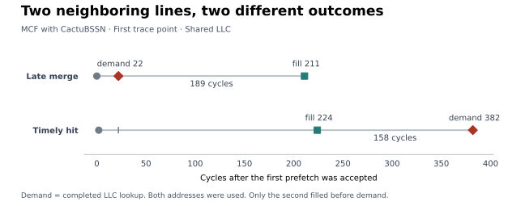

# What the first measurements tell us

## A. Two decisions on neighboring lines

- In the first MCF + CactuBSSN mix, Stride proposed physical line 363429 at cycle 10,143,692. The request left the LLC at 10,143,712. Demand arrived two cycles later. The line filled at 10,143,903, 189 cycles **after** the demand lookup.
- Stride proposed the very next line, 363430, at 10,143,694. It left the LLC at 10,143,714 and filled at 10,143,916. Instruction 10,080,319 on the MCF core demanded it at 10,144,074, 158 cycles **after the fill**. That same dynamic load missed with NoPF.
- Both addresses were useful. Only the second request produced a timely hit. The predictor had already committed to the second line 380 cycles before its demand. The LLC hit observed 105 cycles before that demand and the miss one cycle before it were too recent to inform that decision. [Dynamic event examples](results/examples.csv)

## B. What the workload matrix shows

Percent time saved is positive when Stride finishes earlier. “Coverage” counts matched first uses, including late merges. “Timely coverage” counts matched timely first hits. A dash marks a zero denominator.

| Solo point | Accepted | Accuracy | Timeliness | Coverage | Timely coverage | LLC hit rate, NoPF → Stride | Time saved |
|---|---:|---:|---:|---:|---:|---:|---:|
| MCF 665B | 29,408 | 99.71% | 47.77% | 58.81% | 28.09% | 64.93% → 74.26% | +2.81% |
| MCF 994B | 120 | 91.67% | 100.00% | 0.14% | 0.14% | 36.87% → 37.15% | +0.24% |
| CactuBSSN 2421B | 0 | — | — | 0.00% | 0.00% | 73.65% → 73.65% | +0.00% |
| CactuBSSN 3477B | 1 | 0.00% | — | 0.00% | 0.00% | 73.61% → 73.61% | +0.00% |
| Xalancbmk 700B | 55 | 80.00% | 100.00% | 11.76% | 11.76% | 99.53% → 99.59% | +0.03% |
| Xalancbmk 592B | 324 | 94.14% | 100.00% | 12.25% | 12.25% | 97.13% → 97.48% | +0.16% |
| LBM 4268B | 16,491 | 99.95% | 83.27% | 28.78% | 23.97% | 0.05% → 24.07% | -0.57% |
| LBM 3766B | 12,276 | 99.98% | 98.79% | 44.40% | 43.87% | 0.00% → 43.88% | +3.29% |

- LBM at 4268B finished **87,390 cycles later** while Stride achieved 99.95% accepted accuracy and raised the LLC demand hit rate from 0.05% to 24.07%. At 3766B its accuracy was similarly high, but timeliness reached 98.79% and the program finished 257,069 cycles sooner. Hit rate, accuracy and completion time answer different questions. [L2 and LLC denominators, coverage and per-core times](results/core_performance.csv)
- The six two-program mixes had NoPF/Stride time ratios of **1.04054× / 1.00191×** for the two MCF + CactuBSSN points, **1.03049× / 1.00202×** for MCF + Xalancbmk, and **0.99073× / 0.99446×** for LBM + Xalancbmk. In the second LBM + Xalancbmk mix, LBM itself sped up by 1.03105×. Xalancbmk was the last to finish, and its slowdown increased the mix's time by 65,536 cycles (0.56%). [Per-mix performance](results/mix_performance.csv)
- Across the 14 SPEC pairs, 98,076 of 613,460 NoPF LLC misses became hits and 95,262 received direct timely first-use credit. A further 515,176 remained misses. Some accesses changed service path upstream. The 4,287 NoPF hits that became misses are a separate cost. These counts include some of the same trace intervals both alone and in mixes. They describe this matrix; they are not an estimate of suite-wide coverage. [Complete outcome matrix](results/outcomes.csv)
- For 1,112 of those 4,287 lost hits, replaying the eviction history identifies a prefetch fill as the last eviction of the target line with no intervening refill. In 59 cases the evicting prefetch came from the other core. The remaining 3,175 had a different last evictor. This is more specific evidence of possible pollution than a hit-to-miss transition alone; only an intervention removing that prefetch could isolate its causal cost. [Eviction attribution](results/pollution.csv)

### What earlier issue actually bought

- In the MCF + CactuBSSN mix, the matched 5M-instruction interval on each core took 18,184,893 cycles with NoPF and 17,476,439 with Stride. MCF finished sooner. CactuBSSN took 5,190,332 cycles with Stride versus 5,161,897 with NoPF. Aggregate IPC alone hides that cost to the other program.
- Of MCF's 54,730 NoPF LLC misses, 15,186 became hits. Tracking the line from its Stride fill to the specific demand gives direct first-use credit for 13,864. A further 15,456 matched misses merged into a prefetch in progress. CactuBSSN had 28 miss-to-hit transitions with **zero** attributable first uses of prefetched lines. These transitions show how changed service order and residency can look like coverage if one simply subtracts miss counts.
- To test the value of earlier issue, use hindsight to select up to 256 loads that missed under both policies and waited at the retirement head. Give one previous same-core, same-page LLC trigger their target as its sole candidate. Keep the ordinary tag checks, queueing and DRAM timing in place. This is a diagnostic with privileged target selection. Its speedup gives a measured example of what those 256 decisions were worth. It is neither a bound on all prefetch opportunities nor the accuracy of a realizable predictor.
- In that mixed real run, all 256 selected triggers still occurred, 247 target loads received a timely first hit and nine merged late. Forty-four of the targets had already merged late with ordinary Stride. Completion fell by **24,770 cycles (0.142% of the Stride time)**. MCF saved those 24,770 cycles; CactuBSSN took 4,130 extra cycles. DRAM traffic changed from 4,753,664 to 4,752,256 bytes. The benefit and its distribution came from rerunning the machine. [Replay counts and cycles](results/earlier_issue.csv) · [Selected load examples](results/earlier_issue_examples.csv)
- Running the same diagnostic on a tight padded loop changed the result. All 256 overrides went to the intended loads, all 256 were late, and completion stayed at 2,363,318 cycles. For one boundary target the trigger occurred at cycle 29,317, 208 cycles before the target entered the LLC in the original run. The intervention issued at 29,317, reached DRAM at 29,337, encountered the actual demand at 29,545 and filled at 29,800. The original median dispatch-to-fill latency of 151 cycles was a poor proxy for this particular request. [Earlier-issue method](intervention/README.md)

## C. Which history merits attention?

- Give the loop more time between loads while preserving its line order. In the paced version, ordinary Stride turned **1,561 of 1,803 row-interior misses** into timely hits. All 60 within-page second-row starts and all 60 cross-page pair starts still missed. The tight and paced variants retire the same amount of work but execute different numbers of loads. Compare boundary fractions within each trace. [Synthetic cases](experiments/README.md)
- A causal counting test used the current PC, page offset, last stride and run length. It chose a different next delta only after that context had led to the same delta at least twice in earlier events. Actions were generated using a prefix scan; a second scan of the intervention run verified the same decisions and the same prior counts. Source-level boundary annotations were used only to score the outcomes.
- This simple rule turned **57 of the 60 within-page row starts** into hits, also recovered 116 interior hits, and lowered time from 1,147,567 to 1,134,977 cycles. All 60 cross-page pair starts still missed under the common page restriction. The fixed-length example supports a run counter and a second stride. It gives no empirical reason to spend attention hardware on that case. The counting test uses an unconstrained software dictionary; its table capacity and port costs would require separate measurement for a hardware implementation. [Boundary outcomes](results/counted_boundary.csv) · [Counting rule](features/counted_boundary.py)

### What surrounds a hit, and what could the predictor have seen?

- In MCF with CactuBSSN at the first point, match 10,664 miss-to-hit loads to persistent misses at the same core, PC and quarter-page offset, within 65,536 dynamic instructions. For the miss-to-hit group, the preceding LLC lookup came from the same PC 4.7% of the time. For the persistent-miss controls it came from the same PC 66.4% of the time. The preceding lookup itself hit in 88.0% versus 63.0% of cases. This makes PC interleaving worth inspecting on this point. It does not establish a causal or transferable feature: some of those lookups had not yet happened when a useful request had to leave the predictor. [Matched neighborhoods before and after demand](results/hit_context.csv)
- The first MCF + CactuBSSN point offers a more specific failure split. Of 39,541 MCF misses persisting under Stride, 23,263 had no earlier recorded candidate action for the target since its previous lookup, 15,456 merged late, 486 last saw a page rejection, 332 last saw a fill, and four last saw an unused eviction. “No earlier action” is an interval-limited observation, not a claim that the address was intrinsically unpredictable. The measured earlier-issue result above isolates a small subset with a legal lead. [Failure and pressure by cohort](results/outcomes.csv) · [Queue and head-wait measurements](results/pressure.csv)

### Do the preceding four deltas carry transferable information?

- Estimate a frequency table on the first point, then evaluate on the second point of the same program. All variants see the same eligible triggers, twelve candidate offsets and a retrospective budget of 2% of triggers. The score is the count of **distinct later NoPF misses reached in a measured lead window**. It does not assume that data would actually be resident at demand.
- On LBM, the current PC, page offset and current delta reached 486 distinct targets in 552 decisions. Adding four preceding deltas reached 489; sorting those same four also reached 489. Extra context supplied three additional targets in this test. Retaining their order supplied none.
- MCF had 4,852 distinct targets in range of the candidate vocabulary and lead window with hindsight. All three variants reached three in 2,544 decisions. Only 168 of 127,223 test anchors even had a PC observed at training anchors, and no current-context key met the eight-observation support threshold. This test exposes a **cross-point transfer problem**. It gives little information about the value of ordering within a familiar MCF phase.
- The best-case vocabulary contained only one distinct eligible miss for CactuBSSN and 66 for Xalancbmk. The three summaries reached zero and seven, respectively. A larger sequence model scoring the same candidate menu would still face that reach limit. A useful next discussion is when the right *candidate* first becomes visible. [Held-out counts and support](results/history_associations.csv) · [Feature probe and labels](features/README.md)

### Measurement checks

- Across all main and control arms, per-core retirement reached the specified bounds. Page maps matched across NoPF/Stride, the corresponding solo/mixed runs and the two warmup lengths. Detailed event tracing on and off gave exactly equal cycles and aggregate counters on short real solo and mixed runs. [Placement checks](results/page_audit.csv) · [Logging controls](results/logging_control.csv)
- For the MCF + CactuBSSN first point, shortening warmup from 10M to 5M while preserving the same 5M measured instructions changed NoPF/Stride makespans from 18,184,893/17,476,439 to 18,388,844/17,673,847 cycles. The speedup was 1.04054× and 1.04046×. This checks one mix and region. Both warmups train the Stride table, with prefetch issuance starting at the measurement boundary.
