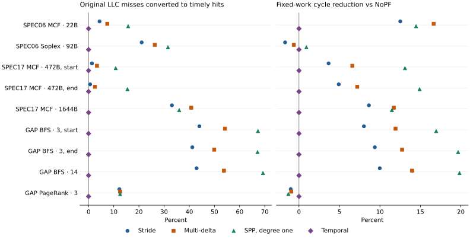

# 一个能提前产生新地址的规律，是否值得交给 ML？

本研究把三个问题逐一验证：在 demand 之前能否根据信息生成合法物理行，这个行能否及时填回，发出它是否缩短固定工作的完成时间。下列计数以相同动态指令及 load operand 在 NoPF 中的 LLC tag miss 为起点。只有归因到已完成预取的首次 demand 使用才算直接及时覆盖。

**在真实 MCF 中，一个访存 PC 刚刚走过的地址增量，偶尔能提前给出另一个 PC 将要访问的物理行。** 在 MCF-472B 末段，在线重放确认了 23 个由这条跨 PC 规则直接发出并及时填回的候选，逐个对应到离线找到的 418 个动态目标。相同实验也给出了研究边界：廉价算术已经能生成这些地址，SPP 在整个区间用的时间更短。在七个运行冻结结构规则的主区间，它没有一次超过该区间最快的常规基线。

## 九个固定工作区间

每个区间单独预热 50M 并测量 200M 条指令。表中最快策略从 NoPF、Stride、Multi-delta、单候选 SPP 和 256 项 temporal 中选；并列单列。最后两列只比较冻结结构规则与同一窗口的 Stride。正的耗时变化表示结构规则更慢。另测的两步 lookahead 见独立对照。

| 录制与区间 | NoPF 原始 LLC miss | 五策略中最快 | 比 NoPF 节省时间 | 结构规则相对 Stride 的时间变化 | 原始及时首用增加 / 失去 |
|---|---:|---|---:|---:|---:|
| SPEC06 MCF 22B | 4,165,259 | Multi-delta | 16.64% | +0.0000% | 0 / 0 |
| SPEC06 Soplex 92B（留出） | 2,003,166 | SPP | 0.92% | +0.1511% | 23,751 / 24,900 |
| SPEC17 MCF 472B，开头 | 3,067,839 | SPP | 13.09% | +0.0106% | 6,824 / 3,277 |
| SPEC17 MCF 472B，末端 | 2,256,312 | SPP | 14.90% | 未运行 | — |
| SPEC17 MCF 1644B | 5,009,921 | Multi-delta | 11.71% | +0.0563% | 80,641 / 74,108 |
| GAP BFS-3，开头 | 2,244,917 | SPP | 16.95% | +0.5622% | 37,748 / 57,707 |
| GAP BFS-3，末端 | 2,409,071 | SPP | 19.66% | 未运行 | — |
| GAP BFS-14 | 2,452,070 | SPP | 19.83% | +0.6725% | 20,766 / 50,736 |
| GAP PageRank-3（留出） | 15,678,522 | NoPF / Temporal | 0.00% | -0.0015% | 18,549 / 55,337 |

[各策略的 IPC、固定周期、hit/miss rate、MPKI、准确性、及时性和交通量](native/performance.csv) · [全部动态 operand 的原始首用对齐](discovery/full_complete_load_alignment.csv)

## 从第一条指令一直到文件末尾：GAP PageRank-3

这次用同一个模拟器连续执行全部 **500,000,001 条**录制指令。预热后共有 450,000,001 条测量指令，包含 35,499,013 个原始 LLC miss。上表的 PageRank 与这次运行的前 200M 测量指令重叠。对五种基线逐指令比对，所有重叠范围内的 operand 结局都相同。[重叠范围核验](native/entire/pagerank_overlap.csv) 其余六份录制都已完整下载并校验，执行结果对应所列区间。

| 策略 | 固定工作周期 | 相对 NoPF 增加的耗时 |
|---|---:|---:|
| NoPF | 10,085,429,754 | 0 |
| 256 项 Temporal | 10,085,429,754 | 0 |
| PC Stride | 10,188,897,972 | 1.0259% |
| Multi-delta | 10,182,387,967 | 0.9614% |
| 单候选 SPP | 10,216,578,416 | 1.3004% |
| 冻结的结构规则 + Stride | 10,188,171,676 | 1.0187% |

结构规则与 Stride 共同保留了 4,211,131 个及时首用。另有 41,395 个原始 miss 在结构规则下新获及时首用（其中 33,908 个在 Stride 中迟到），同时失去 124,178 个。及时首用净减少 82,783 个，整段比 Stride 少用 726,296 cycles，比 NoPF 多用 102,741,922 cycles。这个例子表明，及时覆盖净变化甚至不能单独判断执行时间变化的方向。[完整录制五策略结果](native/entire/BASELINE_FINDINGS.md) · [独立地址生成与替换代价](discovery/FINDINGS.md)

## 最值得继续核验的关系：另一个 PC 的增量能否解释当前地址？

在 MCF-472B 末端，PC `0x402dcb` 先后看到物理行 `0xc774` 和 `0xc76d`，产生 −7 的增量。稍后另一个 PC `0x402dc3` 在指令 1,800,011,025 访问 `0xc769`。只使用此时已知的信息就能构造同页的 `0xc762`。同一 PC 在指令 1,800,011,092 到达这个目标，中间有两次其他 LLC ingress，提前量为 165 cycles。这段观察说明，某个 stream 能给另一个 stream 提供一个具体的地址增量。它没有揭示底层源代码一定采用哪种算法。

对 472B 末端的四个日志区间，用相同的物理页限制、未来 16 次 ingress 和训练源冻结的 130-cycle 参考线筛选后，发现 **418 个不同动态目标**：跨 PC 增量有足够的观测提前量；本 PC 增量和六个固定动作 ±1、±2、±4 没有以相同条件匹配；四个常规策略都没有给该 operand 产生直接及时首用。同样方法在 472B 开头得到 51 个，在 1644B 得到 1 个。130 cycles 是服务时间的诊断参考，不能替代真实 fill。418 也是四个日志区间内的计数，不能外推为整段的频率。[逐目标地址与提前量](streams/mcf_arithmetic_targets.csv) · [窗口分母与对照](streams/arithmetic.csv)

在这 418 个目标的最早匹配中，−3、−7、−10 分别解释 113、111、96 个。这三个常数若在正确锚点选中，至少能构造其中 320 个目标。这个上界没有给在线系统选择动作的能力。接下来要分辨的是**谁能提前选对增量、应当取哪一行、少发哪些错误请求**。这些观察既支持检验条件关系，也给廉价表格提供了明确的反证机会。

在线重放进一步收紧了这个上界。把原样的跨 PC 增量规则接到 Stride，在这 418 个具体的 operand 中，只有 24 个变为直接及时首用，23 个可归因于新增的算术候选；本 PC 增量对照中一个也没有。对完整 200M 指令，跨 PC 规则用 573,910,934 cycles，比本 PC 增量的 574,344,664 快 0.0755%，比 Stride 快 0.7972%。SPP 仍只需 517,754,410 cycles。整段的差异包括所有及时首用的得失，不能全记在那 23 个目标上。同一条规则也在另外两个 200M 区间运行：在 472B 开头，相对同 PC 对照快 0.1506%；在 1644B 却慢 0.6231%，并且比 Stride 慢 0.3668%。这三个区间的最快常规方案分别是 SPP（472B 两段）和 Multi-delta（1644B）。在 472B 开头的 51 个目标中有 3 个直接用上跨 PC 请求，1644B 的唯一目标也及时用上；同 PC 规则在这两组都是零。这说明地址关系确实在另一份录制中发生过，但单个命中给不出可泛化的收益估计。[相同规则在三个 MCF 区间的动态重放](streams/mcf_transfer/README.md)

其中一次真实发出的请求可以逐时刻验证。PC `0x402dcb` 先后产生物理行 57,454、57,451，给出 −3；指令 1,800,071,809 处的另一个 PC 在物理行 53,187 上沿用该增量，发出 53,184。生成、dispatch、fill 分别发生在 28,669,229、28,669,249、28,669,452 cycles。目标 demand 在 28,669,479 到达，实测余量 **27 cycles**。这给出了跨 PC 信息如何转化成一个新预取地址的证据，也说明为何排队延迟或额外的推理时间会影响结果。

## 一个可以逐条复核的真实规律

GAP BFS-3 的一个片段里，同一个 PC 连续访问物理行 370037、370038、370039，随后另一个 PC 访问行 3500603。冻结的计数表使用四个 PC 的相等关系、页内位置和同 PC 增量，从后一个访问独立提出行 3500606。每个数字都是 cache-line 编号。下面两个时刻在**同一次结构规则重放**内相减。

| 事件 | 源 trace 指令序号 | 模拟周期 |
|---|---:|---:|
| 在行 3500603 的 LLC ingress 提出当前行 +3 | 100,100,888 | 240,298,184 |
| 预取发往下层 | | 240,298,204 |
| 行 3500606 填回 | | 240,298,394 |
| operand 0 对行 3500606 的 demand 到达 LLC | 100,101,506 | 240,300,579 |

这次提前量为 2,395 cycles。扫描从录制开始到目标 demand 的所有 load 和 store，发现该行的首次数据引用恰在 100,101,506。它比锚点晚 618 条指令，超过本机型的 256 项 ROB。这个例子证明 LLC 端可以在新行第一次被 demand 访问之前构造其物理地址。Stride、Multi-delta 和 SPP 在各自执行中最终都预测到了同一行，但发生的是 late merge。其目标 load 的 ROB-head wait 从 NoPF 的 150 cycles 降至三个常规策略下均为零，记录到及时首用并未进一步降低这项等待。[实际请求生命周期](discovery/full_native_examples.csv) · [从录制起点核验首次引用](streams/first_reference_examples.csv)

**相同 grant 的固定 +3 解决了这条访问。** 它在同一个动态锚点发出了同一个物理地址，提前 2,714 cycles，亦产生及时首用。两个领先时间都以各自执行中的目标 demand 为参照。对全部 200M 条指令，固定 +3、结构规则、Stride、SPP 分别用了 709,936,361、709,659,043、705,691,824、637,186,290 cycles。这个地址是寻找条件规律的入口；它本身给不出必须学习 PC 序列的理由。[固定 +3 逐事件对照](discovery/bfs_fixed3_witness.csv) · [完整区间对齐](discovery/bfs_fixed3_alignment.csv)

还有一个更直接的反事实：全程只在这个锚点把常规候选 3500604 换成 3500606，其余决定交给原策略。替换前的候选本来也是一个有用的及时预取。对 Stride，这个选择让整段快了 20,856 cycles（0.0030%）；对 SPP，整段慢了 63,240 cycles（0.0099%）。目标都从 late 变成及时首用，两个策略下它的 ROB-head wait 都维持在零。改动之前的季度，动态结局和完成周期逐项相同。这个实验测得的是一次选择对后续整个系统的净影响。[单次干预和季度验证](single_address/README.md)

## 为什么单看 hit rate 或 IPC 会得到不完整的答案

单核运行固定退休指令数时，IPC = 退休指令数 / 周期数，两者对策略的排序完全相同。耗时缩短百分比与 IPC 提升百分比的分母不同。本文用固定工作周期报告收益，用准确性、提前量和原始 miss 的直接及时覆盖解释收益从哪里来。双核则还要看两个程序各自的完成时间。

在 SPEC2017 MCF-472B 的 200M 指令中，SPP 的 LLC MPKI 为 15.615，NoPF 为 15.339；SPP 的完成时间仍缩短了 13.09%。有 1,448,604 个原始 miss 在 SPP 执行中合并到未完成的预取。对采样到的 SPP 首用，及时组与迟到组从 dispatch 到 fill 的中位时间同为 190 cycles，但从提出请求到 demand 到达的中位时间分别为 1,328 和 58 cycles。对这些样本，更早识别目标是有依据的问题。一次策略切换同时改变许多请求，汇总数字不能给出这些晚到请求各自节省了多少周期。[基线定义与测量](native/README.md)

在 BFS-3，按程序顺序跟踪所有原始 miss 时，93 个 load PC 中有 76 个在 Stride 下没有一次直接及时覆盖；这 76 个 PC 合计只占 3,112 / 2,244,917 个原始 miss。若按「从不成功的 PC 数量」排列优先级，研究会错过交替成功和失败的主要访问流。SPP 在该区间把 67.30% 的原始 miss 转为直接及时首用，同时有原为 NoPF hit 的访问在 SPP 中成了 miss。[整个区间的 stream 计数](streams/group_counts.csv) · [原始结局之间的对齐](native/transitions.csv)

共享带宽还改变了每个程序的代价。在独立的 5M 预热、20M 测量双核实验中，Stride 使 BFS 比配对 NoPF 早 20,378,618 cycles 完成，MCF 却晚了 4,381,789 cycles。看配对 makespan、各核固定工作时间及其对同物理放置 solo 的 slowdown，才能解释一项预取决策把成本转移给了谁。[双核干扰实验](interference/README.md)

**四个短窗口会把模式切换频率估错，而且误差方向随程序改变。** 用额外的无干扰记录器重放两个完整 200M 区间，保留了 10,319,258 次真实 Stride ingress。只取 NoPF 曾 miss 且进入 Stride 的原始目标，在一次直接及时首用之后，下一个目标成为普通或迟到 miss 的比例，BFS-3 全局是 42.87%，用四个窗口估计却是 63.02%；Soplex 全局是 53.64%，四个窗口仅为 28.92%。这个比例描述相邻结果，并不能定位一个源代码 loop boundary。下面的按窗口历史拟合只用于找线索，频率或性能结论另用完整重放验证。[可复核的分母、到达顺序和 PC/页分组](continuous/FINDINGS.md)

## 从一个 region 转到另一个，哪些观察还能保留？

同为 SPEC17 MCF，Stride 在 472B 的直接及时覆盖仅为 1.34%，在 1644B 却达到 33.10%。472B 上 SPP 的耗时最短；1644B 上 Multi-delta 比 NoPF 节省 11.71%，略多于 SPP 的 11.48%。因此「MCF 有许多迟到的预取」有可复核的实例，但其频率和适合的常规对手需要逐个 region 验证。BFS-3 和 BFS-14 上，SPP 的方向较一致，分别直接覆盖 67.30% 和 69.28% 的原始 miss。[按录制的五策略结果](native/performance.csv)

**相同的局部信息确实常常指向多个未来地址。** 在留出的 GAP PageRank 样本中，177,784 个预测时刻里有 80,763 个属于这样的上下文：当前 PC、页内位置和最近两个同 PC 增量都相同，却至少有两个可表达的后续增量各出现过两次。加入先前 PC 的有序身份后，留出数据上的平均预测损失仍为每次 3.270 bits，与局部表相同。在 BFS-14 上，局部表为 5.571 bits，四个 PC 的相等关系改善到 5.425；仅保留页内位置与同 PC 增量、去掉绝对 PC 身份的简单表则达到 4.148。相同局部特征对应多个未来，是可以测量的现象；究竟哪个较早事件能消除这种歧义，还要看它能否在新阶段和新程序上胜过这些对照。这里的损失衡量下一地址的预测概率，并未测量及时性或执行收益。[按阶段和特征统计的留出结果](discovery/phase_address_information.csv)

我们还测试了一条可以跨 PC 表达、无需拟合的规则：把最近另一个 PC 的已观察地址增量加到当前物理行。以 BFS-3 的一个实例为例，另一个 PC 从行 `0x242bb` 移到 `0x242be`；当前 PC 据此从 `0x170207` 预测 `0x17020a`，提前 559 cycles。这是一种实际存在的地址关系。它也能否帮助执行，则需要重放。在 50M 预热后的 1M 指令对照中，这条规则在 BFS-3、BFS-14 上分别比 Stride 快 1.118%、0.557%，在 GAP PageRank 和 Soplex 上却分别慢 0.429%、0.280%。四个窗口里都由更简单的同 PC 增量取得了更短的完成时间。它为后续设计提出了一个具体门槛：需说明**何时另一个 stream 提供了当前 PC 缺少的预测信息**，同时计入猜错和替换的代价。[四个程序区间、36 次实际重放](streams/address_relations.md)

## 哪些假设站得住？

- **得到支持**：仅用 LLC 当下可见的信息，就可能生成一个此前从未有过数据引用的物理行，或在常规预测到同一地址之前让它到达。BFS 的新地址和 MCF 的 late→timely 配对都能逐请求复核。跨 PC 增量可以迁移到另一段 BFS，并在独立稀疏程序上命中一些目标。
- **不支持所测试的实现**：冻结的四事件生产者结构表没有稳定地跑赢强常规预取。固定步长、同 PC 增量以及简单 lookahead 解释了许多看似复杂的成功。Soplex 的两个方案都会取得新的及时首用，但 NoPF 与 SPP 对照改变了结论。GAP PageRank 的两步 lookahead 比 Stride 净增 449,489 个直接及时首用，耗时仍增加 0.235%。[留出程序的完整 lookahead 重放](long_lookahead/README.md)
- **仍未证实**：存在一种在不同程序、图输入和物理布局中维持作用、并以同等硬件预算带来稳定净加速的复杂模式类。采样、候选表达和干预各回答一部分问题。在没有访存值和符号化源映射时，也不能从一串地址断定它就是指针依赖或嵌套循环边界。

## 下一步值得验证的地址预测问题

| 实测问题 | 当时已知的信息 | 已能处理的常规机制 | 潜在学习能力 | 能证伪它的下一步实验 | 首先应计入的硬件成本 |
|---|---|---|---|---|---|
| MCF17 中同一目标常被预测正确却迟到，不同 region 的相对收益也变了 | 当前 PC、页内位置、同 PC 近期增量、之前产生的其他访存事件 | Multi-delta、SPP、固定步数 lookahead 各能处理一部分 | 在同一组简单局部特征面临多个未来时，从可迁移的上下文选**地址和时机** | 用未分析的 MCF/SPEC 录制固定词表与预算，同时记录额外及时首用、被替换的首用及执行周期；先与同容量 PC-free 局部表比较 | 对局部状态和历史额外读取的端口、每个 ingress 的候选数、请求送达 issuer 的延迟 |
| BFS 有跨 stream 的地址增量和第一次见到的新物理行 | 上一生产者的增量、当前已见物理页、生产者出现顺序 | 同 PC 增量、固定 +1/+3、SPP 已解释许多实例 | 只在另一个 stream 真能区分未来目标时利用它，保留独立生成地址的能力 | 预先在新图程序/明确标注的图输入上固定规则；与同 grant 的常数、有限表、打乱生产者顺序对照，比较正确和错误发出的总量 | 每核 64 项 PC/行记录、少量近期 PC、额外查表与加法；匹配需要的物理页、重复检查和队列预算 |
| Soplex 的可及时转换数与执行时间可能反向变化 | 先前观察到的时序、常规置信度、可见队列状态及已经抵达的历史反馈 | 两步 lookahead 可以多产生及时首用，SPP 在该录制中更快 | 区分值得额外取的地址和代价高于收益的候选，兼容独立地址生成 | 同一干预在正常和受控带宽下重放；按相同工作量记录错误候选、其他 demand 的服务及完成时间 | 反馈计数器的更新时点、共享带宽、在途 MSHR 和被替换候选；推理延迟需要另行测量 |
| 合法跨页目标与可识别目标之间仍有缺口 | 当时已知的物理页/区域、相对增量、PC 或交织顺序 | 已见页表、有限 temporal 和固定偏移 | 在不同地址布局中识别相同的目标关系 | 冻结物理构造规则，用新的页放置及独立输入检验；分别报不可表达、可表达但难区分、来不及服务的比例 | 已见页标签和替换状态、物理地址构造与重复检查；真实物理映射信息的可用性 |

优先级最高的是第一行和第二行的交集：在完整真实流中找到同样局部输入却走向不同目标的上下文，确认较早信息可以区分它们，并在留出程序中检查其净执行收益。短窗口上的 log loss、某一条地址的成功预测、或某一台模拟机上的最佳配置，都不足以决定模型架构。这个 study 没有拟合神经网络，也没有测量推理数据通路的面积、功耗或时序收敛。
