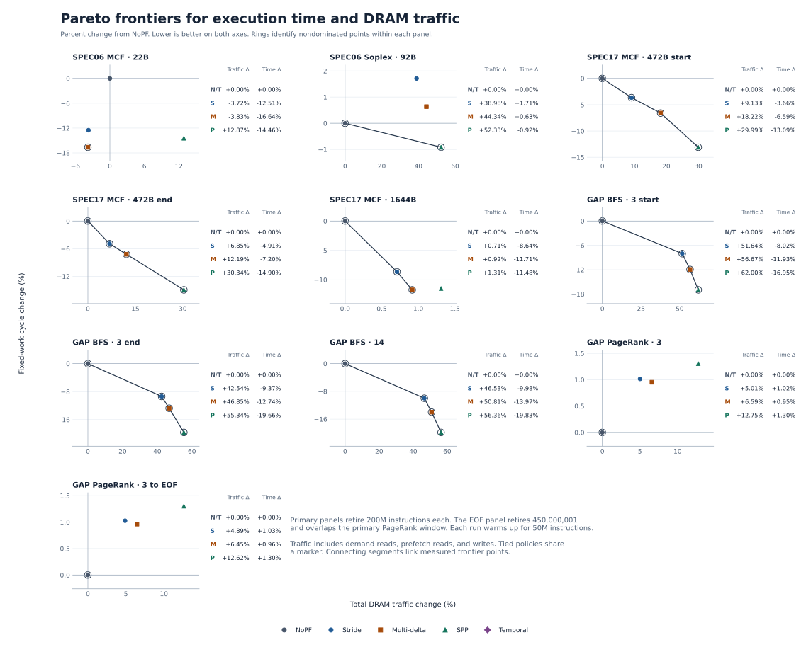

# LLC prefetching figures

Start with fixed-work time and the Pareto frontiers. Use the hit rates and request metrics to explain why a policy moves, then follow the matched request timelines for individual cases. All values are printed on the figures. Select an SVG to zoom in.

## Baseline performance and cache behavior

| Figure | What it shows | Input table |
|---|---|---|
| [Fixed-work time and IPC](baseline_execution.svg) | Completion time relative to NoPF and absolute IPC for each policy and window | [Primary performance](../native/performance.csv) |
| [Hit and miss rates](baseline_cache_access.svg) | L2 and LLC demand tag rates, by workload and policy | [Primary performance](../native/performance.csv) |
| [MPKI and memory pressure](baseline_miss_intensity.svg) | L2 and LLC misses per 1,000 instructions, mean LLC MSHRs and DRAM read-queue occupancy | [Primary performance](../native/performance.csv) |
| [Accuracy, coverage and timeliness](baseline_prefetch_quality.svg) | Timely and useful accuracy, direct and inclusive coverage, net miss reduction and the timely share of first uses | [Primary performance](../native/performance.csv) |
| [Timely coverage and time saved](coverage_and_cycles.svg) | Two aligned views of the same nine windows | [Primary performance](../native/performance.csv) |
| [Quarter-by-quarter time saved](diagnostic_quarters.svg) | Fixed-work performance in each consecutive 50M-instruction quarter | [Quarter results](../native/quarters.csv) |
| [Complete PageRank recording](baseline_pagerank_entire.svg) | Cycles, IPC, cache misses and prefetch quality through EOF | [Complete PageRank performance](../native/entire/performance.csv) |

## Trade-offs and request timing

| Figure | What it shows | Input table |
|---|---|---|
| [Time versus DRAM traffic Pareto frontiers](tradeoff_pareto.svg) | One frontier per workload window. Both axes are normalized to that window's NoPF and lower is better. Coincident policies share labels. | [Primary performance](../native/performance.csv) · [Complete PageRank performance](../native/entire/performance.csv) |
| [Prefetch metrics versus time](tradeoff_metrics_vs_time.svg) | Useful accuracy, timely coverage and timely share versus elapsed cycles in MCF, BFS and PageRank | [Primary performance](../native/performance.csv) |
| [SPP request lead, service and fill margin](tradeoff_spp_timing.svg) | Sampled tenth, median and ninetieth percentiles for timely and late first uses | [Sampled timeliness](../native/sampled_timeliness.csv) |
| [Timely uses gained and lost versus time](tradeoff_displacement.svg) | What the frozen independent rule displaces, including the complete PageRank run | [Aligned first uses](../discovery/full_complete_load_alignment.csv) · [Replay performance](../discovery/full_performance.csv) |
| [BFS and MCF request timelines](tradeoff_address_examples.svg) | Candidate, dispatch and fill events relative to demand for two aligned addresses | [BFS witness](../discovery/bfs_fixed3_witness.csv) · [MCF target details](../streams/mcf_transfer/target_details.csv) |
| [Cross-PC MCF replay](diagnostic_mcf_cross_pc.svg) | Sampled targets made timely and complete-window time saved versus the local-increment control | [Target outcomes](../streams/mcf_transfer/target_outcomes.csv) · [Paired cycles](../streams/mcf_transfer/paired.csv) |
| [Sampling and miss transitions](diagnostic_sampling.svg) | Observed late or ordinary misses after a timely use in the complete arrival stream and four short windows | [Continuous arrival counts](../continuous/counts.csv) |
| [Two-core interference](tradeoff_core_interference.svg) | Paired versus solo fixed-work cycles and first-use changes for BFS and MCF | [Per-core results](../interference/per_core.csv) |



## Metric denominators

| Metric | Calculation |
|---|---|
| Hit rate and miss rate | Demand tag hits or misses divided by demand tag lookups at the indicated level |
| MPKI | Demand tag misses per 1,000 retired instructions |
| Useful accuracy | Timely first uses plus late first-use merges, divided by accepted prefetches |
| Timely accuracy | Timely first uses divided by accepted prefetches |
| Direct timely coverage | Original NoPF LLC misses that become attributed timely first uses, divided by original NoPF LLC misses |
| Inclusive coverage | Original misses that become attributed timely first uses or late merges, divided by original NoPF LLC misses |
| Net demand miss reduction | NoPF LLC demand misses minus policy LLC demand misses, divided by NoPF LLC demand misses |
| Timely share of first uses | Timely first uses divided by timely plus late first uses |
| Time saved | NoPF cycles minus policy cycles, divided by NoPF cycles |
| Total DRAM traffic | Demand read bytes plus prefetch read bytes plus write bytes |
| Fill margin | Demand-arrival cycle minus fill cycle. Positive values indicate that the fill led demand. |

An em dash marks an undefined ratio. Complete PageRank overlaps its primary 200M interval. The paired-core test measures a separate 20M interval per core. The timing plots draw on sampled detailed events. [Native measurement definitions](../native/README.md) · [Traces and raw outputs behind every figure](../data/README.md)

## Regenerate

From the repository root, run these commands with Python and Matplotlib. The scripts read the compact CSVs stored on the branch.

```sh
study=llc_hybrid_prefetch/full_workload
python3 -B "$study/figures/plot.py"
python3 -B "$study/figures/baseline_metrics.py"
python3 -B "$study/figures/tradeoffs.py"
python3 -B "$study/figures/diagnostics.py"
```
