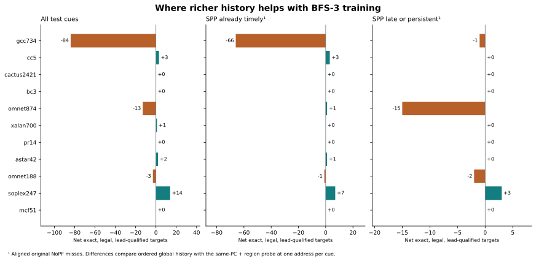
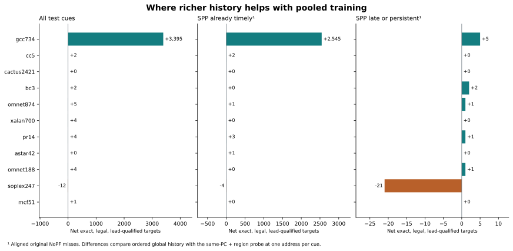

# Does additional history help on external recordings?

One donor, one eighth-arrival displacement vocabulary and one proposed physical line per test cue. The comparator sees the current event, same-PC history and region-local history. The richer probe also sees 32 globally ordered events. Both see the same cues. A counted address must match the exact target, use an observed physical page and precede demand by at least 130 cycles. The independent recordings were chosen by source and workload before collecting their policy outcomes.

| External recording | Test cues | In donor vocabulary | Qualified local → global | Net on SPP-timely¹ | Net on SPP-late¹ | Net on SPP-persistent¹ | Fastest baseline |
|---|---:|---:|---:|---:|---:|---:|---|
| gcc734 | 6,004 | 5,269 | 3,761 → 3,677 | -66 | -1 | +0 | SPP |
| cc5 | 6,012 | 310 | 0 → 3 | +3 | +0 | +0 | NoPF |
| cactus2421 | 6,005 | 258 | 0 → 0 | +0 | +0 | +0 | SPP |
| bc3 | 6,010 | 76 | 2 → 2 | +0 | +0 | +0 | Multi-delta |
| omnet874 | 6,034 | 480 | 30 → 17 | +1 | -11 | -4 | SPP |
| xalan700 | 6,022 | 321 | 4 → 5 | +0 | +0 | +0 | SPP |
| pr14 | 6,003 | 83 | 1 → 1 | +0 | +0 | +0 | NoPF |
| astar42 | 6,021 | 58 | 0 → 2 | +1 | +0 | +0 | SPP |
| omnet188 | 6,021 | 488 | 36 → 33 | -1 | -4 | +2 | SPP |
| soplex247 | 6,011 | 1,148 | 443 → 457 | +7 | +1 | +2 | SPP |
| mcf51 | 6,004 | 21 | 0 → 0 | +0 | +0 | +0 | NoPF |

¹ These three columns require an original NoPF miss at the same dynamic operand. The overall column includes every sampled cue. Ordinary hits and no-LLC-tag outcomes have their own categories in the underlying table. A net count can hide both gains and losses. SPP outcomes come from a matched SPP replay. The 130-cycle lead is measured in the Stride history that supplied the cue. The two clocks cannot establish how many cycles earlier this proposed line would arrive in SPP. No sampled probe proposal in this table is automatically a timely first use or a saved cycle.

The full table includes the number of gains, ties and extrema across eight contiguous test blocks, donor vocabulary support, legal page reach, log loss, subgroup denominators and an equal-weight pool of three training programs. Coarse log loss includes the out-of-vocabulary class. When vocabulary coverage is low, better abstention can dominate the score. The comparison among conventional policies uses all 200M measured instructions. The single prospective replay separates the effect of one probe action from these offline counts. [Joined evidence](external_evidence.csv) · [Held-out scores](probes/scores.csv) · [Matched conventional outcomes](probes/conventional_outcomes.csv) · [Pooled donor comparison](probes/pooled_transfer.csv) · [Whole-run policy results](expansion/results/performance.csv) · [Actual offered address](one_offer/README.md)
