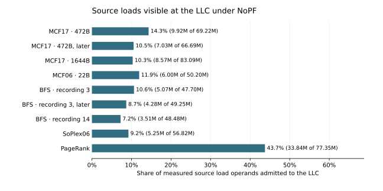
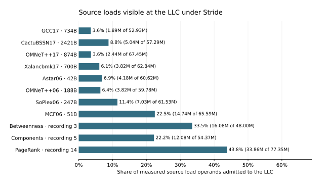

# Measured data

Each run warms the machine for 50M instructions, then records 200M retired instructions on one active core of the two-core machine. The primary panel covers nine windows from seven recordings. Every primary window has all four native policies. The eleven external recordings add a rich Stride stream at placement slot 0. Their four conventional comparisons come from the [expansion study](../expansion/README.md).

| Panel | Windows | Rich runs | Source load operands, once per window | LLC admissions across runs | Indexed gzip streams (GiB) |
|---|---:|---:|---:|---:|---:|
| Primary | 9 | 36 | 548,807,320 | 333,826,717 | 43.22 |
| External | 11 | 11 | 667,753,481 | 105,009,979 | 13.16 |

An LLC admission appears once in the arrival stream and has a pressure snapshot at the same row. The gzip totals include the seven rich streams. They exclude the source traces, baseline outcome masks and derived label indexes.

| Panel | Source load rows across runs | Other cache callbacks | Offer lifecycle records | Positive retirement-wait records | Prefetch victims |
|---|---:|---:|---:|---:|---:|
| Primary | 2,195,229,280 | 3,204,745,830 | 613,478,691 | 679,069,283 | 40,213,269 |
| External | 667,753,481 | 993,957,119 | 142,545,934 | 202,257,932 | 5,342,533 |

[Primary trace and run inventory](captures.csv) · [External trace and run inventory](external_captures.csv) · [Schema and raw run paths](README.md)

The [primary](replicas.csv) and [external](external_replicas.csv) replica tables list runs whose two site certificates match. Each reports the payload origin, row population, retirement outcomes and fixed-work cycles.

## Which loads reach the LLC?

Each percentage counts distinct dynamic source operands admitted to the LLC divided by all load operands in the measured instruction sequence. Every admitted line in these two plots was checked against its original PC, virtual operand and simulated page map. A load absorbed by the private caches contributes to the denominator. It supplies no LLC admission on which a predictor at this interface could trigger. The two panels use different policies.

[Primary source checks](source_parity.csv) · [External source checks](external_source_parity.csv) · [Plot script](plot_visibility.py)
