# Figures

## Which loads reach the LLC?

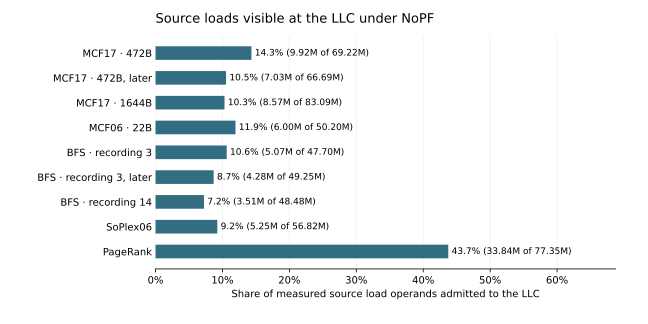

Across the nine NoPF windows, 83,456,728 of 548,807,320 source load operands reached LLC ingress. The observed share ranged from 7.2% in BFS-14 to 43.7% in PageRank-3. Each arrival maps to a unique source operand with a verified PC and physical line. [Source audit by window](../capture/source_parity.csv)

## Which policy finishes first?

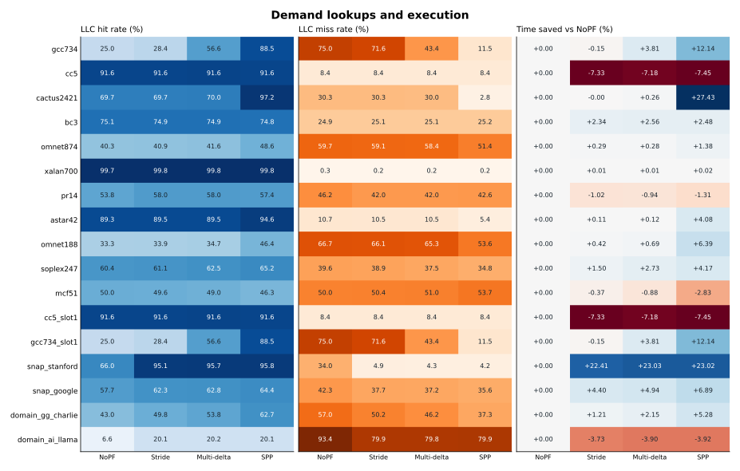

Only LLC tag lookups enter the hit and miss rates. Time saved is relative to the same recording and placement under NoPF. Rows ending in `_slot1` repeat that recording with a different physical placement. SNAP rows use 2M measured instructions. The other rows use 200M. The last two rows show the Google service and AI inference recordings. [SPEC, GAP and SNAP counts](../expansion/results/performance.csv) · [Google and AI counts](../domains/results/performance.csv)

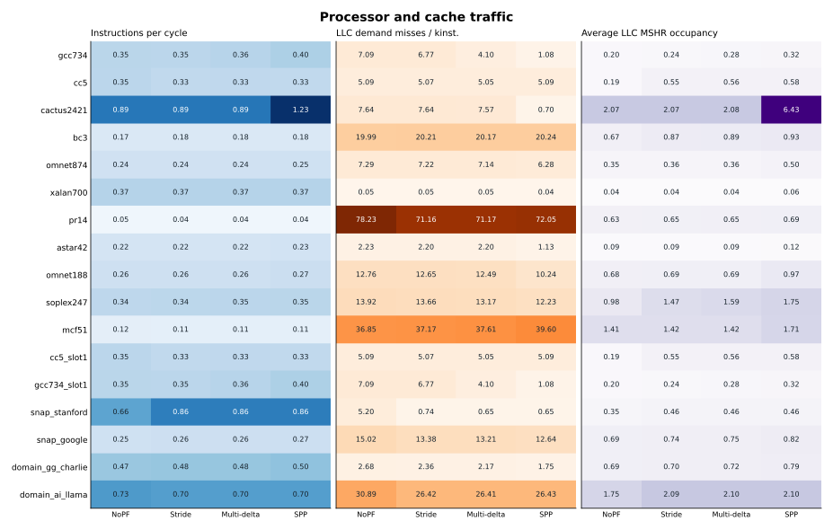

IPC uses completed instructions and core 0 cycles. Queue occupancy is averaged over all measured cycles. [Run metrics](../expansion/results/performance.csv) · [Resource state at prediction time](../resources/README.md)

## What happened to the requests?

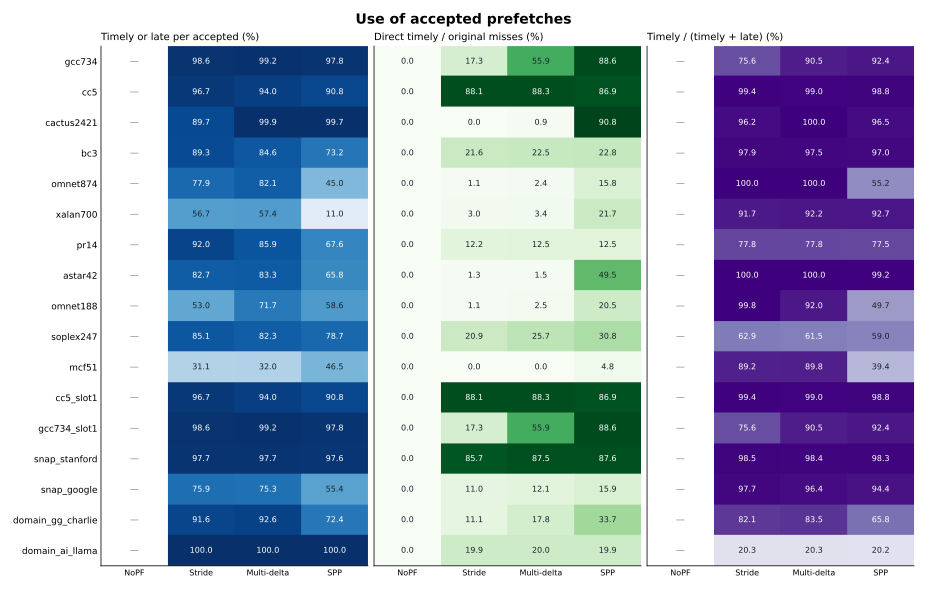

Accuracy here includes late demand merges. Direct timely coverage requires the aligned NoPF operand to have missed. A dash marks an undefined denominator. Timely accuracy per issued request and all numerators are in the [source table](../expansion/results/performance.csv).

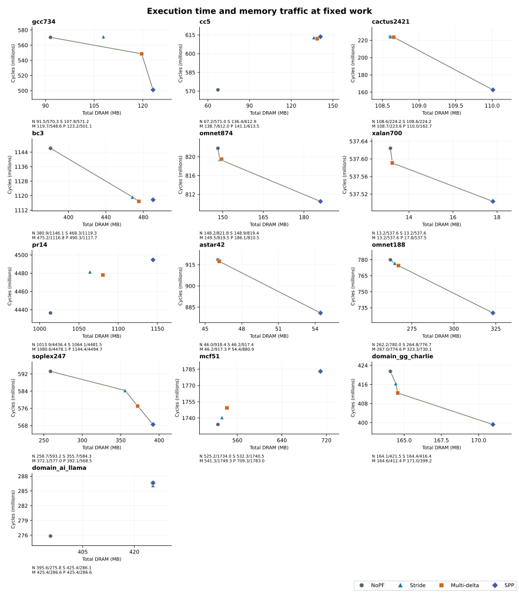

Lower values on both axes are preferable. Connected points form the observed nondominated frontier for that recording. Coordinates under each panel give DRAM MB and millions of cycles. N, S, M and P denote NoPF, Stride, Multi-delta and SPP. [Raw metrics](../expansion/results/performance.csv)

## Does history give a usable target?

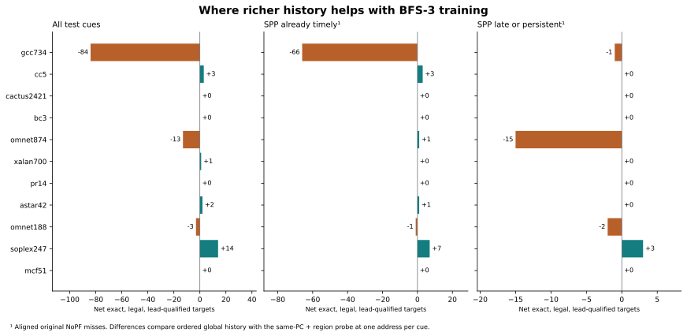

The left panel counts gains minus losses across all test cues. The other panels split original misses by SPP outcome. Every panel uses the same one-address budget. The [external recording comparison](../WORKLOADS.md) includes a second figure using three training programs.

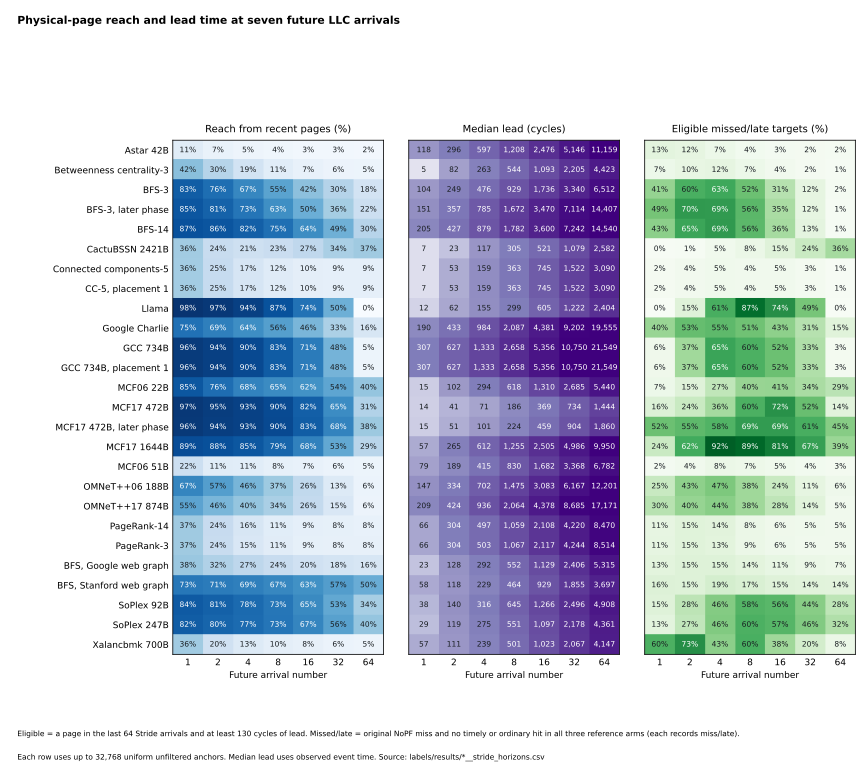

These are hindsight opportunities at sampled anchors. [Labels, samples and denominators](../labels/RESULTS.md) · [Held-out address prediction](../probes/README.md)

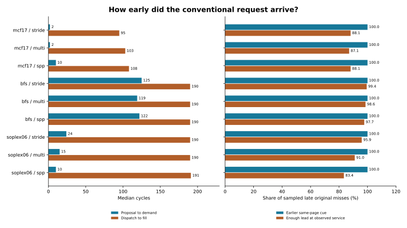

The left panel compares two measured intervals for late claims on original misses. The right panel shows the fraction with a same-page witness and with enough lead at that witness to cover the observed acceptance-to-fill duration. Earlier issue can change the service duration. [Per-arm counts and percentiles](../resources/request_service.csv)

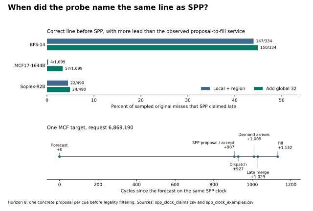

The dynamic MCF request belongs to an original NoPF miss. A frozen probe predicted its exact physical line 907 cycles before SPP proposed it. The timeline uses a single SPP execution throughout. [Measured request IDs and timestamps](../probes/SPP_CLOCK.md)

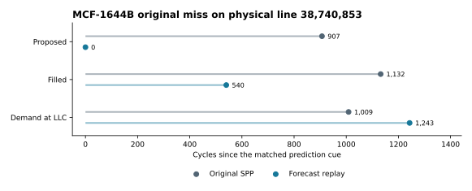

In a 200M-instruction replay, replacing one SPP offer with that forecast filled the line before the intended demand. The two executions share their entire pre-decision history. Each row uses the clock of its own subsequent execution. [Replay and whole-run cost](../trials/README.md)

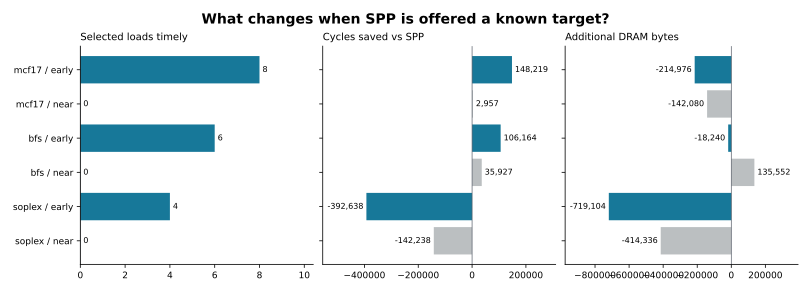

Each bar is a full replay of the same retired work. A selected load can become timely while other original timely loads lose coverage. Positive cycle savings mean the run finished earlier. [Individual requests](../trials/request_timing.csv) · [Whole-run gains and losses](../trials/effects.csv)

All expansion plots can be regenerated from the cache root with `python3 -B llc_hybrid_prefetch/learning_opportunity/figures/plot.py`. The earlier SPEC and GAP panel has its own [figure gallery](../../full_workload/figures/README.md).
