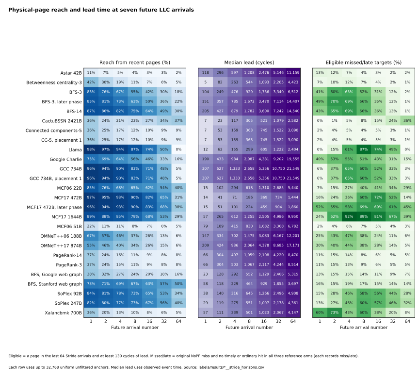
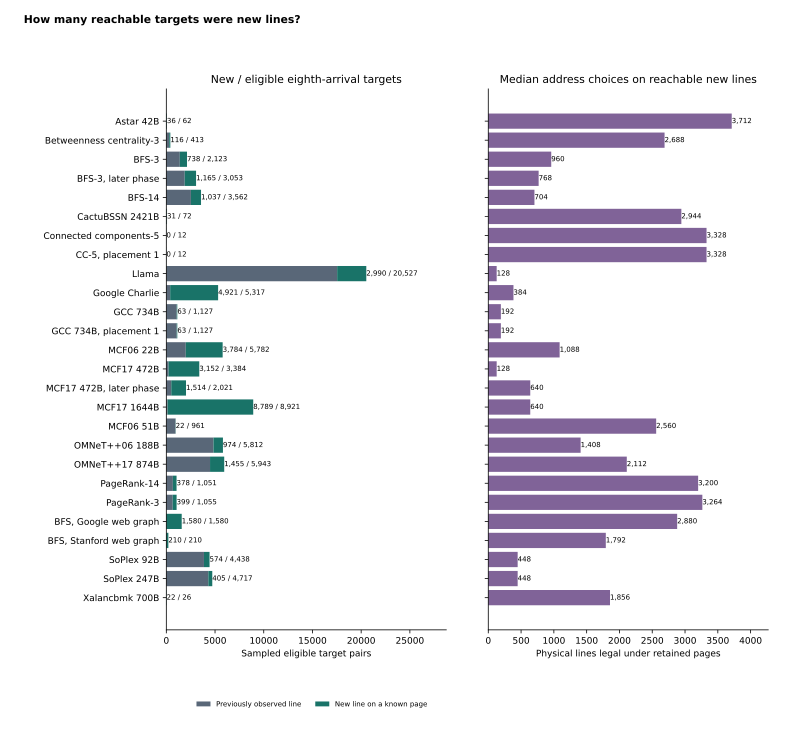

# Which future targets are physically reachable in time?

The tables count observed targets on real simulations. A row uses up to 32,768 uniform anchors on the selected Stride execution. Each anchor is eligible for sampling regardless of its cache outcomes. The full indexed stream can be queried at any rank. [Queries and split boundaries](README.md) · [Per-scope counts](results/)

## What changed between workloads

- **MCF17, independent recordings.** At horizon eight, 3,152 of 3,384 eligible target pairs in 472B and 8,789 of 8,921 in 1644B concern a new exact line on a recently observed physical page. In each count the target is the first subsequent demand for that line. This gives an address-generation probe a concrete test across recordings.
- **PageRank-3.** Median lead at horizon eight was 1,067 cycles. Of 12,291 pairs missed or late in all three controls, only 1,055 met the recent-page and 130-cycle tests. A different construction vocabulary could change this ceiling.
- **Google Charlie and Llama.** In equally sized horizon-eight samples, 29,941 Google targets and 78 Llama targets had a different PC from their trigger. The programs had 5,317 and 20,527 eligible pairs respectively. Cross-PC targets describe a subset of the available opportunity. Whether previous PC context helps choose the address is an independent prediction test.
- **Xalancbmk 700B.** Of 32,768 unfiltered horizon-eight targets, 78 missed under NoPF and 26 met the joint eligibility test. Large fractions of a small gap population can have little effect on total work.

## Fixed horizons

Each count requires the target to be an original NoPF miss and a plain miss or late first use in all three conventional executions. The target page must occur among the latest 64 physical-page observations at the anchor. The target's admission must follow the anchor by at least 130 cycles. Counts at different horizons may refer to the same target. The fixed-horizon count can include a line already requested between the trigger and the target. The novelty table below reports the stricter first-demand subset. The denominator gives every anchor with an observed target at horizon eight. The 128-cycle footprint counts distinct lines after the anchor, measured only where the complete future window is observable.

| Capture | Complete arrivals | h8 eligible / observed | h1 eligible | h64 eligible | h8 lead p50 (cycles) | 128-cycle footprint p50 / p90 |
|---|---:|---:|---:|---:|---:|---:|
| astar42 | 4,184,546 | 62 / 32,768 | 227 | 32 | 1,208 | 1 / 2 |
| bc3 | 16,078,811 | 413 / 32,768 | 418 | 77 | 544 | 2 / 6 |
| bfs_discovery | 5,072,474 | 2,123 / 32,768 | 1,660 | 77 | 929 | 1 / 7 |
| bfs_discovery_far | 4,276,388 | 3,053 / 32,767 | 2,773 | 49 | 1,672 | 0 / 5 |
| bfs_transfer | 3,510,471 | 3,562 / 32,768 | 2,758 | 93 | 1,782 | 0 / 1 |
| cactus2421 | 5,043,762 | 72 / 32,768 | 4 | 329 | 305 | 4 / 12 |
| cc5 | 12,084,704 | 12 / 32,768 | 6 | 2 | 363 | 3 / 7 |
| cc5_slot1 | 12,084,704 | 12 / 32,768 | 6 | 2 | 363 | 3 / 7 |
| domain_ai_llama | 6,615,688 | 20,527 / 32,768 | 48 | 24 | 299 | 3 / 5 |
| domain_gg_charlie | 939,784 | 5,317 / 32,768 | 4,108 | 1,533 | 2,087 | 0 / 2 |
| gcc734 | 1,891,604 | 1,127 / 32,768 | 114 | 59 | 2,658 | 0 / 1 |
| gcc734_slot1 | 1,891,604 | 1,127 / 32,768 | 114 | 59 | 2,658 | 0 / 1 |
| mcf06_discovery | 5,997,947 | 5,782 / 32,767 | 1,022 | 4,231 | 618 | 2 / 5 |
| mcf17_discovery | 9,919,915 | 3,384 / 32,768 | 908 | 779 | 186 | 5 / 10 |
| mcf17_discovery_far | 7,027,404 | 2,021 / 32,768 | 1,491 | 1,281 | 224 | 4 / 10 |
| mcf17_transfer | 8,566,403 | 8,921 / 32,768 | 2,419 | 3,960 | 1,255 | 1 / 3 |
| mcf51 | 14,740,182 | 961 / 32,768 | 353 | 429 | 830 | 1 / 3 |
| omnet188 | 3,823,733 | 5,812 / 32,768 | 3,721 | 902 | 1,475 | 0 / 2 |
| omnet874 | 2,444,230 | 5,943 / 32,768 | 4,703 | 761 | 2,064 | 0 / 2 |
| pr14 | 33,861,976 | 1,051 / 32,768 | 1,374 | 567 | 1,059 | 1 / 2 |
| pr_heldout | 33,838,905 | 1,055 / 32,768 | 1,430 | 581 | 1,067 | 1 / 2 |
| snap_google | 70,944 | 1,580 / 32,763 | 1,530 | 774 | 552 | 2 / 7 |
| snap_stanford | 30,527 | 210 / 30,519 | 190 | 166 | 464 | 2 / 4 |
| soplex06_heldout | 5,246,784 | 4,438 / 32,768 | 1,158 | 2,178 | 645 | 1 / 6 |
| soplex247 | 7,032,865 | 4,717 / 32,768 | 1,037 | 2,581 | 551 | 2 / 6 |
| xalan700 | 3,823,566 | 26 / 32,768 | 31 | 4 | 501 | 2 / 4 |

## Earliest legal anchor

For each sampled target that misses under NoPF and records miss/late in all three conventional arms, search the last 64 observed triggers. At each trigger the page-and-offset vocabulary can address any offset on the previous 64 observed pages including the trigger's page. Counts are retrospective address-construction ceilings. Actual prediction must choose a target, reach the issuer, obtain resources and finish in time.

| Capture | Sampled miss/late targets | At least one legal anchor | ≥130 cycles | ≥146 cycles | ≥194 cycles | Median lead when legal |
|---|---:|---:|---:|---:|---:|---:|
| astar42 | 1,762 | 299 | 245 | 245 | 242 | 1,780 |
| bc3 | 5,800 | 1,877 | 1,246 | 1,221 | 1,167 | 303 |
| bfs_discovery | 3,993 | 3,119 | 2,966 | 2,963 | 2,948 | 2,373 |
| bfs_discovery_far | 5,386 | 4,396 | 4,259 | 4,255 | 4,247 | 3,044 |
| bfs_transfer | 6,321 | 5,031 | 4,942 | 4,941 | 4,933 | 2,814 |
| cactus2421 | 913 | 407 | 335 | 335 | 335 | 1,766 |
| cc5 | 231 | 64 | 27 | 26 | 19 | 46 |
| cc5_slot1 | 231 | 64 | 27 | 26 | 19 | 46 |
| domain_ai_llama | 23,426 | 22,954 | 21,666 | 21,644 | 21,042 | 1,193 |
| domain_gg_charlie | 10,424 | 7,603 | 7,107 | 7,099 | 7,073 | 7,361 |
| gcc734 | 1,984 | 1,400 | 1,372 | 1,372 | 1,350 | 2,948 |
| gcc734_slot1 | 1,984 | 1,400 | 1,372 | 1,372 | 1,350 | 2,948 |
| mcf06_discovery | 14,521 | 10,949 | 7,573 | 7,533 | 7,376 | 3,144 |
| mcf17_discovery | 5,643 | 5,381 | 4,933 | 4,896 | 4,687 | 728 |
| mcf17_discovery_far | 2,952 | 2,610 | 2,527 | 2,524 | 2,503 | 12,859 |
| mcf17_transfer | 10,109 | 9,724 | 9,495 | 9,495 | 9,485 | 8,299 |
| mcf51 | 14,330 | 2,816 | 1,571 | 1,561 | 1,556 | 330 |
| omnet188 | 15,210 | 11,057 | 9,083 | 9,003 | 8,901 | 1,644 |
| omnet874 | 15,788 | 10,004 | 9,095 | 9,088 | 9,071 | 3,642 |
| pr14 | 12,292 | 4,725 | 3,415 | 3,409 | 3,277 | 304 |
| pr_heldout | 12,323 | 4,729 | 3,419 | 3,412 | 3,281 | 304 |
| snap_google | 11,568 | 4,830 | 3,512 | 3,502 | 3,374 | 621 |
| snap_stanford | 1,208 | 541 | 437 | 437 | 406 | 930 |
| soplex06_heldout | 7,593 | 6,288 | 5,446 | 5,434 | 5,404 | 2,087 |
| soplex247 | 7,969 | 6,477 | 5,680 | 5,670 | 5,638 | 2,723 |
| xalan700 | 53 | 39 | 37 | 37 | 37 | 41,941 |

The fixed-horizon and target-anchored tables answer different questions. The first fixes a prediction time and asks which observed successors meet the requirements. The second fixes the target and allows hindsight to select its earliest expressible trigger. A longer observed gap increases the time budget but can put the eventual target outside a small observed-page vocabulary. Transfer of address information across programs is tested by the [held-out probes](../probes/).

## Novel lines at horizon eight

For each eligible original miss at the eighth future global arrival, split the targets by whether the exact physical line had already been observed at the anchor. All eligible targets have a retained page. The last column counts the address alternatives at the anchor, using 64 offsets for every distinct retained page, among all reachable new-line targets. The stricter subset requires a distinct target line with no earlier demand for it after the trigger. Lines might still be resident or outstanding from before the trigger.

| Capture | Eligible seen line | Eligible new line on known page | Distinct line and first future demand (both groups) | Median legal alternatives on reachable new lines |
|---|---:|---:|---:|---:|
| astar42 | 26 | 36 | 62 | 3,712 |
| bc3 | 297 | 116 | 413 | 2,688 |
| bfs_discovery | 1,385 | 738 | 2,123 | 960 |
| bfs_discovery_far | 1,888 | 1,165 | 3,053 | 768 |
| bfs_transfer | 2,525 | 1,037 | 3,562 | 704 |
| cactus2421 | 41 | 31 | 72 | 2,944 |
| cc5 | 12 | 0 | 12 | 3,328 |
| cc5_slot1 | 12 | 0 | 12 | 3,328 |
| domain_ai_llama | 17,537 | 2,990 | 20,527 | 128 |
| domain_gg_charlie | 396 | 4,921 | 5,317 | 384 |
| gcc734 | 1,064 | 63 | 1,127 | 192 |
| gcc734_slot1 | 1,064 | 63 | 1,127 | 192 |
| mcf06_discovery | 1,998 | 3,784 | 5,782 | 1,088 |
| mcf17_discovery | 232 | 3,152 | 3,384 | 128 |
| mcf17_discovery_far | 507 | 1,514 | 2,021 | 640 |
| mcf17_transfer | 132 | 8,789 | 8,921 | 640 |
| mcf51 | 939 | 22 | 961 | 2,560 |
| omnet188 | 4,838 | 974 | 5,812 | 1,408 |
| omnet874 | 4,488 | 1,455 | 5,943 | 2,112 |
| pr14 | 673 | 378 | 1,051 | 3,200 |
| pr_heldout | 656 | 399 | 1,055 | 3,264 |
| snap_google | 0 | 1,580 | 1,580 | 2,880 |
| snap_stanford | 0 | 210 | 210 | 1,792 |
| soplex06_heldout | 3,864 | 574 | 4,438 | 448 |
| soplex247 | 4,312 | 405 | 4,717 | 448 |
| xalan700 | 4 | 22 | 26 | 1,856 |

## What the LLC never observed

The denominator covers every original NoPF demand operand with a measured LLC tag miss. The remaining columns count how many of those operands had no matching admission at the LLC in each execution. A different load can issue the package-level request when accesses merge. Per-policy retirement labels and the missing-ingress count can therefore differ. [Full source-operand joins](results/)

| Capture | Original NoPF misses | NoPF absent | Stride absent | Multi-delta absent | SPP absent |
|---|---:|---:|---:|---:|---:|
| astar42 | 445,772 | 0 | 0 | 0 | 0 |
| bc3 | 3,997,176 | 0 | 25 | 25 | 29 |
| bfs_discovery_far | 2,409,071 | 0 | 10 | 12 | 10 |
| bfs_discovery | 2,244,917 | 0 | 35 | 32 | 34 |
| bfs_transfer | 2,452,070 | 0 | 4 | 4 | 5 |
| cactus2421 | 1,528,611 | 0 | 0 | 0 | 45 |
| cc5_slot1 | 1,018,690 | 0 | 1 | 1 | 1 |
| cc5 | 1,018,690 | 0 | 1 | 1 | 1 |
| domain_ai_llama | 6,178,307 | 0 | 55 | 54 | 63 |
| domain_gg_charlie | 535,480 | 0 | 651 | 800 | 1,139 |
| gcc734_slot1 | 1,418,027 | 0 | 299 | 356 | 403 |
| gcc734 | 1,418,027 | 0 | 299 | 356 | 403 |
| mcf06_discovery | 4,165,259 | 0 | 5,286 | 6,330 | 58,383 |
| mcf17_discovery_far | 2,256,312 | 0 | 69,265 | 86,610 | 85,349 |
| mcf17_discovery | 3,067,839 | 0 | 38,114 | 46,656 | 50,365 |
| mcf17_transfer | 5,009,921 | 0 | 9 | 18 | 11 |
| mcf51 | 7,369,231 | 0 | 49 | 53 | 115 |
| omnet188 | 2,551,438 | 0 | 2,470 | 3,955 | 18,812 |
| omnet874 | 1,458,853 | 0 | 52 | 70 | 278 |
| pr14 | 15,646,366 | 0 | 15 | 15 | 14 |
| pr_heldout | 15,678,522 | 0 | 11 | 12 | 12 |
| snap_google | 30,043 | 0 | 1 | 1 | 2 |
| snap_stanford | 10,391 | 0 | 0 | 0 | 0 |
| soplex06_heldout | 2,003,166 | 0 | 2,578 | 2,633 | 2,886 |
| soplex247 | 2,784,707 | 0 | 6,772 | 7,158 | 7,408 |
| xalan700 | 9,855 | 0 | 0 | 0 | 0 |

## Changing physical-page placement

The same source operand anchors each paired Stride query. Changing the frame allocation can also change admission order. The last two columns condition on the same target operand occurring at that horizon in both executions. [All paired horizons](placements.csv)

| Capture | Horizon | Paired horizons | Same target operand | Same signed delta among matched targets | Matched targets crossing 130-cycle threshold |
|---|---:|---:|---:|---:|---:|
| gcc734 | 1 | 32,768 | 32,768 | 32,768 | 0 |
| gcc734 | 8 | 32,768 | 32,768 | 32,768 | 0 |
| gcc734 | 64 | 32,768 | 32,768 | 32,768 | 0 |
| cc5 | 1 | 32,768 | 32,768 | 32,768 | 0 |
| cc5 | 8 | 32,768 | 32,768 | 32,768 | 0 |
| cc5 | 64 | 32,768 | 32,768 | 32,768 | 0 |

The complete source mappings show the frame displacement for each virtual page.

- GCC 734B used 1 distinct frame shift. 9,112 of 9,112 mapped pages moved by +64 physical frames.
- Connected components-5 used 1 distinct frame shift. 18,656 of 18,656 mapped pages moved by +64 physical frames.

A uniform frame shift leaves relative deltas intact by construction. Per-page permutations test a different form of generalization.
