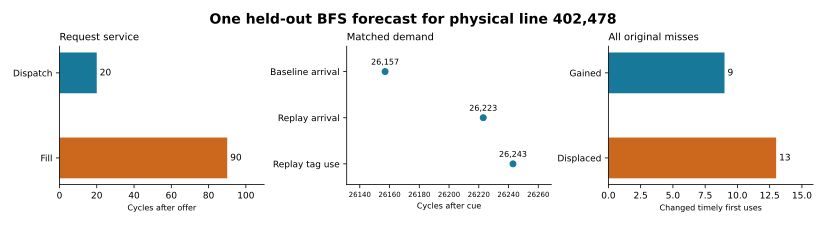

# A prospective address in the shared issuer

A tree probe fitted on Soplex supplies a physical-line displacement from a held-out BFS Stride history. The selector takes at most one action from each of two prespecified chronological windows. Eligibility uses the emitted address and current physical page. In the second window the global and same-PC probes must also disagree. Future accesses, compulsory misses, SPP outcomes and future service times are unavailable to the selector. The first window produced no qualifying action. [Frozen selections](../probes/prospective_offers.csv)

Each offer receives an independent replay of all 50M warmup and 200M measured instructions. Up to the intervention the native Stride policy makes every decision. The scorer compares every arrival, physical address and cycle up to and including the cue. It then checks the proposal in the native lifecycle log, demand outcomes in both arms, fixed-work cycles and all DRAM byte classes. The engine can reject a duplicate or an already resident line. Stride resumes immediately and observes its own altered future. The oracle timing experiment uses a separate population and a different selection protocol. [Measured outcome](effects.csv) · [Timing interventions](../trials/README.md)

## One forecast reached the intended load

At source instruction 217,131,623, operand 0, the cue was physical line 402,470. Stride proposed line 402,471. The held-out probe proposed line 402,478, exactly the eighth later LLC arrival, 26,157 cycles ahead. The proposal was accepted, dispatched, filled and used on time by that dynamic operand. The same target hit even under NoPF and already consumed a timely prefetch under Stride. Its three observed masks were 1, 9 and 9.

The request dispatched 20 cycles after prediction and filled after 90. In the changed execution the same operand still arrived eighth, 26,223 cycles after the cue, then claimed the line at its tag lookup 20 cycles later. Across 200M measured instructions the replay gained nine and displaced thirteen directly timely first uses of original misses. It moved 64 fewer DRAM bytes and took 784 more cycles than Stride. Both the original Stride offer and the replacement served a timely first use, on different lines. [Measured timestamps and effects](effects.csv)



The dynamic ID places a single experimental intervention. The address itself comes from causal source-trained inference. Simulation assumes an immediately available score, so this isolated result cannot establish speedup for a continuously operating predictor or account for inference area and energy.

```sh
p=llc_hybrid_prefetch/learning_opportunity
python3 -B "$p/one_offer/replay.py"
python3 -B "$p/one_offer/score.py"
```
