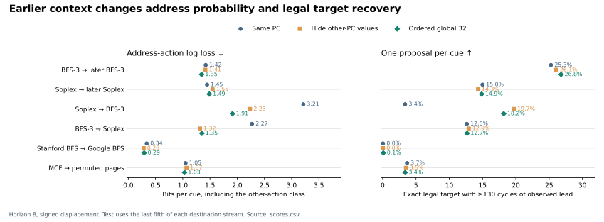
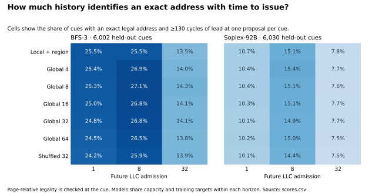
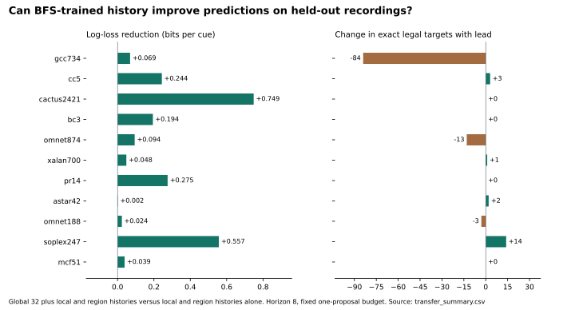
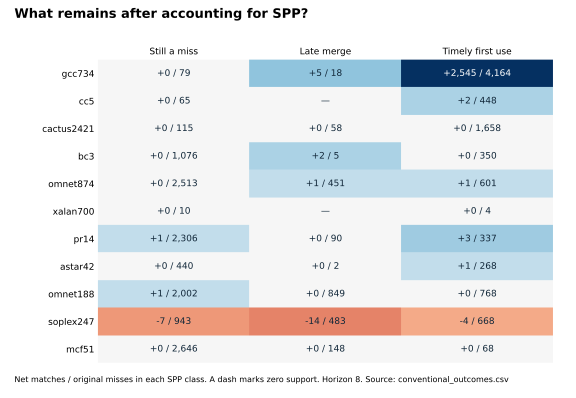

# What transfers in an address-prediction probe

The frozen BFS-3 model has now been scored on 11 independent expansion recordings. Adding the ordered 32-event global window to same-PC and region history reduced aggregate action log loss in 11 and conditional address loss on representable targets in 10. At the same one-proposal budget, legal exact H8 matches with ≥130 cycles of lead improved in 4, tied in 4 and fell in 3. The same-workload BFS-14 recording shows the clearest separation between learning an address relationship and complementing SPP: net +207 fixed-budget qualified addresses against a local-plus-region probe, of which +196 were already timely under SPP. [Transfer results](transfer_summary.csv) · [Matched conventional outcomes](paired_targets.csv)

An offline tree ensemble trained on Soplex learned when to propose a relative address in BFS-3, where every test cue PC was absent from the source training-anchor dictionary. With 32 ordered events, it recovered 1,033 exact legal targets at least 130 cycles before demand among 6,002 BFS cues. The same-PC probe recovered zero qualified targets. Each of the 1,033 additional targets was eight lines ahead of its cue. The outcome shows transfer of a simple displacement across producer PCs and 75 target regions. Evidence for more complex complementary behavior varies by workload. [Paired target-level counts](paired_targets.csv)

## Equal work and equal address budgets

The table fixes horizon eight, the source-trained displacement vocabulary, and the chronological test partition. Bits per cue includes the aggregate out-of-vocabulary class. Qualified counts require the exact line on a recently observed page and at least 130 cycles of lead. The last two columns force one concrete proposal per cue even when the model favors abstention. Both counts measure an address opportunity before queueing.

| Train → evaluated trace | Cues | Same-PC bits | Global-32 bits | Qualified, same PC | Qualified, global | One proposal, same PC | One proposal, global |
|---|---:|---:|---:|---:|---:|---:|---:|
| BFS-3 → later BFS-3 | 6,002 | 1.421 | 1.346 | 1,048 | 1,263 | 1,517 | 1,608 |
| Soplex → later Soplex | 6,030 | 1.446 | 1.487 | 720 | 743 | 904 | 896 |
| Soplex → BFS-3 | 6,002 | 3.215 | 1.913 | 0 | 1,033 | 202 | 1,091 |
| BFS-3 → Soplex | 6,030 | 2.272 | 1.352 | 741 | 702 | 762 | 764 |
| Stanford BFS → Google BFS | 7,079 | 0.339 | 0.291 | 0 | 0 | 3 | 7 |
| MCF → permuted pages | 4,426 | 1.051 | 1.033 | 1 | 0 | 162 | 149 |

The [complete transfer table](transfer_summary.csv) contains 37 source/destination comparisons. The [per-horizon results](scores.csv) include development scores, other feature windows and a second encoding that predicts an offset on a known page.

## Which part of history helps?

- On BFS-3, a same-PC H8 probe used 1.421 bits per cue. Adding region history and 32 ordered events reduced this to 1.346, with lower loss in five of eight contiguous test blocks. With other-PC global token values hidden, it used 1.414 bits. The global probe made 1,608 legal, lead-qualified matches under one proposal per cue, versus 1,565 with masking. Using both same-PC and region histories without the global window yields 1.360 bits and 1,533 forced matches. Adding the ordered global window to that control saves 0.014 bits and adds 75 matches. The other-PC mask covers global tokens only. Region histories can still contain other producers’ values. [History contrasts](history_value.csv)
- On Soplex, the same comparison raised log loss from 1.446 to 1.487 bits. For the Soplex-trained transfer to BFS, hiding other-PC values yields 1,182 qualified addresses under the forced budget, versus 1,091 when retaining them. The direction depends on the workload, score and issue budget. [Scores](scores.csv)
- The named Stanford-to-Google BFS test exposed a vocabulary limit. Only 145 of 7,079 Google targets could be named by the Stanford-trained H8 displacement alphabet. Mean loss fell from 0.339 to 0.291 bits, while both decision rules with abstention recovered zero lead-qualified lines. The global probe recovered seven under the forced budget. A low loss can mostly measure correct rejection of an unrepresentable target. [Trace inputs](../graph_inputs/README.md) · [Vocabulary and exact outcomes](scores.csv)
- In BFS-3, the 32-event timed probe used 1.355 bits. Adding contemporaneous occupancy from six queues reduced loss to 1.344. Adding trace-derived core metadata in a separate comparison gave 1.338. Each would require extra inputs and implementation costs. [Core and pressure controls](scores.csv)

## Relation to conventional prefetching

In Soplex-to-BFS transfer, the global probe added a qualifying target for 123 of 241 sampled original misses that merged into a late SPP request. It added none among 1,034 plain persistent SPP misses and none among 84 cues for a newly observed line on a known page. With one concrete proposal per cue, global gained 116 and lost two against same-PC in the late group. Those outcomes tie opportunity to specific missing lead time. They do not measure cache hits or execution benefit from issuing the model's proposals. [Paired gains and losses](paired_targets.csv) · [Additional trace witnesses](paired_examples.csv)

For one such case, source instruction 228,391,751 on the held-out BFS run reached physical line 36,114. The Soplex-trained global probe proposed line 36,122. Its target reached the LLC 607 cycles later. Both caller and target had PC 93,831,678,904,576; the physical line had previously appeared in the measured LLC stream. [Dynamic key and event values](paired_examples.csv)

The first actual demand to a predicted line can occur at a different position from the training label. Across 6,002 Soplex-to-BFS cues, the global probe offered 1,081 legal addresses. A matching line first appeared within 8,192 cycles for 1,050 offers. Eleven arrived within 130 cycles and 1,039 had at least 130 cycles of lead. Fifteen qualifying first uses occurred at a position other than horizon eight. Of the 1,039, 782 were original NoPF misses and 123 were SPP-late. This follow-up does not require hitting the originally supervised position. [First-demand windows](first_demand_soplex06_heldout.csv) · [MCF](first_demand_mcf17_discovery.csv)

## One prospective action in the real issuer

The predeclared cue-only selector supplied one BFS-3 offer. It predicted line 402,478 at a lead of 26,157 cycles before the eighth demand. That operand already hit under NoPF and was already a timely first use under Stride. After replacing the ordinary Stride proposal at that one decision, the real 200M-instruction replay gained 9 timely attributions and displaced 13, with 784 extra fixed-work cycles. One exact forecast had no marginal value for its intended target. [Selection protocol](PROTOCOL.md) · [Native replay and outcome definitions](../one_offer/README.md)

## Local ambiguity and different target definitions

In BFS-3, 53 training-supported PC/offset/two-distance contexts had multiple recurring displacement actions. They accounted for 469 held-out cues. Ordered global history raised loss from 1.287 to 1.303 bits and increased forced, qualified matches from 65 to 67. The stronger within-trace effect occurred among 3,493 cues with low or unseen local support, where forced matches rose from 319 to 385. The experiment finds limited disambiguation on repeating exact contexts. [Training-defined ambiguity cohorts](ambiguous_contexts.csv)

Changing which future event is predicted changes the result. For the eighth subsequent demand from a different PC in BFS-3, adding global context to same-PC history reduced forced, qualified matches from 192 to 152 among 6,002 cues. For the eighth demand outside the current 256 KiB region, only 30 targets were expressible and neither probe recovered a qualified target. Soplex yielded 76 versus 68 for the other-PC target across 6,022 eligible cues. [Future relation comparisons](related_targets.csv)

## Transfer, target novelty and recording coverage

In mcf17_layout_original, 4,294 test cues fell in trigger regions absent from the sampled training anchors. Global-32 recovered 0 qualified targets with abstention and 156 with one proposal per cue. This measures transfer to trigger regions; the output line may itself have previously appeared in the measured history. In Soplex → BFS-3, all 6,002 trigger PCs were unseen in donor training, 2,515 targets were in the H8 vocabulary, and 1,033 were recovered legally with lead. [Novelty denominators and outcomes](unseen_contexts.csv)

The timed BFS probe recovered 1,594 qualified targets at one proposal per cue. Giving it earlier LLC tag outcomes and their ages yielded 1,610 and 1.348 bits per cue. Adding earlier Stride stage/reason/age feedback yielded 1,608 and 1.347 bits. All callback serials used as features strictly precede the anchor. [Feedback joins](feedback.py) · [All scopes](scores.csv)

On the independent BFS-14 recording, adding global history to local and region context reduced loss from 2.223 to 1.747 bits. One concrete proposal per cue gained 245 and lost 38 qualified lines, spanning eight additional displacements and 51 target regions. Of the net 207, 196 were original misses that SPP already covered on time. The net change was +3 among 334 SPP-late original misses and −1 among 865 persistent ones. This recording supports transfer of predictive context, with limited complementary coverage. [Matched individual gains and losses](paired_targets.csv)

In the 2M-instruction MCF placement replay, 4,418 of 4,426 alternate-layout cues matched an original cue operand. The same H8 target operand followed in 4,388 pairs, and its physical line changed in 3,859 pairs. In these relocated pairs, global32 recovered 101 qualified fixed-budget targets in both layouts, 41 only in the original and 32 only in the alternate. The same fit and source instructions can yield different physical displacement and timing outcomes. [Paired placements](matched_placements.csv)

The fixed BFS-3 training fit has been applied to 11 of 11 preregistered held-out expansion recordings. Each row adds the ordered global window to a control already observing the same PC and the same region. The alphabet, sampled cues, trees per fit and issue budget stay fixed.

| Independent target recording | Cues | Vocabulary coverage | Bits saved | Change in qualified matches at one proposal per cue |
|---|---:|---:|---:|---:|
| gcc734 | 6,004 | 87.8% | +0.069 | -84 |
| cc5 | 6,012 | 5.2% | +0.244 | +3 |
| cactus2421 | 6,005 | 4.3% | +0.749 | +0 |
| bc3 | 6,010 | 1.3% | +0.194 | +0 |
| omnet874 | 6,034 | 8.0% | +0.094 | -13 |
| xalan700 | 6,022 | 5.3% | +0.048 | +1 |
| pr14 | 6,003 | 1.4% | +0.275 | +0 |
| astar42 | 6,021 | 1.0% | +0.002 | +2 |
| omnet188 | 6,021 | 8.1% | +0.024 | -3 |
| soplex247 | 6,011 | 19.1% | +0.557 | +14 |
| mcf51 | 6,004 | 0.3% | +0.039 | +0 |

### Does a better address add to SPP coverage?

The pooled global-32 probe and its local-plus-region control each receive one proposal per cue. The figure gives their difference in lead-qualified exact matches, stratified by the SPP outcome for the same dynamic target. Each denominator counts only original NoPF misses. A gain on an already timely SPP target cannot become an additional timely first use for that target. [Native outcome decomposition](conventional_outcomes.csv)

BFS-only training across 11 test recordings produced a net change of -15 qualified matches among 2,104 late SPP original misses, +0 among 12,195 persistent misses, and -55 among 9,334 already timely targets. Each comparison adds global history to the same-PC and region control.

Pooled training across 11 test recordings produced a net change of -6 qualified matches among 2,104 late SPP original misses, -5 among 12,195 persistent misses, and +2,548 among 9,334 already timely targets. Each comparison adds global history to the same-PC and region control.

GCC-734B shows how the donor can change the apparent need for history. With the pooled training set, global32 gained 3,423 qualified lines and lost 28 against local+region at a fixed budget. Displacement +8 accounted for 3,419 newly qualified lines, across 8 cue PCs and 122 target regions overall. With the BFS-only donor, the same scope change reduced qualified hits from 3,761 to 3,677. [Paired address concentration](paired_targets.csv) · [Unpooled controls](scores.csv)

One pooled H8 prediction on GCC originated at instruction 215,006,233, physical line 164,231, PC 4,257,721. The target was line 164,239 at PC 4,257,546, 2,268 observed cycles later. This target had appeared in the prior measured stream and was an original miss that SPP predicted late. The example transfers a displacement between producer PCs. It has no isolated performance replay. [Source operands](paired_examples.csv)

### Resolved cache feedback on external recordings

The fixed BFS-3 fit uses identical ordered history and timing features in all three columns. Each cell gives action log loss in bits and the count of exact, legal, lead-qualified addresses at one proposal per cue. Prior tag feedback supplies resolved tag hit/miss and age. The last column adds prior Stride decisions and outcomes. [Callback counts and raw scores](external_feedback.csv)

| Destination | Timing only | + Prior tag feedback | + Prior tag and Stride feedback |
|---|---:|---:|---:|
| gcc734 | 2.414 / 3,736 | 2.434 / 3,681 | 2.498 / 3,704 |
| cc5 | 0.660 / 5 | 0.665 / 2 | 0.750 / 1 |
| cactus2421 | 0.623 / 0 | 0.635 / 0 | 0.693 / 0 |
| bc3 | 0.270 / 6 | 0.264 / 5 | 0.315 / 2 |
| omnet874 | 0.888 / 24 | 0.872 / 32 | 0.851 / 29 |
| xalan700 | 0.645 / 4 | 0.641 / 5 | 0.702 / 5 |
| pr14 | 0.287 / 5 | 0.279 / 1 | 0.336 / 1 |
| astar42 | 0.250 / 2 | 0.258 / 0 | 0.281 / 0 |
| omnet188 | 0.970 / 32 | 0.967 / 34 | 0.963 / 28 |
| soplex247 | 1.158 / 467 | 1.160 / 460 | 1.173 / 461 |
| mcf51 | 0.154 / 0 | 0.156 / 0 | 0.167 / 0 |

### Balanced multi-program training

The pooled fit uses 12,000 training cues each from BFS-3, MCF17-472B and Soplex-92B. It learns its own alphabet from the 36,000 donor targets. The following counts hold that new alphabet fixed across feature scopes. Absolute log loss across the pooled and single-donor alphabets uses different target classes. [All pooled cohorts](pooled_transfer.csv)

| Independent target | Cues | Cues with expressible H8 targets | Conditional bits, local+region → global | Fixed-budget qualifying lines, local+region → global |
|---|---:|---:|---:|---:|
| gcc734 | 6,004 | 5,277 | 4.53 → 2.87 | 72 → 3,467 |
| cc5 | 6,012 | 209 | 8.22 → 7.43 | 0 → 2 |
| cactus2421 | 6,005 | 18 | 9.46 → 7.90 | 0 → 0 |
| bc3 | 6,010 | 56 | 8.41 → 7.65 | 0 → 2 |
| omnet874 | 6,034 | 552 | 6.37 → 5.50 | 3 → 8 |
| xalan700 | 6,022 | 263 | 7.74 → 6.22 | 4 → 8 |
| pr14 | 6,003 | 56 | 6.96 → 5.96 | 0 → 4 |
| astar42 | 6,021 | 29 | 6.60 → 5.85 | 2 → 2 |
| omnet188 | 6,021 | 515 | 7.15 → 5.97 | 7 → 11 |
| soplex247 | 6,011 | 1,330 | 2.64 → 2.87 | 606 → 594 |
| mcf51 | 6,004 | 27 | 6.81 → 6.47 | 0 → 1 |

The [full transfer matrix](transfer_summary.csv) separates a later phase from a different recording of the same program, a named graph input, a different executable and a changed simulated physical placement. A model is frozen at transfer. Same-executable recording IDs alone do not identify independent graph inputs.

## Google service and AI inference transfer

The BFS-3 H8 donor, alphabet and feature scopes stay frozen. These recordings previously had a short screening interval. Their later evaluation provides a cross-domain check. The separate reserved files remain untouched. [Trace selection and dependency limits](../domains/README.md) · [Domain scores](domain_transfer.csv) · [Matched native outcomes](domain_outcomes.csv)

| Recording | Cues | Expressible H8 targets | Page-bank reach | Conditional bits, local+region → global | Qualified fixed-budget lines, local+region → global |
|---|---:|---:|---:|---:|---:|
| domain_gg_charlie | 6,063 | 1,570 | 2,562 | 5.37 → 5.08 | 318 → 301 |
| domain_ai_llama | 6,014 | 5,973 | 5,239 | 0.46 → 0.58 | 5,228 → 5,138 |

## What remains open

The current positive transfers concentrate on a few displacements or on targets that SPP already covers. A useful next test targets independent recordings with adequate legal reach and asks whether the richer probe consistently predicts original SPP-late or persistent misses. Only prospective replay with equal issue opportunity can establish marginal completion-time gains. The measured one-off replay sets a counterexample to inferring performance from an exact address alone. [Novelty strata](unseen_contexts.csv) · [Protocol and limits](PROTOCOL.md)
