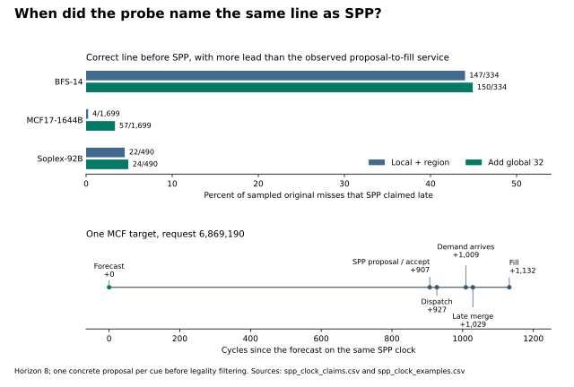

# Can a frozen probe name the line before SPP?

Yes, on some real misses. In MCF17-1644B, the BFS-trained global-history probe named 59 of 1,699 original misses that SPP claimed late. Every forecast preceded the proposal of the actual claiming request. For 57, the forecast preceded the first subsequent demand to that line by more than the request's measured proposal-to-fill time. The local-plus-region probe met both conditions for four targets. The incremental 53 forecasts used just two displacements, +5 lines in 46 cases and +4 in seven. Allowing the probe to abstain reduced the global result to two targets. [Paired target counts](spp_clock_pairs.csv) · [Issue and abstention denominators](spp_clock_population.csv)



## The same address on the same clock

The fixed donor is the first 60% of the BFS-3 **Stride** stream. Its horizon-eight displacement vocabulary, training-only PC encoding and tree settings are inherited from the [probe protocol](PROTOCOL.md). Apply each frozen fit to the **SPP** arrival stream and score reproducibly sampled cues in its final 20%, using the same 32-event split guard. Every admission updates history. The global probe adds 32 ordered events to the local control's same-PC and same-region histories. Both see only observations available at the cue.

One-proposal scoring picks the highest-probability concrete action, adds it to the current physical line, and suppresses candidates outside the bank of recently observed physical pages. Each cue therefore costs at most one legal proposal. Exact credit requires the physical line of the eighth subsequent SPP LLC demand. NoPF contributes only the original-miss mask for that same dynamic source instruction and operand. SPP supplies every timestamp below.

| Recording | SPP result on original miss | Sampled targets | Global exact and legal | Forecast before / same cycle / after SPP proposal | Before SPP **and** enough time, local / global | Median global advance / observed service, cycles |
|---|---|---:|---:|---:|---:|---:|
| BFS-14 | Late | 334 | 150 | 150 / 0 / 0 | 147 / 150 | 1,481.5 / 210 |
| BFS-14 | Timely | 2,734 | 1,140 | 1,130 / 10 / 0 | 944 / 1,130 | 1,601 / 90 |
| MCF17-1644B | Late | 1,699 | 59 | 59 / 0 / 0 | 4 / 57 | 1,034 / 363 |
| MCF17-1644B | Timely | 1,268 | 24 | 24 / 0 / 0 | 0 / 24 | 795 / 239.5 |
| Soplex-92B | Late | 490 | 24 | 24 / 0 / 0 | 22 / 24 | 883.5 / 210 |
| Soplex-92B | Timely | 717 | 38 | 25 / 2 / 11 | 21 / 25 | 619.5 / 100 |

The signed advance is SPP proposal cycle minus cue cycle. Medians use all correctly named, legally constructible targets in the row with a matched proposal. A forecast qualifies on service when target admission minus cue cycle **strictly exceeds** the actual claim's proposal-to-fill duration. Requiring lead to the first intervening future demand to that line gave the same qualifying counts in this table. Every late-class qualifying global prediction was on its cue's physical page. The request ID joins proposal, acceptance, dispatch, fill and the late/timely callback. The callback's consumer operand and physical line must match the indexed demand. Same-cycle forecasts are reported separately even when callback order is known. [All counts, service margins, ties and censoring](spp_clock_claims.csv)

## One MCF demand

At cycle **1,113,907,119**, source instruction 211,167,451, operand 0, entered SPP's LLC stream at physical line 38,740,849, PC 4,207,520. The global probe proposed line **38,740,853**. SPP proposed and accepted request 6,869,190 for that line at cycle 1,113,908,026, dispatched it at 1,113,908,046 and filled it at 1,113,908,251. The demand from PC 4,207,541 (instruction 211,167,631, operand 0) arrived at 1,113,908,128. Its late-merge callback followed at 1,113,908,148. The forecast led SPP by **907 cycles** and the demand by 1,009. The actual request took 225 cycles from proposal to fill, leaving a descriptive margin of **784 cycles**. The local probe missed this target. [Operand keys and timestamps](spp_clock_examples.csv)

## Forecast cost and interpretation

On MCF, forcing a concrete action produced 5,276 legal global forecasts over 6,011 cues. Just 90 named the exact eighth line and 89 of those targets were original NoPF misses. With abstention enabled, the probe abstained 5,893 times, issued 115 legal forecasts and named three exact original misses. Only two were SPP-late. An earlier correct address is demonstrable here. A practical confidence or issue budget that preserves the useful cases remains unresolved.

The unclaimed original misses also matter. The global probe exactly named 17 persistent SPP misses on BFS-14, six on MCF and three on Soplex. These operands have no claiming SPP proposal to time. Ordinary hits, absent tag observations, illegal proposals, abstentions, and missing lifecycle records have separate counts. All correctly named late/timely claims in these three runs matched a request and had a measured fill. Earlier rejected or unrelated requests to the same physical line are outside this comparison. Charging the observed service duration assumes it could be preserved at a different issue time. Queue contention, occupancy, eviction and inference latency can alter that outcome in a replay. [Population accounting](spp_clock_population.csv)

This post hoc appendix covers three named recordings and one forecast horizon. Its sampled durations and target frequencies apply to these SPP runs. The diagnostic executed no probe-issued requests. [Original recordings](../../full_workload/data/trace_files.csv) · [Native capture format and clock](../capture/README.md) · [Complete index and label schema](../labels/README.md)

## Reproduce

From this folder, with the validated native capture, aligned sequence index, baseline retirement masks and original BFS-3 probe sample present, run:

```sh
python3 -B spp_clock.py
python3 -B verify_spp_clock.py
python3 -B plot_spp_clock.py
```

The [analysis](spp_clock.py) reads `../raw/capture/runs/{bfs_transfer,mcf17_transfer,soplex06_heldout}__spp/`, generates the identical block-based SPP samples if needed, and writes one row per cue and feature scope to `../raw/probes/spp_clock/<case>.csv.gz`. The [independent check](verify_spp_clock.py) compares native retirement masks with the index, reruns the original probe scorer, checks legal and abstaining decisions and recalculates the first-demand service counts.
