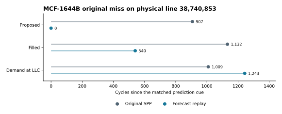

# What would an earlier correct address buy?

These paired interventions use hindsight to select a physical target. They estimate the net effect of offering that target at two different LLC arrivals under normal queueing, admission, fills and evictions. They measure a scenario with oracle target information. They do not guarantee an upper bound on the best possible schedule.

Use the four existing detailed samples from each of the 200M-instruction SPP runs for MCF-472B start, BFS-3 start and Soplex-92B. Within each sample, select original NoPF misses that remain plain misses or late first uses under SPP. Each target must have two distinct, preceding, same-page anchors in its last 64 SPP ingress events, with no intervening target access. The nearer anchor has 1–64 cycles of lead and the earlier anchor at least 220. Selection excludes the edges of each logging window. Use a seeded shuffle to choose one eligible target per quarter and class, with distinct, spaced anchors. [Eligible populations and selected operands](targets.csv)

Each treatment replays the full 50M/200M interval. It overrides the usual SPP offer at the observed dynamic anchor with the signed displacement to the known target. A changed arrival stream can omit the anchor or cause a different physical offer. The scorer checks for both. Ordinary duplicate and outstanding filters still apply. Whole-run cycles include resource contention and displaced offers. The targeted load's ROB-head wait is an exposure proxy. Head waits across loads cannot be summed as independent speedups.

```sh
p=llc_hybrid_prefetch/learning_opportunity/trials
python3 -B "$p/select_targets.py"
python3 -B "$p/replay.py"
python3 -B "$p/score.py"
```

## Measured effects

| Workload | Offer | Timely selected / planned | Other and selected first uses gained / lost | Cycles saved vs SPP | DRAM byte change |
|---|---|---:|---:|---:|---:|
| MCF-472B | early | 8 / 8 | 84,108 / 84,351 | +148,219 | -214,976 |
| MCF-472B | near | 0 / 8 | 84,494 / 84,074 | +2,957 | -142,080 |
| BFS-3 | early | 6 / 6 | 32,711 / 33,766 | +106,164 | -18,240 |
| BFS-3 | near | 0 / 6 | 17,779 / 19,559 | +35,927 | +135,552 |
| Soplex-92B | early | 4 / 4 | 50,206 / 55,477 | -392,638 | -719,104 |
| Soplex-92B | near | 0 / 4 | 49,931 / 52,501 | -142,238 | -414,336 |

Every early offer reached its selected original miss in time. None of the near offers did. Under Soplex, the early treatment lost 5,271 more original timely first uses than it gained. Both DRAM bytes and exposed waiting changed after the interventions. Cycle savings summarize the whole trajectory. They cannot be divided by the number of selected misses to infer per-load value. [Native replay totals](effects.csv) · [Aligned target timing and ROB-head waits](request_timing.csv)

## A diagnosed MCF forecast turned a late merge into a timely hit

The frozen BFS-trained global-history probe generated line 38,740,853 at source instruction 211,167,451, operand 0. We selected the first reported MCF-1644B example whose exact address preceded an SPP late claim with sufficient measured service time. Selection therefore used the future outcome. This experiment tests whether that identified opportunity survives admission and service. [Frozen example](forecast_selection.csv) · [Candidate population](../probes/SPP_CLOCK.md)



Up through the cue, all 6,869,184 LLC arrivals matched SPP in operand, PC, line and cycle. At this cue the forecast replaced SPP's proposed line 38,740,850. Original SPP proposed the target 907 cycles later, after which the demand merged before fill. In the changed execution the forecast filled after 540 cycles and the intended demand arrived after 1,243. Its NoPF, SPP and replay masks were **2, 6 and 9**. The same source load moved from original miss to late merge to timely first use.

The 200M-instruction run took 1,314,438,254 cycles versus 1,314,447,978 for SPP, a reduction of **9,724 cycles (0.00074%)**. DRAM traffic fell by 14,400 bytes. Across all original misses, 31,590 gained a timely first use and 31,754 lost one. These whole-execution changes include displacement and downstream timing effects. One retrospectively selected success cannot estimate the benefit of issuing the probe's full forecast stream. [Measured effects](forecast_effect.csv)

`python3 -B llc_hybrid_prefetch/learning_opportunity/trials/replay_forecast.py` reproduces this treatment. The complete native output is under `learning_opportunity/raw/trials/mcf1644_identified_forecast/` inside the project.
