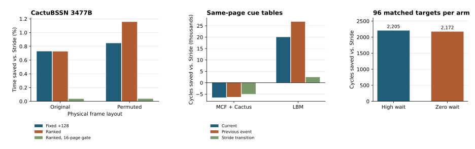
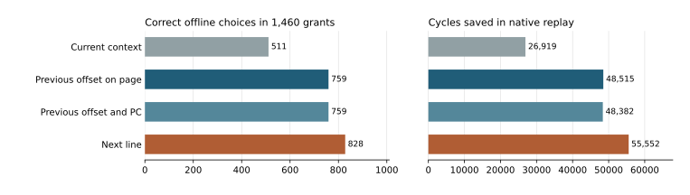

# Which earlier events predict a valuable LLC request?

There are two real cases worth distinguishing. In later BFS-3 an earlier access to the **same physical page** carries information even after accesses to other pages intervene. A simple table can retrieve the last offset on that page. In CactuBSSN 3477B, a physical line on a previously seen page can sometimes be named hundreds of cycles before demand, and a fixed cross-page displacement buys almost all the benefit of a fitted table on the original layout. Only the second claim requires granting the LLC a broader physical candidate interface. Neither result establishes a neural requirement.

## Real case 1 · Returning to a page in later BFS-3

Across the first 1M-warm/2M-measured BFS-3 interval, one load PC generated all LLC ingress. At a fixed follow-up interval, instructions 50M–52M, there were eight such PCs. Ordinary Stride directly converted 15,765 of 47,888 original misses there (32.9%), compared with 23,949 of 25,393 (94.3%) in the early interval. SPP on the later interval saved 1,793,065 cycles (12.99%) relative to Stride and used 122,432 additional DRAM bytes. The graph benchmark name alone would have concealed this phase difference. [Phase measurements](../workloads/performance.csv) · [Demand outcomes](../workloads/outcomes.csv) · [Conventional runs](../conventional/policy_results.csv)

On the held-out suffix of that later interval, 1,087 of 1,460 granted triggers had a qualifying upcoming access to the same page. A table using the current context selected the correct offset on 511 grants; including the last two PCs gave 519. Retrieving the previous offset on this page gave **759**, and adding that older access's PC also gave 759. Using an alternative older event gave 572. The improvement over current context is 248 matched grants, or 17.0 percentage points of the common 1,460 grants. Each correct choice in this particular probe identifies a distinct dynamic target. Of the 759 successes, 370 still missed under Stride and 389 already received timely native first-use credit. A fixed next-line scored 828 on the same offline task. Prediction success depends on a cheap piece of *indexed* history. Read the current page's record, regardless of how many other pages intervened. [Counts by rule and split](../history/page_association.csv) · [History study](../history/history_feature_study.md)

One example shows what was worth remembering. On physical line 191,187, instruction 51,608,107 left a record for its page. Two intervening load PCs accessed other pages. At instruction 51,608,215, now on line 191,188, the current-only key chose page offset 17. Retrieving that page's earlier offset selected offset 21. Three LLC events and 684 cycles later, instruction 51,608,294 accessed line 191,189, missed under both baseline policies and registered 118 cycles of head wait. Native replay verified that both the page-offset rule and next-line prefetched line 191,189 for that same load; the current-context rule proposed a different line already resident. The physical sequence 191,187 → 191,188 → 191,189 explains why next-line is such a strong control. Of 249 targets gained by looking up page history, 195 had intervening events and 111 had a prior reference from a different PC. The gain persisted in each chronological third (71, 93 and 85 new targets, with 0, 1 and 0 lost). [Real cue–target witnesses](../history/page_memory_witnesses.csv) · [Held-out stability](../history/page_memory_stability.csv)

Native replay then used the same trigger allowance on the held-out suffix and recomputed decisions from the changing stream. The current-context rule saved 26,919 cycles against ordinary Stride. Reading the previous page offset saved 48,515 cycles, or 21,596 more than current context. A 16-entry direct-mapped page history retained 46,243 cycles of savings. Adding the prior page PC saved 48,382 cycles. The simplest equal-grant control, issuing the next line, saved **55,552** cycles with 751 accepted auxiliary requests; the prior-offset table accepted 750. Next-line also explained **246 of the 249 added offline matches** relative to current context. This leaves four page-rule matches beyond next-line over the full scored set, versus 73 next-line-only matches. The page rule created 379 timely auxiliary first uses, compared with 290 for current context and 440 for next-line. This establishes an informative historical feature with measured benefit over a particular current-context table. It also establishes the stronger conventional comparator a learned design would have to beat. SPP above was active throughout the separate full-run comparison. [Live page-memory results](../page_memory/results.csv) · [Implementation and controls](../page_memory/README.md)

**Two real loads survive the stronger controls.** Among the four targets picked only by page history versus next-line, two also missed under current-context prediction, repeat-delta, multi-delta and the degree-one SPP port. Each was issued from its original cue and directly claimed a timely fill under both the full page history and the 16-entry version. The third was also covered by the current-context fallback. SPP covered the fourth from exactly the same trigger. The detailed SPP and multi-delta reruns reproduced all native counters and the cycles of their original open-budget runs. [All nine arms for each load](../history/page_exclusive_loads.csv) · [SPP and multi-delta request evidence](../conventional/bfs_strong_targets.csv)

| Same target PC in later BFS-3 | Prior → current → target offsets within the page | Age of prior page reference at decision | Cue-to-target lead on Stride clock | Qualifying training examples / context observations | Target ROB-head wait, Stride → finite page history |
|---|---|---:|---:|---:|---:|
| Load 51,681,598 | 50 → 51 → **55** | 2 ingresses, 350 cycles | 995 cycles | 5 / 26 | 118 → 48 cycles |
| Load 51,766,261 | 9 → 10 → **12** | 2 ingresses, 684 cycles | 623 cycles | 6 / 21 | 238 → 48 cycles |

Both histories look locally like +1; simply extrapolating that step predicts 52 or 11. A previously fitted table keyed by the current context and the retrieved page offset instead produced 55 or 12. Two ingresses of age means **one intervening ingress**; this is selective retrieval with a short event gap and a long cycle gap. Support is modest, the cohort was selected retrospectively for disambiguation, and target head waits cannot be added as a wall-time benefit. These examples identify a reproducible architectural opportunity. Their frequency and cost advantage on additional recordings remain open.

The later BFS-8 slice has only 854 LLC demands. In a BFS-3-late → BFS-8-late transfer with 98 grants, all four controls above reached two qualifying targets. That transfer does not support a general claim about graph traversal. The results also give no special status to the name or loop identity of any PC. The available recordings lack enough symbols to assign the cue to a particular graph data structure. [Coverage and phase composition](../workloads/README.md)

## Real case 2 · A legal early address in CactuBSSN

Train on CactuBSSN 2421B, then score the different 3477B recording. Of 7,077 paired persistent LLC misses with positive retirement-head exposure, take a fixed 48-load sample. Zero had a different-line same-page ingress at least 190 cycles early. Allow a signed displacement of up to 1,024 lines into a physical page already observed by this core: 38 did. The enumerated candidate menu yielded 36 at that lead. The 190-cycle service reference is the median of 6,033 completed training-prefix demand services. This is an opportunity ceiling for the specified observation window. [Per-target samples](../history/sampled_opportunities.csv.gz) · [Ceilings](../history/history_ceiling.csv)

A concrete decision links this ceiling to execution. In the ordinary R2 run, load **10,145,041** accessed physical line 72,743 at cycle 5,813,437. Sixteen LLC ingress events and 965 cycles later, load **10,145,357** requested line 72,871. The R1 frequency table ranked +128 at the earlier cue; R2's native Stride had no proposal for that line in the observation window. The demand missed and waited 104 cycles at the retirement head. In a new native run the frozen table recomputed its decision from that run's history. It proposed at 5,812,784, dispatched at 5,812,804, filled at 5,812,935 and the target entered at 5,813,409. The target got the first hit and its head wait fell to zero. Compare trigger and demand timestamps **within** each run. [Exact example in every arm](../physical_replay/target_example.csv)

| R2 frame layout and mechanism | Timely first hits on original misses | Accepted auxiliary requests | Cycles saved vs that layout's Stride | Total DRAM bytes |
|---|---:|---:|---:|---:|
| Original, Stride | 0 | 0 | 0 | 847,104 |
| Original, fixed physical +128 | 905 | 1,135 | 35,999 (0.728%) | 847,552 |
| Original, R1 ranked candidates | 927 | 1,201 | 35,880 (0.726%) | 848,000 |
| Original, R1 ranked with 16-page issue gate | 33 | 42 | 1,784 (0.036%) | 847,552 |
| Permuted, Stride | 0 | 0 | 0 | 847,040 |
| Permuted, fixed physical +128 | 726 | 823 | 46,480 (0.846%) | 853,248 |
| Permuted, R1 ranked candidates | 1,160 | 1,374 | 63,495 (1.156%) | 860,608 |
| Permuted, R1 ranked with 16-page issue gate | 98 | 127 | 2,044 (0.037%) | 848,896 |

Every arm retired 5M measured instructions. The example's new frame displacement was −1,664 lines. All policies missed that particular load on the second layout. The permutation also increased Stride LLC lookups from 38,457 to 145,329 and baseline cycles from 4,943,576 to 5,491,843, despite exactly 10,149 NoPF LLC misses in each layout. Thus this is a paired within-layout robustness test. The original ranking saw 339 physical pages and 457 PCs in the reference R2 stream. With the 16-page gate it rejected 4,652 of 4,807 choices on the original layout. For this cross-page controller, one engineering question is which page handles justify long-lived storage. The broader opportunity across workloads is evaluated in the [paired transition and predictability study](../../transition_study/README.md). The 16-entry ablation still uses the reference generator's larger state; it is not a complete 16-entry implementation. [Full measurements](../physical_replay/placement_results.csv) · [Follow-up scope](../physical_replay/protocol.md)

## How much earlier is an address expressible?

Fixed sample of 48 ordinary NoPF misses that remained misses under Stride and incurred a positive head wait, **per** held-out recording. Earliest is bounded by 64 prior core-local ingresses, 4,096 cycles and the previous access that could have consumed a prefetch. Latency proxies are estimated from the other recording's training prefix. Lead percentiles are conditional on the enumerated candidate being reachable; service-margin counts include all 48.

| Held-out workload | Training service p50 | Any same-page target with margin | Enumerated target with margin | Eligible target's earliest lead, p50 / p90 cycles | Median lead in events |
|---|---:|---:|---:|---:|---:|
| MCF 994B | 81 | 13 / 48 | 14 / 48 | 17 / 1,540 | 1 |
| CactuBSSN 3477B | 190 | 0 / 48 | 36 / 48 | 915 / 2,103 | 27 |
| LBM 3766B | 561 | 44 / 48 | 44 / 48 | 2,271 / 3,963 | 7 |

The four-way separation matters. Some targets are unreachable under the original interface. Some become legally constructible, but many legal candidates collide on the same features. For others there is a supported choice only after the useful deadline. Even an early, correct choice can wait in memory queues or displace valuable data. The exact demand latency in one arm cannot determine hypothetical fill latency in another. Stratified sampling gives interpretable proportions for these exposed persistent misses; it does not estimate a whole-workload fraction without population weighting. Other strata, calibrated rules and individual target evidence are in the linked tables. [Ceilings and denominators](../history/history_ceiling.csv) · [Rule-selected examples](../history/history_verified.csv)

## MCF · Correct earlier addresses can lose time

In the original MCF 665B + CactuBSSN run, 39,541 MCF misses persisted. Of these, 15,456 merged with an in-flight prefetch, 23,263 had no recorded prior action on the line since its preceding lookup, 486 last saw a page rejection, 332 a fill and four an unused eviction. Separately, 15,186 original misses became hits, of which 13,864 were attributable timely first uses. An absence of a prior action could reflect low confidence, limited history or missing visibility. The interval-limited observation does not distinguish those explanations by itself. [Original event taxonomy](../../MEASUREMENTS.md)

We fit equally bounded conventional tables and let them issue only on MCF's last 30% of measured work. The current-context table moved **222 originally late** loads to timely first uses; its matched triggers were a median 460 cycles earlier than native proposals. Remembering the latest local stride change converted **220**, a median 490.5 cycles earlier. Yet whole-run times grew by 6,490 and 4,952 cycles respectively. In the transition case 508 paired misses gained direct timely first hits from that source, 220 of them originally late. Normal Stride remains active on other opportunities. Timing changes include displaced native candidates, contention and service-order changes; attribution here does not allocate the net slowdown to one effect. The companion had finished before the suffix intervention. [Replays](../deadlines/replay_results.csv) · [Per-load issue/dispatch/fill](../deadlines/event_examples.csv)

Two-step conventional lookahead tells a different story. At **exactly 28,949 accepted** requests per run, it saved 106,672 cycles over matched-count Stride. In an open degree-one comparison, multi-delta saved 195,315 cycles but accepted 9,386 more requests than Stride. Performance at a common acceptance count and at an open budget answer different questions. [Conventional comparison](../conventional/conventional_baselines.md)

## Lateness, pressure, pollution and exposed stalls

- On early BFS-8 the same 25,372 baseline misses yielded 23,912 directly attributed timely hits alone and 18,128 with LBM. Late merges rose from 656 to 6,440. Both runs retained the same dominant PC and stride. For the timely first-use cohort, median proposal-to-dispatch stayed at 20 cycles, dispatch-to-fill rose from 70 to 190, and proposal-to-first-demand changed from 254 to 284. A separate comparison joined 24,568 requests by trigger, consumer and physical target across the two arms. Among the 5,820 that switched from timely to late, median proposal-to-demand changed only from 172 to 174 cycles, while median dispatch-to-fill increased from 70 to 233. [Matched-request timing](../conventional/bfs_service.csv) [Service and lead distributions](bfs_service.csv) · [Matched runs](../workloads/outcomes.csv)
- For original MCF mixed first-use hits, the immediately preceding LLC ingress's PC matched the target PC in 0.85% of 13,864 cases; for 15,456 late merges the fraction was 91.19%. Its tag result existed at the *target's* ingress in 62.44% vs 4.35% of cases, and at the *actual native prefetch proposal* in 0% of either group. A feature seen just before a hit may already be too late for the prediction that caused it. Subsequent neighbors are retained as descriptive controls. [Hit, miss and surrounding events](hit_neighborhoods.csv)
- In matched MCF interventions, 96 high-wait targets and 96 zero-wait targets had nearly equal median original lead, 414 and 414.5 cycles. For high-wait targets mean head wait fell from 510.56 to 42.01 cycles. The high-wait and zero-wait batches saved 2,205 and 2,172 whole-run cycles. The second core lost 4,623 and 8,043 cycles respectively. These are two policy counterfactuals. The 33-cycle difference does not support a per-load criticality reward proportional to head wait. [Matched causal replays](../conventional/criticality.csv)
- In the multi-delta MCF mixed run, 1,950 MCF NoPF hits became misses. For 529, the last eviction of the same line was a prefetch eviction. Twenty of the companion's 67 lost hits followed an eviction by MCF's prefetch. A displaced victim supplies stronger attribution than a miss count alone; the isolated performance cost of that victim remains unknown. [Victim tracing](../conventional/pollution.csv)
- Two synthetic predictor ports asked for the same physical line. The second proposal was rejected by the shared PQ, then by its MSHR and later by residency as the original request progressed. Exactly one physical request was accepted. Promotion after agreement found no useful mature non-head PQ entry in the tested MCF and LBM mixes. [Directed issuer test](../conventional/duplicate_fixture.csv) · [Agreement analysis](../conventional/conventional_baselines.md)

## Evidence status

**Supported.** Selected real physical targets are predictable before conventional Stride can issue them, and actual earlier fills can lower fixed-work time. Per-page history adds forecast information on a held-out segment of later BFS-3; two verified target loads were also missed by SPP, multi-delta, next-line, repeat-delta and the current-context rule. Trigger visibility, page placement, metadata lifetime, co-runner pressure and issue timing can change the result materially.

**Unsupported in the tested cases.** A fixed nested-loop boundary, positive synthetic XOR result, high accepted accuracy, the number of newly timely loads or a long ordered history on its own justifies neural hardware. Earlier selective-transition issues in MCF did not beat the simpler conventional performance controls.

**Open.** Whether any real cue requires learned retention or content-based retrieval to outperform equal-capacity conventional temporal/region predictors across unseen phases and physical mappings. No study here implements the full Triangel or Tetrahedrangel design, synthesizes a controller, or establishes a suite-wide speedup. [Smallest discriminating experiments](next_experiments.md)
