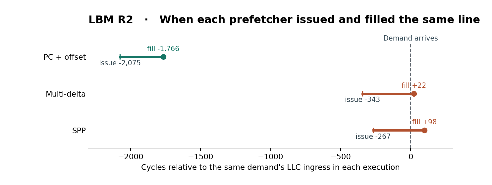

# When Stride loses timely coverage

A table trained on LBM's first interval (R1) used the current load PC and exact physical-page offset to predict future lines in R2. Among 5,429 distinct demands where Stride's run of timely hits broke, the table's own requests converted **85 original misses to timely hits**. All 85 missed under unrestricted SPP, Multi-delta, a cross-PC table and a physical-successor table. [Matched demands and attribution](strong_controls/union_results.csv)

SPP proposed the correct line for all 85 demands. The frozen table issued from an earlier dynamic load in **84 of 85** cases and from the same trigger in one. Median proposal-to-demand lead was 1,384 cycles for the table and 266 for SPP, with a median paired difference of **1,130 cycles**. Issue-to-dispatch took 20 cycles in both runs, and the median paired dispatch-to-fill difference was 3 cycles. This cohort was selected on the table's successful uses to diagnose timing. Over the full fixed-work interval, the table saved **269,697 cycles (3.566%)** against Stride. A 256-entry Multi-delta saved **485,281 cycles (6.416%)** with Stride's budget of 12,276 accepted requests. [Paired timing](strong_controls/timing_summary.csv) · [Conventional controls](strong_controls/README.md)

At LBM load PC 4,201,648, offset 15 was followed by useful offset 22 in 54 of 214 R1 contexts. In R2 the table saw physical line 650,831 at source instruction 14,971,705 and proposed line 650,838. The last timely hit in the original sequence was instruction 14,972,675. For demand 14,973,121, the table proposed 2,075 cycles early and filled 1,766 cycles early. SPP proposed 267 cycles early and filled 98 cycles late. Multi-delta proposed 343 cycles early and filled 22 cycles late. Each interval uses its own demand-ingress clock. The table also preserved the two preceding timely hits. Stride, fixed +1 and fixed +5 missed, and the cross-PC and physical-successor tables did not propose that target. Other page offsets at the same PC supported +5 and +10. [Training counts and lifecycle](replay/lbm_transfer_witness.csv) · [Control timing](replay/lbm_witness_controls.csv)

The question is whether observations available at the LLC can give a hybrid prefetcher useful physical addresses earlier or more accurately and shorten execution. Conditional prediction, lookahead and transfer to new contexts can each be tested on their own. [Research question and criteria](RESEARCH_QUESTION.md) · [Full-scale follow-up](../full_workload/README.md)

## Where timely coverage breaks

In the paced loop with alternating 8- and 24-line rows, seven displayed accesses all miss under NoPF. Stride covers lines 8325–8327 in time. At 8327 it proposes 8328, but the next line is 8352 in the same physical page. Two subsequent accesses still miss, and timely coverage resumes at 8355. This case gives a concrete target and simple controls based on page layout and counted strides. In the BFS example, both executions already proposed the correct next address. [Loop access sequence](figures/row_example.csv) · [BFS service timing](timing/examples.csv)

We align each core by source instruction and load operand, then verify PC, virtual line and physical mapping. Event times are relative to each run. **T** is a directly attributed timely first use for an original NoPF LLC miss. **L** is a late merge for such a miss, and **P** is a persistent miss with no late claim. Private hits, forwarding, ordinary LLC hits, merges and upstream changes are recorded separately. Any other outcome can break a run of T events. The last T is an offline marker. Its tag result may arrive after a subsequent LLC ingress.

The first 18 NoPF and Stride pairs yield 21 per-core sequences. Program and LLC arrival orders are each grouped by core, PC, physical page and four-page region. Each group records the first L or P after at least two T events and the subsequent recovery. Similar prefixes that keep hitting serve as controls. The original set contains 99,951 interruption records across overlapping views and 47,802 controls matched without reuse within their matching scopes. Adding LBM R2 after offline screening brings the totals to 19 pairs, 22 per-core sequences, 112,785 interruption records and 49,412 controls. [Cohort definitions and checks](episodes/README.md)

| Interval and view | First L / P after at least two T events | What the sequence shows |
|---|---:|---|
| MCF with CactuBSSN, MCF core LLC order | 35 / 36 | No transitions met the same condition in full program order, where loads served by the private caches intervene. |
| Same MCF, LLC order within each PC | 1,624 / 913 | Among the 913 P targets, 761 had no recorded action since the prior same-line lookup, 151 had a cross-page rejection as the most recent action, and one had an eviction. In matched controls, the delta changed on 76.3% of P and on 0.2% of continued hits. A changed delta at demand is visible only after the earlier prediction opportunity. |
| Early BFS-8 alone and with LBM, core LLC order | 516 / 373 and 2,742 / 199 | Stride proposed every one of the co-run's 2,742 L targets before the preceding T completed its tag lookup. Of the matched requests, 2,447 were timely alone. Median proposal-to-demand lead stayed at 170 cycles. Median dispatch-to-fill grew from 70 to 190 cycles. |
| Middle BFS-3 and BFS-8, core LLC order | 51 / 2,567 and 210 / 3,239 | The source interval of 25M–27M instructions was set in advance for both recordings. Their interruption mix differed markedly from the earlier intervals. |
| Three synthetic streams sharing one PC and CactuBSSN R2 | 0 / 0 in both | Stride had no timely hits. CactuBSSN R2 still had 10,149 NoPF LLC misses. A scan anchored on the last hit cannot find these opportunities. |

The same load can contribute to several views. The delta-change rates use the matched subset. Later deltas, pages and retirement-head waits are offline labels. [Full denominators](episodes/summary.csv) · [Matched service timing](timing/README.md) · [Conventional controls](../opportunity_study/conventional/conventional_baselines.md)

## How far in advance can history identify a line?

The evaluation keeps every legal LLC trigger, including those in continued-hit sequences. A rule outputs a physical line or abstains before the future load is revealed. It separately measures when history becomes available, the target becomes expressible, and the lead meets a training-derived service threshold. The tests cover 1–4, 5–16 and 17–64 future ingresses, with a shared issue opportunity every eight ingresses. Actual issues, mistakes and abstentions can differ. Cross-page candidates use previously observed physical pages. Native replay verifies timing under queues, eviction and interference. [Address reach](predictability/reach.csv) · [Rule scores](predictability/scores.csv)

- **LBM R1 to R2.** Of 4,020 core-wide interruption targets, the current PC and exact offset correctly identified 1,655 early targets from 3,447 shared issue slots. Adding the prior offset on the same page gave 1,926, including 1,731 before the last T. An approximate-age replacement supplied exactly the same 1,926 dynamic targets. Adding the previous core-wide PC gave 1,949, including 1,919 shared with page history. Of the 1,731 early page-history matches, 305 had a trigger at an earlier T within the same hit sequence. Some opportunities predated the whole sequence. The rules index the PC's low 12 bits and exact offset, allowing aliasing, and share a low-support fallback. The current-PC/offset rule had sufficient training support at 27,556 of 27,571 eligible triggers. Stride had no recorded proposal for any of the 1,655 identified targets. Median lead was 1,274 cycles and four ingresses. [Matched controls](predictability/matched_controls.csv) · [Target overlap](predictability/control_overlap.csv)
- **Other offsets within the same LBM PC.** Offset **58 → 63** appeared in 59 of 214 matching R1 contexts. At R2 instruction 12,656,273 the rule used line 552,058 to propose 552,063, before the previous last T at 12,656,771. It filled 949 cycles before demand 12,657,217, reducing head wait from 333 to 10 cycles. Fixed +5 also reached the target. Offset **11 → 21** occurred in 54 of 214 contexts. An access to line 451,147 at instruction 10,397,889 identified line 451,157 for demand 10,399,777. Stride, +1 and +5 missed. The fill led demand by 1,836 cycles and head wait fell from 586 to 13. Neither training key aliased other original PC/offset combinations. Unrestricted SPP timely-covered both demands, and SPP at Stride's acceptance budget still timed the +10 target. Unrestricted Multi-delta was late on both and finished the whole run sooner. [Training and replay evidence](replay/lbm_transfer_witness.csv)
- **Late BFS-3.** The chronological test tail had 546 interruptions. Of these, 542 had eligible triggers, 424 were expressible in the candidate set and 421 were expressible before the last T. On the same issue slots, page history identified 13 early targets, next-line 15, and exact current offset 19. [Target and trigger examples](predictability/examples.csv) · [Earlier page-history examples](../opportunity_study/page_memory/README.md)
- **Previously unmeasured middle windows.** Training only on early BFS-3, page history identified 23 and 24 early interruption targets in the middle BFS-3 and BFS-8 windows, respectively. Next-line identified 180 and 165. The new windows came from the existing recordings and test time-window transfer. [Window selection](holdout/README.md) · [Transfer scores](predictability/middle_scores.csv)

## More timely hits can take longer

The main replay compares Stride, fixed two-step lookahead, two-step lookahead gated by arrival spacing and pressure, and a rule using observed line transitions, over 12 preregistered intervals. Native admission checks cover page constraints, residency, MSHRs and read, write and prefetch queues, with one offer per slot. The same dynamic IDs identify gains and lost hits. Completion time includes shared-resource interference. [Protocol](replay/protocol.md) · [Performance](replay/performance.csv) · [Matched cohorts](replay/cohorts.csv)

| Replay versus Stride | Timely-conversion cohort | Fixed-work time |
|---|---|---|
| BFS-8 solo, fixed two-step | All 516 first L became T and preserved their preceding T. | 4,141 cycles slower |
| Same BFS-8 with LBM, fixed two-step | 2,586 of 2,742 first L became T, including 2,483 with the preceding T preserved. | 478,762 cycles faster (6.835%) at the last finishing core |
| MCF with CactuBSSN, fixed two-step | 30 of 35 first L became T, including 29 preserving the preceding T. None of the 36 P became T. | 92,273 cycles faster (0.528%) |
| Same MCF, line-transition counts plus spacing control | 12 of 36 P became T. All 12 lost the original immediately preceding T. | 228,234 cycles slower |
| Late BFS-3, fixed two-step | 445 of 2,700 first P became T, including 344 preserving the preceding T. | 85,677 cycles slower |

In the supplemental LBM R2 replay selected by offline scores, Stride took 7,563,339 cycles for 5M instructions. The previous-PC, page-history and current-PC/offset tables took 7,298,295, 7,300,093 and **7,293,642** cycles, respectively. The current-PC/offset table made 2,505 P and 48 L timely and lost 1,842 earlier T outcomes, with the same total DRAM bytes as Stride. Page history had better offline interruption coverage, while the simpler table completed earlier. The fitted fixed +5 saved 175,947 cycles and fixed +1 added 60,372 on the same schedule. The tables had zero modeled decision delay and an unbounded observed-page set. The offset rule had 384 supported primary entries and 135 fallbacks. Page history had 509 primary entries. Each key had 76 action scores, with hardware cost still unmeasured. The evaluation used a fixed grant window. [Protocol](replay/lbm_protocol.md) · [Cycles, retained hits and traffic](replay/lbm_performance.csv)

Ten additional conventional runs used the same trace, placement, 10M warmup and 5M measured instructions. Unrestricted SPP and Multi-delta saved 9.630% and 16.400% against Stride. Capping accepted requests at Stride's 12,276 gave 2.754% and 6.416%. Controls spend the cap in issue order and can offer on every trigger. The current-PC/offset table overrides Stride on a one-in-eight schedule and accepted 13,493 requests. Among the 5,429 unique interruption demands, the offset table and unrestricted Multi-delta timely-covered 1,834 and 1,802, sharing 886. The four unrestricted conventional arms jointly timely-covered 3,654 of 5,429. Outside that union, the offset-table run timed 96 demands (85 table requests and 11 Stride requests affected by timing). The page-history run timed 105 (96 from its own requests). Together they timed 114 unique demands that were actual tag misses in all four controls. SPP named all 114 and was late. Multi-delta was late for 102 and had no prior proposal for 12. The union combines different executions and is used to identify targets for replay. [Matched misses](strong_controls/uncovered_targets.csv) · [Attribution](strong_controls/union_results.csv) · [Control protocol](strong_controls/README.md)

In a matched supplemental late BFS-3 run, the frozen rule saved 8,947 cycles and +1 saved 55,552. The same comparison on the alternating-row synthetic trace gave 8,830 additional cycles for the rule and 1,120 saved with +1. These inputs were selected using offline results. [Supplemental protocol](replay/supplement.md) · [Results](replay/supplement_performance.csv)

## Metrics and follow-up questions

At fixed work, per-core IPC is retired instructions divided by cycles. Multi-core comparisons give per-core cycles and the last completion time. Useful accuracy counts timely first uses plus late merges among accepted requests. Timely accuracy counts only timely first uses on that denominator. Timely coverage counts directly attributed timely first uses among the same original NoPF misses. Unresolved requests stay in the accuracy denominator and get a separate count. Hit and miss rates use demand operands with LLC tag lookups. MPKI uses retired instructions. LLC misses can also change through indirect effects on residency. [Metrics for all 22 per-core sequences](baseline_metrics.csv)

For MCF co-running with CactuBSSN, Stride reached 99.65% useful accuracy, 47.12% timely accuracy and 25.33% direct timely coverage. LLC tag hit rate rose from 61.51% to 71.04% and IPC from 0.275 to 0.286. Individual ROB-head waits help attribute exposed latency. Their overlap makes fixed-work completion time the appropriate measure of overall benefit.

| Observation | Earlier information | Conventional check | Next test and likely hardware costs |
|---|---|---|---|
| LBM future lines depend on page position and PC. | Current page offset, PC and nearby other PCs. | Exact-offset and previous-PC count tables, fixed offsets, Multi-delta and SPP. | Test new intervals or inputs at equal address range, state, bandwidth and decision delay. Account for tags, read ports, and any model arithmetic. |
| BFS and MCF correct proposals can arrive late. | Known stride, arrival spacing, prior service and queue pressure. | Fixed two-step lookahead and simple pressure gating. | Compare fixed and variable lookahead on unseen mixes with the same candidate set. Account for counters, timestamps and arbitration. |
| MCF rejects some cross-page requests, and CactuBSSN has cross-region misses. | Legally observed pages, relative offsets and earlier PCs. | Known-page, fixed physical-offset and temporal tables. | Replay new windows with at least two physical placements. Report unreachable, expressible but unidentified, and late targets. Account for page metadata and validation. |
| Synthetic row and interleaved-stream transitions resemble some real gaps in coverage. | PC order, deltas and arrival spacing. | Counters, Multi-delta, separated streams and SPP. | Compare models on continued-hit, interrupted and never-timely real streams with matched lead and issue budget. Account for per-core state, updates and decision delay. |

Earlier history can identify specific useful addresses, and fixed lookahead improved some co-runs. The evidence leaves cross-input transfer and equal-cost learned representations open. [Literature and mechanism discussion](../opportunity_study/reports/learned_memory_mechanisms.md)

## Reproduction and data

Prepare the simulator, traces and archived histories from the parent study. From `llc_hybrid_prefetch/transition_study`, follow [middle windows](holdout/README.md), [alignment and validation](episodes/README.md), [prediction and controls](predictability/README.md), then [native replay](replay/README.md). Run `python3 -B timing/compare.py`, `python3 -B metrics.py` and `python3 -B figures/plot.py`. The plotting script reads the committed small tables. The [strong controls guide](strong_controls/README.md) gives the additional LBM commands.

In both cache roots, parent inputs are in `llc_hybrid_prefetch/raw/traces`. Study raw outputs are in `llc_hybrid_prefetch/transition_study/raw`, with subdirectories `runs`, `history`, `episodes`, `predictability`, `replay` and `strong_controls`. Sacramento independently repeated the four BFS configurations and the three LBM R2 replay arms for shadow Stride, current offset and page history. LBM per-core cycles and all recorded counters matched the local runs. Times here are simulated cycles. The experiment did not measure circuit area, energy or decision timing. [Parent traces and measurement references](../MEASUREMENTS.md) · [LBM run and input details](replay/lbm_protocol.md)
