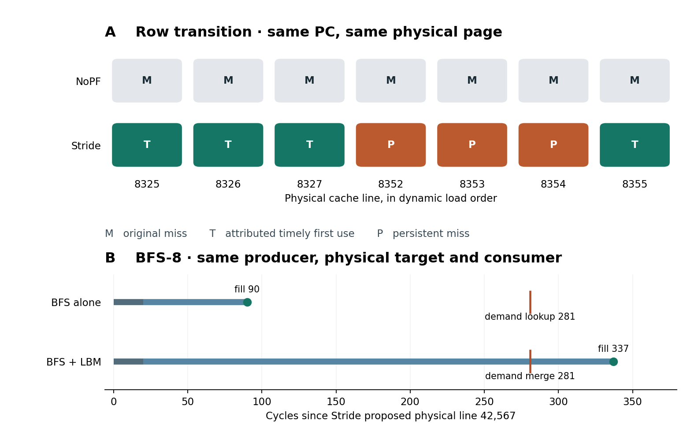

# 哪些访问能在 Stride 失去及时覆盖之前预测出来？

**LBM 给出了一个真实的提前预测机会。** 同一条 load 指令在物理页内的不同位置，能提前指向不同的未来目标行。用第一个片段（R1）拟合一个按当前 PC 和精确页内偏移索引的计数表，冻结后在第二个片段（R2）原生重放。在 5,429 个去重的 Stride 中断需求中，该表的辅助请求让 **85 个原始 miss 成为及时命中**，这 85 个在 SPP、multi-delta、跨 PC 表、物理后继表四种开放配置下全部实际 LLC miss。[原始需求与归因](strong_controls/union_results.csv)

SPP 对这 85 个需求都给出了正确地址。它们在冻结表下及时，是因为 **84/85 个从更早的动态 load 提出了预取**，余下 1 个来自同一触发点。表和 SPP 各自的 proposal→demand ingress 提前量中位数为 1,384 和 266 周期，逐对提前量之差的中位数为 **1,130 周期**。两边 issue→dispatch 均为 20 周期，dispatch→fill 时间的逐对中位差仅 3 周期。这个子集按冻结表成功筛选，用于解释成因。整段固定工作量下，冻结表比 Stride 少用 **269,697 周期（3.566%）**，而 256 项 multi-delta 在与 Stride 相同的 12,276 个接受请求下少用 **485,281 周期（6.416%）**。这给出了真实的预测机会，也给出了任何学习型设计必须面对的性能对照。[逐对时序](strong_controls/timing_summary.csv) · [相同片段的强基线](strong_controls/)

**最能回答“究竟学到了什么”的一条真实记录**来自同一个 LBM load PC（4,201,648）。R1 训练段中，当它在一个物理页内访问偏移 15，214 次相同上下文里有 54 次在规定时间窗内出现一个值得提前取的偏移 22。冻结后测 R2，指令 14,971,705 访问物理行 650,831 时就提出 650,838，早于原序列的 Last T（14,972,675）。相对需求 14,973,121 在各次运行自己的 ingress，冻结表提前 2,075 周期提出，提前 1,766 周期填入。SPP 到前一 Last T 才提出，领先 267 周期，填入晚了 98 周期；multi-delta 的对应数字是领先 343 周期，填入晚了 22 周期。冻结表保住了原来连续的两个 T。Stride、+1 和 +5 都 miss；SPP 与 multi-delta 给对地址但均迟到，跨 PC 表和物理后继表都没有提出目标。这个 PC 在不同页内位置还对应 +5 和 +10，因而一个统一的固定 delta 无法解释三个例子。这里的可迁移信息是“当前指令处于页内什么位置，与稍后会用到哪个位置相关”，预测动作是提前发出物理地址。[R1 真实出现次数与 R2 全生命周期](replay/lbm_transfer_witness.csv) · [各 conventional 对照的提案、到达及填入时刻](replay/lbm_witness_controls.csv)

研究问题是 **用当时可见的信息，哪些有价值的物理行能比 conventional prefetcher 更准确或更早地预取，使更多原始 demand misses 成为及时命中，并缩短执行时间？** 输出可以是多个距离上的地址；它可以与 Stride 一致、早于 Stride，或覆盖 Stride 一直没有提出的地址。条件模式、预测距离和跨 context 泛化是三条可以分别检验的能力。历史保存、Attention、重确认和优先级属于后续可讨论的实现选择。[研究问题及判据](RESEARCH_QUESTION.md)

## 1. 看同一段动态访问怎样从 hit 回到 miss

下图上半部分来自 paced 8/24 行长循环。七次访问在 NoPF 都是 LLC demand miss。Stride 已经把 8325–8327 变为及时首次使用的 hit；在 8327 仍然提出 8328。实际下一条是同一物理页内的 8352。随后两个访问仍然 miss，到 8355 才恢复。这给出了要提前学的**具体输出 8352**，也给出了用于反驳复杂模型的控制：页内布局、固定行长或历史步长计数是否已经足够。真实 BFS 的下半部分展示同样的“hit 后出现 miss”，但两次执行中预测器都已给出完全正确的下一条地址。[逐条数据](figures/row_example.csv) · [实测请求时间](timing/examples.csv)

对齐单位为每核的原始指令序号和 load operand，并逐条核对 PC、虚拟行以及两次运行的物理映射。在每次执行自己的时钟上比较 ingress、tag、proposal、dispatch、fill 与 first use。**T** 要求同一 NoPF load 在 LLC miss，Stride 有可归因的预取首次 timely hit。**L** 是这组原始 miss 中的迟到合并；**P** 是仍 miss 且没有 late claim 的访问。私有缓存命中、转发、普通 LLC hit、合并、上游变化都单列。一段中任何其他结果都可能中断连续 T。Last T 只在离线定位中定义，当次 hit 的 tag 结果可能比下一次 ingress 更晚到达。

18 组 NoPF/Stride 配对得到 21 条每核序列，分别按程序顺序和 LLC ingress 顺序观察，各自再按全核、PC、物理页、四页区域投影。每一投影中取连续至少两个 T 后紧接的第一个 L/P，再跟踪恢复位置。同时保留相似前缀随后继续命中的对照。初始 18 组有 99,951 条跨视角可重叠的中断记录、47,802 个在各自匹配范围内不复用的继续命中对照。根据离线可预测性追加 LBM R2 后，总计 19 组、22 条每核序列、112,785 条跨视角记录与 49,412 个对照。“全核”指单核所有 PC；共跑压力通过两个核心各自的请求及共享服务记录分析。[完整分类、匹配条件和验证](episodes/README.md)

| 片段与视角 | ≥2 T 后第一个 L / P | 从前后历史能得出什么 |
|---|---:|---|
| MCF 与 CactuBSSN 共跑，MCF 全核 LLC 顺序 | 35 / 36 | 投影回完整程序顺序时为零，期间还有被上级缓存吸收的 load。 |
| 同一 MCF，按 PC 的 LLC 顺序 | 1,624 / 913 | 913 个 P 中，761 个目标自上次同一行 lookup 后无已记录动作，151 个最近一次动作是跨页拒绝，1 个是驱逐。匹配样本中 76.3% 的 P 改变了 delta，continued-hit 对照为 0.2%。地址变化在目标到达时可确认，提前预测还需寻找更早的 cue。 |
| BFS-8 早段，独跑 / 与 LBM 共跑，全核 LLC 顺序 | 516 / 373；2,742 / 199 | 共跑的 2,742 个 L 全部在前一及时 hit 的 tag 完成前已经由 Stride 提出正确地址。逐一配对的 2,447 个请求在独跑时及时。proposal→demand ingress 中位数均为 170 周期，dispatch→fill 从 70 升到 190 周期。 |
| BFS-3 与 BFS-8 的新中段，全核 LLC 顺序 | 51 / 2,567；210 / 3,239 | 同一程序、同一输入记录的不同时段也能有截然不同的中断分布。两个中段均先选定 25M–27M 原始指令，再检查结果。 |
| 共用一个 PC 的三流切换；CactuBSSN R2 | 均为 0 / 0 | Stride 原本就没有直接及时覆盖；CactuBSSN R2 仍有 10,149 个 NoPF LLC misses。必须保留全体原始 miss 的对照，依赖“上一个 hit”的扫描会漏掉这一类。 |

同一 load 可以落在多行统计内。表中的变化率来自可匹配的子集；中断后的 delta、page 变化和 retirement-head wait 都不能作为前一触发点的输入。过去的 cross-page、cross-PC、多流、SPP 和 counted-stride 实验继续用来约束解释。[完整分母](episodes/summary.csv) · [服务时间配对](timing/README.md) · [已验证 conventional controls](../opportunity_study/conventional/conventional_baselines.md)

## 2. 历史在多早以前能给出正确地址？

以每个合法 LLC 触发点作预测，包括之后仍然连续命中的触发点。训练部分以目标地址作标签；评估时规则先给出物理行或 abstain，再揭晓未来的 load。分开计量有历史可观察的最早时间、地址在候选集合内可表达的最早时间、以及达到训练片段服务时间参考值的最早时间。比较 1–4、5–16、17–64 次 ingress 等距离，以及每八个 ingress 一个共同发出机会；限额内的实际发出数、错误和放弃数仍可能不同。跨页候选只使用已观察到的物理页。离线“有提前量”使用训练期参考耗时，带排队、驱逐及干扰的真实及时性由重放测得。[候选与时间分布](predictability/reach.csv) · [逐规则结果](predictability/scores.csv)

- **LBM R1→R2。** 共 4,020 个全核 ingress 中断目标。在 3,447 个共同 grant 上，当前 PC 与精确页内偏移的表提前认出 1,655 个目标；加入同页前次偏移为 1,926，其中 1,731 个可以在 Last T 之前提出。用近似同年龄的替代访问偏移，也认出完全相同的 1,926 个动态目标。加入上一条全核 ingress 的 PC 得到 1,949 个，和页历史表重合 1,919 个。页历史表的 1,731 个早于 Last T 的成功中，305 个能从这段及时命中内的更早 T 提出；另一些机会在整个命中段开始前就出现。LBM 中确实存在跨位置的地址可预测性，精确记录哪次过去的页访问才是关键仍缺乏支持。这些关联将 PC 的低 12 位与精确页内偏移混合索引，可能发生别名，且共享低支持时的回退规则。当前 PC/精确偏移表在 27,571 个合格触发点中的 27,556 个命中有充分训练支持的键。它命中的 1,655 个目标都没有观测到 Stride 提出的相应地址，提前量中位数为 1,274 周期、4 次 ingress。[匹配控制](predictability/matched_controls.csv) · [逐目标重叠](predictability/control_overlap.csv)
  一个可逐条核实的例子是 **PC 4,201,648、当前页内偏移 58 → 未来偏移 63**。在 R1 训练前缀的 214 次相同原始上下文中，有 59 次将该偏移标为足够早的未来中断目标。R2 中，指令 12,656,273 访问物理行 552,058 时就提出了 552,063，比原序列的 Last T（指令 12,656,771）更早。到实际需求指令 12,657,217，预取已填入 949 周期，load 的 head wait 从 333 降为 10 周期。固定 +5 也能取到这个例子。**同一个 PC 还有另一种位移：偏移 11 → 21（+10）**，R1 中为 54/214 次。R2 指令 10,397,889 访问 451,147 时就能选到 451,157；原生 Stride、+1 和 +5 对需求 10,399,777 都 miss。冻结表在 demand ingress 前 1,836 周期填入，head wait 从 586 降到 13。这两组训练键都未与其他原始 PC/偏移组合混淆。开放 SPP 对两个示例都能及时命中；在接受数限制到与 Stride 相同时，它仍能及时覆盖 +10。multi-delta 对这两个示例在开放配置下均迟到，整段完成时间却更短。它们说明当前行处于页内的什么位置能改变应该发出的位移，也说明单例很难判定哪个预测器更好。[训练和各个 R2 原生请求的证据](replay/lbm_transfer_witness.csv)
- **BFS-3 后段。** 同片段按时间划分后的测试尾段有 546 个中断；542 个有满足参考提前量的触发点，424 个可用试验词表表达，421 个可从 Last T 之前表达。共同 grant 上，页历史规则提前认出 13 个，next-line 为 15 个，仅用当前精确页内偏移为 19 个。这是“可构造”和“识别正确”之间的实测差距。前次研究中两个确有页历史收益的 load 依然成立；局部成功尚未转化为该机制在整段的优势。[触发与目标](predictability/examples.csv) · [前次原生实例](../opportunity_study/page_memory/README.md)
- **两个此前未测的中段。** 只用 BFS-3 早段拟合，迁移到 BFS-3 / BFS-8 中段。页历史规则提前认出 23 / 24 个中断目标，next-line 为 180 / 165 个。在同一程序内，换时间片就足以改变一条规则的相对价值。新窗口仍来自原有记录，因此只检验时间迁移。[独立中段](holdout/README.md) · [迁移结果](predictability/middle_scores.csv)

## 3. 命中变多以后，程序是否真的更快？

主重放把 12 个事先指定的片段分别跑 Stride、固定双步 lookahead、由访问间隔与压力控制的双步 lookahead、以及带已见行转换计数的规则。实际 issuer 验证同页、驻留、MSHR 和读写/预取队列，每个位置最多一项。用原始 NoPF/Stride 固定好的动态 ID 回查更早及时段是否保住、目标是否真的 timely、下一段何时恢复。所有模式都计入之前已命中的 load、额外流量和对其他核心的影响。[主试验协议](replay/protocol.md) · [全片段结果](replay/performance.csv) · [逐访问组](replay/cohorts.csv)

| 原生试验，相对 Stride | 原始中断恢复情况 | 固定工作量结果 |
|---|---|---|
| BFS-8 独跑，固定双步 | 516/516 个第一处 L 变为 T，且都保住前一 T | **多用 4,141 周期**。 |
| 同一 BFS-8 与 LBM 共跑，固定双步 | 2,586/2,742 个第一处 L 变为 T，其中 2,483 个保住前一 T | **少用 478,762 周期（6.835%）**，按较慢核心完成时间。 |
| MCF 与 CactuBSSN 共跑，固定双步 | 全核 ingress 的 35 个第一处 L 中恢复 30 个，29 个保住前一 T；36 个 P 中恢复 0 个 | **少用 92,273 周期（0.528%）**。 |
| 同一 MCF，已见行转换计数加间隔控制 | 恢复 12/36 个 P，这 12 个都失去了原来紧邻的前一 T | **多用 228,234 周期**。 |
| BFS-3 后段，固定双步 | 恢复 445/2,700 个第一处 P，其中 344 个保住前一 T | **多用 85,677 周期**。 |

在根据离线结果选择的 **LBM R2** 补充重放中，5M 条指令原需 7,563,339 周期。前一 PC 表用 7,298,295 周期，页历史表用 7,300,093，当前 PC/精确偏移表用 **7,293,642**。后者让原来 2,505 个 P 和 48 个 L 真正变为及时命中，同时失去了原来的 1,842 个 T；总 DRAM 字节和 Stride 一样。页历史在中断目标上有更高离线覆盖，却没能超过简单表的全程序时间。训练期选出的固定 +5 也节省 175,947 周期，同 grant 的 +1 增加 60,372 周期。所有表均允许零额外决策延迟，已观察的物理页集合未限容量。参考导出中精确偏移表有 384 个有训练支持的顶层键，另有 135 个回退键，页历史表有 509 个顶层键；每键的 76 个动作分数并未折算为硬件面积。测试 grant 的开始和停止由评估窗口固定；真实使用还需测试持续开启时的流量与推理代价。[LBM 试验条件](replay/lbm_protocol.md) · [时间、原及时命中保留和流量](replay/lbm_performance.csv)

**更强的基线。** 在相同 trace、页放置、10M warmup 和 5M 固定退休工作下，另做了 10 个 conventional 原生运行。SPP 开放时节省 9.630%，把全段接受请求上限设为 Stride 的 12,276 后节省 2.754%；multi-delta 对应 16.400% 和 6.416%。上限按先到先得消耗，开放与限量两组都报告；这些策略每个触发点可提出请求，而冻结表只在共同的 1/8 机会覆盖 Stride。当前 PC/偏移表实际接受 13,493 个请求。八种投影去重后的 5,429 个原始中断需求中，当前 PC/偏移表和开放 multi-delta 分别将 1,834 和 1,802 个转成及时首次使用，其中 886 个相同。进一步取开放 SPP、multi-delta、跨 PC 表和物理后继表所覆盖目标的并集，四种机制合计直接及时覆盖 3,654/5,429 个。其余目标中，使用当前 PC/偏移表的运行有 96 个变为及时，其中 85 个由辅助预测器直接提出、11 个来自时序改变后原有 Stride 的请求。加入页历史的运行相应为 105 个，其中 96 个为辅助请求。两个运行合起来有 114 个不同需求；已逐一确认这 114 个在四种开放对照中全部实际 tag miss。SPP 对全部 114 个都已提出正确地址但迟到；multi-delta 在其中 102 个迟到、12 个没有先前提案。这批证据指向取得足够提前量；它不能支持“SPP 无法产生这些地址”的解释。多种策略在不同原生执行中的覆盖并集只用于筛选；合并省多少时间仍需独立重放。[四种强基线均未及时覆盖的原始 load](strong_controls/uncovered_targets.csv) · [归因总数](strong_controls/union_results.csv)[强基线协议和完整测量](strong_controls/)

在相同 grant 做的其他补充重放中，BFS-3 后段的冻结关联表相对 Stride 节省 8,947 周期，同 grant 的 +1 节省 55,552。交替行长的合成片段中，关联表增加 8,830 周期，+1 节省 1,120。补充试验根据离线结果选择案例，解析离线样本和重放后真实执行的分布会不同。[补充协议](replay/supplement.md) · [结果](replay/supplement_performance.csv)

## 4. 怎样衡量预取器，以及还值得讨论哪种 ML 能力？

固定指令数时，每核 IPC 为退休指令数除以周期；周期数直接回答同样工作早多少结束，多核同时报告每核周期与整个组合完成时间。报告将 **useful accuracy** 定义为已接受请求中首次被 demand 及时使用或迟到合并的比例，**timely accuracy** 为仅计及时首次使用的比例，**timely coverage** 为同一批原始 NoPF LLC misses 中被直接转成 timely first-use hit 的比例。未决请求留在 accuracy 分母并单列。tag hit/miss rate 的分母只含有 LLC tag lookup 的 demand operands，MPKI 的分母是退休指令。跨执行的净 miss 降幅可包括间接缓存变化。[全部 22 条每核序列的实测指标](baseline_metrics.csv)

例如，MCF 与 CactuBSSN 共跑时，MCF 的 Stride useful accuracy 为 99.65%，timely accuracy 为 47.12%，direct timely coverage 为 25.33%；LLC tag hit rate 从 61.51% 升到 71.04%，IPC 从 0.275 升到 0.286。它经常提出最终会使用的行，却未必领先足够多。单个 load 的 ROB-head 等待可用于辨别暴露程度，多个 load 的等待会重叠。程序收益以实际完成时间裁决。

| 观察到的问题 | 提前可见的信息 | 现有 conventional 解释 | 待讨论的 learned 能力 | 最小可证伪试验 | 主要硬件成本 |
|---|---|---|---|---|---|
| LBM 中部分未来行很早就能从布局、PC 识别 | 当前页内偏移与 PC、近期其他 PC | 精确偏移、前一 PC 的计数关联，固定偏移；multi-delta 已有更高的整段收益 | A 条件建模；C 对新布局泛化 | 在新时间段或不同输入预注册，匹配物理词表、状态字节、实际带宽及推理延迟，对比这些表和 SPP | 表项标签、读端口；学到的表示还需权重读取与算术 |
| BFS / MCF 预测到正确地址却迟到 | 已知 stride、到达间隔、过去已完成的服务时长和当前压力 | 双步 lookahead；简单压力规则也实测过 | B 提前量随上下文而变 | 固定控制与可变提前量使用相同地址集合，在未见的共跑片段比较每核时间和总时间 | PC 计数器、时间戳、压力反馈、仲裁周期 |
| MCF 的变化与跨页拒绝；CactuBSSN 的跨区原始 misses | 合法取得的页信息、相对偏移、前序 PC | 已知页、固定物理偏移、时间相关表 | A / C 提前认出目标区域 | 在至少两种物理映射和新片段上重放，分别报告不可构造、可构造未识别、正确但迟到 | 页标签/地址生成、元数据访问、跨页验证 |
| 合成行/交织流转换；一些真实区间从未出现 T | 多 PC 顺序、连续 delta、时间间隔 | 计数、多 stride、stream 分离、SPP | A 学习多个 cue 的条件组合 | 同时选择真实的 continued-hit、发生中断及从未产生 T 的窗口，匹配 lead 和预算，与表模型比较 | 顺序状态、每核更新带宽、推理延迟 |

**当前判断。** 原始 miss→及时 hit 的中断有时揭示可提前识别的访问关系，有时只揭示服务变慢。已有真实证据支持“更早的历史有时指向具体有价值的地址”和“固定 lookahead 在部分共跑环境能缩短运行时间”。独立输入上的泛化、learned 表示能否在同等成本下超过常规表，以及是否需要 Attention、选择性记忆或任何特定神经网络，仍然开放。模型与 hybrid 的选择留到比较这些证据之后。[既有机制与文献讨论](../opportunity_study/reports/learned_memory_mechanisms.md)

## 复现与适用范围

从 `llc_hybrid_prefetch/transition_study` 开始。先使用父项目说明准备原始模拟器、trace 和 archived history，按 [中段](holdout/) → [对齐与验证](episodes/) → [预测与匹配控制](predictability/) → [在线重放](replay/) 的顺序执行各目录命令。再执行 `python3 -B timing/compare.py`、`python3 -B metrics.py` 和 `python3 -B figures/plot.py`；图可直接用已发布的小表生成。LBM 再按 [强 conventional 对照](strong_controls/) 的命令运行。原始运行存放在本地及 Sacramento 的同名 raw 子目录，研究分支保留源代码、紧凑结果及准确 ID。Sacramento 另用 Linux 编译的模拟器独立重跑两段 BFS 的四个配置，并复核 LBM R2 的 Stride shadow、当前偏移表、页历史表三组；LBM 的每核周期和全部已记录 stats 与本地相等。模拟工作量、输入版本与每个阶段的截止条件见相应协议。图和报告中的时间均为模拟周期，未测量实际电路的面积、能量或推理时序。
