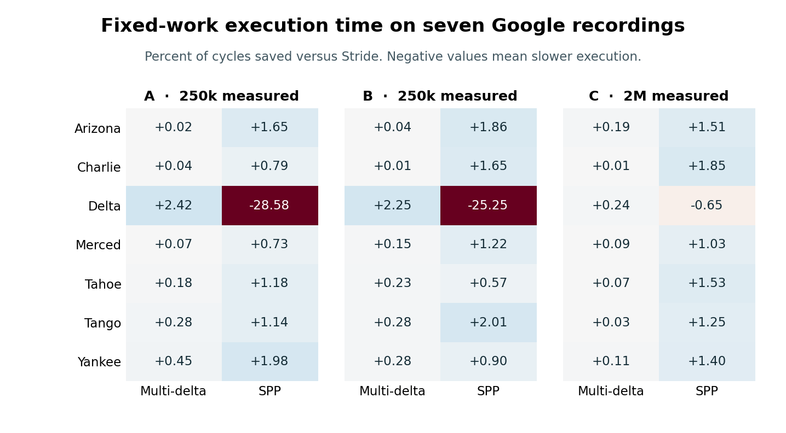
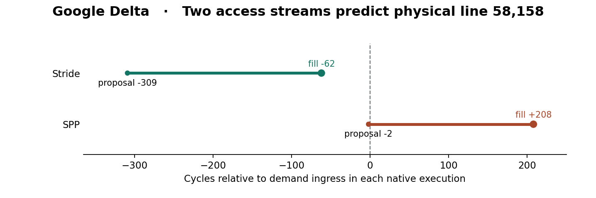

# DPC4 workload expansion and LLC pattern screening

Two interleaved streams in Google Delta can predict the same physical line from different PCs. The request-level comparison shows why one prediction is timely while another with the same address arrives too late. SPEC MCF showed a different pattern: the current PC, page offset and two local deltas were identical, but earlier PCs distinguished two later targets. One target missed under all three conventional prefetchers and had no recorded proposal. That branch had little training support. [Pattern data](patterns/README.md) · [Disjoint-window tests](transfer/README.md)

[Full-scale SPEC and GAP follow-up](../full_workload/README.md) · [Reproduction](REPRODUCE.md)

## Inputs and runs

We checked 610 objects against the official manifest: 359 Google gtrace_v2, 79 Graph, 92 SPEC17 and 80 AI/ML. The 16 discovery recordings span seven Google service labels, four Graph workloads, three SPEC controls and two AI/ML programs. The reserved set includes six named test recordings and another 74 from the same groups. Only catalog metadata was read for those recordings. [Official DPC4 collection](https://github.com/CMU-SAFARI/DPC4#workload-traces) · [Trace registry](intake/registry.csv) · [Record format and validation](intake/README.md)

| Window | Recordings | Measured source instructions | Selection |
|---|---:|---|---|
| A | 16 | 100,001–350,000 | 100,000 warmup instructions. Chronological training, development and test splits for pattern discovery. |
| B | 16 | 550,001–800,000 | Second interval chosen in advance, with a fresh 100,000-instruction warmup. |
| C | 7 | 3,000,001–5,000,000 | Longer follow-up for all seven Google discovery recordings after the short windows showed little support for distinct future branches. Warmup was 1M instructions. |

NoPF, PC Stride, 256-entry Multi-delta and degree-one SPP ran in each window, for **156 native runs**. All used the same two-core geometry with one active core, page placement, shared LLC and DRAM model. Alignment checked source instruction and operand IDs, PC, virtual line and LLC-visible physical line. Each strategy could offer one candidate per trigger, subject to deduplication, residency and queue checks. The Google V2 input encodes register dependencies. The converted traces do not preserve the original physical mapping, multithreaded schedule or every original dependency. Interpret IPC and retirement stalls in the simulated configuration. [Simulator and metrics](screen/README.md) · [Google trace format](https://dynamorio.org/google_workload_traces.html)

## Observed address patterns

Native measurements come from actual issued requests and fixed-work execution. Offline matches use a reference lead-time threshold.

| Pattern | Measured evidence | Interpretation |
|---|---|---|
| **Two PCs predict the same line. Google Delta.** | Two alternating +2 streams occurred 420 times in A's training section and 112 times in test. Stride was timely and SPP late on 872, 875 and 952 matched demands in A, B and C. Median proposal-to-demand lead was 122 cycles under Stride and 2 under SPP in all three. In A, SPP directly covered 1,821 original misses versus Stride's 1,786, yet took 72,535 extra cycles. Another 713 demands moved from Stride late to SPP timely. | Two ordinary access streams and their lookahead explain many correct addresses. Both gains and losses affect the outcome. [Matched producers](screen/producer_pairs.csv) · [Performance](screen/performance.csv) |
| **One local context leads to two addresses. SPEC MCF.** | Four context and horizon pairs showed both outcomes in A's training prefix and B. For one PC at page offset 19 with two recent +1 deltas, the future delta was +2 after a same-PC history and +6 after two other PCs intervened. All three prefetchers covered +2 in time. All missed +6, which could be formed with 1,354 cycles of lead and incurred 238 head-wait cycles. +6 appeared only once in five training examples. At a 16-event horizon, adding three earlier PCs gained 10 and lost 47 targets relative to the local table among demands all three prefetchers missed. | The earlier PCs distinguished a real pair of targets. The evidence calls for independent validation of frequency and transfer. [Paired targets](transfer/paired_futures.csv) · [Request timing](screen/transfer_witnesses.csv) |
| **Cross-PC cues at variable lookahead. Google Charlie.** | In C, the preceding PC plus the current PC and offset supported +5 in seven of eight training examples. The offline proposal at source instruction 4,658,501 targeted line 370,565, needed five ingresses later. Compared with the local table on the same schedule, the earlier-PC rule gained nine targets and lost six. One gain fell outside the union of four simple controls. Its 104-cycle lead exceeded the reference by five cycles. Stride offered nothing, and Multi-delta and SPP took 190 and 229 cycles from dispatch to fill. A frequent fixed offset covered 808 reference-timely original misses versus 220 for the earlier-PC rule. | Variable horizons exposed a candidate that a fixed future position can hide. An actual replay would be needed to establish timely use for this target. [Offline candidate](patterns/long_google/window_examples.csv) · [Native request lifecycle](screen/charlie_probe.csv) |
| **Simple patterns can transfer. PageRank, CLIP, Llama and Google Tahoe.** | The most frequent four-event motif from two interleaved PageRank +1 streams appeared 1,255 times in test. At horizon 16, a fixed +8 identified 2,359 original misses at the reference lead versus 2,380 for the offset table. Fixed +16 tied the result on CLIP and Llama. A frozen LBM rule tied the unconditional prior across all seven Google A windows. In Tahoe B, its 217 matches fell to 74 under each of 15 PC relabelings that preserved equality and order. Fixed +16 reached 358 on the same issue slots. | Fixed offsets account for much of the signal. Tahoe was sensitive to the numeric PC encoding. [Frozen transfer tests](transfer/README.md) |
| **Far recurring addresses versus fresh miss targets. Deeper Google windows.** | An unbounded exact-line successor table matched 2,264 next addresses, including 331 more than 512 lines away and outside the last three pages. All 2,264 were already NoPF hits. Of 4,897 next-event targets that missed under all four policies and met the lead threshold, none had appeared earlier at same-core LLC ingress during measurement. The simulator had seen the target page for 2,477 of them. | Retrieving a previously observed line cannot reach this cohort. Predicting a new offset in a known page remains testable. [Temporal tables and address reach](temporal/README.md) |

## A single demand, two request paths

At Google Delta instruction 100,121, Stride proposed line 58,158 from the same PC's earlier access to line 58,156. SPP proposed it from another PC's access to line 58,157. The Stride fill arrived 62 cycles before demand ingress and the SPP fill 208 cycles after. ROB-head wait increased from 0 to 187 cycles. This +2 and +1 pairing accounted for 866 of the 872 Stride-timely, SPP-late demands in A. The order can also reverse, so evaluate the actual trigger and service timing. [Matched requests](screen/producer_examples.csv)

The denominators include streams with no timely hits. In Google Tango A, 239 of 243 Stride PCs had no attributed timely first use, covering 1,333 original misses. In CactuBSSN A, none of Stride's 324 PCs had a timely hit. SPP timely-covered 1,293 of that recording's 1,787 original misses. Each GAP SSSP window decoded 50,000 stores and zero loads, leaving no demand-load opportunities in those windows. All four SSSP runs took the same time. [Sequence denominators](patterns/sequence_populations.csv) · [Trace audit](intake/format_audit.csv)

## Results and source data

The tested Google keys had no two-branch example that repeated across training and test in the seven short and seven longer windows. Many test keys were unseen. A flexible observation window exposed the Charlie candidate. For MCF, the distinguishing-PC example warrants testing against the same address vocabulary, capacity, grant rate and decision delay on independent recordings. Native replay should account for displaced timely hits and completion time. [Training support](patterns/long_google/key_support.csv) · [A results](screen/performance.csv) · [B results](transfer/performance.csv) · [C results](transfer/long_google/performance.csv)

The 156 runs were repeated on Sacramento with an independently built simulator. Retired instructions, completion cycles and all recorded counters matched the local runs. In both cache roots, the study uses `llc_hybrid_prefetch/workload_expansion/raw/intake` for input prefixes and intake metadata, and `raw/screen`, `raw/replication` and `raw/long_google` for corresponding output directories, relative to the study. The registry gives the original archive URLs and the reproduction guide gives the exact output paths. [Cross-platform verification](screen/verify_repeat.py) · [Trace registry](intake/registry.csv) · [Reproduction](REPRODUCE.md) · [Earlier LBM and BFS study](../transition_study/README.md)
